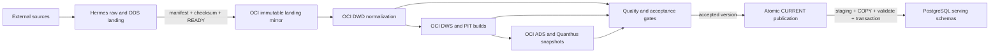
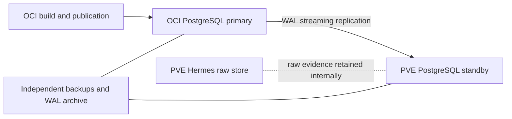

# ADR 0002: Hermes and OCI Data Platform Boundaries

- Status: Partially superseded by ADR 0005
- Date: 2026-07-24
- Scope: Data acquisition, transformation, publication, and disaster recovery
- Supersedes: The single-node deployment assumption in ADR 0001; its file-first analytical
  contracts remain in force
- Operationalized by: ADR 0003 for recurring T-close plus five-hour processing

ADR 0005 replaces this ADR's target placement of daily DWD/DWS builds and per-dataset publication
authority with dual-lane candidate production and one OCI release-set authority. The file-first
system-of-record, PostgreSQL, network-security, backup, and disaster-recovery decisions below
remain accepted. Until ADR 0005's explicit cutover gate passes, the OCI-only transform path below
also remains the live operating boundary.

## Context

Hermes and the current PostgreSQL service run on an internal PVE host. That placement gives
the collector low-latency access to local storage and keeps source credentials inside the
private network, but the host has limited CPU capacity. Running full-history cleansing,
point-in-time joins, aggregation, validation, and repeated research builds there would make
the collector compete with the database and network services.

OCI has more suitable compute capacity and is already the primary Quanthus development and
acceptance environment. The platform therefore needs an explicit ownership boundary that
does not confuse a machine, a database engine, or a warehouse layer with the system of record.

## Decision

### 1. Deployment roles

| Runtime | Owns | Must not become |
| --- | --- | --- |
| Hermes on PVE | External acquisition, immutable raw payloads, request metadata, watermarks, checksums, and append-only landing batches | The full-history cleansing or aggregation engine |
| OCI | Quanthus development, DWD normalization, DWS/PIT computation, ADS/data-mart builds, quality gates, acceptance, and version publication | An unversioned patching environment |
| PostgreSQL | Indexed query and serving projections published from versioned artifacts | The sole system of record or the place where canonical corrections are made |

Hermes is the collector and ODS/landing owner. In warehouse terminology it is not ADS: ADS is
a consumer-facing data-mart layer and is built on OCI. PostgreSQL is a serving engine rather
than a warehouse layer; schemas hosted by it may project ODS, DWD, DWS, reference, or ADS data
without changing ownership of the corresponding canonical artifacts.

### 2. Systems of record

- Hermes raw batches are the source-evidence system of record. They include original payloads,
  request parameters, acquisition timestamps, watermarks, checksums, and revision metadata.
- Versioned Parquet artifacts built on OCI are the system of record for normalized and derived
  data. Their manifests identify input revisions, transformation versions, schemas, and
  content checksums.
- PostgreSQL tables are rebuildable query and release projections. A database row without a
  corresponding published artifact and manifest is not canonical evidence.
- Git stores code, schemas, policy, tests, and documentation only. Credentials, market data,
  database dumps, and run artifacts remain outside the repository.

### 3. Data flow and publication

1. Hermes completes an immutable acquisition batch and publishes its manifest, checksums, and
   readiness marker to the read-only Hermes-to-OCI channel.
2. OCI mirrors the required batch and verifies completeness before exposing it to a build.
3. OCI creates new DWD, DWS/PIT, and ADS revisions; it never edits a released Parquet artifact.
4. Quality and release gates run against exact input and output manifests.
5. An accepted revision atomically advances a `CURRENT` pointer or equivalent catalog record.
6. OCI loads PostgreSQL through staging tables, bulk `COPY`, validation, and a transactional
   publish step. Versioned history is retained according to each dataset contract.

### 3.1 OCI local layout

The OCI filesystem separates landing copies from OCI-owned derived artifacts:

| Location | Ownership and allowed contents |
| --- | --- |
| `/home/ubuntu/data/astock/` | Hermes ODS landing mirror pulled through the read-only channel; raw evidence and source revisions only |
| `/home/ubuntu/data/quanthus/revisions/` | OCI-owned immutable DWD, DWS, PIT, and ADS revisions; every `CURRENT` pointer must resolve here |
| `/home/ubuntu/data/quanthus/snapshots/` | OCI-owned immutable, manifest-bound consumer snapshots |
| Git repository | Code, policies, schemas, tests, and documentation only; no Parquet, raw payload, manifest, snapshot, or database data |

An OCI build may read the landing mirror, but it must publish a child under
`/home/ubuntu/data/quanthus/revisions/` before it becomes canonical. A full ODS pull must not be
used as a way to publish or overwrite OCI-derived data.

Direct Hermes writes are limited to append-only ODS tables where a database landing copy is
operationally useful. Curated, reference, DWD, DWS, ADS, and metadata publication is owned by
OCI. Production fixes are made at the owning source layer and propagated as a new revision;
there are no ad hoc PostgreSQL updates, deletes, fills, or direct patches to released Parquet.

### 4. PostgreSQL topology

The current PVE PostgreSQL service may remain in place while OCI performs the computation and
writes accepted projections back through a private channel. Heavy transformations must not be
pushed into that PVE instance merely because it is co-located with Hermes.

If database load or network measurements later justify migration, the target topology is:

- OCI PostgreSQL becomes the writable primary and the normal development/query endpoint.
- PVE PostgreSQL is a read-only streaming-replication standby and an internal copy of consumer
  data. Hermes continues to retain the internal raw-evidence copy.
- Initial failover is manual until promotion, fencing, client redirection, and failback have
  been exercised. Split-brain prevention is required before any automated failover.
- Migration is optional and evidence-driven. It is not a prerequisite for P1 or P2 as long as
  OCI can publish reliably to the current PVE service.

Streaming replication is not a backup: deletion, corruption, or a bad transaction can be
replicated. The platform must also keep encrypted base backups and archived WAL for
point-in-time recovery, apply retention outside the primary failure domain, and periodically
prove restore procedures. Target RPO and RTO are set and tested before PostgreSQL is migrated.

### 5. Schema and access boundaries

| Role | Allowed write scope |
| --- | --- |
| Hermes collector | Append-only `ods` landing tables only |
| OCI publisher | `dwd`, `ref`, `dws`, `ads`, and publication metadata through controlled jobs |
| Migration role | DDL migrations only; separate from runtime roles |
| Read-only consumers | Explicit published schemas and views only |

The OCI publisher does not own or alter Hermes raw files. The Hermes collector cannot publish
curated datasets or mutate consumer schemas. PostgreSQL credentials are least-privilege,
rotatable secrets and never appear in manifests, logs, or Git.

OCI-to-PVE database writes and replication must use EasyTier, WireGuard, an SSH tunnel, or TLS
with certificate verification. Public database writes using `sslmode=disable` are prohibited.
The read-only rsync channel remains read-only from OCI; publication uses a separate,
authenticated path.

## Operational invariants

- Every promoted dataset is reproducible from immutable inputs, code, configuration, and a
  manifest; PostgreSQL must be disposable and rebuildable from those artifacts.
- Point-in-time and `knowledge_cutoff` semantics are enforced during OCI builds and again at
  publication boundaries.
- Transfer interruption cannot expose a partial batch. Consumers see only a verified ready
  revision.
- A correction creates a new source or derived revision and records lineage to its parent.
- Resource-intensive scans, joins, and quality audits run on OCI by default.
- PVE retains internal raw evidence, and after database migration it also retains a consumer
  database replica; independent backups cover both failure domains.

## Migration sequence

1. Keep the current PVE PostgreSQL endpoint, enforce schema roles, and move all non-ODS build
   jobs and publications under OCI ownership.
2. Standardize ready markers, manifests, OCI staging loads, atomic publication, monitoring,
   and replayable database rebuilds.
3. Measure transfer duration, publication latency, PVE database load, backup duration, and
   restore time before deciding whether PostgreSQL should move.
4. If justified, create the OCI primary, seed and validate the PVE standby, rehearse recovery,
   then switch clients during a controlled migration window.

## Consequences

The PVE host is protected from repeated analytical computation while its network locality and
internal raw archive remain useful. OCI becomes the consistent development, build, validation,
and publication environment. Keeping canonical artifacts outside PostgreSQL makes either PG
topology reversible and supports disaster recovery across OCI and the internal network.

The trade-off is additional operational machinery: version manifests, transfer completion
protocols, controlled database publication, replication monitoring, backups, and restore
drills all become required platform work rather than informal operator steps.
