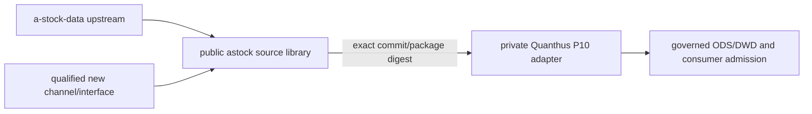

# Independent astock source subproject

| Field | Value |
| --- | --- |
| Design status | approved |
| Delivery gate | open |
| Work item | [P10-DATA-SUPPLY-005 / #587](https://github.com/rv198-star/Quanthus/issues/587), parent #581 |
| Parent | [Permanent P10 data line](lld/12-permanent-data-line.md) |
| Owner direction | 2026-10-29: maintain a public astock fork, keep Quanthus private, preserve their relative independence |
| Bounded continuation | 2026-10-30: integrate qualified capabilities into P10, establish units/time/rollback and dated quality candidates with a finite observation period |
| Source repository | [rv198-star/astock](https://github.com/rv198-star/astock), public fork of simonlin1212/a-stock-data |

## Purpose and boundary

Maintain reusable source acquisition in an independently versioned project while
P10 retains data governance and consumer admission. A separate source repository
makes absorbed capabilities, upstream updates, source-specific bugs and releases
traceable. Repository creation is not migration of the deployed Quanthus collector.

| Public astock owns | Quanthus P10 owns |
| --- | --- |
| Source requests, transport bounds, source identity, parsing and explicit errors | Jobs, schedules, incremental windows, warehouse construction and releases |
| Raw response envelope, request/body hashes and acquisition clock | Retention, PIT interpretation, frozen consumer gates and governed snapshots |
| Generic source contracts, offline tests and source-library releases | Product/consumer quality decisions, deployment, rollback and operational authority |

astock must not import Quanthus or contain its credentials, node paths, source
archives, policies, warehouse schemas or strategy code. Quanthus may depend on a
fixed astock release; the source library does not depend on its consumers. Public
fork PRs describe generic source behavior without copying private issue bodies.

## Repository and update model

The fork preserves the complete 68-commit upstream history through
`cb57c7aba720380b48a11dd065c6db57a2c39db9`, its Apache-2.0 license, SKILL 3.10.3,
and original tests. `upstream` points to simonlin1212/a-stock-data and `origin` to
rv198-star/astock. Own Python 3.10+ code lives in `src/astock`; the library version
is separate from the retained upstream skill version.

The source-library implementation was merged through
[astock PR #1](https://github.com/rv198-star/astock/pull/1), exact tested commit
`0eeedec0b0f22df78f4e738db2765b5219ca0ab6` on `codex/source-library-bootstrap`.
Candidate prerelease [sources-v0.1.0](https://github.com/rv198-star/astock/releases/tag/sources-v0.1.0)
contains the verified wheel, source archive and checksums. It is a source-library
candidate, not an active Quanthus dependency.

Upstream updates enter a reviewed branch. Preserve their original history and
identify applicable changes; never regenerate executable production modules from
the skill during a running job. Absorbed channels enter as individual source and
capability changes with provenance and regression evidence. Same-backend wrappers
and duplicate institution entries do not count as independent data suppliers.

Quanthus consumes an exact full commit and wheel digest at build time for its
bounded P10 observation consumer. No live job pulls `main`/`latest`, no task switches
`/opt/collector` by virtue of a new fork commit, and no mutable source directory
becomes a hidden deployment dependency. The initial source repository is a logical
subproject with independent Git history. The optional `supplement-sources` dependency
and the source-watch image below activate only the specified observation consumer.

## Source-library candidate

Owner continued source absorption and isolated environment construction on
2026-10-30. Fourteen independently implemented request contracts now reuse the
retained qualification responses; they do not restart the 673-request screen.

| Capability | Increment over the upstream baseline | Engineering evidence |
| --- | --- | --- |
| ChinaMoney LPR direct | Additional actual backend beside upstream Eastmoney LPR | 12 original records parsed from the retained response; Decimal percent units and effective dates |
| CNBC RSS / generic RSS-Atom parser | Reusable publisher feed discovery | 30 original feed items parsed; publication text retained, missing/naive clocks remain unknown |
| Tencent / Sina / Eastmoney single-security quote | Explicit source, venue, native price and clock contracts | Three original snapshots replayed; no adjustment, suspension or fill inference |
| Eastmoney CPI / PPI / PMI / GDP / M2 | Reusable current-vintage numeric rows | Ten original rows replayed; native field names/values and period text retained |
| ChinaBond treasury curve | Identified curve and source-date contract | 505 original points replayed; exact curve ID/name checked |
| CNINFO HTTPS disclosure index | Raw metadata supplement | Two original rows replayed; source milliseconds retained, no PDF acquisition |
| Sina roll channels 2516 / 2510 | Publisher metadata discovery | Four original items replayed; 2510 is archive metadata, not current-policy coverage |

Transport/source failures are `FAILED`; explicit valid empty lists are `EMPTY`;
only nonempty valid records are `SUCCESS`. Raw bodies and request/acquisition
identity remain attached. Neither state nor timestamp grants historical PIT.
Public source-library availability and P10 purpose admission remain separate.

The isolated Python 3.10 environment contains hash-verified PyPI build/runtime
wheels and openpyxl; shared production environments were not modified. The
maintained library's 30 synthetic contracts and Ruff pass. The full retained
upstream-plus-library suite now passes: 221 tests, four opt-in live cases skipped.
Legacy tests reuse the existing read-only pandas dependency closure; a fresh wheel
installation separately passes all 30 library tests without checkout imports.
Two builds with pinned tools and the same source epoch produce the same wheel,
SHA256 `b1896aabced17fcb1761121f9a1fce8a40073495185d2a9ea90a79e3398df646`.

A separate frozen 14-request live canary returned 13 successful samples; Eastmoney
quote had a connection failure and is held for current availability. A previous
valid replay does not erase that failure. Macro/curve/quote values remain explicitly
source-native; consumer unit/basis admission is still required. Full per-purpose
dispositions, artifacts and cleanup evidence are in the
[supply work item](../work-items/p10-source-supply-20261029.md).

The supplied cn-financial-scraper README declares MIT, but the snapshot lacks a
separate license and a verified public upstream. No snapshot code is copied into
the new library. Interface leads and package identity are documented; future code
copying requires an attributable source/license. This does not block independent
implementation of the already observed interfaces or current daily products.

## P10 observation integration and rollback

The consumer is **P10 source qualification and supplementary observation** under
#583–#587. It retains independently addressable capabilities so optional-source
failures are isolated. The fifteen default contracts include the original fourteen
and the subsequently verified Eastmoney NAV request for fund `000001`.

The versioned policy is
[`p10-supplement-sources.v1.json`](../../config/pipelines/p10-supplement-sources.v1.json).
It pins astock `0.1.1`, exact source `8360132de1255a68e42df8a1aa142f1335bd68e7`,
wheel SHA256 `49b04b404016fa5432acb12a1bbfdd5a2a4268adbd3a4e44a1f16adc53b1eebf`,
all source modules, the request/security/fund universe and hash-locked transport
dependencies. The public change is [astock PR #2](https://github.com/rv198-star/astock/pull/2),
with [sources-v0.1.1](https://github.com/rv198-star/astock/releases/tag/sources-v0.1.1).
No source snapshot code was copied.

[`p10_source_contracts.py`](../../src/quanthus/p10_source_contracts.py) owns exact
Decimal mapping: GDP/M2 亿元 × 100,000,000 → CNY; rates/changes % ÷ 100 → ratios;
CPI/PPI/PMI index points remain index points; treasury maturity is years. GDP
periods begin January 1 and end at the stated quarter end. Macro `REPORT_DATE`
remains a vendor period marker. The fixed Shanghai A-share quote scope uses
CNY/share with source snapshot basis; no volume, adjustment or suspension is inferred.
Fund NAV uses CNY/fund unit, retains the vendor accumulated-NAV basis and its
valuation date, and discloses request-bound identity when no response code is echoed.
Primary unit references and retained evidence hashes live in the policy.

Every row starts its knowledge interval at actual complete-response acquisition.
Publisher clocks, quote clocks, CNINFO epoch milliseconds and LPR effective dates
remain separate fields. No scheduling rule or display date supplies a historical
publication clock. Source-clock claims over 300 seconds in the future, future
source periods and stale current-news feeds fail their affected purpose; missing
quote clocks remain a disclosed diagnostic limitation. Channel 2510 serves archive
metadata only. The policy freezes these new observation thresholds.

[`p10_supplement.py`](../../src/quanthus/p10_supplement.py) builds one shared
raw → parsed → normalized intermediate per capability and Job. Quality and ledger
consumers share it. Unpublished staging is `TMP`; published raw/normalized records
and manifests are immutable P10 qualification audit products, retained until an
explicit P10 disposition. They have a stable governance consumer, not an automatic
market-warehouse consumer. Identities include code, policy, source/dependency,
schema, date scope, universe, full request, raw bytes and acquisition time.
Elapsed time, rows, bytes and build/reuse disposition are recorded. A verified
same-day job may be reused without another request; independent online validation
and full reproduction must be named separately.

Requests run serially with a hard 20-second per-source process budget, including
DNS, a 256 KiB response ceiling and no retries or provider substitution. A failing
or disabled source publishes an explicit unavailable result. The prior good
snapshot remains a reference, never a silent fallback. Exact-snapshot reads check
hashes, schema, the caller's policy SHA and actual knowledge cutoff.

The independent watch lasts seven days, at one cycle per day, with its original
end time persisted across restarts. At least three distinct successful days and
the latest three consecutive successful days, with a recent final observation,
permit `REVIEW_DUE`. Failure or insufficient evidence remains a hold. Expiry stops
the process; neither success nor elapsed time promotes a business input. Each
candidate records verification time, latest source date/clock and age, field-unit
contract, quality flags, failed attempts and review deadline.

The isolated runtime and selective-disable/stop rollback are in the
[source-watch runbook](../../ops/source-watch/README.md). Only its own observation
root is writable. Stopping it removes the optional supplement from new work;
selective disable records `SOURCE_DISABLED_ROLLBACK`. Tests cover units, clocks,
optional failure isolation, prior-snapshot preservation, tampering, cutoff reads,
daily reuse, finite probation and non-renewal in
[`test_p10_supplement.py`](../../tests/unit/test_p10_supplement.py).

After reclaiming audited local build images, Quanthus full `make check` passes:
5,699 passed, 20 skipped. This documentation follow-up retains the exact tested
executable/config/test closure and reruns affected document/planning checks. This
source-library engineering pass does not admit historical data or migrate a live
collector.

Source qualification under #583–#585 continues for the remaining function contracts.
Its dated outcomes and current execution evidence are in the linked supply work
item. Consumers needing warehouse substitution or historical PIT retain their own
admission gates.
