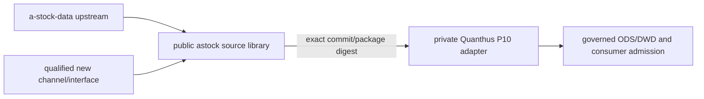

# Independent astock source subproject

| Field | Value |
| --- | --- |
| Design status | draft — repository independence/public visibility explicitly selected by Owner |
| Delivery gate | open; source-library engineering and production migration are separate |
| Work item | [P10-DATA-SUPPLY-005 / #587](https://github.com/rv198-star/Quanthus/issues/587), parent #581 |
| Parent | [Permanent P10 data line](lld/12-permanent-data-line.md) |
| Owner direction | 2026-10-29: maintain a public astock fork, keep Quanthus private, preserve their relative independence |
| Source repository | [rv198-star/astock](https://github.com/rv198-star/astock), public fork of simonlin1212/a-stock-data |

## Purpose and boundary

Maintain reusable source acquisition in an independently versioned project while
P10 retains data governance and consumer admission. A separate source repository
makes absorbed capabilities, upstream updates, source-specific bugs and releases
traceable. Repository creation is not migration of the deployed Quanthus collector.

| Public astock owns | Quanthus P10 owns |
| --- | --- |
| Source requests, transport bounds, source identity, parsing and explicit errors | Jobs, schedules, incremental windows, warehouse construction and releases |
| Raw response envelope, request/body hashes and acquisition clock | Retention, PIT interpretation, frozen consumer gates and governed snapshots |
| Generic source contracts, offline tests and source-library releases | Product/consumer quality decisions, deployment, rollback and operational authority |

astock must not import Quanthus or contain its credentials, node paths, source
archives, policies, warehouse schemas or strategy code. Quanthus may depend on a
fixed astock release; the source library does not depend on its consumers. Public
fork PRs describe generic source behavior without copying private issue bodies.

## Repository and update model

The fork preserves the complete 68-commit upstream history through
`cb57c7aba720380b48a11dd065c6db57a2c39db9`, its Apache-2.0 license, SKILL 3.10.3,
and original tests. `upstream` points to simonlin1212/a-stock-data and `origin` to
rv198-star/astock. Own Python 3.10+ code lives in `src/astock`; library version
0.1.0 is separate from the retained upstream skill version.

The source-library implementation was merged through
[astock PR #1](https://github.com/rv198-star/astock/pull/1), exact tested commit
`0eeedec0b0f22df78f4e738db2765b5219ca0ab6` on `codex/source-library-bootstrap`.
Candidate prerelease [sources-v0.1.0](https://github.com/rv198-star/astock/releases/tag/sources-v0.1.0)
contains the verified wheel, source archive and checksums. It is a source-library
candidate, not an active Quanthus dependency.

Upstream updates enter a reviewed branch. Preserve their original history and
identify applicable changes; never regenerate executable production modules from
the skill during a running job. Absorbed channels enter as individual source and
capability changes with provenance and regression evidence. Same-backend wrappers
and duplicate institution entries do not count as independent data suppliers.

Quanthus will consume an exact full commit or wheel digest at build time, after a
bounded consumer integration. No live job pulls `main`/`latest`, no task switches
`/opt/collector` by virtue of a new fork commit, and no mutable source directory
becomes a hidden deployment dependency. The initial source repository is a logical
subproject with independent Git history; no submodule or production dependency is
activated by this documentation.

## Source-library candidate

Owner continued source absorption and isolated environment construction on
2026-10-30. Fourteen independently implemented request contracts now reuse the
retained qualification responses; they do not restart the 673-request screen.

| Capability | Increment over the upstream baseline | Engineering evidence |
| --- | --- | --- |
| ChinaMoney LPR direct | Additional actual backend beside upstream Eastmoney LPR | 12 original records parsed from the retained response; Decimal percent units and effective dates |
| CNBC RSS / generic RSS-Atom parser | Reusable publisher feed discovery | 30 original feed items parsed; publication text retained, missing/naive clocks remain unknown |
| Tencent / Sina / Eastmoney single-security quote | Explicit source, venue, native price and clock contracts | Three original snapshots replayed; no adjustment, suspension or fill inference |
| Eastmoney CPI / PPI / PMI / GDP / M2 | Reusable current-vintage numeric rows | Ten original rows replayed; native field names/values and period text retained |
| ChinaBond treasury curve | Identified curve and source-date contract | 505 original points replayed; exact curve ID/name checked |
| CNINFO HTTPS disclosure index | Raw metadata supplement | Two original rows replayed; source milliseconds retained, no PDF acquisition |
| Sina roll channels 2516 / 2510 | Publisher metadata discovery | Four original items replayed; 2510 is archive metadata, not current-policy coverage |

Transport/source failures are `FAILED`; explicit valid empty lists are `EMPTY`;
only nonempty valid records are `SUCCESS`. Raw bodies and request/acquisition
identity remain attached. Neither state nor timestamp grants historical PIT.
Public source-library availability and P10 purpose admission remain separate.

The isolated Python 3.10 environment contains hash-verified PyPI build/runtime
wheels and openpyxl; shared production environments were not modified. The
maintained library's 30 synthetic contracts and Ruff pass. The full retained
upstream-plus-library suite now passes: 221 tests, four opt-in live cases skipped.
Legacy tests reuse the existing read-only pandas dependency closure; a fresh wheel
installation separately passes all 30 library tests without checkout imports.
Two builds with pinned tools and the same source epoch produce the same wheel,
SHA256 `b1896aabced17fcb1761121f9a1fce8a40073495185d2a9ea90a79e3398df646`.

A separate frozen 14-request live canary returned 13 successful samples; Eastmoney
quote had a connection failure and is held for current availability. A previous
valid replay does not erase that failure. Macro/curve/quote values remain explicitly
source-native; consumer unit/basis admission is still required. Full per-purpose
dispositions, artifacts and cleanup evidence are in the
[supply work item](../work-items/p10-source-supply-20261029.md).

The supplied cn-financial-scraper README declares MIT, but the snapshot lacks a
separate license and a verified public upstream. No snapshot code is copied into
the new library. Interface leads and package identity are documented; future code
copying requires an attributable source/license. This does not block independent
implementation of the already observed interfaces or current daily products.

## Integration and rollback gate

The first delivery establishes the public repository and reviewable library. The
existing Quanthus collector remains at its verified revision. A later bounded
consumer PR must name the consumer, exact source-library commit/package digest,
schema/time/unit mapping, request/time budget, acceptance evidence and rollback to
the prior dependency. It must compare any replaced provider behavior before a
versioned image can be considered for rollout. Business gates stay with their owners.

After reclaiming audited local build images, Quanthus full `make check` passes:
5,699 passed, 20 skipped. This documentation follow-up retains the exact tested
executable/config/test closure and reruns affected document/planning checks. This
source-library engineering pass does not admit historical data or migrate a live
collector.

Source qualification under #583–#585 continues independently. The new fork is not
evidence that their remaining code URL definitions are functioning APIs, that all
14 candidates have been absorbed, or that full Weekly/PIT acceptance is satisfied.
