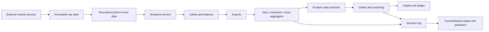
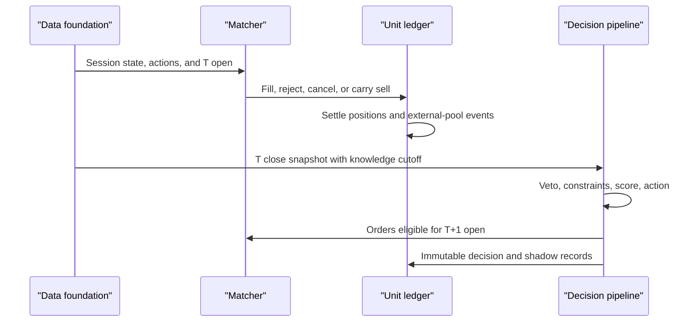

# Quanthus High-Level Design

| Field | Value |
| --- | --- |
| Status | Approved baseline |
| Version | 0.1 |
| Effective date | 2026-07-23 |
| Governing policy | `config/p0-policy.v1.json` |

## 1. System context

Quanthus is a local-first research and decision platform. It ingests market data, creates
point-in-time snapshots, describes market state, obtains independent expert opinions,
applies vetoes and constraints, maps the result to position actions, and executes those
actions through the same order and ledger contracts in backtest and simulation.

The representation and model layer has no direct edge to orders.

## 2. Architectural layers

| Layer | Responsibility | Primary output |
| --- | --- | --- |
| Raw data | Preserve source payload and acquisition metadata | Immutable source partitions |
| Normalized data | Canonical security, calendar, prices, actions, and status | Versioned Parquet datasets |
| Snapshot service | Enforce market-date and knowledge-cutoff visibility | `SnapshotRef` plus data views |
| Labels/features | Replayable state descriptions | Versioned evidence-bearing values |
| Experts | Scoring, position constraints, and veto decisions | Typed expert outputs |
| Aggregator | Fixed-priority governance and action mapping | Proposed position action |
| Position engine | Capital-unit lifecycle and concentration rules | Desired orders |
| Matching/ledger | Conservative fills, rejects, costs, and accounting | Immutable order/fill/ledger events |
| Audit/attribution | Provenance, hypothetical ledger, reruns, scorecards | Run manifests and reports |

## 3. Storage design

P1 uses a file-first analytical architecture:

- Raw source payloads are immutable and partitioned by source and acquisition date.
- Canonical tables are Parquet datasets partitioned by market date where appropriate.
- DuckDB provides local SQL and snapshot materialization.
- Polars/PyArrow implement typed transformations and validation.
- Metadata, manifests, and small registries may use JSON before a transactional catalog is needed.

The architecture avoids a network database during P1/P2 while preserving a migration path to
an object store and shared catalog. Notebooks never own canonical transformation logic.

## 4. Canonical daily sequence

Unfilled buys are cancelled and reconsidered after the next close. Unfilled sells remain
pending until tradable and produce one status event per session.

## 5. Cross-module contracts

### Snapshot contract

Every feature and decision references:

- `market_date`;
- timezone-aware `knowledge_cutoff`;
- `source_revision`;
- immutable `snapshot_id`.

### Decision contract

- Scoring: signal, confidence, evidence.
- Constraint: position bounds, stop rule, hold rule.
- Veto: allow, reason code, required action.
- Precedence: force-liquidate, reduce-only, block-new.

### Run contract

Every run records code version, parameter hash, data snapshot id, feature version, rule
version, run id, and result summary. A report without that manifest is not an official result.

## 6. Vertical-slice release

The first P3 action path enables only:

- tradability and funding vetoes;
- one basic candidate rule;
- extension-risk and market position constraints;
- structural-break exit;
- industry and same-day concentration constraints;
- complete audit logging.

Other labels and experts execute in shadow mode without changing position actions.

## 7. Reliability and failure behavior

- Missing or invalid data blocks new entries and alerts; held positions take no synthetic action.
- Every batch is idempotent by run id, source revision, and output partition.
- Candidate ordering is score descending, then security code ascending.
- Repeated runs over the same immutable inputs must produce byte-equivalent canonical records.
- Partially published snapshots are never visible to downstream decisions.

## 8. Security and operations

- Git uses a repository-scoped deploy key on OCI.
- Market credentials are environment or secret-store values and never enter run manifests.
- Data and research artifacts are excluded from Git.
- The private GitHub repository stores code, configuration, tests, and approved documentation.
- CI validates policy, gates, imports, and deterministic bootstrap tests.

## 9. Governance

Policy and implementation changes follow proposal, written expectation, development replay,
shadow trial, and promote/rollback. Arbitration and blind partitions cannot be used to tune a
failed proposal. Repository docs and configuration are updated in the same pull request.

## 10. Detailed designs

The implementation contracts are defined under `docs/design/lld/01-data-foundation.md`
through `docs/design/lld/10-monitoring-attribution.md`. Stable work-item ids connect each
design section to GitHub issues.
