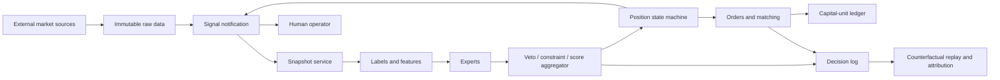
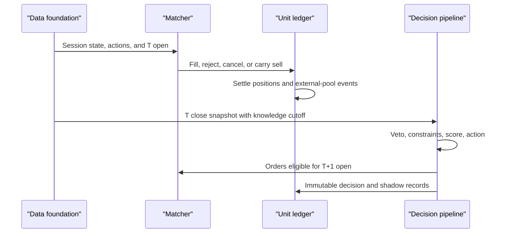

# Quanthus High-Level Design

| Field | Value |
| --- | --- |
| Design status | approved |
| Delivery gate | not-applicable |
| Current phase | P4 implementation open |
| Version | 0.8 |
| Effective date | 2026-07-29 |
| Governing policy | `config/p0-policy.v1.json` |
| Governing gate | `config/p3-gates.v1.json` |

## 1. System context

Quanthus is a file-first research and decision platform. It ingests market data, creates
point-in-time snapshots, describes market state, obtains independent expert opinions,
applies vetoes and constraints, maps the result to position actions, and evaluates those
actions through the same order and ledger contracts in backtest and paper operation. A separate
notification path may deliver persisted signals to a human operator; it does not place orders.



The representation and model layer has no direct edge to orders. The human-operator edge is
outside automated execution; no broker adapter exists in the near-term profile.

## 2. Architectural layers

| Layer | Responsibility | Primary output |
| --- | --- | --- |
| Raw data | Preserve source payload and acquisition metadata | Immutable source partitions |
| Normalized data | Canonical security, calendar, prices, actions, and status | Versioned Parquet datasets |
| Snapshot service | Enforce market-date and knowledge-cutoff visibility | `SnapshotRef` plus data views |
| Labels/features | Replayable state descriptions | Versioned evidence-bearing values |
| Experts | Scoring, position constraints, and veto decisions | Typed expert outputs |
| Aggregator | Fixed-priority governance and action mapping | Proposed position action |
| Position engine | Capital-unit lifecycle and concentration rules | Desired orders |
| Matching/ledger | Conservative fills, rejects, costs, and accounting | Immutable order/fill/ledger events |
| Notification delivery | Idempotent delivery of persisted signal or intent | Notification events; never fills |
| Audit/attribution | Provenance, hypothetical ledger, reruns, scorecards | Run manifests and reports |

## 3. Data platform and storage design

The approved target is a file-first analytical architecture distributed across CN01, Hermes, and
OCI:

- CN01 is the fixed-primary daily lane and Hermes is a continuously exercised standby. Each owns
  its immutable raw/ODS evidence and builds one complete DWD/DWS candidate family from its own ODS
  against the exact epoch parent and shared reference set supplied by OCI. Neither lane can publish
  canonical data, ADS, PostgreSQL projections, or consumer pointers.
- OCI owns arbitration epochs, independent candidate gates, cross-lane comparison, canonical
  acceptance/catalogs, ADS builds, atomic release sets, and serving publication. CN01 remains
  primary regardless of readiness order or favorable output. Hermes may replace it only after an
  independently established primary failure; unresolved material divergence blocks both lanes.
- A canonical acceptance record selects one complete lane family without mixing DWD, DWS, or
  lane-bound PIT artifacts. A versioned catalog snapshot maps market dates to accepted generations.
  Operational ADS is built from an exact catalog snapshot and required generation subset.
- One release-set manifest binds the catalog, canonical inputs, and required operational ADS.
  `release-set_CURRENT.json` is the sole consumer publication pointer; compatibility dataset
  pointers are non-authoritative projections and cannot be joined independently.
- Portable research ADS bundles are self-contained, immutable, manifest-bound inputs for replay,
  P4 event research, and later P5 training. Initial bundles use semantic `tables[].parts[]` without
  mandatory calendar-year directories. Development, arbitration, blind, and forward scopes are
  issued as physically separate authorized bundles.
- Daily acquisition remains provider-readiness gated. Both lanes require the complete target-date
  sentinel-index set before scanning stocks, bounded socket/retry behavior, and no `READY` on any
  coverage gap. Contract-defined activation grace rejects elapsed-window timer replays.
- Canonical and derived artifacts are versioned Parquet with portable relative-path manifests.
  DuckDB, Polars, and PyArrow provide local query, typed transformation, and validation.
- PostgreSQL contains indexed, rebuildable serving projections. It is not a canonical system of
  record and is not the execution venue for full-history transformations.

This is the approved target boundary, not a claim that every listed surface is deployed. The
current repository contract covers DWD daily bars, DWD daily status observations, one DWS daily
market summary, fixed-primary arbitration, a limited research-only operational ADS, trusted
Shanghai-time arbitration windows, fenced publication and rollback, immutable correction and
revocation state, accepted-ODS recovery evidence, and the self-contained portable
`strategy_replay` ADS profile. Runtime qualification, real NTP/clock evidence, independent accepted-
ODS restore evidence, full PIT/tradability candidate families, and portable `event_library` and
`ml_training` profiles remain open gates. The historical strategy ADS bootstrap records that it
lacks per-decision publication proof; its 2025 output is not a genuine unopened blind evaluation.

The legacy OCI full-ODS pull/build path remains live until ADR 0005's shadow, fencing, recovery,
rollback, and explicit `GO_FOR_CUTOVER` gates pass. Target work is copy-only and uses separate
roots; no existing ODS, DWD/DWS, ADS, pointer, log, or evidence may be deleted or reused as staging.

P1/P2 computation and replay do not depend on PostgreSQL availability once bound to an accepted
snapshot or self-contained research bundle. OCI publishes accepted release-set projections to PG;
Hermes may directly append only small ODS landing tables. Notebooks never own canonical
transformation logic.

PostgreSQL may remain on PVE initially. If it later moves, OCI is the writable primary and PVE
is a read-only streaming standby, while Hermes retains the internal raw-evidence copy.
Replication is not a backup, so independent base backups, WAL archiving, PITR, and restore
drills are required. Detailed PostgreSQL, network, and recovery boundaries remain in
`docs/architecture/adr-0002-hermes-oci-data-platform.md`; dual-lane ownership, canonical
publication, and ADS portability are governed by
`docs/architecture/adr-0005-dual-lane-canonical-and-ads-publication.md`.

## 4. Canonical daily sequence

### Active close-to-next-open profile



Unfilled buys are cancelled and reconsidered after the next close. Unfilled sells remain
pending until tradable and produce one status event per session.

### Target two-window operator-assisted profile

The approved near-term direction evaluates opportunities in exactly two versioned action windows
per eligible session: `09:45-10:15` and `14:15-session close` in `Asia/Shanghai`. These are
half-open action intervals, so session close is not itself a new decision or execution instant.
Historical execution remains simulated. Forward operation persists the same profile/window-bound
signal and may email it to the operator for manual action; delivery does not create an order or
fill. Synthetic P2 fixtures prove cutoff and expiry mechanics, but target evaluation cadence,
input-latency SLA, and fill reference remain inactive until a non-synthetic executable policy and
tests freeze them.

```mermaid
sequenceDiagram
    participant Decide as "Decision pipeline"
    participant Notify as "Email notification"
    participant Human as "Human operator"
    participant Report as "Execution reporting"
    participant Actual as "Actual ledger"
    Decide->>Notify: Persisted action advice with signal/profile/window ids
    Notify-->>Human: Suggested action; never an order or fill
    Human->>Report: Actual fills, modified/partial action, or no action
    Report->>Actual: Accepted append-only report and reconciliation
```

The actual report may differ from the advice. The system preserves that divergence for slippage,
timing, compliance, and behavior analysis rather than changing the original decision.

Official intraday evidence currently begins with 5-minute data on 2024-07-01. Daily bars cannot be
used to reconstruct a two-window decision or fill, and the current after-session minute archive is
not a live signal feed. The cross-module contract and activation gates are defined in
`docs/design/execution-notification-profiles.md`.

## 5. Cross-module contracts

### Snapshot contract

Every feature and decision references:

- `market_date`;
- timezone-aware `knowledge_cutoff`;
- `source_revision`;
- immutable `snapshot_id`.

A forward or operational decision additionally binds the consumer release-set id resolved from
`release-set_CURRENT.json` and its bound `published_at` no later than the decision time. An
uncommitted publication intent is insufficient. Historical replay instead binds each decision to
its historical PIT snapshot; the later time at which a portable bundle was assembled is not
historical knowledge.

### Decision contract

- Scoring: signal, confidence, evidence.
- Constraint: position bounds, stop rule, hold rule.
- Veto: allow, reason code, required action.
- Precedence: force-liquidate, reduce-only, block-new.

### Run contract

Every run records code version, parameter hash, data snapshot id, feature version, rule version,
run id, and result summary. A profile-aware trading run additionally records its execution profile,
schedule version, and window ids; target activation must version the executable manifest contract
before those fields become required. Operational pipelines and signal delivery record terminal
notification outcomes without persisting notification credentials. A report without its manifest
is not an official result.

A replay or training run also binds the exact research-bundle revision, manifest digest, content
digest, authorization/split digest, and runner or trainer version. It never resolves a mutable
pointer after the run starts.

## 6. Vertical-slice release

Before a concrete P3 rule is frozen, the strategy-neutral daily replay layer runs consecutive PIT
reviews through the accepted P2 matcher and fixed-unit ledger. It preserves the strategy/execution
information boundary, supports sequential complete trades and held-position marks, and emits a
canonical decision trace, equity curve, trade ledger, and strategy performance report. This
accepted substrate does not authorize a strategy or threshold by itself.

The continuous implementation reads only one checksum-verified historical bundle. A strategy sees
an opaque-security-id T-close bar view whose history ends at T; a separate runner-only lazy source
loads T+1 execution evidence and company actions. Universe rows with missing execution evidence
remain visible and fail closed. Versioned company-action exceptions block new entry by
security/date and abort an affected held-position replay rather than silently corrupting quantity
or marks.

The first P3 action path enables only:

- tradability and funding vetoes;
- one basic candidate rule;
- extension-risk and market position constraints;
- structural-break exit;
- industry and same-day concentration constraints;
- complete audit logging.

Other labels and experts execute in shadow mode without changing position actions.

P3 acceptance uses one frozen governed candidate only to prove that these layers compose over a
multi-year replay with complete audit evidence. Its rules and results are not the seed of a formal
strategy lineage, and the gate explicitly forbids tuning or promotion. P4 may reuse the accepted
interfaces and frozen event source while defining an independent event library; formal strategy
hypotheses remain separately governed and the later validation partitions remain unopened.

## 7. Reliability and failure behavior

- Missing or invalid data blocks new entries and alerts; held positions take no synthetic action.
- Every batch is idempotent by frozen inputs, policy, and its declared idempotency key.
- Candidate ordering is score descending, then security code ascending.
- Repeated runs over the same immutable inputs must reproduce the deterministic content digest;
  exact results remain bound to one immutable revision and manifest digest.
- Partially published snapshots are never visible to downstream decisions.
- Each lane candidate passes independent gates before comparison. Consumers see only an old or new
  complete release set after the sole `CURRENT` compare-and-swap; canonical acceptance without a
  valid operational ADS remains internal evidence.
- Notification delivery is secondary: its failure is recorded for monitoring but does not roll
  back an accepted data release.
- A signal email is never execution evidence. Simulated, notified, and manually confirmed states
  cannot share a fill or position record by implication.

## 8. Security and operations

- Git uses a repository-scoped deploy key on OCI.
- Market credentials are environment or secret-store values and never enter run manifests.
- Data and research artifacts are excluded from Git.
- Near-term operation has no automated broker connectivity. Any real-capital manual action is a P7
  activity and requires explicit append-only execution reporting and advice-to-actual
  reconciliation before it enters the actual ledger.
- OCI-to-PVE database writes use a private overlay/tunnel or TLS with certificate verification;
  public write connections using `sslmode=disable` are prohibited.
- Runtime roles separate CN01/Hermes ODS and candidate production, OCI canonical/ADS/serving
  publication, migrations, and read-only consumption. Lane nodes possess no OCI publication
  credential or path authority.
- The private GitHub repository stores code, configuration, tests, and approved documentation.
- CI validates policy, gates, imports, and deterministic bootstrap tests.

## 9. Governance

Policy and implementation changes follow proposal, written expectation, development replay,
shadow trial, and promote/rollback. Arbitration and blind partitions cannot be used to tune a
failed proposal. Repository docs and configuration are updated in the same pull request.

## 10. Detailed designs

The operating profiles are defined in `docs/design/execution-notification-profiles.md`. Module
contracts are indexed by `docs/design/lld/README.md` and defined under
`docs/design/lld/01-data-foundation.md` through `docs/design/lld/10-monitoring-attribution.md`.
Stable work-item ids connect each design section to code, tests, acceptance evidence, and GitHub
issues.

The data-foundation target topology and transition authority are decided by
`docs/architecture/adr-0005-dual-lane-canonical-and-ads-publication.md`; LLD 01 owns its manifests,
state transitions, failure behavior, and module acceptance.
