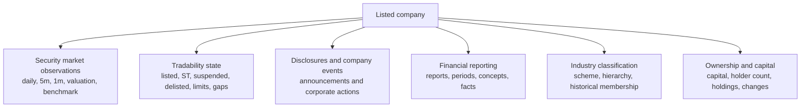
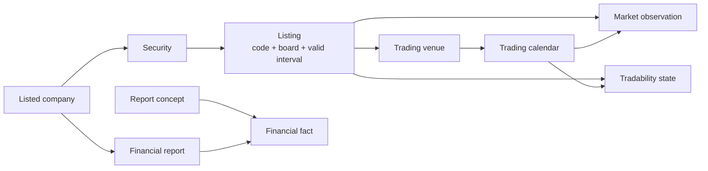

# DWD/DWS Securities Warehouse Model

| Field | Value |
| --- | --- |
| Governing work | `META-DATA-DWD-002` / archived Issue #55 |
| Governing decision | ADR 0006 |
| Design status | implementation-approved |
| Delivery gate | DWD Base accepted and recurring daily maintenance active; generic DWS deferred |
| Machine contract | `config/pipelines/dwd-domain-model.v1.json` |
| Build input | Exact immutable `ods-base-202607-v2` (`V2 Build202607`) |
| Modeling inputs | Quanthus product objective, governed ODS inventory/semantics, and bounded industry references |

## 1. Purpose and boundary

This design turns the governed A-share ODS corpus into a product-bounded warehouse for Quanthus
research and decision workflows. It defines the seven first-class business domains, the minimum
internal structures needed to connect them, the DWD atomic-detail contract, and the DWS fact
constellation derived from one exact DWD revision.

The design intentionally separates three decisions:

1. business-domain scope: which real-world subjects Quanthus needs to analyze;
2. semantic support: which identities, codes, dates, concepts, and relationships are required to
   connect those subjects correctly; and
3. warehouse projection: how DWD detail becomes shared DWS dimensions and facts.

This design does not:

- authorize a generic DWS build or publication without the consumer gate in ADR 0007;
- model issuance, underwriting, brokerage, clearing, settlement, or legal-registry operations;
- let current strategy features define DWD facts;
- treat every FIBO concept as a Quanthus warehouse domain; or
- read historical DWD/ADS tables, prior Bases, or mutable pointers as business-data inputs,
  migration targets, reconciliation baselines, or acceptance evidence. Explicit same-run
  predecessor candidates may supply verified referential identities only.

## 2. Business-domain map

The listed company is the central subject. The remaining six domains describe what can be known
about that subject directly or through a governed security/listing identity.



The authoritative domain catalog is:

| Domain | Core business question | Primary DWD objects |
| --- | --- | --- |
| Listed company | Which company is the subject across providers and code changes? | Listed company |
| Security market observations | What was observed for its security or benchmark at an interval? | Security bar, valuation, index bar |
| Tradability state | Could the security be acted on at the declared time, and why? | Tradability state |
| Disclosures and company events | What did the company disclose or declare, and when was it knowable/effective? | Disclosure, corporate action |
| Financial reporting | What did the company report for a period, scope, concept, and unit? | Financial report, financial fact |
| Industry classification | Which governed industry node applied at the effective and knowledge time? | Company-industry membership |
| Ownership and capital | What capital, holder count, holding, or holding change was observed? | Capital, holder count, holding, holding change |

## 3. Internal supporting structures

Supporting structures may be physical tables when a separate grain or history is required. They
do not become independent business domains and should not be presented to consumers as additional
warehouse scope.



The minimum support catalog includes:

- provider-scoped company identifiers;
- security and namespace-qualified security identifiers;
- effective listing code, board, currency, venue, and listing interval;
- trading venue and trading calendar;
- security/listing status evidence and effective price-limit rules;
- corporate-action terms and adjustment-factor input links;
- financial concepts, units, and report coordinates; and
- data-quality/lineage sidecars.

Security issuance and legal entity are deliberately absent. The direct
`listed company -> security` association is sufficient for the current product boundary and
remains effective- and knowledge-dated through the security version.

## 4. Layer responsibilities

```text
ODS
  source-faithful immutable evidence
      |
      v
DWD
  seven business domains + minimum support structures
  atomic observations/events + governed deterministic business state
      |
      v
DWS
  conformed dimensions + fact constellation bound to one DWD snapshot
      |
      v
ADS
  strategy, research, serving, and offline-package projections
```

The DWD script DAG is:

```text
#56 plan
  -> #57 listed-company identity and venue
  -> #72 trading-calendar backbone
  -> #58 market observations
  -> #59 remaining tradability state and gaps
```

Other company-bound domains may start after #57 according to the machine contract. A downstream
script may read only an explicitly declared same-run predecessor candidate after verifying its run
id, input-plan digest, knowledge cutoff, manifest, semantic digest, table ownership, and physical
inventory. Existing DWD/DWS Bases and every `CURRENT` pointer remain forbidden inputs.

Physical script ownership may cross a business-domain boundary when it is required to keep this
graph acyclic. In particular, #60 builds `dwd_adjustment_factor` and
`dwd_adjustment_factor_input` together with the corporate actions and evidence they reference;
both objects remain members of the security-market-observation domain. #58 therefore owns only
unadjusted bars, valuations, market-index definitions, and index bars. The machine contract lists
every cross-owner foreign-key edge and contract tests derive those edges from the table catalog.

### 4.1 DWD rules

- Read business evidence only from the exact accepted ODS Base and its explicitly bound immutable
  Hotfixes. Read same-run predecessor candidates only for declared referential dependencies, and
  read no historical DWD/ADS package or mutable pointer. A source gap exists only when required
  business evidence is absent from both the parent manifest and every bound Hotfix manifest.
- Apply each Hotfix as an overlay, never as a replacement: the parent Base wins every overlapping
  business key, an overlap-value mismatch fails the build, and a Hotfix may populate only a key
  absent from the parent and every earlier accepted overlay.
- Preserve source-defensible grain; do not aggregate market intervals or financial periods.
- Use internal warehouse identities rather than provider codes as primary keys.
- Normalize only when identity history, many-to-many semantics, or reusable reference meaning
  requires it.
- Store unadjusted bars as atomic prices. Store adjustment factors and their accepted inputs
  separately. Adjusted bars are downstream projections.
- A deterministic tradability state may live in DWD because it is a reusable governed business
  interpretation. It must bind the exact status, calendar, rule, observation, and policy inputs.
- Acquisition receipts and mutable checkpoints stay in ODS. Business-key quality exceptions may
  enter the DWD governance sidecar.
- Decoder, parser, unit conversion, provider-concept extraction, and identity normalization are
  DWD transforms. They do not make an ODS-backed object optional. Every eligible source record must
  produce a business row or an explicit quality exception.

### 4.2 DWS rules

- Every fact has one declared grain and an explicit measure-semantics contract.
- Shared dimensions are conformed across all facts; one fact cannot privately reinterpret company,
  security/listing, date, industry, or snapshot identity.
- Every fact row binds one snapshot dimension representing the exact DWD package and knowledge
  cutoff.
- A dimension key identifies an exact effective and knowledge version, not an arbitrary current
  row.
- Facts with incompatible grains remain separate. No company/security mega-wide table is allowed.

## 5. DWD catalog

The machine contract owns exact columns, types, keys, foreign keys, time profiles, partitions, and
source delivery state. Delivery state describes evidence availability in the exact ODS Base, not
whether transform code already exists. The following is its review projection.

### 5.1 Listed company

| Object | Role | Grain | Initial state |
| --- | --- | --- | --- |
| `dwd_listed_company` | Core object | One recognized listed-company version | Source available |
| `dwd_company_identifier` | Support | One namespace-qualified identifier interval | Source available |
| `dwd_security` | Support | One security definition and company association version | Source available |
| `dwd_security_identifier` | Support | One namespace-qualified security identifier interval | Source available |
| `dwd_listing` | Support | One security-on-venue listing interval | Source available |
| `dwd_trading_venue` | Support | One governed venue/MIC version | Reference seed |

The current CNINFO organization id establishes a provider-scoped company identity, not legal-
registry identity. Listing codes belong to listings and may be reused over time; they are never
company or security primary keys.

### 5.2 Security market observations

| Object | Role | Grain | Initial state |
| --- | --- | --- | --- |
| `dwd_security_bar` | Core object | One listing, interval start, frequency, and unadjusted price basis | Source available |
| `dwd_security_valuation` | Core object | One security/listing, observation date, measure, and method | Source available |
| `dwd_adjustment_factor` | Support | One security, effective date, method, and revision | Source available |
| `dwd_adjustment_factor_input` | Support | One accepted action/evidence input to one factor revision | Source available |
| `dwd_market_index` | Support | One benchmark definition version | Source available |
| `dwd_index_bar` | Core object | One index, interval start, and frequency | Source available |

Daily, 5-minute, and 1-minute bars share one atomic object and differ by `interval_size`. Market
prices remain unadjusted. Factor direction, method, anchor, and action/evidence inputs make any
adjusted projection reproducible without loading adjusted ODS bars as competing facts.

### 5.3 Tradability state

| Object | Role | Grain | Initial state |
| --- | --- | --- | --- |
| `dwd_trading_calendar` | Support | One venue, trade date, and session type | Source available |
| `dwd_security_status_interval` | Support | One typed security status interval | Source available |
| `dwd_listing_status_interval` | Support | One typed listing status interval | Source available |
| `dwd_price_limit_regime` | Support | One effective prioritized venue/board/status/IPO rule scope, optionally overridden by listing | Source available |
| `dwd_tradability_state` | Core object | One listing and trading session decision-state observation | Source available |
| `dwd_observation_gap` | Support | One expected interval without a market observation | Source available |

ST is represented separately from listing suspension/delisting evidence, but both are inputs to the
same consumer-facing tradability state. The state stores `is_tradable`, `can_buy`, `can_sell`,
reason, applicable limits, and an exact input-revision digest. Unknown gap reason fails the build.
The calendar object is physically owned by Issue #72; Issue #59 owns the other five rows in this
domain. Price-limit rules resolve by venue, optional board/status/IPO scopes, priority, and optional
listing override. Equal-priority ambiguity fails rather than duplicating one generic rule across
every listing.

### 5.4 Disclosures and company events

| Object | Role | Grain | Initial state |
| --- | --- | --- | --- |
| `dwd_disclosure` | Core object | One disclosed document/event revision | Source available |
| `dwd_disclosure_subject` | Support | One typed subject relationship for a disclosure | Source available |
| `dwd_corporate_action` | Core object | One declared corporate-action revision | Source available |
| `dwd_corporate_action_term` | Support | One typed term or option in an action | Source available |

The subject relationship is the sole disclosure-to-report/action/security association; report and
action rows do not duplicate a direct `disclosure_id`. Cash, shares, ratios, subscription price,
record date, ex date, and payment date remain typed action terms or event coordinates.

### 5.5 Financial reporting

| Object | Role | Grain | Initial state |
| --- | --- | --- | --- |
| `dwd_financial_report` | Core object | One company, reporting period, scope, and revision | Source available for metadata |
| `dwd_financial_concept` | Support | One versioned provider or mapped standard concept | Source available |
| `dwd_financial_fact` | Core object | One report, concept, unit, and dimensional coordinate | Source available |

The initial DWD expands every non-heading item in the retained three-statement payloads under the
versioned provider namespace. The transform must losslessly unwrap the retained byte-literal
envelope, decompress it, verify `raw_payload_sha256`, and preserve report context, currency, raw
value, and revision. XBRL/CAS mapping is optional enrichment: an unmapped provider item remains a
valid source-native concept, but it cannot claim standardized equivalence.

### 5.6 Industry classification

| Object | Role | Grain | Initial state |
| --- | --- | --- | --- |
| `dwd_industry_scheme` | Support | One industry scheme version | Source available |
| `dwd_industry_node` | Support | One effective node version in a scheme | Source available |
| `dwd_company_industry_membership` | Core object | One company membership interval in one node | Source available |

The first governed snapshot defines the earliest defensible knowledge/effective boundary. Current
membership is never projected backward as historical membership.

### 5.7 Ownership and capital

| Object | Role | Grain | Initial state |
| --- | --- | --- | --- |
| `dwd_share_capital_observation` | Core object | One security, capital type, date, and revision | Source available |
| `dwd_shareholder_count_observation` | Core object | One company/security, period end, and revision | Source available |
| `dwd_shareholding_change` | Core object | One disclosed holder-change event and revision | Source available |
| `dwd_shareholding_observation` | Core object | One holder/security position observation and revision | Source available |

The F10 `股本结构` and `股东研究` sections supply dated capital and top-holder observations. The
build parses their embedded tables, normalizes `股/万/亿` while retaining raw value/unit evidence,
and accounts for every eligible source record. Unresolved shareholder names remain the required
source identity with nullable `shareholder_id`; string equality must not create a canonical company
identity. These top-holder observations must not be described as a complete share register. Share
capital, holder count, position quantity, position percentage, and change quantity remain distinct
measures at distinct grains.

### 5.8 Governance sidecar

| Object | Role | Grain | Initial state |
| --- | --- | --- | --- |
| `dwd_quality_exception` | Governance sidecar | One accepted rule result for one affected business key and revision | Source available |

This sidecar is packaged and governed with DWD but is not a securities business domain.

## 6. DWS conformed dimensions

| Dimension | Source | Version behavior | Purpose |
| --- | --- | --- | --- |
| `dws_dim_snapshot` | DWD package/manifest | Immutable | Exact DWD identity and knowledge cutoff |
| `dws_dim_date` | Governed calendar | Static plus governed calendar attributes | Role-playing trade, report, publish, ex, and payment dates |
| `dws_dim_interval` | Governed frequency/session vocabulary | Static | Daily, 5m, 1m, and session coordinates |
| `dws_dim_company` | Listed-company DWD | Effective and knowledge versioned | Shared listed-company identity |
| `dws_dim_security` | Security and identifiers | Effective and knowledge versioned | Shared instrument and company-association context |
| `dws_dim_listing` | Listing and venue | Effective and knowledge versioned | Denormalized code, board, venue, currency, and lot context |
| `dws_dim_industry` | Industry scheme/node | Effective and knowledge versioned | Shared scheme/node hierarchy |
| `dws_dim_financial_concept` | Financial concept | Provider namespace versioned; optional standard mapping | Concept, statement, data type, and standard/source namespace |
| `dws_dim_market_index` | Market index | Effective and knowledge versioned | Benchmark identity |
| `dws_dim_event_type` | Governed event vocabularies | Static/versioned mapping | Disclosure, action, and ownership-event types |

Security and listing remain separate dimensions because factors, actions, and capital are security-
level facts while bars and tradability are listing-level facts. The listing dimension denormalizes
venue attributes for analysis; DWD retains the separate listing/venue structures and their exact
history.

## 7. DWS fact constellation

| Fact | Grain | Shared dimensions | Measure semantics | Initial state |
| --- | --- | --- | --- | --- |
| `dws_fact_security_market_interval` | Snapshot x listing x interval start x interval size | Snapshot, date, interval, company, security, listing | OHLC non-additive; volume/turnover additive only across non-overlapping intervals | Source available |
| `dws_fact_index_market_interval` | Snapshot x index x interval start x interval size | Snapshot, date, interval, index | Same interval semantics as security bars | Source available |
| `dws_fact_security_daily_state` | Snapshot x listing x trade date/session | Snapshot, date, company, security, listing | State flags and limits are non-additive | Source available |
| `dws_fact_security_valuation` | Snapshot x security x optional listing x date x measure/method | Snapshot, date, company, security, optional listing | Valuation values are non-additive | Source available |
| `dws_fact_adjustment_factor` | Snapshot x security x effective date x method/direction | Snapshot, date, company, security | Factor values are non-additive effective values | Source available |
| `dws_fact_disclosure_event` | Snapshot x disclosure x subject | Snapshot, date, company, optional security, event type | Factless event; `event_count=1` | Source available |
| `dws_fact_corporate_action_term` | Snapshot x action x term | Snapshot, role dates, company, security, event type | Typed cash/share/ratio measures; no cross-type addition | Source available |
| `dws_fact_financial_metric` | Snapshot x report x concept x unit x coordinate | Snapshot, role dates, company, concept | Flow/stock semantics declared by source or mapped concept | Source available |
| `dws_fact_company_industry_membership` | Snapshot x company x node x effective interval | Snapshot, role dates, company, industry | Factless relationship | Source available |
| `dws_fact_share_capital` | Snapshot x security x date x capital type | Snapshot, date, company, security | Semi-additive over time | Source available |
| `dws_fact_shareholder_count` | Snapshot x company/optional security x period end | Snapshot, date, company, optional security | Semi-additive over time | Source available |
| `dws_fact_shareholding_change` | Snapshot x holder-change event | Snapshot, date, company, optional security, event type | Event quantities/percentages; additive only under compatible units | Source available |
| `dws_fact_shareholding_position` | Snapshot x holder x security x observation date | Snapshot, date, company, security | Position quantity/percentage is semi-additive | Source available |

The core bus matrix is:

| Fact | Snapshot | Date | Interval | Company | Security | Listing | Industry | Concept | Index | Event type |
| --- | --- | --- | --- | --- | --- | --- | --- | --- | --- | --- |
| Security market interval | X | X | X | X | X | X |  |  |  |  |
| Index market interval | X | X | X |  |  |  |  |  | X |  |
| Security daily state | X | X |  | X | X | X |  |  |  |  |
| Security valuation | X | X |  | X | X | optional |  |  |  |  |
| Adjustment factor | X | X |  | X | X |  |  |  |  |  |
| Disclosure event | X | X |  | X | optional |  |  |  |  | X |
| Corporate-action term | X | X |  | X | X |  |  |  |  | X |
| Financial metric | X | X |  | X |  |  |  | X |  |  |
| Industry membership | X | X |  | X |  |  | X |  |  |  |
| Ownership/capital facts | X | X |  | X | optional |  |  |  |  | optional |

Industry is not stamped automatically onto every historical market fact. Consumers that need an
industry-at-time projection must use the same snapshot and an as-of membership join, or consume an
explicit ADS projection that records the membership version used.

## 8. Bitemporal and PIT contract

Every DWD business row includes `knowledge_from` and `knowledge_to`. The applicable business-time
coordinates depend on the object:

| Profile | Business coordinates | Examples |
| --- | --- | --- |
| Effective interval | `effective_from`, `effective_to` | Identities, listings, statuses, industry membership |
| Effective event | `effective_at`, optional `announced_at` | Disclosures, actions, ownership changes |
| Market observation | `observation_start`, `observation_end` | Bars, valuation, calendar state, tradability |
| Reporting period | `period_start`, `period_end`, `published_at` | Reports and financial facts |
| Governance event | `affected_effective_at`, `detected_at` | Gaps and quality exceptions |

Intervals use half-open `[from, to)` semantics. A correction creates a new knowledge version and
closes the prior interval; it does not rewrite what was previously knowable.

For one DWS build:

1. freeze the exact DWD package and knowledge cutoff in `dws_dim_snapshot`;
2. resolve each DWD row whose effective coordinates apply and whose knowledge interval contains
   the cutoff;
3. produce deterministic version keys for company, security, listing, industry, concept, and index;
4. reject orphan or ambiguous version resolution; and
5. bind every fact row to the resulting snapshot and dimension keys.

## 9. ODS coverage and fail-closed disposition

The machine contract reconciles all 53 static source ids in the final July ODS Base, all 17 unique
daily/intraday artifact names, and all 33 unique dataset ids in the bound Hotfix. Every source
occurrence has exactly one disposition:

| Disposition | Meaning |
| --- | --- |
| `modeled` | Populates one or more DWD objects after governed transforms |
| `ods_only` | Evidence, receipt, metadata, or container with no DWD business row |
| `superseded` | Retained for reconciliation but not the atomic authority |
| `source_gap` | Required in-scope evidence is absent from the exact self-contained V1.1 manifest |
| `deferred` | Outside DWD/DWS v1 product scope |

Parser, decoder, mapping, normalization, and unit-conversion work is never classified as
`source_gap`. It is an implementation obligation for a `modeled` source.

### 9.1 Consolidated 209-security Hotfix lineage

The parent security master contains 5,201 currently listed SSE/SZSE securities, while its normal
collection stock list contains 4,992. An exact audit found 209 excluded listings: 83 SSE and 126
SZSE. Of those, 208 have retained parent repair history through 2026-07-24; `688806` is a new
listing with no parent repair history. The gap is a collection-universe defect, not a suspension,
delisting, or provider-availability condition.

`ods-base-202607-v1-hotfix-001` is an immutable child bound to parent manifest
`sha256:553665772eb9746dcbca3318ae15f1c9b421f351c6e734f8e475ee8309a71d4c`. Its own manifest is
`sha256:c2fae9116e74f13b921f8cbf192d546b4f9ffd14c181dad7ca5b84bb0ccbd30a`, and its content digest is
`sha256:31453165b0eafd00f94357638fad7029ab0687d3c836269b843358ecfd933cac`. It contributes only
parent-absent business keys and does not mutate the parent Base. The child and parent payloads are
now consolidated without copying into self-contained `ods-base-202607-v1.1`, manifest
`sha256:3a031118af4421b90df7aca8a96bd617a49dba2ef7e49a2074206104991e956e` and content digest
`sha256:86372a3e0237c3bba3ff36e575ab041e1a0a01223587b629e7125b5ac1ba76da`.

| Hotfix capability | Verified coverage |
| --- | ---: |
| Unadjusted daily/status rows | 671,335 rows across 209 securities |
| Parent/provider daily overlap | 832 matching rows, zero mismatches |
| 1-minute observations | 4,716,720 rows across 209 securities |
| 5-minute observations | 4,942,128 rows across 209 securities |
| Historical valuation | 671,335 rows across 209 securities |
| Three-statement wrappers / quarterly projection | 627 / 14,832 rows |
| Raw F10 / industry snapshot | 3,344 / 209 rows |

The DWD input planner must resolve and verify V1.1 alone. It reads the embedded per-file source
labels and dataset-specific business-key precedence but must not require the older parent or
Hotfix directory names. For daily bars and status, parent canonical rows win, the
Hotfix-assembled repair rows fill missing history, and newly acquired rows fill only keys absent
from both. The same parent-first rule applies to minute, valuation, financial, F10, and industry
artifacts. BSE remains `BSE_PARTIAL_NONBLOCKING`: existing evidence is modeled, absence is marked
as a coverage boundary, and no zero rows are invented.

The following ODS evidence was verified in the checksum-identical Base on Hermes and CN01:

| ODS artifact | Retained evidence | Rows | Bytes |
| --- | --- | ---: | ---: |
| `financial_statements.parquet` | Full balance sheet, income statement, and cash-flow payloads for 4,992 securities | 14,976 | 1,647,000,047 |
| `financial_quarterly.parquet` | Provider-derived quarterly projection | 287,552 | 8,791,343 |
| `raw_f10.parquet` | 16 categories per security including capital and top-holder sections | 79,872 | 440,592,412 |
| `ref_shareholder_count.parquet` | Structured shareholder-count history | 411,318 | 19,402,499 |

Key scope states are:

| Capability | Disposition |
| --- | --- |
| Company/security/listing identity | Modeled from security master and provider organization mapping |
| Daily, 5m, and 1m unadjusted observations | Modeled as one security-bar object |
| Adjusted OHLCV | Superseded; rebuilt downstream from unadjusted bars and exact factors |
| Tradability, ST, listing status, limits, and gaps | Modeled with exact input lineage |
| Announcements, actions, dividends, and factors | Modeled |
| Full provider-native financial facts | Modeled from complete three-statement payloads; decoder and concept extraction are build transforms |
| Industry membership | Modeled from the first defensible snapshot; no fabricated history |
| Shareholder count and holding changes | Modeled |
| Share capital and top-holder positions | Modeled from dated F10 sections; parsing and unit normalization are build transforms |
| Issuance, legal registry, order/trade events, clearing/settlement | Deferred or ODS-only |

## 10. Physical package and partition contract

Proposed package layout:

```text
<dwd-package>/
  manifest.json
  payload/domains/<domain>/<dwd-table>/...
  payload/support/<owner-domain>/<dwd-table>/...
  payload/governance/dwd_quality_exception/...
  READY

<dws-package>/
  manifest.json
  payload/dimensions/<dws-dimension>/...
  payload/facts/<dws-fact>/...
  READY
```

Market facts partition first by interval size and then by market year/month. Daily state and
valuation partition by market year/month. Disclosure/action and ownership events partition by
effective or published year/month. Financial facts partition by report period year. Small
effective reference tables remain unpartitioned unless measured size justifies a revision.

Paths are storage hints only. Package manifests, table ids, schema digests, keys, and exact DWD/DWS
pair identity hold semantic authority.

## 11. Build sequence and gates

Recommended implementation sequence after design approval:

1. Verify the exact parent Base and bound Hotfix manifests, compile their dataset/key precedence
   plan, and prove the resulting listed SSE/SZSE scope is 5,201 without an overlap mismatch.
2. Build listed-company identity and its security/listing/venue support bridge.
3. Build the independent trading-calendar backbone from the accepted venue identity.
4. Build unadjusted security/index bars and valuation against that calendar, then build status,
   limit, tradability, and gap objects from the same-run identity, calendar, and market candidates.
5. Build disclosures and company actions/terms together with their adjustment factors/inputs;
   build industry membership, shareholder count, and holding changes after their declared
   same-run predecessors.
6. Decode and expand provider-native financial facts; parse F10 capital and top-holder history;
   account for every eligible source row with a business row or explicit quality exception.
7. Freeze one complete DWD snapshot and build all 10 DWS dimensions and 13 facts from it.
8. Produce independent CN01 and Hermes candidates, compare semantic identities, and only then
   install an accepted immutable pair on the three nodes under existing publication authority.

Mandatory gates include:

- exact ODS Base/Hotfix identity, parent-first overlay precedence, and complete source disposition;
- zero null/duplicate row keys and zero orphan effective/knowledge foreign keys;
- no overlapping effective or knowledge versions per business key;
- company/security/listing/code/venue reconciliation;
- unadjusted-only atomic market prices;
- exact factor-to-action/evidence lineage and adjusted-price reproduction;
- complete security-calendar tradability/gap classification;
- no industry history before the first defensible snapshot;
- financial wrapper decode and digest verification, provider-concept/context/unit validation, and
  duplicate-coordinate validation;
- XBRL/CAS equivalence required only for rows that claim a standardized concept;
- F10 capital/top-holder source-row coverage with no silent parse drops and preserved raw units;
- declared additive/semi-additive/non-additive semantics for every DWS measure;
- exact DWD package and cutoff binding for every DWS snapshot/fact;
- deterministic clean rebuild and isolated restore; and
- no implicit package, Base, catalog, release-set, or consumer pointer advancement.

## 12. Review state and work item

The opt-in September patch contract `config/pipelines/base231-domains.v1.json`
adds source-literal F10 major financial indicators without changing the native
33-table schemas or earlier seals. `base231_f10_selection.py` makes one
metadata-only selection shared by financial and holder consumers: latest actual
capture per provider, stock and category, with same-clock body conflicts held.
An older capture remains retained evidence; selecting a snapshot is not a
historical revision priority or an assertion of unchanged omitted periods.

`base231_financial_summary.py` preserves explicit yuan/per-share/percentage
labels, original tokens, source blocks and real capture times. A yuan label does
not establish CNY; a source display value is not provider-original precision.
Values not representable exactly in the frozen decimal column remain literal
text, and publication/availability is never inferred. New financial concepts
have a separate source-scoped namespace and use actual governance knowledge time.

`base231_holder_scope.py` certifies complete literal matrices at their governed
component grain. Missing ranks do not establish exits or full issuer top-ten
coverage. Its September change parser leaves the frozen August evaluator intact;
unrecognized, incomplete and internally conflicting blocks remain evidence-bound
holds. Same holder/date/value does not establish transaction equivalence: that
requires qualified original provider event and disclosure identities.

`base231_domain_pack.py` seals independent, locally replayable domain projections,
with complete retained F10 files, referential parents, configuration and evaluator
identities. Offline acceptance recomputes the selection, projection, typed
summaries, complete physical file set and global keys/references. Its READY is
domain completion only. Native reconciliation, whole-mirror acceptance and
consumer admission remain separate; 4,173 unavailable visibility exceptions,
old tail-conflict dispositions and all consumer freezes stay intact.

The real-source successor envelope in `base231_source_qualification.py` adds
exact retained ODS/DWD manifest and verified supply-catalog pins, and proves each
copied raw member and parent against those identities. Source reproduction alone
does not admit arbitrary rehashed source files or replace qualification evidence.
The envelope preserves the inner domain seal during job-owned physical transfer
and relocation; source strings remain archival. This still grants neither
transaction equivalence nor whole Base/consumer acceptance.

`base231_native_delta.py` prepares an additive job-local integration TMP. New
financial concepts are source-namespaced; existing financial values are not
replaced. A holder frame may add missing components only when all existing latest
components are an identical subset of the certified new frame. Differences or
absent old components hold that whole frame, preventing inferred exits and
duplicate ratio-basis components. Future source-date claims remain isolated, and
unproven change atoms are not merged. This TMP is not a published data product or
a substitute for the complete 33-table mirror and cold acceptance.

`base231_holder_revision.py` separately repairs a uniquely matched component
when original member hash, body identity, provider, every scalar and all
non-representation fields are identical. It preserves distinct archival revision
labels; labels do not override exact content identity. Both coarse coordinates
must have one component, preventing ambiguous split-component matches. The old
open knowledge interval closes at the actual successor governance clock while
its values and provenance remain intact; missing other holders do not imply
exits. The successor records only representation fields from the complete
certified source matrix. Its TMP has offline physical/hash checks and bounded
reproduction, not whole-image or transaction-equivalence acceptance.

`base231_image.py` defines the patch integration and whole-image acceptance mode.
It reproduces additive selection and exact-original-body representation repairs
from image-local immutable inputs, pairs every authorized old interval end with
its successor, and preserves all other old atoms. Financial additions retain
their separate namespace; 29 unaffected tables must match the exact predecessor
file/partition hashes. The 33-table native evaluator is unchanged and follows
inherited repair qualification and patch replay. A new 2.3.1 manifest and READY
are written only after full structural checks; two source/network-denied cold
relocations and missing/corrupt faults remain separate mandatory acceptance.
Local unresolved domains retain scoped use limits, not an unconditional veto
on unrelated qualified patch data.

| ID | Work | Current state | Acceptance evidence |
| --- | --- | --- | --- |
| `META-DATA-DWD-002` | Build the product-bounded seven-domain DWD Base V2 | 33 DWD objects accepted; recurring daily maintenance active; generic DWS deferred | `config/releases/v2-build202607.json`, package manifest, script tests, and build receipts |

The 33-object DWD implementation and Base build are complete. The retained DWS constellation is a
reviewed design, not a current delivery claim; ADR 0007 requires a concrete consumer before its
implementation is reactivated. A green contract test proves structural consistency, not runtime
or publication acceptance.
