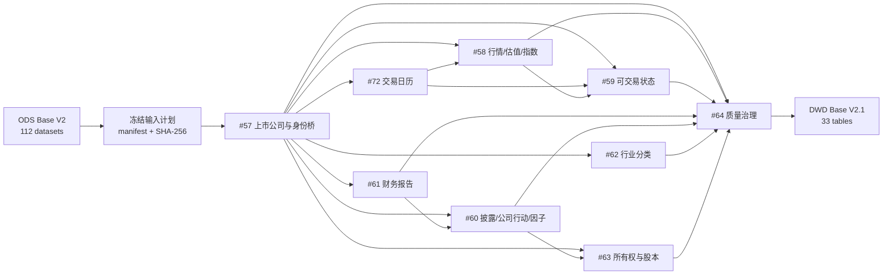
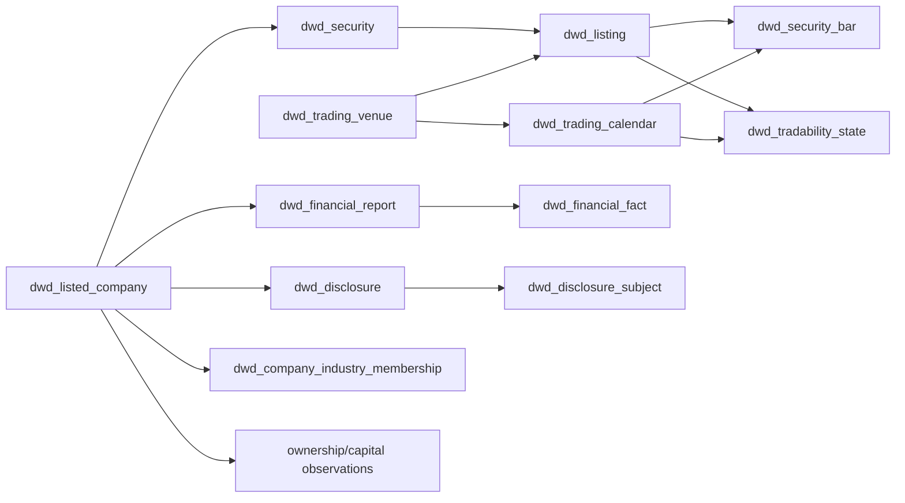

# ODS 到 DWD 数据血缘

| 字段 | 值 |
| --- | --- |
| 设计状态 | approved |
| 交付状态 | Base accepted；手工 correction-001 accepted；日更部分覆盖；自动 DWD 周更 open |
| 上级设计 | [`../01-data-foundation.md`](../01-data-foundation.md) |
| 当前 Base | ODS V2 / DWD V2.1 `Build202607` |
| 全量覆盖 | 7 个业务域，9 个物理 DWD builder，33 张 DWD 表 |
| 当前日更覆盖 | 1 个聚合 builder，7 张当日增量表 |
| 当前周更覆盖 | ODS corrections 已调度；DWD transform 未启用 |

## 1. 血缘单位

一条可验证血缘不是“文件 A 大概生成表 B”，而是以下五段身份链：

```text
ODS Base/release manifest
  -> dataset_id + part path + part SHA-256
  -> frozen input plan / four-lane daily catalog
  -> builder code revision + transform contract
  -> DWD table/partition + schema/content digest + receipt
```

DWD 行继续保留 `record_source`、`source_record_id`、`source_revision`、
`source_artifact_sha256`、`knowledge_from` 和 `knowledge_to`。因此表级血缘说明数据流向，
行级血缘负责回答具体一行来自哪份 ODS 证据。

### 1.1 Base 实例身份桥

历史包 `dwd-base-202607-v2` 在构建时封存的直接上游仍是原包名 `ods-base-202607-v1.2`，其
manifest SHA-256 为
`sha256:090d6a50aac7007337229588e9cd1586a50f09811332e6024d08f28ddc4b6e05`。ODS 后续做了
名称迁移，当前正式身份是 `ods-base-202607-v2`，manifest SHA-256 为
`sha256:7f74a7655f3f86982b4e662f55b12aff4fa2f28ee23cf9b5db530f9f2aa0955b`。两者的
content digest 都是
`sha256:c95adef6624d5d904a53fc93b27d1e2d78ed4a908a653661d89c47147380ac01`。

当前正式 DWD 是从该 ODS V2 身份重建并通过五项独立审计的
`dwd-base-202607-v2.1`。因此 `config/releases/v2-build202607.json` 是当前 ODS/DWD Base
组合身份的权威；各包 manifest 是其原始构建血缘的权威。名称迁移没有重写 DWD manifest；
V2.1 则是新的正式重建 Release，二者都保持不可变。

## 2. 全局关系图



身份桥是所有公司/证券事实的关联前提。财务先于披露事件，是因为
`dwd_disclosure_subject.financial_report_id` 必须引用同一构建中的财报身份；披露先于
股权持仓，是因为持仓变化可引用 `disclosure_id`。日历先于行情和可交易状态。

## 3. 全量 Base 构建血缘

| Owner / builder | 依赖 | 主要 ODS 业务输入 | DWD 输出 |
| --- | --- | --- | --- |
| #57 `build-dwd-listed-company` | 冻结计划 | `security_master`, `announcement_orgid_map`, `security_lifecycle`; `stock_list` 仅对账 | `dwd_listed_company`, `dwd_company_identifier`, `dwd_security`, `dwd_security_identifier`, `dwd_listing`, `dwd_trading_venue` |
| #72 `build-dwd-trading-calendar` | #57 | `trading_calendar`, `trading_calendar_history_hotfix`, 日/分钟 release calendar | `dwd_trading_calendar` |
| #58 `build-dwd-market-observation` | #57, #72 | 未复权日线、1m、5m、估值、指数及 Hotfix；复权日线只对账 | `dwd_security_bar`, `dwd_security_valuation`, `dwd_market_index`, `dwd_index_bar` |
| #59 `build-dwd-tradability` | #57, #72, #58 | `st_status_pit`, `suspensions`, `price_limit_regime`, 日状态、日历、行情覆盖和例外证据 | `dwd_security_status_interval`, `dwd_listing_status_interval`, `dwd_price_limit_regime`, `dwd_tradability_state`, `dwd_observation_gap` |
| #61 `build-dwd-financial-reporting` | #57 | 完整三表封装、`financial_quarterly`、SQLite `fin_abstract` | `dwd_financial_report`, `dwd_financial_concept`, `dwd_financial_fact` |
| #60 `build-dwd-disclosure-event` | #57, #61 | SQLite `announcements`、公司行动、分红、复权因子和例外证据 | `dwd_disclosure`, `dwd_disclosure_subject`, `dwd_corporate_action`, `dwd_corporate_action_term`, `dwd_adjustment_factor`, `dwd_adjustment_factor_input` |
| #62 `build-dwd-industry-classification` | #57 | `industry_membership` 和 209 证券 Hotfix 行业快照 | `dwd_industry_scheme`, `dwd_industry_node`, `dwd_company_industry_membership` |
| #63 `build-dwd-ownership-capital` | #57, #60 | `shareholder_count`, SQLite `holder_changes`, F10 `股本结构/股东研究` | `dwd_share_capital_observation`, `dwd_shareholder_count_observation`, `dwd_shareholding_change`, `dwd_shareholding_observation` |
| #64 `build-dwd-quality-governance` | #57-#63 | 缺口、异常 OHLC、状态语义、因子例外、解析未决项和所有领域 receipts | `dwd_quality_exception` |

这里共有 9 个物理 DWD builder。#72 是为解除行情和可交易状态循环依赖而独立出来的
内部支撑骨架，不增加第 8 个业务域。

全量 builder 只读取精确 ODS Base、同一 run 的声明前序 candidate 和版本化 reference
配置。历史 DWD/DWS/ADS、旧 Base 和任何可变 `CURRENT` 都不是业务输入。

## 4. ODS disposition 到 DWD 的映射

### 4.1 身份和参考

| ODS | Disposition | DWD |
| --- | --- | --- |
| `security_master`, `security_lifecycle`, `daily_market_security_master` | modeled | 公司、证券、证券标识、上市关系和上市状态 |
| `announcement_orgid_map` | modeled | 公司身份和提供方标识 |
| `stock_list`, `security_hotfix_stock_list` | superseded | 仅采集范围对账；不得覆盖证券身份 |
| `trading_calendar`, release calendars, calendar Hotfix | modeled | 交易场所和交易日历 |
| receipts、metadata、progress、request scope | ods_only | 不生成 DWD 业务行，仍保留 package/行级血缘 |

### 4.2 市场和可交易状态

| ODS | Disposition | DWD |
| --- | --- | --- |
| `daily_ohlcv_unadjusted`, 日行情 delta, daily Hotfix | modeled | `dwd_security_bar(interval_size=1d, price_basis=UNADJUSTED)` |
| 1m/5m archives、delta、Hotfix | modeled | 同一 `dwd_security_bar`，按 `interval_size` 分区 |
| `daily_ohlcv_adjusted` | superseded | 只作复权重放校验，不生成竞争行情事实 |
| `valuation_daily`, valuation repair/Hotfix/delta | modeled | 估值宽列 unpivot 为 `measure_type/value/methodology` |
| `index_daily`, index delta/metadata | modeled | `dwd_market_index` + `dwd_index_bar` |
| `st_status_pit`, daily status, suspension | modeled | security/listing status，并参与 `dwd_tradability_state` |
| `price_limit_regime` | modeled | 有效期优先规则，并参与上下限和可买卖判断 |
| coverage/delist/tradability evidence | modeled 或 ods_only | 可解释缺口进入 `dwd_observation_gap`；治理结论进入质量旁表 |

### 4.3 披露、财务、行业和所有权

| ODS | Disposition | DWD |
| --- | --- | --- |
| SQLite `announcements`, `announcements_delta` | modeled | 披露及其公司/证券/报告/行动 subject |
| `corporate_actions`, `dividends` 及 delta | modeled | 公司行动和类型化条款 |
| `adjustment_factors_pit`, factor/adjustment evidence | modeled | 因子及其行动/证据输入；例外进入质量旁表 |
| 完整 `financial_statements` | modeled | 无损解码后生成报告、provider-native 科目和原子事实 |
| `financial_quarterly`, SQLite `fin_abstract` | modeled | 财报摘要、补充事实和对账证据 |
| `industry_membership` | modeled | 行业方案、层级节点和公司成员有效期 |
| `shareholder_count` | modeled | 公司/可选证券粒度股东户数观察 |
| SQLite `holder_changes` | modeled | 股东持股变动事件 |
| F10 `股本结构` | modeled | 股本类型观察，规范化股数并保留原值/单位 |
| F10 `股东研究` | modeled | 前十大/流通前十大持仓观察；不声称完整股东名册 |

机器契约还逐条覆盖 static sources、17 类 recurring artifacts、SQLite 10 个成员和 34 类
Hotfix artifacts。完整 ODS dataset id 目录见
[`ods-dwd-data-dictionary.md`](ods-dwd-data-dictionary.md)，精确 `target_tables` 以
`config/pipelines/dwd-domain-model.v1.json` 的 `ods_source_contract` 为准。

## 5. 关键字段级血缘

### 5.1 行情

```text
ODS stock_code
  -> 在 T 时点解析 dwd_security_identifier
  -> 有效 dwd_listing.listing_id
ODS date/ts
  -> dwd_trading_calendar.calendar_session_id
ODS OHLCV/amount
  -> decimal(38,10) OHLCV/turnover
ODS dataset/revision/file digest
  -> record_source/source_revision/source_artifact_sha256
```

日线和分钟线不能因代码字符串相同而跳过有效期解析。金额字段统一为 `turnover`，源单位
必须在 transform 中有显式方法；`pct_change`、`turnover_rate` 和调整后价格不成为原子
行情列。

### 5.2 财务

```text
financial wrapper raw_payload_gzip
  -> byte-literal unwrap + gzip decode
  -> raw_payload_sha256 验证
  -> report identity / period / scope / revision
  -> provider namespace concept
  -> value_decimal 或 value_text + unit + context_hash
```

没有标准科目映射不构成源缺口。未映射科目保留 provider namespace；只有显式版本映射
才能声称 XBRL/CAS 等价。

### 5.3 可交易状态

```text
listing + calendar session
  + security/listing status intervals
  + price-limit regime
  + observed market row / classified gap
  -> is_tradable + can_buy + can_sell + reason_code
  -> input_revision_digest
```

`dwd_tradability_state` 是可重放的治理状态，不是策略标签。缺行情、停牌、一字板或异常
转移必须保留不同 reason；缺失数据不能被解释为结构破坏。

日行情存在 OHLC 静态占位但 `volume<=0` 或 `turnover<=0` 时，状态必须为
`ZERO_ACTIVITY_OBSERVATION`，且 `is_tradable/can_buy/can_sell=false`、上下限为空。它与
`SUSPENDED` 和 `PROVIDER_NOT_TRADING` 分开保留；后两者的明确证据优先于零活动分类。

### 5.4 所有权和股本

```text
F10 raw content + content_sha256 + source offsets
  -> versioned parser
  -> raw_value/raw_unit
  -> normalized SHARE/PERCENT value
  -> company/security + observation/effective time
```

`shareholder_source_name` 是必留源身份；`shareholder_id` 可空。字符串同名不能自动建立
法人或自然人统一身份。

## 6. 当前日更血缘（实际部署）

当前正常入口是 `run-cn01-daily-dwd`，由四路 ODS READY catalog 触发
`build_daily_domain_increment`。它读取只读 DWD Base 中的身份、日历和指数参考，并输出
一个不可变日包。当前实际输出只有 7 张表：

| 四路 ODS 输入 | 当日日增量 DWD |
| --- | --- |
| market daily OHLCV | `dwd_security_bar` 的 1d 分区 |
| 1m / 5m intraday bars | 同一 `dwd_security_bar` 的 1m/5m 分区 |
| valuation delta | `dwd_security_valuation` |
| index delta | `dwd_index_bar` |
| trading calendar | `dwd_trading_calendar` |
| daily status | `dwd_tradability_state` |
| announcements delta | `dwd_disclosure`, `dwd_disclosure_subject` |

`financial_disclosures_delta` 是从已经进入受治理 Base 的 `financial_quarterly` 静态快照按
`publish_deadline` 筛出的重复证据。截止日不是实际公告时间，不能授权新的 disclosure
事件；其中的季度报告业务键也已由 Base 建模。因此它显式归类为 `ods_only`：日包审计
必须记录 lane、artifact、行数、源哈希和原因，但不重复输出 DWD 业务行。

这条日更链不等于全量 9-builder DAG。当前未实现日增量 handler 的 artifact 是：

- `adjustment_evidence_delta`；
- `suspensions_delta`；
- `corporate_actions_delta`；
- `dividends_delta`；
- `factor_evidence_delta`。

它们非空时 builder 必须失败，而不是静默丢弃。因此目前“日更完成”只证明上述 7 表的
当日增量完成，不代表 33 表全部按日更新。

## 7. 当前周更血缘

ODS `weekly-corrections` 在周六 08:00 运行。`cn01-dwd-weekly-input` 仅能准备/验证输入；
周更领域 transform 和 DWD correction 发布尚未启用。完整财务、F10、股东户数、公司行动
等 Base 来源已进入 Build202607，但后续自然周修订目前没有形成正式 DWD 增量。

周更实现必须复用第 3 节领域 builder 的 schema 和 transform，不允许另写一套业务清洗
逻辑，也不能修改 Base。

`dwd-base-202607-v2.1-correction-20260813-001` 是一次手工 Hotfix：状态按
`listing_id+calendar_session_id` replacement，公司行动按稳定记录 id tombstone/replacement，
并把规范化 v3 公司行动封装到 correction 的 replay 面。它验证了不可变 correction 的最小
合同，但不代表上述自动周更 transform、调度和发布已启用。

## 8. 外键和回放主链



外键解析必须同时满足业务有效期和知识有效期。查询“2020 年当时知道什么”时，不得使用
2026 年才建立的当前代码、行业、报告修订或股东身份。

## 9. 质量和失败语义

- 缺表、缺分区、schema digest 不符、源行无解释丢失、重复 row key、孤儿/多义外键或
  时间区间重叠都阻塞构建。
- 可接受限制、排除、延后、隔离和失败通过 `dwd_quality_exception.disposition` 区分。
- ODS receipt/metadata 不生成业务事实，但仍绑定构建输入和审计证据。
- 每个成功包先写 manifest/checksums，深度验证后最后写 READY；失败不推进 Base 或日包
  `CURRENT`。
- OCI 当前只镜像 CN01 已验证 DWD 日包，不参与 ODS 或 transform。

## 10. 维护规则

1. 增加 ODS dataset，必须声明 disposition、目标表、源行对账和 PIT 时间来源。
2. 增加/修改 DWD 表，必须更新 owner、依赖边、外键和数据字典。
3. 日/周 handler 覆盖变化，必须同步第 6/7 节，不能只更新 runbook。
4. 血缘验证读取 sealed artifact 和 receipt，不能依赖 builder 进程内状态。
5. DWS/ADS/event library 是 DWD 下游投影；不得反向成为 DWD 业务来源。
