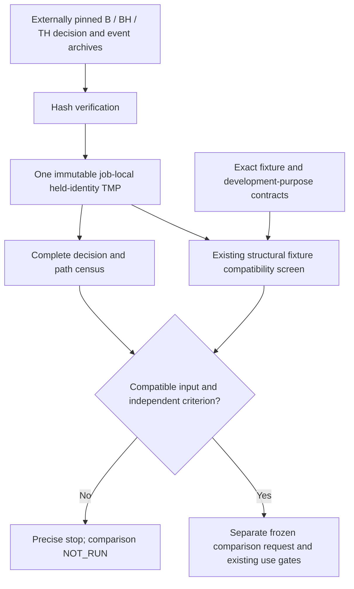

# Held-position structural-input preflight

| Field | Value |
| --- | --- |
| Parent | [Expert Strategy Layer](../expert-strategy-layer.md) |
| Design status | approved — Owner's bounded #545 continuation on 2026-10-28 |
| Delivery gate | accepted for offline denominator screening; candidate comparison remains blocked |
| Work item | `P3-EXPERT-007` / #545 |
| Code | `src/quanthus/expert_strategy/held_structure_preflight.py`; `scripts/expert545_preflight.py` |
| Contract | `config/research/expert545-held-preflight.v1.json` |
| Tests | `tests/unit/test_held_structure_preflight.py`; `tests/unit/test_held_structure_preflight_runner.py` |
| Evidence | [Bounded preflight receipt](../../../../acceptance/expert545-held-preflight-20261028.md) |

This additive offline tool determines whether an existing structural evidence set can support a
proposed comparison at the actual `PositionRiskPolicy.evaluate_held` consumer. It neither implements
a structural expert nor changes the accepted consumer, aggregator, guardians, thresholds or actions.
Original strict P3 admission and the separate retrospective closeout remain distinct. A completed
preflight can legitimately end with no justified experiment.

## Exact denominator and one shared intermediate

An externally frozen selection pins every accepted archive member's complete SHA256 and byte bound
before interpretation. The event selection binds its parent selection digest. The command verifies
all selected members, including metadata not otherwise consumed, before creating output. An existing
output or a destination inside an input directory fails. No sources, pointers or permissions change.

The stage graph is:



One materialization owns the held identity projection; admission and footprint reports reuse it.
It is TMP, not ADM, a feature cache, a new position ledger or a source-quality pipeline. The receipt
records materialization time, counts, bytes, reuse and process RSS. Formal independent reproduction
remains a separate mode; a TMP hit cannot replace independently built evidence where required.

Each held decision is keyed by its own arm, market date and unit. The key `held:capital-unit-NN`
does not identify a security. Resolve the same-day, positive-position snapshot at or before the
original 15:00 Shanghai boundary, then bind the latest strictly earlier filled entry through the
accepted event-coordinate map. Missing, conflicting, duplicated, future or out-of-scope evidence
rejects the whole selected denominator; it is never silently dropped.

Cross-arm counts distinguish different securities at one unit/date, different entry episodes,
different quantities, and unmatched paths. Even identical entry identity and quantity do not prove
equal marked returns, holding facts, reduction history, feature revisions or complete consumer
states. These are descriptive overlap counts, not matched counterfactuals or independent samples.

## Compatibility and claim ceiling

Ticker/date overlap is only a necessary coarse screen. Exact listing/security identity, source
closure, price/action coordinate, calendar, feature version, observation/knowledge semantics and
purpose still need an explicit compatible binding. Raw unadjusted breakout/volume Facts cannot be
aliased to total-return feature inputs or to Support Evolution age/distance/rebound Facts. Null
support fields stay unavailable. Retrospective knowledge does not become historical PIT knowledge.

The current risk consumer reads RSI14, volatility20 and holding sessions/marked return/prior
reductions. Structural evidence has no current read or action branch there. Missing held evidence
abstains and does not itself cause a sale; existing base safety actions retain their independent
authority. Entry blocking, alerting and all existing guardian behavior remain unchanged.

The command has no comparison execution path. It reports no effect estimate when no candidate
mapping or qualified comparison exists. A compatible source is necessary, not proof that a state
adds value beyond the same continuous Facts. A future action-changing comparison must separately
freeze its input population, continuous-Facts control, independent usefulness criterion, policy
mapping, unchanged safety guards and resource budget before outcome reads. It follows the parent
quality/value gates; development 10/11 acceptance alone grants no trading or P6 authority.

## Reproduction

```bash
PYTHONPATH=src:. python3 scripts/expert545_preflight.py \
  --selection /approved/job/inputs.frozen.json \
  --event-selection /approved/job/inputs.identity-events.frozen.json \
  --output /approved/job/new-offline-analysis
```

Only existing, already authorized selected archives are inputs. The script imports no provider or
replay engine and calls no network. Private identity TMP remains outside Git and the public export;
only aggregate counts, file/config/code identities and restrictions are handed off. The fixed
configuration is a bounded inspection contract, not a new acquisition or experimental authority.
