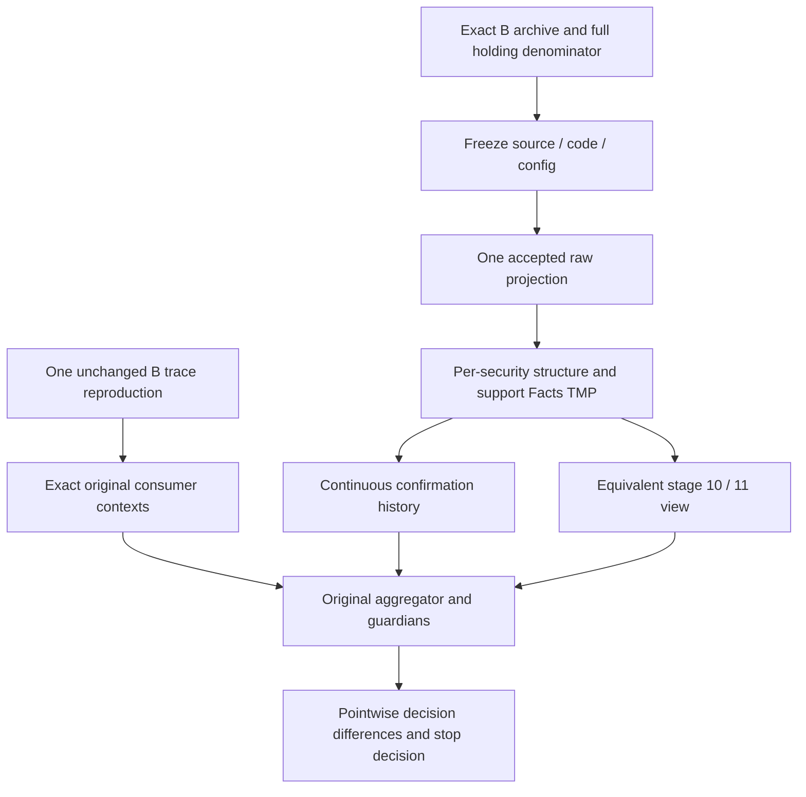

# Actual-held-path structural decision slice

| Field | Value |
| --- | --- |
| Parent | [Expert Strategy Layer](../expert-strategy-layer.md) |
| Design status | approved — Owner adopted the three-step proposal on 2026-10-28 |
| Delivery gate | accepted-conditional for the bounded offline slice; tested mapping parked; full strategy value and production unaccepted |
| Work item | `P3-EXPERT-007` / #545 |
| Contract | `config/research/expert545-held-structure.v1.json` |
| Code | `held_structure_inputs.py`, `held_structure_shadow.py`; `scripts/expert545_held_structure.py` |
| Predecessor | [Held-input preflight](held-structure-preflight.md), preserved at its original scope |
| Evidence | [Actual-held-path receipt](../../../../acceptance/expert545-held-structure-20261028.md) |

## Purpose and fixed population

Determine whether support-failure evidence changes an actual held-position decision before
investing in a new capital-constrained strategy comparison. Use every one of the original B's
8,393 held reviews, 343 native security identities and 538 entry episodes, from 2012-01-04 through
2021-12-30. Selection is independent of losses and new structural outcomes. BH/TH remain old
evidence and are not rerun. This is an offline, retrospective, pointwise policy comparison; it
does not grant historical PIT, independent holdout, training, forward Shadow or P6 admission.

The Owner adopted the exact three-step proposal retained at CN02
`expert545-review-20261028T084701Z-0e07ed8/next-plan.md`. Its total limit is three hours,
with no acquisition, threshold search, production mutation or new economic replay.

## Input identity and time

The accepted original B archive freeze supplies exact effective raw daily bars, native identity
intervals, per-venue open calendars, normalized action boundaries, retained exceptions and the
already authorized supplemental official-action facts. Freeze member bytes/full SHA256 and schema
before interpretation, then bind source, configuration, algorithm, scope and code identities.
Only selected 2011–2021 history can warm up a 2012–2021 decision. No #541 fixture or borrowed
128-issuer sample substitutes for actual holdings.

Raw unadjusted CNY prices and original total-return features remain separate coordinates.
Declared effective actions reset the raw structural coordinate epoch. Unknown actions, missing
calendar observations, zero activity and insufficient history remain unavailable or censored;
there is no flat fill. The native identity contract treats null `valid_to` as open-ended and
enforces a known end, without inventing a DWD listing ID or requiring an unrelated clipping flag.
Binary64 source values retain their existing `Decimal(str(value))` convention, without a new
precision claim.

The legacy `built_at` is artifact generation, retained separately with its original value.
Provider acquisition and DWD known-from remain unavailable. The existing retrospective envelope
cutoff is not evidence that information was known at the historical close. Existing visibility
exceptions and all strict P3/P5/P6 gates remain intact.

## Stage ownership and reuse

The raw projection is built once per qualified job; two bounded workers compute each security's
20-session anchors and 60-session support process once. Both representations consume the same
immutable TMP. All same-day support processes remain recorded. An existential failure rule can
propose only one reduction; a lexicographic evidence witness never selects an attractive price
outcome. Invalid/incomplete attempts are retained and cannot be reused as qualified Facts.

If the archived consumer lacks complete context, one trace-only engineering reproduction of B
may capture original holding age, quantity, settled state, marked return, prior reductions,
feature versions and baseline safety action. All original decisions, engine events and manifest
must reproduce byte-identically. This is not a new scientific baseline. A unit/date label or
end-of-day quantity alone cannot substitute for that context.

The job registers a 2 GiB new-write cap, at least 8 GiB free, actual device/inode capacity and the
hard deadline. No source files, old attempts, services, permissions or pointers are changed.
These artifacts are job-local TMP, not a new ADS/ADM or cross-job cache.

## Frozen optional policy

`shadow.support-failure-reduce-only.v1` proposes a reduction only when an available 20-session
support process has the existing persistent stage-10 confirmation, the position is at least
three sessions old, and its original entry has no prior strategy reduction. The target is the
existing 10% cap, rounded down by the existing lot convention. At/below-cap positions are not
increased. Unknown structural evidence cannot sell or remove an independent base safety action.
Stage 11 is explanation only. Base force liquidation and all existing constraints retain priority.
The original strategy card and production `PositionRiskPolicy` are unchanged.

Compare B, continuous Facts **including confirmation memory**, and the equivalent 10/11 view
through the existing aggregator/guardians. The last two have the same information and mapping;
equal actions demonstrate representation equivalence, not two independent value results.
Every row retains exact source/feature/process/evidence and decision identities.

The shadow reads the original B state at every point. It does not apply hypothetical fills or
update quantity, cash or subsequent entry/reduction history. Repeated daily proposals and distinct
entry episodes therefore are not counts of executed reductions. No return, drawdown or cost
benefit can be inferred from these snapshots.

## Acceptance and continuation

Require all 8,393 identities, unchanged baseline decision digests and equal candidate decisions
between the two information-equivalent representations. Report unavailable and inapplicable
reasons, proposed actions covered by original rules, final action differences, dates/issuers/entry
episodes and actual cost. Prefix-causal, action/calendar/identity, missing-data and safety-precedence
regressions accompany focused lint/type checks and `make check`.

No final action difference, or a difference confined to one entry episode, parks this candidate.
Distributed differences justify only proposing a separately frozen B-versus-structure complete
capital comparison. That future candidate may hold names or dates outside the original B path;
input coverage, capital/cost rules, attribution, budget and use authority must be checked for the
whole new path. The present slice cannot accept #545's full strategy-value gate or activate P6.

The blueprint records only the actual FACTS/EXPERT scope. Head2, parked 3/4 references, parked
volume policy, training and local-update qualifications are unaffected.
