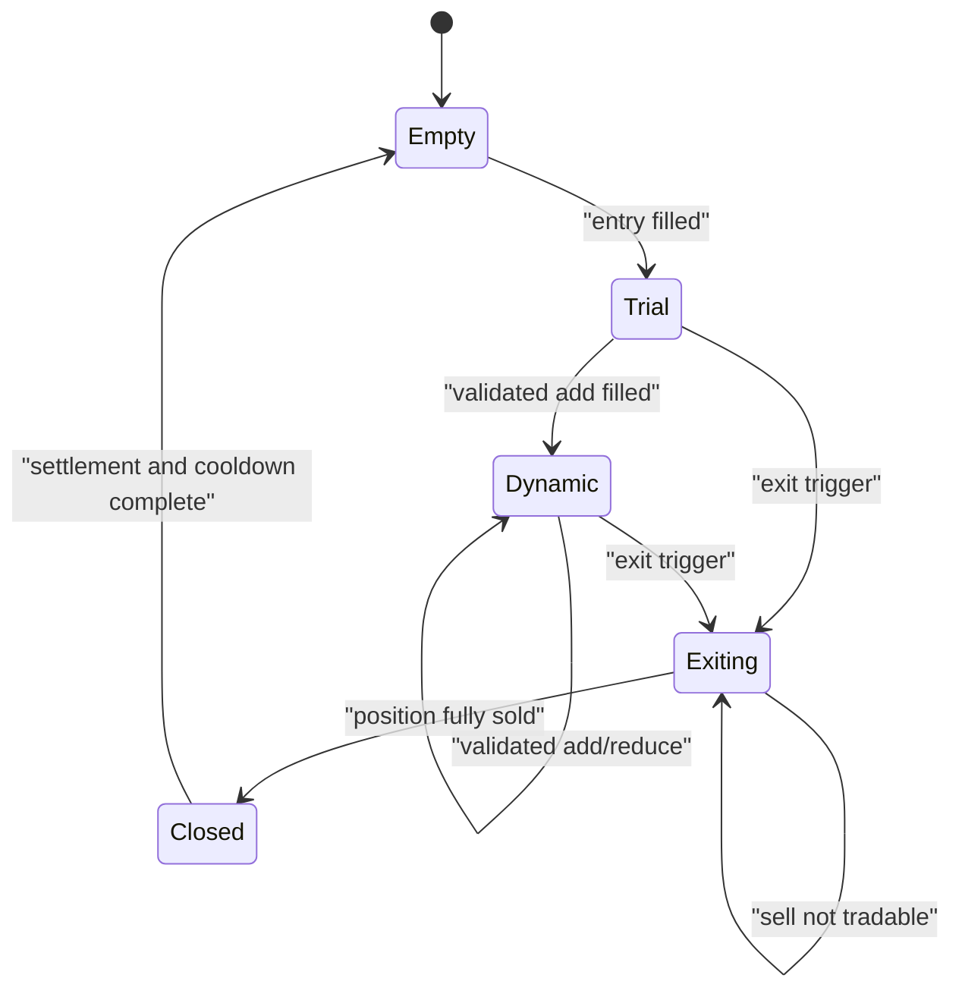

# LLD 05: Position and Execution Lifecycle

| Field | Value |
| --- | --- |
| Phase | P3 |
| Status | Vertical-slice baseline |
| Governing requirements | FR-RULE-004/005, FR-BT-003/004 |

## 1. Goal

Turn governed actions into legal fixed-unit position transitions from trial entry through
daily review and exit.

## 2. State machine

Empty cannot transition directly to full exposure. A unit may own one security and event.
Illegal transitions fail closed and produce an audit exception.

## 3. Entry and concentration

A governed trial-entry action targets the frozen trial percentage of unit notional. Before an
order exists, the position engine enforces:

- no more than two active units in one static level-one industry;
- no more than two new units in one market date;
- market-wide position maximum;
- unit funding and tradability vetoes.

Rejected entries use `industry_cap` or `daily_open_cap` reason codes and enter the diagnostic
hypothetical ledger.

## 4. Adds and reviews

Adds are anti-martingale: the position must have unrealized profit and an improving/stable
daily review. Extreme extension forbids adds. Add size, count, and maximum position are
versioned rules rather than constants in the state machine.

Every T close reviews probability of improvement/deterioration, trend stability, holding
necessity, and structural integrity. Rule-only implementations precede any model score.

## 5. Exit triggers

Exactly four sources may initiate exit in the approved baseline:

1. independent structural-break veto;
2. constraint stop;
3. consecutive deteriorating reviews;
4. maximum holding period.

Force-liquidate outranks reduce-only, which outranks block-new. A sell that cannot trade stays
in Exiting and is carried without duplicate orders. Minimum hold, maximum hold, T+1 sale
eligibility, and cooldown use one versioned calendar convention.

## 6. Capital settlement

On full close, realized profit transfers to the finite external pool; loss is replenished up
to available pool cash. The unit retains reduced capital when the pool cannot replenish it.
All transfers are ledger events and report separately from trading PnL.

## 7. Work items

| ID | Work | Dependency | Acceptance evidence |
| --- | --- | --- | --- |
| P3-POS-001 | Implement legal unit/position state machine | P2 ledger | Transition property tests |
| P3-POLICY-001 | Freeze trial/add/hold/cooldown parameters | P2 acceptance | Versioned position policy |
| P3-RISK-001 | Implement industry and daily-entry caps | Position state | Concentration golden cases |
| P3-POS-002 | Implement trial/add/review rules | Experts | Lifecycle replay |
| P3-EXIT-001 | Implement four-source exit arbitration | Aggregator | Precedence fixtures |
| P3-POS-003 | Implement cooldown and carried-exit behavior | Calendar/matcher | Consecutive limit-down case |
| P3-ACCEPT-001 | Run vertical-slice multi-year replay | All P3 work | Auditable closed loop |

## 8. Acceptance

No illegal transition occurs, total results decompose into unit ledgers, concentration rejections
are deterministic, and a consecutive untradable-sell scenario carries correctly without crash
or duplicate order creation.
