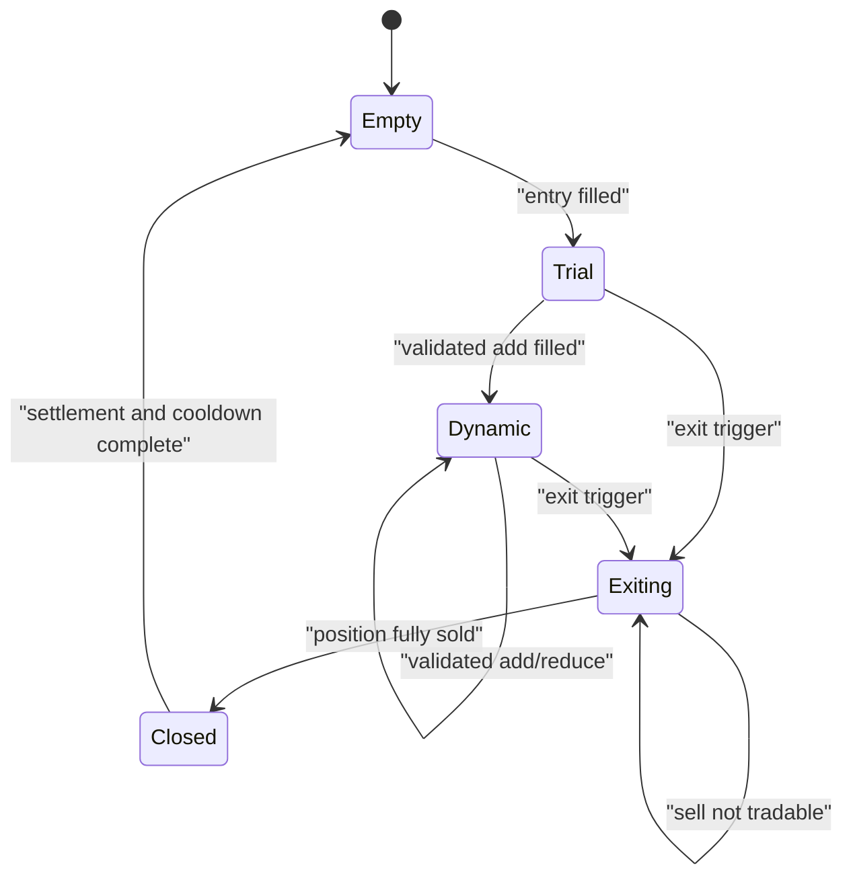

# LLD 05: Position and Execution Lifecycle

| Field | Value |
| --- | --- |
| Phase | P3 |
| Design status | approved |
| Delivery gate | open |
| Implementation status | `P3-POS-001` accepted; `P3-RISK-001` accepted for capacity and reservation competition; `P3-EXIT-001` accepted; sizing policy, market-wide cap, trigger evaluators, review rules, and cooldown policy not started |
| Gate source | `config/p2-gates.v1.json` |
| Governing requirements | FR-RULE-004/005, FR-BT-003/004 |

## 1. Goal

Turn governed actions into legal fixed-unit position transitions from trial entry through
daily review and exit.

## 2. State machine

Empty cannot transition directly to full exposure. A unit may own one security and event.
Illegal transitions fail closed and produce an audit exception.

`src/quanthus/position_lifecycle.py` now owns the versioned legal topology as an immutable,
evidence-bearing state contract. Every transition reconciles P2 `UnitState` before/after views:
entry/add/reduce/exit fills must prove the corresponding quantity direction, an exit request and
an untradable carry cannot mutate position quantity, a full exit must leave the P2 unit empty, and
closed-to-empty reset requires both settlement and calendar evidence. Unit, security, and
opportunity identity cannot change inside one lifecycle; transition ids and source evidence are
consumed once. Evidence: `docs/acceptance/p3-position-lifecycle-slice-20260728.md`.

This slice freezes only legal state transitions. It does not choose trial/add sizes, define hold or
cooldown durations, arbitrate an exit trigger, or create a `BacktestSignal`, `OrderIntent`, `Order`,
or `Fill`. Those remain with the work items below and the accepted P2 execution path.

## 3. Entry and concentration

A governed trial-entry action targets the frozen trial percentage of unit notional. Before an
order exists, the position engine enforces:

- no more than two active units in one static level-one industry;
- no more than two new units in one market date;
- market-wide position maximum;
- unit funding and tradability vetoes.

Rejected entries use `industry_cap` or `daily_open_cap` reason codes and enter the diagnostic
hypothetical ledger.

`src/quanthus/concentration.py` now implements the two frozen P0 capacity limits before any order
exists: at most two active or already-reserved units in one static level-one industry and at most
two accepted new-unit reservations on one market date. It consumes only Trial/Dynamic/Exiting
lifecycle evidence, requires one static industry-map version and explicit
`static_non_pit_concentration_only` lineage use, and returns all applicable cap reason codes in
fixed order. The decision is canonical and declares `execution_authorized=false`. Evidence:
`docs/acceptance/p3-concentration-capacity-slice-20260728.md`.

`src/quanthus/capital_allocation.py` now orders already-governed entry candidates by the frozen
aggregate-score/security-code priority, orders caller-supplied empty units by identity, and builds
reservations sequentially through the same capacity evaluator. A cap-rejected candidate does not
consume its considered unit; an accepted reservation immediately consumes both unit and industry/
daily capacity for later candidates in the batch. Lifecycle and P2 ledger evidence must both prove
that a unit is empty. Input permutation cannot change the batch digest. Evidence:
`docs/acceptance/p3-capital-allocation-slice-20260728.md`.

This allocation slice does not choose how many units exist, reserve or size cash, calculate a trial
percentage, create the diagnostic replay, implement a market-wide maximum, or produce a Signal,
OrderIntent, Order, or Fill. Every result declares `execution_authorized=false`; static membership
still cannot enable a sector expert or sector filter.

## 4. Adds and reviews

Adds are anti-martingale: the position must have unrealized profit and an improving/stable
daily review. Extreme extension forbids adds. Add size, count, and maximum position are
versioned rules rather than constants in the state machine.

Every T close reviews probability of improvement/deterioration, trend stability, holding
necessity, and structural integrity. Rule-only implementations precede any model score.

## 5. Exit triggers

Exactly four sources may initiate exit in the approved baseline:

1. independent structural-break veto;
2. constraint stop;
3. consecutive deteriorating reviews;
4. maximum holding period.

Force-liquidate outranks reduce-only, which outranks block-new. A sell that cannot trade stays
in Exiting and is carried without duplicate orders. Minimum hold, maximum hold, T+1 sale
eligibility, and cooldown use one versioned calendar convention.

`src/quanthus/exit_arbitration.py` now requires exactly one same-review evaluation for each frozen
P0 exit source and emits a deterministic exit-request, hold, or hold-with-unavailable-evidence
result. Multiple triggers remain visible in frozen policy order. An unavailable source raises an
alert but does not synthesize an exit; missing-data evidence is structurally forbidden from
triggering structural break. Every result declares `execution_authorized=false`. Evidence:
`docs/acceptance/p3-four-source-exit-arbitration-slice-20260728.md`.

This slice does not evaluate a structural break, stop, deterioration streak, or holding duration,
and it defines none of their thresholds. An exit request still requires the legal lifecycle
transition and the accepted P2 Signal-to-Order path before any simulated execution can exist.

### Research baseline boundary

The three `P3-STRAT-001` baselines are one-unit comparison controls over the accepted P2 replay,
not implementations of the target Trial/Dynamic lifecycle. They intentionally use whole-position
entry and exit, do not add or reduce, and keep their small holding rules in the research catalogue.
The current v2 baseline caps each entry at 30% of available unit cash and carries the remainder as
cash, but this research-only cap is not the target trial/add sizing policy. V1's full-unit entries
remain only as rejected extreme-control evidence. Their results cannot close `P3-POLICY-001`,
`P3-POS-002`, or `P3-POS-003`, and cannot be promoted by renaming a run. A future governed strategy
must still pass the lifecycle, allocation, exit-source, and promotion boundaries in this LLD.

## 6. Operator-assisted boundary

The target near-term profile has exactly two versioned action windows. The position engine may
produce a profile/window-bound signal and OrderIntent for email delivery, but neither it nor the
email provider places a broker order. Backtest and paper operation send the intent through the P2
simulated matcher. A human trade remains unknown until an explicit operator execution report is
accepted; email delivery alone cannot transition the actual position state.

The report may record no action, execution as advised, partial execution, or modified execution,
including multiple actual fills. Only an accepted append-only report may transition the actual
position; a correction supersedes rather than overwrites prior evidence. Advice, paper position,
and actual position remain separately addressable for reconciliation.

Paper notifications without real capital belong to P6. Any manual action using real capital is P7
live operation even without a broker adapter and requires fill, fee, and slippage reconciliation.

## 7. Capital settlement

On full close, realized profit transfers to the finite external pool; loss is replenished up
to available pool cash. The unit retains reduced capital when the pool cannot replenish it.
All transfers are ledger events and report separately from trading PnL.

## 8. Work items

| ID | Work | Dependency | Acceptance evidence |
| --- | --- | --- | --- |
| P3-POS-001 | Implement legal unit/position state machine | P2 ledger | Transition property tests |
| P3-POLICY-001 | Freeze trial/add/hold/cooldown parameters | P2 acceptance | Versioned position policy |
| P3-RISK-001 | Implement industry and daily-entry caps | Position state | Concentration golden cases |
| P3-POS-002 | Implement trial/add/review rules | Experts | Lifecycle replay |
| P3-EXIT-001 | Implement four-source exit arbitration | Aggregator | Precedence fixtures |
| P3-POS-003 | Implement cooldown and carried-exit behavior | Calendar/matcher | Consecutive limit-down case |
| P3-STRAT-001 | Implement three one-unit research baselines | P3-FEAT-002, P3-REPLAY-001 | Development-period deterministic suite |
| P3-ACCEPT-001 | Run vertical-slice multi-year replay | All P3 work | Auditable closed loop |

## 9. Acceptance

No illegal transition occurs, total results decompose into unit ledgers, concentration rejections
are deterministic, and a consecutive untradable-sell scenario carries correctly without crash or
duplicate order creation. Operator-assisted acceptance additionally proves that notification
cannot move actual state and that accepted no-action, partial, modified, and superseding reports
reconcile without rewriting the original advice.
