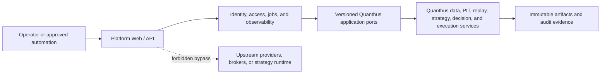

# LLD 11: Platform Kernel Extraction and Integration

| Field | Value |
| --- | --- |
| Phase | Platform Kernel, orthogonal to P1-P7 |
| Design status | approved |
| Delivery gate | accepted |
| Implementation status | PK1-PK4, candidate workbench/approval, Replay Worker, and PK6 cutover/recovery accepted; P4 Event Worker is an additive named-workflow extension under Issue #74 and remains unaccepted until the real-corpus double-run gate closes |
| Gate source | `config/platform-kernel-gates.v1.json` |
| PK0 acceptance | `docs/acceptance/platform-kernel-pk0-boundary-freeze-20260812.md` |
| PK1-PK3 acceptance | `docs/acceptance/platform-kernel-pk1-pk3-acceptance-20260812.md` |
| PK4 acceptance | `docs/acceptance/platform-kernel-pk4-product-web-correction-20260812.md` |
| Candidate workbench acceptance | `docs/acceptance/platform-candidate-validation-workbench-20260813.md` |
| Candidate approval acceptance | `docs/acceptance/platform-candidate-approval-workflow-20260813.md` |
| Replay Worker acceptance | `docs/acceptance/platform-worker-production-loop-20260813.md` |
| P4 Event Worker checkpoint | `docs/acceptance/p4-event-worker-implementation-20260820.md` |
| Public edge acceptance | `docs/acceptance/platform-kernel-public-edge-acceptance-20260812.md` |
| PK6 acceptance | `docs/acceptance/platform-kernel-pk6-cutover-recovery-20260813.md` |
| Operations | `docs/operations/platform-kernel-runbook.md` |
| Governing decisions | `docs/architecture/adr-0010-platform-kernel-integration.md`, `docs/architecture/adr-0012-postgresql-worker-runtime.md` |
| Source baseline | QuantDinger `v5.0.15` / `e64e1c227bf3174e441a42143620179b286387e1` |

## 1. Goal

Extract a small, production-capable operator platform from QuantDinger without importing a second
market-data, strategy, replay, decision, or execution system. The result must be easier to test
than the upstream product, explicitly composable, and capable of restoring a deferred feature
without retaining that feature as dead code.

This milestone is named Platform Kernel and uses `PK-*` work items. It is not P8. P1-P7 continue
to own Quanthus domain delivery; Platform Kernel supplies the cross-cutting application shell.

## 2. Ownership boundary



The Platform Kernel owns HTTP/session transport, identity and authorization, generic operational
job state, presentation, and platform telemetry. Quanthus domain modules own all financial facts
and actions. PostgreSQL may store users, access policy, job state, request audit, and rebuildable
serving projections; it is never the canonical market-data or replay store.

Platform endpoints call versioned Quanthus application ports. The adapter boundary is asymmetric:

- platform code may import declared application-port interfaces;
- Quanthus domain code does not import Flask, QuantDinger models, Celery, or Web types;
- adapters translate identity and request context into typed Quanthus commands or queries;
- no adapter can manufacture a snapshot, decision, order, fill, or acceptance result; and
- direct provider, broker, upstream backtest, or upstream strategy imports fail contract tests.

## 3. Extraction rule

A capability is present only when it is declared in one versioned Feature Manifest. The manifest
selects all of these surfaces together:

1. HTTP and command routes;
2. startup hooks and process roles;
3. database migrations and seeds;
4. runtime and optional dependencies;
5. Web routes, navigation, permissions, and API calls; and
6. tests, metrics, and operational checks.

Environment variables may configure an admitted feature, but cannot be the only mechanism that
hides a removed feature. A removed capability must be absent from every surface above. A deferred
capability may exist in the upstream/recovery inventory, but not in the default source tree,
installation, database, OpenAPI document, worker schedule, or Web bundle.

## 4. Capability disposition

The machine-readable inventory in `config/platform-kernel-gates.v1.json` is the exact disposition
source. This table explains the intended grouping. `Keep` means extract and conform, not copy
unchanged. `Replace` means preserve the operator need while changing the implementation owner.

| Capability | Disposition | First-kernel result | Restore or activation rule |
| --- | --- | --- | --- |
| Application factory and configuration | keep | Minimal WSGI API factory with explicit composition | Always in kernel |
| Local login, password lifecycle, sessions/JWT | keep | Identity independent of billing, providers, and trading | Always in kernel |
| User administration and role/permission checks | keep | Bounded operator/admin roles | Always in kernel |
| MFA, login-attempt controls, verification, and security logs | keep | Fail-closed security controls and audit | Always in kernel |
| OAuth providers | defer | No provider-specific OAuth in first boot | Named identity-provider requirement and threat review |
| Health, readiness, request id, structured logs, metrics | keep | API and worker operational contract | Always in kernel |
| OpenAPI generation and API error envelopes | keep | Only admitted routes appear in the document | Always in kernel |
| PostgreSQL integration | keep | Platform/control state and rebuildable projections only | Always in kernel |
| Redis response cache | defer | No required cache in minimal boot | Measured latency/concurrency need with invalidation owner |
| Generic finite-job contract | replace | Quanthus `JobRunner` port, idempotency, progress, cancel, result refs | A named long-running Quanthus workflow |
| Celery and Redis job transport | defer | Optional adapter, absent from minimal install | JobRunner load/HA evidence shows local runner is insufficient |
| Agent token, audit, and idempotency | defer | No Agent Gateway in first boot | Approved non-human API consumer and least-privilege scopes |
| Email and webhook transport | defer | Notification port only; no provider enabled | Existing P6 transport gate and a named notification consumer |
| Production container, reverse-proxy, secret, and monitoring skeleton | keep | Quanthus-owned deployment definitions | Always in kernel |
| Desktop operator Web | replace | Quanthus-owned source-built Web shell for admitted workflows | Always in the first product path; upstream extraction needs a later fixed-revision license review |
| Mobile H5/native clients | remove | No mobile image, route, build, or navigation | New product decision and independent security/UX scope |
| Market, kline, universe, factor, and fundamental APIs | replace | Read-only Quanthus query adapters | Corresponding Quanthus application port accepted |
| Dashboard, portfolio, and report views | replace | Views over Quanthus published facts | View contract names an authoritative Quanthus artifact |
| QuantDinger market/data providers and catalog sync | remove | No `akshare`, `yfinance`, `finnhub`, exchange, or broker data path | Never as domain authority; new adapter needs separate ADR |
| Strategy V2, bots, templates, runtime, and strategy worker | remove | No upstream strategy lifecycle | A strategy may return only as a Quanthus-governed proposal |
| QuantDinger backtest, factor research, and analysis tasks | remove | No competing replay or research store | Reuse only after independent Quanthus conformance review |
| Broker credentials, IBKR, Alpaca, crypto exchange, live/grid/pending orders | remove | No broker SDK, secrets, route, table, or worker | Separate execution milestone and explicit capital authority |
| Billing, membership, credits, referral, and USDT payment | remove | Identity and admin contain no monetization fields or behavior | New product and compliance decision |
| Community, indicator market, comments, and purchases | remove | No marketplace/community surface | New product decision and moderation/abuse model |
| MCP server and legacy Agent Gateway tools | remove | No MCP process, package, tool, or old route | Rebuild adapter after a real MCP consumer exists |
| Fast Analysis | remove | No route, task, table, PDF, queue, or dependency | No planned restoration |
| AI Copilot/chat/tool registry | remove | No chat or assistant workflow | New operator problem and evidence of value |
| Strategy review, reflection, calibration, and AI decision client | remove | No review report, scheduled AI worker, or decision path | No planned restoration |
| Strategy/indicator generation | defer | Optional Authoring module is absent by default | PK4 accepted plus separate draft-only activation decision |

### PK0 accepted confirmation set

The user accepted these six defaults on 2026-08-12. They close the PK0 product boundary without
admitting any upstream business implementation:

| Decision | Accepted value | Consequence |
| --- | --- | --- |
| Desktop Web source | Build a Quanthus-owned Web shell for the first path | QuantDinger-Vue is not a dependency; a later selective extraction requires a fixed revision and accepted license |
| OAuth | Defer; ship local password login plus MFA first | Smaller identity and secret surface; provider login can return through its own threat review |
| Redis/Celery | Use PostgreSQL as the durable queue and state authority; defer Redis, Celery, and RabbitMQ until measured workload evidence proves the need | Candidate replay is the named Worker consumer; `LISTEN/NOTIFY` is wakeup-only and workers pull leased Jobs |
| Agent Token/Audit | Defer until a non-human consumer exists | MCP removal does not leave an unused parallel authentication surface |
| Email/Webhook | Defer behind the existing P6 notification gate | Platform extraction cannot imply a signal delivery or fill |
| Strategy/indicator Authoring | Defer to optional PK5 and allow `not-applicable` for first cutover | It cannot delay the core platform or bypass Quanthus governance |

## 5. Implemented package and process shape

The first implementation uses one isolated `quanthus.platform` package:

```text
platform/
|-- manifest.py        Feature Manifest and frozen-capability coverage
|-- composition.py     sole application and startup composition root
|-- identity.py        users, password auth, sessions, MFA, roles, and audit
|-- candidate_approval.py
|                      digest-bound evidence-review and governance state machine
|-- api.py             dependency-free WSGI/OpenAPI transport and error contracts
|-- jobs.py            finite local JobRunner and operational job envelopes
|-- observability.py   request context, JSON logs, metrics, health, and readiness
|-- persistence.py     store port plus PostgreSQL and in-memory adapters
|-- migrations.py      module migration registry
|-- product_query.py   validated catalogue and digest-bound replay evidence projection
|-- ports.py           versioned Quanthus application-port contracts
`-- adapters/quanthus.py
                       read-only gate and attribution-publication adapters
```

The accepted initial process set was `api` plus PostgreSQL, with migration as an administrative
role. Candidate replay now proves that the local finite-job boundary is insufficient. ADR 0012
adds an independently deployed Replay Worker. The Web/API control plane submits,
reads, and cancels Jobs but never executes batch handlers. The old cooperative-thread
`LocalJobRunner` remains only as a test/ephemeral adapter after Worker cutover.

PostgreSQL is the durable queue and Job/Run state authority. The initial Replay Worker polls and
pulls work through transactional `FOR UPDATE SKIP LOCKED` leases. `LISTEN/NOTIFY`, Redis, Celery,
RabbitMQ, and a separate scheduler remain deferred until measured latency, load, or topology
evidence requires them. MCP, mobile, AI, payment, trading, and broker roles remain absent.

`config/platform-features.v1.json` is the runtime admission source. Each enabled feature maps the
upstream capabilities it absorbs; the admitted and excluded sets must be disjoint and together
equal all 29 frozen rows in `config/platform-kernel-gates.v1.json`. The composition root rejects an
unknown process role, dependency group, startup hook, migration, route, capability omission, or
capability overlap before serving a request.

## 6. Persistence and dependency rules

The upstream `init.sql` is an evidence source, not the target migration system. Target migrations
are ordered by module and recorded in a schema-version ledger. A clean database runs only the
modules enabled by the same Feature Manifest. Disabling or omitting a feature on a fresh install
must create none of its tables, indexes, seeds, or administrative probes.

The first core schema is limited to identity, access policy, MFA/security audit, platform schema
history, request/audit metadata, and consumer-backed job records. Market artifacts remain outside
this schema or enter only as explicitly rebuildable projections with source references.

The current registry creates `platform_schema_migrations`, `platform_users`, `platform_sessions`,
`platform_security_audit`, `platform_jobs`, `platform_candidate_runs`,
`platform_candidate_active_runs`, legacy `platform_candidate_reviews`, and active
`platform_candidate_approval_events`. The legacy review table is retained as already-applied schema
history and receives no new runtime writes. The approval-event table stores digest-bound,
append-only evidence-review and governance events; it stores no market, replay, or execution truth.
PostgreSQL migration execution
uses one transaction-scoped advisory lock and an idempotent `(module_id, migration_id)` ledger.
The in-memory store is an explicit test/ephemeral adapter and is not PostgreSQL acceptance evidence.

Dependencies are split into a minimal platform group and optional adapter groups. The minimal
group cannot contain LLM clients, market-data clients, technical-analysis libraries, broker SDKs,
PDF report generation, or Celery/Redis. Dependency and import allowlists are tested from a clean
environment.

## 7. Authentication decoupling

Identity extraction must remove `credits`, VIP/membership expiration, referral bonuses, payment
orders, and feature-consumption checks from registration, login, user serialization, and admin
operations. Authorization is role/scope based. Product entitlements, if ever introduced, require
a separate decision and cannot be inferred from retained upstream columns.

OAuth is not part of the first kernel because local login plus MFA closes the operator need with a
smaller threat and configuration surface. Its later activation requires an identity-provider
owner, redirect/secret policy, account-linking behavior, and recovery tests.

## 8. Job and Worker contract

`JobRunner` is a port, not a commitment to Celery. A submitted job has a typed job kind, actor,
idempotency key, immutable input reference, state, progress, timestamps, cancellation policy,
result artifact reference, and bounded error reason. Domain results stay in Quanthus artifacts;
the platform job row does not become a second result store.

The first implementation ran locally because the admitted attribution-release verification was
finite, idempotent, and wrote no domain result. Candidate replay is the named consumer that opens
the independent Worker Runtime. Submission persists an immutable-input envelope and returns before
execution. A Worker Supervisor claims one compatible Job, maintains a generation-fenced lease,
and executes each analytical attempt in an isolated child process. Initial production replay
concurrency is one. Two instances compete only in horizontal-correctness acceptance until measured
queue delay justifies another always-running instance.

Queue lifecycle (`queued`, `running`, `succeeded`, `failed`, or `canceled`) is independent from
job-kind execution stage. `cancel_requested_at` and `available_at` represent cancellation intent
and delayed eligibility without creating additional lifecycle states. Progress records a bounded
stage plus meaningful coalesced counters. The UI percentage is a coarse stage weight, never
elapsed-time extrapolation or lifecycle authority. Direct DWD replay reports authority validation,
source scan, market projection, corporate-action projection, projection validation, feature-panel
completion, candidate-family completion, sealing, and publication. Cancellation is
cooperative until the Supervisor's bounded termination deadline. Infrastructure failures may
retry under a declared attempt policy; deterministic data, PIT, policy, and strategy failures fail
closed without blind repetition.

Every claim carries a Worker id, monotonic `claim_generation`, and lease expiry based on PostgreSQL
time. Renewal, progress, cancellation completion, failure, success, and active-evidence publication
condition writes on the current generation and running state. Expired work is reclaimable, but an
old generation cannot update authority or publish. PostgreSQL stores only bounded Job/Run metadata
and artifact references. Large results remain immutable Quanthus artifacts.

The initial deployment is one statically configured Replay Worker with `queue=replay`, concurrency
one, a read-only exact DWD view, and a writable Run root. It performs replay, metrics, evidence,
sealing, and candidate-active-evidence CAS as stages of one Job. It has no DWD mutation authority.

Issue #74 is the first named workflow that justifies a second static Worker kind. The P4 Event
Worker uses `queue=event`, concurrency one, and originally admits only
`quanthus.p4-event-scan.v1`. It receives read-only mounts for the exact DWD Base V2.1,
correction-001, and the frozen development research references, plus a separate writable
`/data/event-runs` volume. The P4 request is exact-path and exact-code-revision bound; the Worker
executes the composite `run-p4-reported-event-scan` child process, validates the immutable Event
Library, Label Corpus, and Comparison Report packages, writes one generation-bound
`run-manifest.json`, and only then marks the PostgreSQL Job succeeded.

`P3-STRUCT-001` adds exactly one second research Job kind to this same static Event Worker:
`quanthus.structure-mvp.v1`. It does not create a new Worker family, routing registry, or service.
Its request permits only repository-enumerated Structure run configs plus an exact code revision;
path substitution and arbitrary commands fail closed. `P3-STRUCT-001` binds
`config/structure-mvp-run.development.v1.json` to `python -m quanthus.structure_mvp_run`.
`P3-STRUCT-002` adds exactly one second allowed config,
`config/structure-economic-run.development.v1.json`, bound to
`python -m quanthus.structure_economic_experiment`. `P3-STRUCT-003` adds a third fixed config,
`config/structure-facts-run.development.v1.json`, bound only to
`python -m quanthus.structure_facts_run`. All retain the same read-only DWD mounts and generation
fencing, publish below the separate immutable `structure-runs/` namespace, and are deep-verified by
stdlib-only Worker contracts before success. The economic verifier additionally requires exact C0
baseline reproduction, exactly C0/C1/C2 variants, the frozen three comparisons, no sealed-partition
access, and no execution authority. The facts verifier requires the Continuous Structure Facts ADM
identity, content/row digests, direct-consumer/P2 compatibility summaries, and rejects any fact row
that contains coarse/state authority even when all file and semantic hashes are internally
consistent. This Job kind remains research-only: it cannot mutate DWD, enable the draft stock-stage
vocabulary, authorize orders, or open Shadow/P6.
Real-DWD qualification and independent reproduction closed
`P3-STRUCT-001` under
`../../acceptance/structure-intelligence-mvp-real-dwd-acceptance-20260906.md`. Continuous Structure
Facts v1 later closed `P3-STRUCT-003` after exact Real-DWD A/B reproduction and a preregistered
12-row outcome-blind review under
`../../acceptance/continuous-structure-facts-v1-real-dwd-acceptance-20260906.md`. Neither acceptance
widens the Job's execution authority.

`P3-STRUCT-004` adds one fourth exact input config,
`config/structure-facts-v2-run.development.v1.json`, mapped only to
`python -m quanthus.structure_v2_run`. It uses the same supervised child, generation fencing and
immutable structure-runs root. The bounded stdlib-only `structure_v2_artifact` verifier rebuilds
small published source members without reading DWD or importing backtests; it verifies qualified
business objects, separate physical consumption receipts and P2 event reconciliation. It returns
bounded source/fact/consumer/probe counts and the preregistered outcome-blind sample. The runner
builds one cold Direct-DWD prerequisite shared across B2-B5; a fixed 1,200-second child budget is
not permission for unlimited retries. Submission uses the explicit governed API; all seeders stay
off. Runtime acceptance remains separate from this static dispatch implementation. Detailed scope
and issue gates are `../structure-facts-v2-delivery.md`.

Default-off qualification seeders exist only for bounded, revision-bound A/B acceptance where the
current client tool schema cannot yet express the admitted Structure Job kind/config. The Structure
MVP, economic comparison, and Continuous Structure Facts paths each use separate fixed environment
switches; normal production keeps them disabled outside the exact qualification window.

A default-off qualification seeder exists only to bridge an external control-plane admission lag.
The Event image is build-bound to one clean 40-character Git revision. When and only when
`QUANTHUS_STRUCTURE_MVP_QUALIFICATION_SEED=1`, startup idempotently submits exactly two fixed
`quanthus.structure-mvp.v1` Jobs (`A` and `B`) through the normal `DurableJobQueue`; both bind that
image revision and the frozen Structure MVP run config. The seeder admits no caller-supplied path,
command, universe, or policy, and the Jobs still use normal queue state, lease fencing, child
execution, immutable publication, and verification. The default is `0`; normal Event Worker
operation therefore does not self-submit research work. The one-time `P3-STRUCT-001` qualification
enabled the seeder only long enough to create the fixed A/B Jobs and returned it to `0` in the
acceptance closeout. The external production admission now also recognizes the typed
`quanthus.structure-mvp.v1` Job, so `P3-STRUCT-002` uses normal submitted Jobs rather than reopening
the one-time seeder.
The P4 event child owns one Direct-DWD session and two disposable, scope-bound TMP Feature Panels for the
attempt: execution scope for Label and decision scope for Report. The ranges are separate semantic
identities under the current floating-window evaluator and are each built once from the shared DWD
projection. The Worker remains control-plane-only: it validates the runtime receipt and exact
materialization counts without importing Event or feature-construction domain modules. A reclaimed
sealed Run is deep-verified before reuse. The API may read `/data/event-runs` read-only for bounded
Run metadata; it never executes the scan.

During the child run, a replace-atomic `progress.json` may exist only below the active attempt
staging root. It is capped at 64 KiB, schema-validated, limited to child progress 5 through 89, and
polled by the Event Worker. Each accepted update is conditioned on the current PostgreSQL
`claim_generation`; a stale generation terminates its child and cannot update authority. The
receipt is deleted before Run sealing. Its stage, counters, percentage, and timings are derived
operational metadata: PostgreSQL Job state, generation fencing, package verification, and atomic
Run publication remain the lifecycle authorities.

`PERF-SHARD-001` adds a bounded physical-plan option beneath this same parent Event Job. Static
target zero retains the U16 child; targets one through four create Event-specific PostgreSQL shard
leases for Direct-DWD date/merge work, complete-security candidate scans, and the two scope-bound
Feature Panels. Every shard binds the current parent claim generation and its own monotonically
increasing lease generation. Profile-gated `event-shard-worker` instances have hard 3 GiB cgroup
limits. The parent still owns global finalization, T+1, Label, Report, verification, and Run
publication. No Worker registry, dynamic resource discovery, arbitrary task API, or new transport
is admitted.

Production cold A/B on Event Worker revision `120c6ac` accepted this progress path and the
single-process exact-scan optimization after all three governed package trees reproduced byte
identically and average complete runtime fell by 72.3 percent. Process-wide peak RSS remained about
19.5 GiB, so the desired 16 GiB ceiling remains separate resource work. Evidence is recorded in
`docs/acceptance/perf-event-001-production-ab-20260823.md`.

This activation does not admit a Worker registry, dynamic capability documents, resource classes,
or separate QA/build/artifact/publication services. Those remain deferred until additional named
workflows demonstrate a routing or permission need.

Existing CN01/Hermes ODS and DWD schedules, OCI DWD synchronization, notifications, recovery, and
operator hotfix commands retain their accepted node-local `systemd`/CLI ownership. They are outside
the initial product Job runtime and are not migrated for orchestration uniformity.

The first query port is `quanthus.gate-query.v1`, which reads the versioned repository Platform
Kernel gate. The first task port is `quanthus.attribution-verification.v1`, which calls the existing
deep attribution publication verifier and returns only a release/artifact reference envelope. The
platform neither copies the workspace nor recomputes a claim.

Candidate replay uses `quanthus.candidate-replay.v1`. Its immutable request binds candidate and
parameter versions, authoritative DWD package plus correction identities and digests, replay
window, P2 execution policy/profile, code version, and request reason. Ordinary replay consumes
the DWD/PIT provider directly and may build disposable Job-local frames; it does not require one
maintained ADS per candidate.

P4 full-market event scanning uses `quanthus.p4-event-scan.v1`. Its input contains the exact code
revision and frozen repository contracts for source authority, Direct-DWD provider, candidate rule,
split policy, outcome card, structural-break card, feature registry, and comparison policy.
Independent acceptance Jobs intentionally use identical `input_ref` with different idempotency keys
so deterministic equivalence is measured rather than created by changing a run label. Event,
Label, and Report semantic content, counts, and leading features must reproduce; manifests must
reproduce when the same code revision is under test. Job-local prerequisite reuse cannot replace
an independently rebuilt cold run.

Direct DWD availability does not redefine a versioned strategy's research universe. A candidate
whose policy binds a frozen static mapping or universe must apply that identity set before ranking
or allocation. Records outside that set remain available to other candidates but cannot silently
enter the frozen candidate merely because the direct projection contains more listings than the
older research package. Price-bearing zero-activity records retain valid OHLC for T-close signal
evaluation while P2 maps `ZERO_ACTIVITY_OBSERVATION` to `NON_TRADING_OBSERVED` and cancels an
eligible order with `security_not_trading_observed`; other missing, invalid, company-action, and
unexplained-transition evidence remains fail-closed as `MISSING_EVIDENCE`.

The Worker writes and validates a Job-local package before atomically registering an immutable Run
and switching the candidate's active evidence pointer. Run identity is stable for a Job across
claim generations. If the process stops after filesystem sealing and before PostgreSQL publication,
the next claim validates the manifest, result digest, all candidate identities, contained paths,
and all five evidence digests before reusing the Run. Any mismatch fails closed. Database
publication remains fenced by the current claim generation. Failed, canceled, incomplete, or stale
attempts cannot switch the pointer. A published digest starts at `pending-review`; old Runs and
digest-bound approval streams remain queryable, and stale approval writes continue to fail.

## 9. Web contract

The corrected PK4 path uses a source-built selective derivative of pinned
`QuantDinger-Vue@f2b5968bb815ed7c0c2301d61523dca98dcdddde`. Its license, attribution, provenance,
and reproducible build are recorded; no prebuilt upstream image is a runtime dependency.

The primary product flows are login/logout, A-share research overview, candidate validation, and
published attribution. Candidate identity, replay stage, governance decision, and execution
authorization are independent fields: a replayed candidate cannot be presented as governance
admitted, and a catalogue candidate cannot grant itself execution authority. The secondary
`/operator` flow owns MFA, personal security, user/role administration, system health, and admitted
operational jobs. Navigation, route guards, localization strings, tests, and build dependencies for
removed features are deleted together. There are no placeholder menu entries or calls to removed
endpoints.

Candidate validation is an operational workflow, not a five-row catalogue. The queue supports
search, review-state filtering, and evidence-oriented sorting. Each detail route renders the
candidate's real replay equity observations, complete closed-trade ledger, frozen parameters,
run/data lineage, and any QuantDinger/Quanthus policy divergence. The evidence JSON is a bounded,
digest-bound serving projection generated from accepted replay artifacts; it does not create or
require a per-strategy ADS.

Candidate state is four independent projections: replay run, evidence review, governance, and
execution authority. The immutable catalogue contains replay facts only. The active evidence digest
selects its own approval event stream, so a new Run can supply new evidence without overwriting the
old package. Review actions are `claim-review`, `request-changes`, `approve-review`, and
`reject-review`. Governance actions are `submit-governance`, `return-governance`,
`resubmit-governance`, `withdraw-governance`, `reject-governance`, and `admit-governance`.

Admin and operator roles may review; only admins may govern; viewers are read-only. Submission and
resubmission require a current review pass. A governance return resets review to pending until a
newer pass exists. Changes requested and review failed close the current evidence package. Reject
and admit are terminal for the same candidate version. Governance admission never changes the
execution projection from `not-authorized`. Data/policy-only reruns require a new Run and evidence
digest; strategy semantic or parameter changes require a new candidate version. The Web exposes no
fake rerun button before a real replay-job integration exists.

The research overview exposes two independent time axes. `data_scope.dwd_base` identifies the
current repository-authoritative DWD Base and cutoff, while `data_scope.replay_partitions` declares
the governed ADS windows. Every strategy row carries an `evidence_scope` within one declared
partition. The API fails closed if the DWD identity drifts, a partition is missing, or candidate
evidence falls outside its partition. The Web must not render DWD availability as replay coverage
or render a replay partition as the warehouse's global date range.

The accepted Web carrier is the source-built `web/` Vinext application plus the independently removable
`ops/platform/Web.Dockerfile` and `web-server.mjs` runtime. `/operator` keeps its bearer session in
same-tab browser storage and calls the API through the same origin. The Web carrier proxies only
the admitted Platform API, health, readiness, metrics, OpenAPI, and read-only attribution-release
paths.

`P3-DICT-001` adds the independently manifest-governed `quanthus-data-catalog-v1` read-only feature.
It has no Platform migration, startup hook, job type or write operation. Viewer/operator/admin roles
receive only `catalog:read`; four GET routes serve summary, bounded search, exact detail and typed
relations from the deterministic repository authority projection. `/catalog` reuses the same bearer
session and makes business limitations, lifecycle, authority and relation type explicit. The Platform does not scan
arbitrary repository files at request time: composition rebuilds the Catalog from an explicit source
manifest and checks the frozen digest/count manifest before serving. No Catalog surface edits schemas,
formulas, labels, Facts, strategies or execution state. `P3-DICT-002` adds Chinese business cards,
internal-only maintenance diagnostics and bounded static processing graphs to these same GET
routes. Summary returns a layered overview; relations accepts depth/node budgets. Field focus also
returns an explicit proof level: exact field processing when evidence exists, or a separately marked
parent-table context that cannot be interpreted as a field mapping. No new service, database
migration or Worker kind is introduced. Lineage view controls are Web-local: a fixed-height infinite
viewport owns an independent `{x,y,zoom}` transform, true centered fitView, unclamped drag pan,
pointer-anchored wheel zoom, two-pointer pinch, floating controls and an interactive MiniMap; none of
these alter the API graph. `table_context_only` is also a single-canvas Web presentation: the parent-table
context replaces the redundant isolated-field canvas, while a compact notice preserves the non-field-proof
boundary. `P3-DICT-003` is the accepted additive Lineage V2 successor on the same four GET routes: the response carries a formal asset graph (ODS/DWD/Research ADM), a separate Definition Dependency graph, and a separate Usage Dependency graph. The main Data Lineage defaults to full registered closure and accepts `asset_scope=focus` only for explicit 1/2/3/5-hop views; node budget remains bounded. This adds no migration, write route, Worker kind or execution authority. A-D and the parent are accepted.

Current audited production checkout/API/Web are
`3aa48377126e28e5e8151c68ff146d2e45894e78`. The API remains a lean serving image: restricted backtest/event-library runtime modules are not added merely to expose static evidence; reviewed evidence digests are frozen in source-bound Catalog configs and verified against source in development/audit checkouts. Evidence: `../../acceptance/catalog-lineage-v2-production-closeout-20260907.md`. The original Catalog and earlier productization acceptances remain retained separately.

Docker keeps API and Web host ports bound to loopback. A governed Web image build also performs a
repository-scoped retention pass for `quanthus-platform-web:git-*`: the target release tag and every
image reference still owned by any running or stopped container are retained, while only older
unreferenced Web release tags are removed. The GC never uses `--force`, global `image prune`, or
volume cleanup, so rollback and unrelated Docker workloads remain outside its deletion scope.
The Web container alone also joins
the external `traefik-net`; Traefik terminates public HTTPS for `quanthus.oci.061718.xyz` and
forwards container-network traffic to port 3100. PostgreSQL and API never join that proxy network.
The public router excludes `/metrics`; metrics remain available through loopback or the tailnet
fallback. Tailscale Serve remains a tailnet-only fallback carrier to the Web loopback listener.

PK4 acceptance covers desktop and mobile product login, candidate state/count fidelity, searchable
queue and detail navigation, nonblank real equity rendering, complete trade evidence, review and
governance RBAC, terminal transitions, PostgreSQL persistence, source labels, published attribution, removed-capability absence,
accessibility, and overflow checks. The
secondary operator acceptance retains MFA enrollment/challenged login/disable, least-privilege user
creation, runtime and delivery-gate inspection, and successful attribution verification. Neither
Web surface calculates replay or attribution facts or manufactures governance state.

## 10. Optional Authoring boundary

Authoring is the only AI capability retained as a future candidate. It produces a versioned draft
containing source prompt/provenance, declared inputs, generated expression or code, static-check
results, and status `draft_untrusted`. It has no direct edge to strategy registration,
publication, decision, notification, order, or fill. An authoring draft must pass Quanthus
parsing/schema checks, operator restrictions, PIT checks,
deterministic replay on authorized development data, and human governance. Passing those checks
does not itself promote the draft. PK5 may be marked `not-applicable` and skipped for first
cutover; it must never silently become a release blocker or a shortcut around P3-P6 governance.
For the first cutover, PK5 is explicitly `not-applicable`. This decision does not remove the
capability from the recovery inventory or authorize future activation; a later activation still
requires the separate draft-only decision and all controls above.

## 11. Recovery package

For every `remove` or `defer` capability, the recovery inventory records:

- upstream repository, tag, commit, license, and relevant notices;
- source paths and local modification provenance;
- HTTP/OpenAPI operations, tables/indexes/seeds, process roles, configuration, and dependencies;
- upstream tests and any captured contract fixture;
- reason for exclusion, restoration trigger, and current Quanthus owner; and
- a reconstruction recipe that targets the current Feature Manifest and application ports.

At PK6, restore one selected deferred module in an isolated branch or disposable worktree, prove
its declared contract, then discard that experiment. The drill demonstrates recoverability; it
does not activate the module or add dead code to the main branch.

## 12. Stage gates

| Gate | Entry | Required artifacts and acceptance evidence | Stop condition |
| --- | --- | --- | --- |
| PK0 Boundary Freeze | Fixed upstream backend source | Complete disposition/owner/path/recovery inventory; license/provenance record; exact Web source verdict; user approval | Any unclassified capability, unknown Web terms, or unresolved domain owner |
| PK1 Minimal Boot | PK0 accepted | Feature Manifest; API + PostgreSQL boot; auth/admin/MFA, health, OpenAPI, request id/logs/metrics; negative route/startup/process checks | Removed route, hook, worker, seed, or dependency is reachable |
| PK2 Structural Slimming | PK1 accepted | Module migrations; minimal dependencies; billing-free identity; clean-install and upgrade evidence | Shared bootstrap or auth still requires a removed domain |
| PK3 Quanthus Integration | PK2 accepted | Versioned ports/adapters; selected query and job vertical slice; authority and idempotency tests | Platform manufactures domain truth or bypasses Quanthus services |
| PK4 Operator Web | PK3 accepted and Quanthus-owned Web baseline declared | Source-built retained workflows; no dead navigation/API calls; desktop accessibility and end-to-end evidence | Any retained workflow needs an upstream removed API or prebuilt-only asset |
| PK5 Optional Authoring | PK4 accepted and separate activation approved | Draft-only schema, sandbox/restrictions, replay handoff, governance tests; otherwise `not-applicable` | Generated output can publish, decide, notify, or execute directly |
| PK6 Cutover and Recovery | PK4 accepted; PK5 accepted or not-applicable | Clean deploy, observability, rollback, license inventory, recovery package, one restoration drill, old-path shutdown | Rollback/restoration fails or old services remain required |

## 13. Work items

| ID | Work | Dependency | Acceptance evidence |
| --- | --- | --- | --- |
| PK-BOUNDARY-001 | Freeze capability dispositions, ownership, source baseline, and activation conditions | ADR 0010 | PK0 inventory and human boundary approval |
| PK-COMPOSE-001 | Implement the Feature Manifest and explicit composition root | PK-BOUNDARY-001 | Manifest selects routes, hooks, processes, schema, dependencies, and Web surface |
| PK-BOOT-001 | Boot the minimal approved API kernel | PK-COMPOSE-001 | Clean API/PostgreSQL boot and negative reachability suite |
| PK-SCHEMA-001 | Split platform migrations and remove shared bootstrap ownership | PK-BOOT-001 | Clean and upgrade migrations create only enabled modules |
| PK-DEPS-001 | Split core and optional dependency groups | PK-BOOT-001 | Minimal install/import allowlist passes |
| PK-AUTH-001 | Detach identity and administration from monetization domains | PK-SCHEMA-001, PK-DEPS-001 | Auth/admin/MFA flows contain no credits, VIP, referral, or payment behavior |
| PK-OBS-001 | Extract health, request id, metrics, and structured logging | PK-COMPOSE-001 | API and admitted workers expose bounded health and telemetry |
| PK-JOBS-001 | Define JobRunner and decide the local versus Celery adapter | PK-DEPS-001 | Named consumer passes idempotency, restart, cancel, and result-reference tests |
| PK-ADAPTER-001 | Connect selected platform workflows to Quanthus application ports | PK-AUTH-001, PK-JOBS-001 | End-to-end query/job slice uses authoritative Quanthus artifacts |
| PK-AUTHORITY-001 | Enforce the platform/domain authority boundary | PK-ADAPTER-001 | Contract and import tests reject providers, brokers, upstream replay, and strategy bypasses |
| PK-WEB-001 | Admit, trim, and connect the desktop operator Web | PK-AUTHORITY-001 | Retained desktop workflows pass with no deleted route or API reference |
| PK-WEB-002 | Correct the primary product Web to candidate-only workflows | PK-WEB-001 | Candidate, governance, and execution counts remain independent across desktop and mobile |
| PK-WEB-003 | Turn candidate-only catalogue into a validation workbench | PK-WEB-002 | Real detail evidence and append-only review workflow pass PostgreSQL and desktop/mobile acceptance without governance or execution promotion |
| PK-WEB-004 | Migrate candidate approval to independent review, governance, and execution projections | PK-WEB-003 | Full transitions, terminal decisions, RBAC, digest binding, PostgreSQL events, and four-axis Web pass without execution authorization |
| PK-CANDIDATE-001 | Adapt one QuantDinger signal as a Quanthus-governed candidate | PK-AUTHORITY-001 | DWD/PIT replay uses P2 fills and emits pending-review evidence without execution authority |
| PK-WORKER-000 | Deliver lean PostgreSQL Replay Worker and candidate replay production loop | PK-JOBS-001, PK-CANDIDATE-001, PK-WEB-004 | Blocking PK-WORKER child items accepted with OCI replay and recovery evidence |
| PK-WORKER-001 | Freeze lean Job/Worker/Run contracts and state machines | PK-WORKER-000 | Versioned contracts and state-machine tests reject ambiguous or stale transitions |
| PK-WORKER-002 | Implement PostgreSQL queue, leasing, cancellation, and bounded progress | PK-WORKER-001 | Concurrent claim, lease expiry, retry, cancellation, idempotency, and migration acceptance pass in PostgreSQL |
| PK-WORKER-003 | Implement independent Worker Supervisor and isolated attempt process | PK-WORKER-002 | API has no production handler path; crash, timeout, cancellation, and horizontal-worker tests pass |
| PK-WORKER-004 | Connect candidate replay to authoritative DWD/PIT and P2 execution | PK-WORKER-003 | One and five-candidate runs bind exact DWD/policy identities without per-strategy ADS |
| PK-WORKER-005 | Publish immutable Run/evidence and switch active digest atomically | PK-WORKER-004 | Failed/stale attempts cannot publish; successful rerun preserves history and resets review for the new digest |
| PK-WORKER-006 | Add replay submit, status, cancellation, retry, and Run history Web flow | PK-WORKER-005 | Desktop/mobile E2E proves useful stages/counters and complete candidate workflow |
| PK-WORKER-007 | Inventory warehouse execution boundaries and retain node-local schedules | PK-WORKER-003 | Boundary inventory and negative API/Replay Worker permissions pass without schedule migration |
| PK-WORKER-008 | Deploy and accept one PostgreSQL Replay Worker on OCI | PK-WORKER-005, PK-WORKER-006 | Public rerun plus restart, lease recovery, temporary two-worker competition, rollback, and observability evidence pass |
| PK-AUTHORING-001 | Optionally implement isolated strategy/indicator draft authoring | PK-WEB-001 | Explicit activation or recorded not-applicable; no direct promotion/execution edge |
| PK-RECOVERY-001 | Build provenance, contract, schema, dependency, and restoration packages | PK-BOUNDARY-001 | Every removed/deferred capability has a complete recovery record |
| PK-CUTOVER-001 | Execute deployment, rollback, restoration drill, and old-path shutdown | PK-WEB-001, PK-AUTHORING-001, PK-RECOVERY-001 | PK6 acceptance package and operating handoff |

### Deferred capability triggers

The following capabilities stay outside the first personal-platform runtime until their trigger is
observed and recorded:

| Deferred capability | Activation trigger |
| --- | --- |
| Second always-running Replay Worker | Queue-wait SLO misses in three consecutive experiment batches |
| Separate queue or priority class | Measured head-of-line blocking causes short experiments to miss the agreed SLO |
| Worker registry or dynamic capabilities | At least two heterogeneous Worker deployments exist and static admission causes a routing or operating defect |
| `LISTEN/NOTIFY` | Fixed polling misses dispatch SLO or creates measurable database load |
| Separate artifact/publication Worker | Replay evidence work materially contends with computation, or publication needs distinct authority |
| PostgreSQL Job event stream | Current Job, log artifact, and Run records cannot reconstruct a real incident |
| Warehouse schedule migration | A named schedule needs product submit/cancel/tracking, or its current owner has a recorded recovery defect |
| Dedicated message system | Optimized PostgreSQL claims materially degrade product queries or dispatch SLO |

## 14. Overall acceptance

Platform Kernel is accepted only when the default install contains the approved platform surface,
all Quanthus authority tests pass, retained Web workflows are complete, optional authoring is
either explicitly accepted or not applicable, and cutover plus recovery are rehearsed from clean
state. A green unit suite without negative reachability, Web, license, rollback, and restoration
evidence is insufficient.
