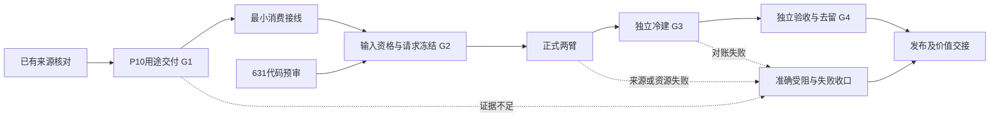

# R4 剩余执行计划：把固定动量候选推进到资金去留决定

| Field | Value |
| --- | --- |
| Design status | approved — Owner于2026-11-12要求按本计划三阶段八步启动执行 |
| Delivery gate | accepted — [完整比较与独立验收](../acceptance/research-capital-recovery-20261112.md)，completed / inconclusive / park |
| Parent | [资金回放合同与原计划](research-capital-replay-plan-v1.md) |
| Milestone / work item | [R4](https://github.com/rv198-star/Quanthus/milestone/18) / [#628](https://github.com/rv198-star/Quanthus/issues/628)，总线[#608](https://github.com/rv198-star/Quanthus/issues/608) |
| Shared data owner | P10 [#556](https://github.com/rv198-star/Quanthus/issues/556)；本次有界工作包标识`P10-DATA-R4-ACTION-001` |
| Existing delivery | [PR #631](https://github.com/rv198-star/Quanthus/pull/631)，叠加于#630；[执行后自审](../acceptance/research-capital-replay-20261112.md) |
| Current result | [价值简报](../work-items/research-capital-replay-value-brief.md)；完整经济比较`completed / inconclusive`；固定持仓用途`park` |
| This handoff | 执行后验收与价值交接；原事前计划正文保留，固定版本`375f7f690b5bda1d1356e7c05e345bd4ccba920f` |

2026-11-12执行记录：S1–S8按本计划交付，G1–G4通过；26文件HF固定发布与全回读完成。
候选/对照净收益+0.31660% / −2.31747%，年度差与前三笔依赖门槛未通过，按原规则停放。
实际身份、检查、失败和独立审阅见[恢复验收报告](../acceptance/research-capital-recovery-20261112.md)。以下正文为事前计划与原始预算基线。

## 1. 目标、当前位置和完成定义

R4要回答：**固定20日原始价格动量[2%,12%]，在既有P2费用、T+1持仓和资金约束下，是否值得进入后续稳健性验证？**
这笔研究的价值是作出继续或停放的资源决定，并保留可复用的资金消费者。

已交付原生消费者、双时钟、T日定量、正式运行和独立算法核对。候选在601186／2021-08-04的三条分红记录处停止，
已完成339个P2步骤；互斥对照完成全窗。下一段复用这些资产和原R2问题，保留旧正式结果、两次参照、失败及已消费窗口。

R4经济验收要求两臂完整执行、独立核对、独立角色审阅、事前分支决定及证据留存。两臂完整且结果为`supported`、
`not_met`或`inconclusive`时，可按其对应的继续/停放决定结案。数据或参照仍阻塞时，#628/R4保持OPEN，并交付准确差集。
源码在main的可用状态单独报告，由原集成专线维护。

第一笔建议仅给P10现有材料核对**45分钟**。本计划的其余工作是条件性估算，建议全会话累计主动工作上限4小时，
每过一个关口再使用后段预算。现有证据是否足够解释经济事件，是当前最主要的工期未知项。

## 2. 三阶段、八步骤与依赖

| 阶段 / 步骤 | 主责 | 执行动作 | 必交产物 / 出口 | 主动工作上限建议 |
| --- | --- | --- | --- | ---: |
| I / S1 冻结P10范围与已有来源 | P10语义负责人 | 核对三条latest行动、历史版本区间、原始artifact/receipt及原始实施文本的已有位置 | 固定证据清单、可访问/缺失分类；范围与停止条件入#556 | 20分钟 |
| I / S2 交付经济事件用途解释 | P10语义负责人 | 依原始单位与事件关系说明副本、替代、分项或未知，选定一种最小合格交付路线 | 用途manifest、源到有效事件关系、有效条款、未知集、独立校核收据；G1通过 | 25分钟 |
| II / S3 接入最小消费差集 | 研究E2主责 | 采用已有合格原生版本，或为P10窄用途包接入显式读取；正式与参照各自构建有效输入 | 版本化消费接口与负例；原选股/持仓/费用不变；代码可审阅 | 45分钟 |
| II / S4 重新资格并冻结恢复请求 | 研究主责 + 独立审阅者 | 核对组合输入、时钟/作用域、剩余未知风险；完成代码预审与检查，冻结准确Git/request/预算 | 新恢复request、环境/输入身份、检查回执、G2运行准入 | 30分钟 |
| II / S5 一次正式两臂计算 | 冻结后的E0执行者 | 守卫下构建一次共享前驱，运行候选/对照并生成事前指标 | 正式Guardian、完整结果或精确新hold；不改参数挑结果 | 15分钟 |
| II / S6 一次独立冷建复算 | 独立算法执行者 | 独立复制原生输入和用途包，以独立特征及Decimal会计重建 | 身份、选择、权益、现金分、成交、资金池、曲线和分支对账；G3通过 | 15分钟 |
| III / S7 独立角色审阅与去留判断 | 未承担作者职责的Sol/Astra角色 | 一部分代码预审在S5前完成；结果出来后审阅真实运行与科学分支 | 独立审阅记录，明确通过/修复/受阻及继续或停放；G4通过 | 合计60分钟 |
| III / S8 发布、价值交接与生命周期收口 | 研究主责 | 固定HF包全回读、CN02长期核验，更新结论/蓝图/工单与通俗简报 | 固定OID、留存收据、R4决定及下一笔安排 | 15分钟 |

上述工作合计225分钟；另留15分钟用于已定位故障的判断或必要验收，共240分钟。额外采集、范围扩展和新结果尝试须另行判断价值及预算。
这些是后继拨款建议，旧批原剩余4小时和总线8小时的实际余款不作推定；所有历史费用与曝光继续累计。



#631既有代码预审可与P10处理并行；用途适配差集需在S4补审。只有获得P10实际交付后，研究线才写定消费路线。
本计划没有将多个节点或多个模型同时运行列为前置。已有分工按[模型任务分级规范](../operations/research-model-task-standard-v1.md)执行：
单位/事件解释、消费时钟和恢复请求属于E2；资金用途接受属于E3；冻结后的命令可交Deepseek执行。
若拆分所需交接超过节省的成本，保留在主责执行者完成；不为模型比较另做研究。

## 3. 阶段I：P10的精确范围与交付合同

### S1：先找已有证据，不扩大搜集范围

固定消费者输入为`rv192/quanthus-base25-sealed@1923c874b43d47e69190a6dc9546e6fd8f3d1ca3`；DWD manifest SHA256
`8cd966be87fce02168c54e77c23e05f491c4afb204c4cbace42a2024eee1cdef`，126成员/192,098,985B。
原生行情2020-01-02..2021-12-31，2019仅日历。源content digest、原请求/结果和action完整ID在[既有交接§2/§6](../acceptance/research-capital-replay-20261112.md)。

本工作包首个经济键为security `security_afaa576cda4f2b0bd37af3b3395a27d8`、listing `listing_0621c4e83fdd19ed237e5c3b397ddd10`，
601186；record_date2021-08-03，ex_date2021-08-04。

| 记录 | latest每股现金 | 已有artifact SHA256 |
| --- | ---: | --- |
| base22_f10/dividend_implemented，action尾缀2129… | 0.23元 | 9744415f523c0771e22e65937e70817f789341dd6137fd76b047bd5e2f8e9fef |
| dividend_history，action尾缀cce1… | 2.30元 | a955a17c4930714a889854a812905ea0673fe4fc28074d1b2b6ce5dcfcd01ac5 |
| p10_retained_eastmoney_implementation，action尾缀e750… | 0.23元 | 0d71e207cf079d60aba0f913e31eb4298fa3cbb6ba50eb7ab94d55263e63a11e |

从原HF结果包和P10既有受管索引按上述SHA定位raw/receipt，核验已有`base22_action_authority`、`base22_canonical_action_revision`、
`base22_cash_restatement`能覆盖的真实范围。旧e750版本带knowledge_to，应与三条latest分开。
首20分钟形成定位表；缺失的artifact、receipt、原始单位文本或关系证据精确列出，停止无界遍历。

### S2：交付最小合格用途版本

交付路线按成本选择一次：

1. 已存在且已资格的原生修订/用途版本若完整满足本键语义、来源和异常合同，优先重绑该固定版本。
2. 否则交付窄范围、追加式P10用途包；原封板保留，研究消费者在S3显式接入。该路线只处理已声明键/规则覆盖范围。

P10必须从原始实施文本及其明确单位推导权益，交代三行是否为同一事件、副本、修订或分项。
单凭10倍关系、来源数量或“最新行”排序均不构成该合同的解释依据。

| 必需字段族 | 最低内容 |
| --- | --- |
| 包身份 | schema、用途版本、工作包/task/attempt、producer Git、规则/环境摘要、固定HF revision和逐成员SHA/bytes |
| 来源闭包 | 原DWD manifest/content及原生成员绑定；每个raw artifact、receipt、record/action/term ID与原始单位位置 |
| 生效关系 | security/listing/ex_date、稳定economic_event_id、各源行到事件的副本/替代/组合处置、有效每股条款及币种 |
| 时钟 | 原announced/effective/knowledge区间，以及此次用途判定真实记录时间；历史版本完整保留 |
| 作用域 | 精确证券/日期/规则、覆盖集合、排除集合、未知集、未覆盖范围的处置；限定回顾研究用途 |
| 资格收据 | 原始SHA核验、单位重建与事件关系检查，解释者和审阅者、结果等级及全部失败 |

**G1出口：**本经济键有唯一、可验证的有效事件/条款及完整源关系，且用途/时钟/异常范围可被消费者独立检查。
若证据只支持未知，P10交付`unavailable`及差集，后段保持停放；本轮不自动启动补采或全市场归并。
已有合格规则在45分钟内可明确覆盖其他键时，可同时列出那一精确范围及例外；不将单键通过外推为整个窗口合格。

## 4. 阶段II：消费接缝、恢复身份与有界执行

### S3：补齐实际接口差集

当前`scripts/research_capital_replay.py:load_native`只读原生行动/条款，`NativeCapitalStore.action_hold`对多记录键保持阻断。
其执行入口尚未提供P10 sidecar接入。采用窄用途包时，最小改动为：

- 增加显式、版本化输入描述，分别验证原生数据和用途包；在读取结果行前核对准确SHA、scope、schema及真实知识时钟。
- 仅在合格作用域内按已声明关系生成有效行动/条款；保存三条原生记录及处置审计。未覆盖或未知的键沿原守卫处理。
- 独立算法另写消费/转换检查，从独立原生副本和用途包重建；不读取正式者已解析的有效表或资金结果作为计算输入。
- 新组合content身份覆盖原生manifest/成员、P10用途版本/摘要、解释规则、代码、策略/费用、范围与schema；Frame/Signal/action统一绑定该身份。
- 原始源知识、P10真实判定知识和模拟市场时间分列保存；新cutoff须覆盖真实被消费材料，旧cutoff和旧结果保持原身份。
- 当前时钟及P2 run_id含001/A1固定标识。恢复接线须让request/task/attempt贯穿正式、参照、事件、Guardian及封包；
  新输入协议/时钟按实际差集版本化，旧v1解析与001/A1历史保持。不要仅改输出目录而沿用旧运行身份。

原生`authority`继续绑定HF封板的真实revision/content；P10用途身份和组合有效内容身份另列，不能把组合摘要写成原生封板摘要。
原生行、用途事件及模拟上下文各自的source_revision与lineage需明确对应其发布者。

若G1已有完整合格原生版本，S3仅实现实际必要的重绑/验证差集，节省的预算保留。

### S4：合成资格、剩余风险与请求冻结

至少提交以下反例及实际检查回执：错误来源/用途摘要、证券日期越界、重复有效事件、源行关系缺失、未知映射、同日不同条款、
每10股/每股明确转换样例、未知ex_date、未来知识时钟、默认PIT/official拒绝、原生买卖方向、参照required_venues，以及已写结果但Guardian失败时禁止采用。
同一输入应在正式者与参照独立构建中产生同一有效事件。费用、现金分和资金池继续使用原P2政策；新适配不改选股或执行公式。

用已封存的名义选择和A源资格清单列出剩余潜在行动/状态风险，用于估算恢复价值；此清单不改变选股、日期窗口或门槛，
也不将“所有未解键清零”作为全局前置。若已显示后继用途覆盖过窄，先形成继续/停放的ROI判断再分配正式次数。

恢复请求建议独立身份`RESEARCH-CAPITAL-002`，标明`recovery_of=RESEARCH-CAPITAL-001`及新输入/用途差集。
原001正式A1、参照A1失败和A2修复全部沿用历史与费用；002仍是同一研究问题、同一已消费开发窗。
请求须在首次正式运行前固定：

- 准确Git、原生HF revision/manifest/成员闭包、P10包固定OID/摘要、组合内容身份、完整25项环境锁与输入资格收据。
- 原20日动量[2%,12%]与互斥对照、2020–2021窗、T日定量、30%配置/21%缓冲/100股整手、原P2费用、最短合法持仓及原全部分支门槛。
- 清理旧scope.simulation_clock的A阶段“待资格”文字，明确实际双时钟；固定source cutoff、sidecar知识时钟及business边界。
- 本批预算/次数、恢复政策、来源/代码前后指纹、审阅者、控制渠道、HF输出和CN02留存入口。

运行前还要按[探索推进准则](exploration-governance.md)检索相关结论，准备新的版本化提案并执行`preflight --request <002_proposal>`。
对旧source-held结论的重开须引用真实P10新用途材料，保留R1/R2/001的成本与曝光；提案检查本身只检查结构，实际运行由该批TPlan和有效任务权限管理。

**G2出口：**G1通过，必要接线、自审、独立代码预审、负例及仓库要求检查通过；新请求身份与预算固定。
现有代码检查可按仓库逐字节闭包规则复用；执行代码、依赖或语义输入变更后，运行适用专项和完整`make check`并绑定新身份。

S4还须交给E0执行者一份已解析的argv/环境清单。保留当前CLI形状时，可按下方模板填写；用途身份从新request绑定。
这些是S3完成后的命令模板，尖括号在G2前替换为真实绝对路径与完整SHA：

```text
PYTHONPATH=src <locked_python> scripts/research_capital_replay.py formal
  --request <002_request> --work <formal_a1> --source-cache <verified_cache>
  --expected-git <full_git_sha> --guarded

PYTHONPATH=src <locked_python> scripts/research_capital_replay.py independent
  --request <002_request> --work <independent_a1> --source-cache <verified_cache>
  --author-job <formal_a1> --expected-git <full_git_sha> --guarded
```

每段须使用新的空Job目录，保存启动标记和真实退出码。源码预审、输入资格及守卫均通过后才执行；
来源受阻时遵循下方事前分支，发布使用对应结果等级的专用固定封包命令，由S4同时冻结。

### S5/S6：正式一次，独立冷建一次

正式Job按“原生/用途资格 → 一次T特征TMP → 一次有效执行/行动TMP → 两臂P2 → 固定决策”执行。
两臂共享Job-local前驱，记录每段耗时、行数、bytes和复用；下一Job按完整语义身份决定缓存有效性。
两臂须使用同一组合输入。旧对照可作为回归参照，新的主要比较使用新输入身份下的两臂结果。

独立者另复制全部所需原生与用途成员并核SHA，从原始输入冷建；独立pandas特征、Decimal会计与正式者逐项对齐。
先比较身份、日历范围及名义选择，再比较经济事件、权益、买卖/拒绝/携带、现金分、费用、资金池、每日财富、交易、尾部估值和决策分支。
**G3出口：**两臂完整且所有必要整数/身份/现金分一致。再次出现source hold时，保留已完成步骤与精确键，停止经济采用，转第7节失败路径。

S4须事前冻结受阻分支：正式者再次source hold时，先独立核对准确源键及到达条件；只有该核对仍需解决重要分歧或固定验收合同要求时，
才使用剩余的一次全窗冷建额度。完整、可用于经济决定的正式结果始终需要S6全量独立重建。
受阻/无效也要完成S8的失败证据与价值收口，发布等级与Guardian失败状态相符。

## 5. 阶段III：独立验收、结果分支和交付

S7由独立角色分两段完成：S5前审#631及恢复接线关键路径，S6后审真实输入/Guardian/结果及事前分支。
作者提交逐项证据，审阅者给出通过、定点修复或受阻；作者自审与独立算法复算分别列明。

沿用父计划§3及原请求的判据：两臂闭合交易各≥100、每年各≥20；候选净收益>0，候选减对照全窗净收益≥1个百分点、
两年差均正、最大回撤≤对照+2个百分点、静态扣掉候选前三笔正贡献后差仍正。样本门槛先于经济分支。

| 完整结果分支 | 具体决定 | R4处置 |
| --- | --- | --- |
| supported | 把精确候选列入后继有界稳健性验证候选，另给问题/预算 | 独立验收及S8完成后可结案 |
| not_met | 样本合格且候选绝对收益≤0或净差≤0，停放该固定持仓用途 | 同上，记录停放与重开条件 |
| inconclusive | 样本不足或其余门槛组合不清，停放，不调整阈值救结果 | 同上，保留条件与曝光 |
| blocked / invalid | 记录数据、时钟、资源或参照差集；受影响比较待恢复 | #628/R4继续OPEN；无经济正负标签 |

S8的首屏交付回答：两臂实际净收益和差值、费用/回撤/集中度、是否过线、改变哪笔资源决定、
保留什么资产、全部已知机器/人力成本及未知字段、下一步和剩余依赖。结论与蓝图只更新实际受影响facet。

## 6. 资源、命名、传输和运行边界

| 项 | 后继建议合同 |
| --- | --- |
| 节点 / 环境 | CN02现有隔离环境，开工重核身份和25项依赖；新Worker继续备用 |
| 资源 | 2线程、DuckDB3GiB、RSS6GiB、Job/scratch4GiB、单进程CPU≤1800秒、空闲盘≥12GiB；原生输入≤512MiB、单个用途包/结果包≤4MiB |
| 机器预算 | 正式≤900秒，独立≤1200秒；上传/回读每次≤180秒；本批计算/传输累计≤1 Worker-hour。完整仓库检查另记机器等待 |
| 次数 | 正式1次、独立冷建1次、固定包发布最多3次；额外结果attempt由TPlan在实际权限/预算内作定位后的恢复决定，超额另行分配 |
| 既有实测 | 001正式92.452秒、参照A1失败73.953秒、A2通过77.213秒；完整检查约14分钟。这些仅作估算输入 |
| P10用途包建议目录 | 既有私有HF `rv192/quanthus-research-r1`：`inputs/P10-DATA-R4-ACTION-001/P10-DATA-R4-ACTION-001-T1/A1/` |
| 恢复结果建议目录 | 同库：`runs/RESEARCH-CAPITAL-002/RESEARCH-CAPITAL-002-T1/A1/`；正式/参照角色分别入文件名 |
| 文件命名 | `<task_id>-<attempt_id>-<role>-<artifact>`；例如`RESEARCH-CAPITAL-002-T1-A1-independent-result.json.gz`；失败记录同规则保留 |
| CN02留存建议根 | `/srv/agentdock/quanthus-ops/research-capital-002/retained/`；P10自身工作根单独隔离，不覆写001和A资格目录 |
| 发布验收 | 专用manifest/READY，按真实结果等级核对完整性与所需Guardian/参照收据；固定HF OID逐文件全回读，CN02有价值证据逐项SHA核验 |
| 生命周期 | 原始/用途/结果及失败证据按其受管责任保留；TMP和输入副本完成30天后由任务维护者复核，审阅/恢复需要时延期 |

上述路径和schema在开工冻结时写入真实request，发布后固定版本不原地修改。完整成功包先通过双Guardian与独立核对；
失败包须保留失败Guardian和准确等级。通用R1封包器的阶段回执不能代填本资本/用途任务的验收。
代码从GitHub固定提交分发；HF凭据只在需用阶段加载，不进入计算子进程或结果包。
研究线核对#628既有任务级SSH例外的适用范围；P10按自身任务入口绑定有效控制渠道，职责/渠道不互相继承。

## 7. 失败、恢复和停止路径

| 触发 | 保留与立即动作 | 可恢复入口 |
| --- | --- | --- |
| S1原始artifact/receipt/单位文本缺失，或S2证据仍歧义 | 45分钟内交固定差集、已查位置、已知费用和unavailable；后段停放 | P10给出具名新证据/小范围补采成本后重新选择；不自动扩全市场 |
| 用途包改变未声明证券/日期、遗漏源关系、事件重复或时钟错误 | G1/G2拒绝，原封板与旧结果保留 | P10修订用途版本；消费者按新摘要重新资格 |
| 新用途需要广泛改引擎/策略，或S3/S4超额 | 在比较前交最小接口差集、完成部分和新估算 | 重新评估修复的实际受益；保留原守卫与研究问题 |
| 再次遇到不同的source hold | 停受影响臂，保留完成步骤、精确经济键和实际影响；原次数与费用累计 | 登记#556；按新增证据/修复成本判断下一笔，不进入自动“修一条再跑一次”循环 |
| Guardian超墙钟/RSS/Job/CPU，或结果存在但Guardian失败 | 当前attempt无有效经济结论；保存结果和监控失败 | 定位原因、剩余预算和授权动作后新attempt；失败结果仅按失败等级留存 |
| 独立身份/日历/名义选择不一致 | 在资金采用前停止，保留两份输入身份 | 先分清输入/参照/生产者差异，不把失败转成市场负结果 |
| 独立现金分/权益/费用/资金池不一致 | 停止采用；原正式与参照结果保持 | 确定错误归属，必要定点修复及恢复决策；不以容差吞掉现金差 |
| 代码预审有影响结论的缺陷 | S5前修复并检查；若在执行后发现则旧结果按影响标记无效/待评 | 精确新Git、影响范围和有界重验；不静默改原结果 |
| HF暂态失败/上传中断 | 保留固定完整包，最多3次发布或回读 | 从固定结果继续；有READY却校验不符时保留损坏证据，停止覆盖 |
| 独立审阅超预算或有未解关键发现 | 交审核差集与成本，保持待验收 | 仅对剩余关键问题另行分配，不用工程完成勾选代替结果验收 |
| 净收益/稳健性门槛未达或样本不足 | 按事前分支停放，交付资产与具体决定 | 有材料变化的新问题再评估；不换阈值、持仓期或窗口重试 |

任何新增实际共享质量问题仍由P10处理。局部债务按真实消费影响判断；本计划不把所有A阶段未知清零设为R4通用前置。

## 8. 可交给分支会话的三个工作包

| 工作包 | 输入 | 接手第一动作 | 交还本线的出口 |
| --- | --- | --- | --- |
| P10用途交付 / #556 | 本文§3、原78文件HF包、P10既有raw/receipt及相关治理模块 | 确认责任/渠道/45分钟范围，登记输入SHA和开始时间 | G1用途包或准确unavailable，固定OID、摘要、逐键关系及成本 |
| 研究恢复 / #628 | G1包、#631准确代码、原请求/依赖/结果和本文§4 | 选定一种交付路线，冻结最小消费差集；G2前不占正式结果次数 | 一次正式+一次独立结果、全部Guardian/失败、声明完整性的现金分对账 |
| 独立验收 / #628 | #630/#631、原自审与恢复差集、原/新请求、G1–G3全部收据 | 可先审既有关键代码；待新接线补审后开放S5 | G4审阅表、事前分支决定、采用范围、剩余差集与S8核对 |

建议直接沿#556/#628维护子清单，重试和日志留在所属工单；本次不增加平行修复工单。
原合并专线可独立接#631及后继接线PR；实际集成时处理叠加依赖、main新差异和账本追加历史，避免变成研究结果前置。

开工交接字段：`role/issue`、准确Git/request/HF/环境、权限和控制渠道、主动/机器累计预算、预期出口、
验收者、失败恢复点、写入根、凭据加载阶段、固定发布位置、TTL/清理责任及旧成本/曝光引用。
执行者回报字段：`completed/blocked/invalid`、真实artifact/OID/sha、已用主动时间与机器时间、失败和剩余差集、下一步。
本计划落实后，负责人应能从一次价值简报直接看出R4是否已得到经济去留决定。
