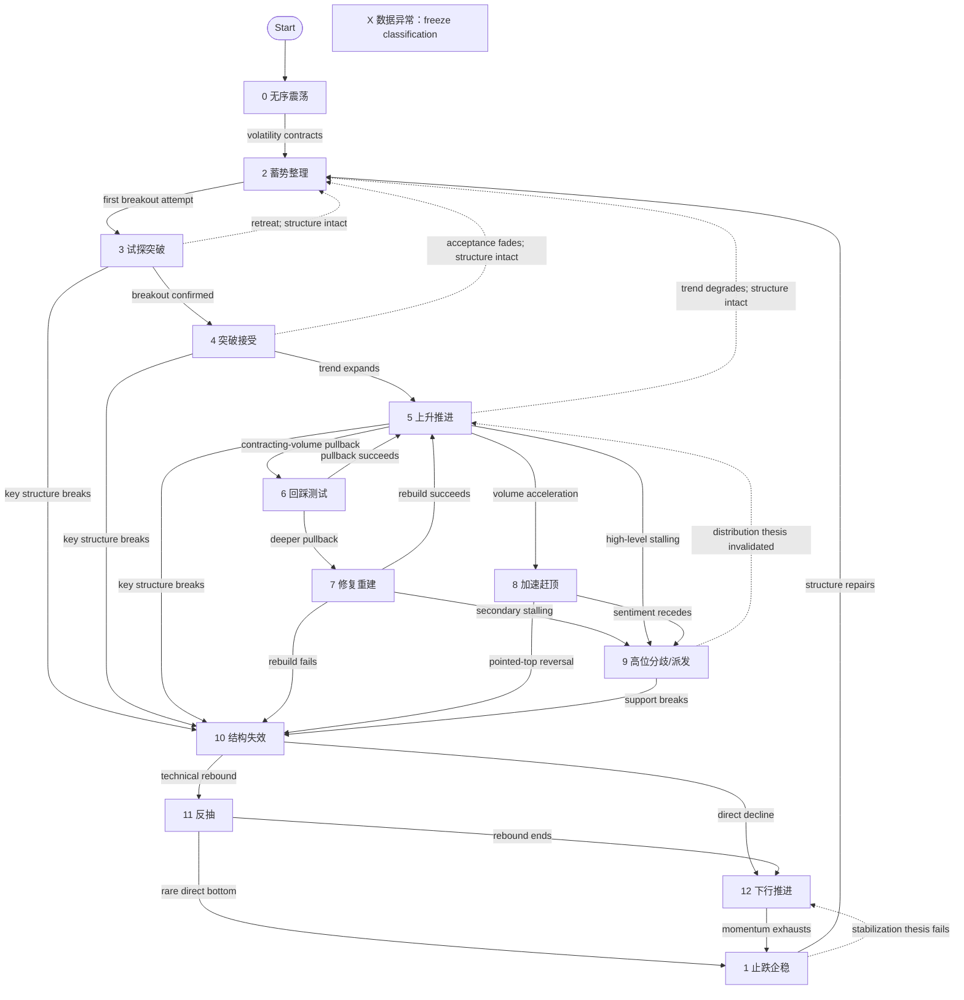

# Stock Stage State Machine

| Field | Value |
| --- | --- |
| Phase | P3 candidate label model |
| Design status | draft |
| Delivery gate | blocked |
| Authority | Non-governing concept; not active in research, backtest, simulation, or trading |
| Version | 0.3 |
| Governing work item | `P3-LABEL-002` (historical vocabulary owner; fixture acceptance does not activate this draft) |
| Qualification proposal | `stock-stage-qualification.md`; `stock-stage-data-dependencies.md` |

## 1. Purpose and boundary

This model describes the primary price/volume stage of one security. It is a candidate
single-valued label for the P3 feature and label system; it is not the position lifecycle state
machine and has no direct authority to create orders, force an exit, or bypass expert/veto logic.

The name "12-state model" refers to the twelve directional lifecycle states `1` through `12`.
The stage vocabulary also contains neutral state `0`, and the evaluator has freeze sentinel `X`,
so its outward representation may contain fourteen distinct codes. `ABSTAIN` is an epistemic
classification outcome, not a fifteenth market state. Whether it is represented as a separate
field or as a qualified outward `0/ABSTAIN` remains schema work, but it must never be pooled with
`0/DIRECTIONLESS` in evidence, metrics, or reports.

No numerical threshold, lookback, key-level algorithm, confidence rule, or minimum dwell time is
approved yet. Those details require versioned label cards and point-in-time acceptance evidence
before the model can leave draft status.

Implementation carriers discussed around this model, including agent frameworks, LLM arbitration,
UI extensions, language choices, and delivery roadmaps, are outside this document's authority.
They do not amend the current project architecture, phase plan, or work-item dependencies.

## 2. State vocabulary

### Neutral and exception control states

| Code | State | Semantic intent |
| --- | --- | --- |
| `0` | 无序震荡 (unordered oscillation) | Valid PIT evidence supports directionless price action; classifier uncertainty alone must not create this market-state label. |
| `X` | 数据异常 (data exception) | Suspension, consecutive one-price limit sessions, event gap, or another condition that makes ordinary stage inference invalid; freeze the stage decision. |

The evaluator must preserve three different meanings:

| Outcome | Meaning | Topology treatment |
| --- | --- | --- |
| `0/DIRECTIONLESS` | Valid observations support a neutral, directionless market stage. | Ordinary stage output; transitions may be defined by a future label card. |
| `ABSTAIN` | Inputs are usable, but directional evidence is insufficient, conflicting, or below the approved confidence rule. | No inferred stage transition; handling remains a versioned evaluator/schema decision. |
| `X` | Data or market conditions make ordinary inference invalid. | Interrupt and freeze; not an ordinary lifecycle transition. |

`X` is fail-closed control flow, not evidence of structural damage. It blocks or freezes a new
stage decision according to the future label card, while missing/invalid data alone must not force
a sale. Event gaps and one-price sessions remain observed facts with reason codes; they must not be
silently replaced by synthetic bars.

### Bottoming and accumulation

| Code | State | Semantic intent |
| --- | --- | --- |
| `1` | 止跌企稳 (stabilizing after decline) | Downward momentum is exhausted and stopping volume appears, but structure is not repaired. |
| `2` | 蓄势整理 (accumulation/consolidation) | Volatility contracts, the center of gravity stabilizes, and price action embeds an upward expectation. |

### Breakout and advance

| Code | State | Semantic intent |
| --- | --- | --- |
| `3` | 试探突破 (breakout probe) | First attack on a key level with expanding volume. |
| `4` | 突破接受 (breakout acceptance) | Price holds above the key level, pullback does not break it, and turnover confirms acceptance. |
| `5` | 上升推进 (advancing trend) | Trend expands with supporting price/volume behavior. |
| `6` | 回踩测试 (pullback test) | Contracting-volume retracement toward support without a broken trend. |
| `7` | 修复重建 (structural rebuild) | A deeper pullback is rebuilding structure and awaits a second confirmation. |

### Topping and decline

| Code | State | Semantic intent |
| --- | --- | --- |
| `8` | 加速赶顶 (accelerating top) | Volume and price accelerate, extension expands, and sentiment is exhausted; pointed-top path. |
| `9` | 高位分歧/派发 (high-level divergence/distribution) | High-volume stalling and gradual turnover; rounded-top path. |
| `10` | 结构失效 (structural failure) | A key support breaks and reversal is confirmed. |
| `11` | 反抽 (post-break rebound) | Technical rebound after failure, with insufficient volume or failure to reclaim the key level. |
| `12` | 下行推进 (declining trend) | Continuing decline or panic acceleration. |

## 3. Candidate transition graph

`X` is an interrupt applicable to any current state. When the input becomes valid again, the
evaluator resumes from the last valid state and current PIT evidence under rules that remain to be
specified; the diagram intentionally does not draw fourteen bidirectional edges to `X`.

### 3.1 Core transition rules

- `3 -> 4`: breakout confirmed.
- `4 -> 5`: breakout acceptance develops into an advancing trend.
- `3`, `4`, or `5 -> 2`: the bullish path retreats or degrades, but its key structure remains
  intact; return to accumulation/consolidation rather than declaring failure.
- `3`, `4`, or `5 -> 10`: the relevant key support breaks and structural reversal is confirmed.
- `5 -> 6 -> 5`: a normal pullback test followed by successful trend resumption.
- `6 -> 7`: the pullback is deeper and enters structural rebuilding.
- `7 -> 5`: rebuilding succeeds.
- `7 -> 9` or `7 -> 10`: rebuilding fails into distribution or structural failure.
- `5 -> 8 -> 9/10` and `5 -> 9 -> 10`: pointed-top and rounded-top paths remain distinct.
- `10 -> 11 -> 12` or `10 -> 12`: post-failure rebound or direct decline.
- `11 -> 1`: rare direct bottoming transition.
- `1 -> 12`: stabilization fails and the declining trend resumes.
- `12 -> 1`: declining momentum exhausts, closing the directional cycle.
- `9 -> 5`: renewed acceptance and advance falsify the distribution thesis.

The shared `3/4/5 -> 2/10` exits make structural integrity the branch condition. A failed
breakout from `3` remains a transition to `2`, not a separate state; loss of acceptance from `4`
and trend degradation from `5` follow the same high-level distinction. State `0` is reserved for
directionless price action and is no longer a classifier-uncertainty or structured
breakout-failure target.

The `1 -> 12` and `9 -> 5` edges are candidate falsification escapes, not a demand to complete a
mathematically symmetric graph. They prevent bottoming and distribution labels from becoming
one-way narratives after contrary evidence appears. No other reverse edge follows by analogy.

The transitions above are the currently proposed high-value constraints, not a complete
permission graph. Unspecified transitions must not be guessed during implementation.

## 4. Promotion requirements

Before implementation or activation, each state needs a label card containing exact PIT inputs,
features and versions, mathematical rules, thresholds, lookbacks, minimum history, reason codes,
confidence/abstention behavior, and counterexamples. Acceptance must include:

- deterministic golden cases for every code and listed transition;
- distinct fixtures and accounting for `0/DIRECTIONLESS`, `ABSTAIN`, and `X`, proving that market
  neutrality, epistemic uncertainty, and invalid-input freezes are not pooled;
- explicit precedence for `X`, with tests proving it cannot become an automatic structural exit;
- transition-frequency, dwell-time, conflict, and unreachable-state audits by market era;
- targeted counterexamples for `1 -> 12` and `9 -> 5`, with evidence that each edge resolves a
  stable falsification pattern rather than label noise;
- comparison of unconstrained outputs with any proposed dwell-time rule: temporal smoothing may
  suppress chatter, but it must not hide structural evidence or add unmeasured detection delay;
- separation of pointed-top `8` and rounded-top `9` behavior;
- an audit of the shared `3/4/5 -> 2/10` structural-integrity branch, including the `3 -> 2`
  breakout-failure path, before considering a new state;
- stratified, adjudicated human review with disagreements retained as evidence, plus multi-year
  out-of-sample stability; reviewer labels are not assumed to be ground truth merely by naming;
- no use of future bars, future key levels, or current classifications in historical replay.

Until these gates pass, the vocabulary is documentation-only and may be used for discussion or
shadow annotation, never as an official feature, expert input, or action rule.

## 5. Qualification design proposal

The 2026-09-07 proposal in [stock-stage-qualification.md](stock-stage-qualification.md) separates
rule conformance, as-of semantic identifiability, independent future settlement, and consumer value.
It treats multi-candidate ambiguity, dimensional overlap, and invalid inputs as different outcomes,
not as reasons to force a top-1 market stage. Its [field-level dependency matrix](stock-stage-data-dependencies.md)
traces each state to actual DWD fields and distinguishes existing bounded Facts v2 from unimplemented
geometry/activity/process extensions. Both documents remain draft; they do not amend the v0.3 codes,
activate a LabelCard, reopen the accepted fixture, authorize result-bearing research, or start daily
observation/strategy Shadow. Proposed work is in
[stock-stage-qualification-proposal.md](../work-items/stock-stage-qualification-proposal.md).

## 6. Exploration provenance and non-goals

This revision selectively records model-level questions raised in a 2026-07-28 exploratory
platform discussion. It does not adopt that discussion's Pi extension, Python/TypeScript split,
LLM classifier, TUI, feature list, parameter examples, trading guidance, or phased roadmap. The
revision creates no implementation commitment and does not authorize P3 work to start before its
existing dependencies and acceptance gates are satisfied.
