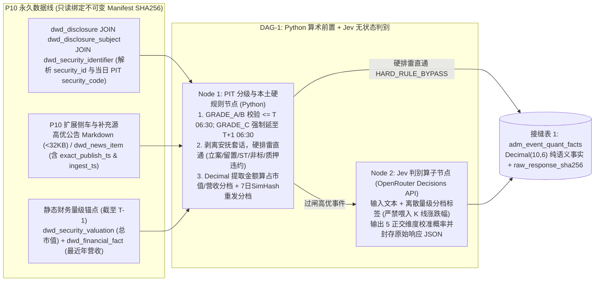
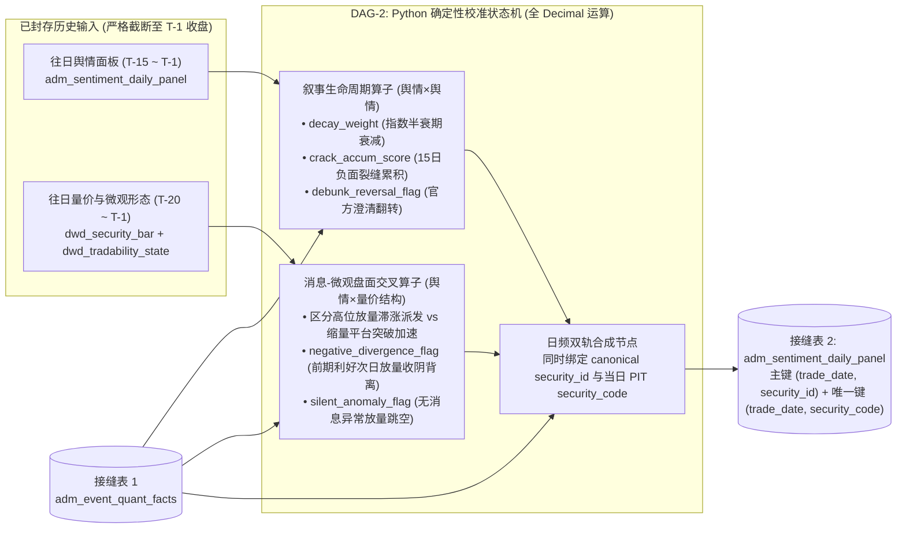
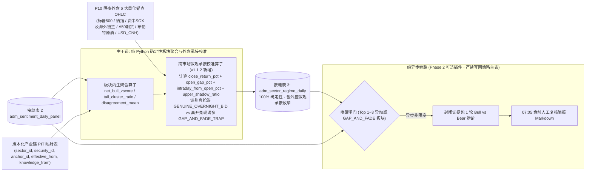

# Quanthus 股市舆情专家模块：PRD 与工程设计文档（v1.1.2 实战增强封板版）

* **文档版本**：v1.1.2（独立终审 `ACCEPTED` · 闭环三轮 16 项代码契约审计 + 11·23 跨市场实战压力测试反哺增强 `AUD-17`）
* **前序版本**：v1.0（初版设计稿） → v1.1（首轮修订） → v1.1.1（三轮契约封板）
* **文档定位**：产品需求规格（PRD） + 详细工程设计（EDD） + 关键架构决策记录（ADR） + 独立审计与实战反哺核销单
* **目标系统**：Quanthus 量化研究与决策平台（仓库 `rv198-star/Quanthus`，对齐 CN02 分支基准 `9de1cdb9` 与 `4321a0cb`）
* **治理与规范对齐**：
  * `AGENTS.md`（PIT 铁律 / 经济身份唯一性 / Fail-Closed 容错 / 本地验收完整语义闭包）
  * `config/data-ownership.v1.json`（P10 永久数据线采集垄断权与消费线职责红线）
  * `docs/architecture/adr-0016-value-proportional-warehouse-quality.md`（价值成比例质量铁律）
  * `docs/design/p10-dws-adm-standard.md`（P10 DWS/ADM 第 7 节 13 项强制契约字段与第 8 节封包规范）
  * `src/quanthus/expert_protocols.py` 与 `src/quanthus/aggregator.py`（专家协议签名、无状态独立求值与约束区间交集）
  * `config/forward-validation/scorecards/p6-role-scorecards.v1.json`（22 交易日独立评估块与实质亏损分类评分卡）

## 版本演进与修订纪要（v1.0 → v1.1.2）

1. **时钟锁与盘前调度归属闭合（REV-01 + AUD-13）**：新增 `PreOpenOrderOverlay`（Level 1 默认路径）与 `SnapshotPromoter`（Level 2 联合打分路径），规避 `ExpertContext` 单一 `knowledge_cutoff` 相等性熔断；明确 **Phase 1 严守零新增采集（仅消费 CN02 现行 `17:30 / 21:15 CST` P10 盘后产出做离线回放）**，而 `21:30 / 02:00 / 06:30 BJT` 隔夜微批与 `09:08 BJT` 候选池专属脉冲采集统一归口至 Phase 2 的 `P10-DATA-*` 工单，P11 保持绝对零外部抓取。
2. **数仓物理 Schema、双键对齐与三档 PIT 防穿越（REV-02 + AUD-15/16）**：通过 `dwd_disclosure JOIN dwd_disclosure_subject` 解析 `security_id`，并在日频宽表中冗余经当日 `dwd_security_identifier` PIT 解析的 `security_code`（建立 `(trade_date, security_code)` 辅唯一键直连 `ExpertContext`）；巨潮历史 `00:00:00 BJT` 伪毫秒戳强制划入 `GRADE_C_DATE_ONLY_EOD`（仅 `T+1` 可见）；全表采用 `Decimal(10,6)` 并补齐 P10 ADM 全部 13 项强制契约字段。
3. **聚合稀释悖论、无状态独立协同与算术前置（REV-03 + AUD-14）**：常态无催化或微弱催化强制返回 `ExpertApplicability.ABSTAINED` 防分母稀释与“温和利好反杀”；持仓态否决器强制返回 `ABSTAINED` 保护 `merged_constraints` 止损规则；补齐 `SectorRegimeConstraintExpert` 必填非空 `stop_rule` 与 `hold_rule`，双专家基于同一特征无状态独立计算下界越界谓词；订单占市值/营收比值由 Python `Decimal` 前置分桶后再送入 [OpenRouter Decisions API](https://openrouter.ai/docs/guides/features/decisions)。
4. **砍除主干道生成式辩论（REV-04）**：将参考 [TauricResearch/TradingAgents](https://github.com/tauricresearch/tradingagents) 的生成式多空辩论移出量化主干道（降级为 Phase 2 可选异步人工简报插件），`adm_sector_regime_daily` 改由纯 Python 确定性状态机生成。
5. **主升浪豁免矩阵与稀疏事件统计验收重构（REV-05）**：新增缩量突破加业绩实锤的 `CONFIRMED_ACCELERATION` 豁免态；产业链强制携带双时间轴 PIT 证据；废除零膨胀全截面 `Rank IC`，改用活跃子集分层超额、回归 `t-stat` 与 22 日块 `Net Veto Value`。
6. **外盘隔夜锚点微观承接增强（v1.1.2 新增 · AUD-17）**：针对“盘前暴涨一步计价、开盘后水下派发收假阴长上影”的跨市场诱多陷阱，在 `GAP-4` 与板块校准算子中新增开盘至收盘真实承接率 `intraday_from_open_pct` 与上影线比例 `upper_shadow_ratio`（含 `H == L` 零除保护），自动识别 `GAP_AND_FADE_TRAP` 并锁定板块为 `CONTESTED` 拒绝早盘追高。

## 1. 背景演进与核心设计哲学

### 1.1 问题起源：从“个人 AI 风险哨兵”到“机构级盘前风控与催化专家”

本模块吸收轻量级 AI 风险监测工具的四条实战原则，并按 Quanthus 工程红线完成系统级重构：

1. **盯“灰犀牛裂缝”，不猜“黑天鹅”**：不预测大盘涨跌，只提取可核验、可溯源、可跨期对比的客观监管/经营异常前兆与业绩预期差信号。
2. **规则与执行解耦**：先固化版本化规则契约与精确模型快照，再绑定无状态判别算子与确定性状态机，杜绝生成式模型临场发挥导致的标准漂移。
3. **客观严重度与头寸敞口解耦**：事件自身的破坏力/催化量级（`magnitude_score`）同组合当前持仓及候选暴露分开建模、正交归因。
4. **先守后攻、断流禁买不强平**：舆情首要职责是开盘前拦截生存级排雷风险（`BLOCK_NEW`）；当数据断流、超期或验签失败时，仅阻断当日新开仓，绝不视为结构破位，绝不触发存量持仓强制平仓或抹除存量止损约束。

### 1.2 核心架构决策记录（ADR-S01 至 ADR-S07 · v1.1.2 封板版）

| 决策编号 | 决策主题 | v1.1.2 终审定稿方案 | 核心决策依据与审计加固说明 |
| :--- | :--- | :--- | :--- |
| **ADR-S01** | **业务通道与协议映射** | **非对称双通道 + 常态弃权机制**（空仓态 `VetoExpert` 硬闸门 + `ABSTAINED`-First 催化共振） | 利空追求高召回一票否决（`BLOCK_NEW`），利好追求高精确共振。因 `aggregator.py` 采用等权算术平均，催化专家在无高优事件或强度不足时必须返回 `ABSTAINED`；否决专家在持仓态必须返回 `ABSTAINED`，防止置空 `GovernanceResult.merged_constraints`。 |
| **ADR-S02** | **实时性窗口与采集归属** | **P10 承接隔夜微批与 `09:08` 脉冲采集 + P11 本地 `06:30 / 09:10 BJT` 双截点只读判定** | 严守 `data-ownership.v1.json`：Phase 1 零新爬虫，仅用存量盘后 DWD 离线回放；Phase 2 由 P10 统一调度 `21:30 / 02:00 / 06:30 BJT` 微批及 `09:08 BJT` 候选池专属脉冲，P11 在 `06:30` 与 `09:10` 纯本地读取已封存快照，既保 `06:50` SLA 又堵住早盘 `06:30–09:08` 突发停牌与政策盲区。 |
| **ADR-S03** | **System 1/2 与算术分工** | **System 2 离线编译 + Python 定点算术前置 + System 1 判别执行** | 依据 [openrouter-decisions 官方能力边界规范](https://openrouter.ai/skills/openrouter-decisions)，单 Token 判别模型不擅长数值除法与日期推算。订单金额提取、占总市值/年营收百分比分桶、近 7 日标题 SimHash 去重全部在 Python 前置节点用 `Decimal` 完成，仅将离散分档枚举送入模型。 |
| **ADR-S04** | **语义判别底座与零漂移封存** | **OpenRouter Decisions API（锁死 [`typesafe/jev-1.13`](https://openrouter.ai/typesafe/jev-1.13) 快照 `20260917`）+ 原始响应封存** | Jev 1.13 输入 `$0.042 / 1M tokens`、输出零计费，且协议兼容 [`typesafe/jev-1.14`](https://openrouter.ai/typesafe/jev-1.14) 与 [`google/gemini-decision-1`](https://openrouter.ai/google/gemini-decision-1)。首次 API 返回概率立即量化为 `Decimal(10,6)` 并连同原始 JSON 封存 SHA256，重放模式禁止联网、强制只读封存回执，确保 `0.000000` 绝对零漂移。 |
| **ADR-S05** | **板块状态机与外盘承接校准** | **主干道纯 Python 确定性板块聚合（含外盘开盘承接与上影线识别）+ 旁路异步简报** | 将生成式多空辩论彻底移出量化主干道；`adm_sector_regime_daily` 由确定性算子结合外盘 OHLC 微观承接结构（区分真抢筹与盘前高开回吐诱多 `GAP_AND_FADE_TRAP`）产出；多空辩论仅作异步人工简报，物理禁止写回策略字段。 |
| **ADR-S06** | **无状态事实与盘面校准隔离** | **纯语义事实表（`raw_*`）与量价微观形态校准列（`effective_*`）双轨并列** | 严禁向 Jev 喂入 K 线涨跌幅以防动量混杂污染。校准矩阵引入 K 线形态鉴别，区分“高位放量滞涨派发（`PRICED_IN_RISK`）”与“缩量锁仓突破后的业绩实锤主升浪（`CONFIRMED_ACCELERATION`）”。 |
| **ADR-S07** | **零 PDF 入库、三档 PIT 与完备 ADM 契约** | **ODS `<32KB` Markdown 侧车 + 历史零点伪戳强制 `T+1` 可见 + 13 项完备 ADM Policy** | 高优公告在 `TMP` 转精简 Markdown 即焚；严格按 `docs/design/p10-dws-adm-standard.md` 声明全部 13 项必填元数据（含 `semantic_digest`、`acceptance`、各表 `role` 与不可变上游 manifest SHA256），最后原子写入 `READY`。 |

## 2. 产品需求规格（PRD）

### 2.1 目标消费者与职责边界

1. **系统级消费者（核心主干）**：
   * **盘前订单准入覆盖层（`PreOpenOrderOverlay`，Level 1 默认激活路径）**：在 `T日 09:15` 集合竞价前读取 `adm_sentiment_daily_panel`（及 Phase 2 激活后的 `adm_preopen_delta_veto`）与 `adm_sector_regime_daily`，按 `(trade_date, security_code)` 精确命中 `T-1 close` 生成的候选买单，执行排雷取消与逆风/高开兑现板块上限裁剪。
   * **形式化治理聚合器（`aggregator.py`，Level 2 共振激活路径）**：经 `SnapshotPromoter` 将 `T-1 close` 量价特征与 `T日 06:30` 舆情特征显式重绑至同一复合快照后，由三个无状态独立专家（`SentimentTailVetoExpert`、`SectorRegimeConstraintExpert`、`SentimentCatalystScoringExpert`）按标准协议参评。
   * **前瞻评估与评分卡系统（`forward-validation/scorecards`）**：按 22 交易日独立块（`collection_block_22_sessions`）统计影子表现、净避险贡献与实质亏损归因。
2. **人工消费者（纯旁路辅助）**：
   * **系统 Owner**：在 Phase 2 在线运行期每日 `07:05` 前接收盘前复核简报，仅用于人工复核与离线迭代规则，绝不构成自动交易指令。

### 2.2 非目标（Non-Goals）与硬安全红线

* **消费线绝对零网络抓取**：P11 舆情专家代码库在运行期严禁直接访问巨潮、新浪、CNBC 或任何行情网站（容器运行态除受控的 OpenRouter 算子网关外无外部采集权限）；一切原始公告、Markdown 侧车、快讯与外盘 OHLC 快照均须由 P10 永久数据线准入落盘并附带 `READY` 与 `manifest.json`。
* **严禁触发存量持仓卖出或清空止损约束**：任何舆情信号或断流异常，在自动链路中仅对空仓候选标的（`position_state == "empty"`）输出 `BLOCK_NEW` 或压降新开仓上限；对在途持仓一律保持 `ABSTAINED`，存量持仓退出完全服从既有 `exit_arbitration.py` 四源仲裁。
* **严禁后视镜概念成分回测**：无历史公开披露 `knowledge_from` 证据的自定义产业链成分股，严禁参与历史年份回测。

### 2.3 运行模式与调度 SLA（分阶段严格对齐 P10 边界）

* **Phase 1（离线回放与盘后日终验证模式 · 复用 CN02 现行 `17:30 / 21:15 CST` P10 调度）**：
  * 不新增任何早盘定时器；每日在 P10 `daily / recovery` 容器完成 `dwd_disclosure` 与高优 Markdown 侧车落盘后触发离线评估批处理，严格按三档 PIT 规则生成历史与日终影子宽表。
* **Phase 2（盘前实时双截点模式 · 依赖 P10 盘前工单上线后激活，时区固定 `Asia/Shanghai`）**：

| 阶段名称 | P10 采集落盘截止 | P11 计算触发与落盘 SLA | 覆盖范围与核心动作 | 故障安全行为（Fail-Closed） |
| :--- | :--- | :--- | :--- | :--- |
| **夜间预热微批 A/B** | `T-1 21:25`、`T 01:55` | `21:30`、`02:00` 触发（非阻塞预热） | 对已入库过闸高优公告与快讯调 Jev 算子，按 `content_sha256` 写入幂等缓存 | 单次超时不阻断，留待 `06:30` 统一补算 |
| **盘前主结算快照** | `T 06:30:00`（锁死 `knowledge_cutoff`） | `06:30` 触发，**`06:50` 前**写出 `manifest.json` 与 `READY` | 处理尾盘增量 → 纯内存跑 DAG-2 与板块外盘承接聚合 → 产出 ADM 主表 | 若 `06:50` 未见有效 `READY`，当日空仓候选默认按 `BLOCK_NEW` 阻断新开仓 |
| **候选池极速快检** | `T 09:08:00`（P10 仅抓候选 Top 20 + 持仓股增量标题与停牌表） | `09:10:00` 触发，**`09:10:05` 前**（`< 5s`）写出 `READY` | 纯 Python 本地正则硬排雷（零外网 API 调用），输出 `adm_preopen_delta_veto` | 若 P10 `09:08` 脉冲缺失或超时，按配置阻断当日新开仓并告警，在途持仓不动 |

## 3. 工程架构、局部数据血缘与代码接线设计（EDD）

### 3.1 局部图 1：纯事实语义与算术前置线（无状态主路径 / DAG-1）

**职责**：从 P10 不可变输入包解析规范 `security_id` 与当日 PIT `security_code`，先由 Python 完成本土话术硬排雷与金额比值分桶，再调用 Jev 输出校准概率并封存原始回执。



* **高含金量公告类别强制提权**：第一阶标题门控除常规业绩预告/快报、重大合同、增减持、并购重组、监管处罚外，**强制将《投资者关系活动记录表》（机构调研纪要）、《监管问询函/关注函回复》与《股票交易异常波动及风险提示公告》列为必过闸类别**。
* **A 股“委婉太极爆雷话术”剥离词典**：Node 1 内置 `config/sentiment/cn-euphemism-guard.v1.json`，预先剥离“上述事项不会对公司日常生产经营造成重大不利影响”、“公司控制权未发生变化”等套话后缀；凡命中**实控人/高管留置、立案调查、违规担保、非标审计意见、控股股东质押违约被动减持、财务资助逾期、主要银行账户被冻结**，一律直通 `HARD_RULE_BYPASS` 置 `entry_veto = True`。
* **Python 定点算术前置**：Node 1 将提取到的合同/增减持/处罚金额按 `Decimal` 除以 `T-1` 总市值及最近年营收，生成离散枚举 `amount_to_revenue_bucket`（`NO_AMOUNT` / `LT_1PCT` / `PCT_1_TO_10` / `PCT_10_TO_50` / `GT_50PCT`）与 `prior_7d_similarity_bucket`（`FIRST_SEEN` / `FOLLOWUP_UPDATE` / `NEAR_DUPLICATE_REPOST`）注入 Jev `state`。

### 3.2 局部图 2：时空上下文与微观形态校准线（有状态路径 / DAG-2）

**职责**：结合 `T-15 ~ T-1` 往日舆情记忆与 `T-20 ~ T-1` 量价微观形态，通过纯 Python `Decimal` 状态机产出双轨并列的个股日频面板。



**“消息-微观盘面交叉矩阵”（含主升浪二波实锤豁免）**：

| 当日纯语义特征 | 近期量价与 K 线微观结构（`T-10` 至 `T-1`） | 状态判定枚举 | 校准系数与风控/策略含义 |
| :--- | :--- | :--- | :--- |
| **强利好催化** | 低位横盘 / 缩量企稳 / 首日温和放量突破 | `FRESH_CATALYST` | 预期尚未充分计价，校准乘数 `1.000000`，保留完整催化分 |
| **硬核实锤利好**<br>(`LANDED_FACT` + 业绩/大单 `>=10%` 营收) | 近 10 日超额 `>15%`，但前 3 日**温和缩量锁仓、无长上影派发** | `CONFIRMED_ACCELERATION` | 主线龙头实锤换手加速，校准乘数 `0.850000`，不误杀二波主升浪 |
| **软性利好或跨市场映射催化**<br>(意向协议 / 治理修复 / 外部映射抢跑) | 近 10 日超额 `>15%` **或前一日午盘已抢跑放量，或外盘锚点触发 `GAP_AND_FADE_TRAP`** | `PRICED_IN_RISK` | 潜伏资金借明牌兑现派发（见光死高危），催化乘数压降至 `0.150000` 并禁止共振加分 |
| **中高级利空风险** | 高位滞涨 / 均线破位 / 放量下跌 | `DOUBLE_KILL_VETO` | 基本面与技术面戴维斯双杀，直通 `entry_veto = True` |
| **中低级非生存利空** | 前期已深跌（超额 `<-15%`）+ 缩量企稳承接 | `EXHAUSTED_WATCH` | 利空钝化观察（**生存级硬排雷如立案/留置/ST 永不豁免**） |
| **前序强利好落地** | 落地当日高开低走（开盘至收盘跌幅 `>4%` 且放量） | `NEGATIVE_DIVERGENCE` | 筹码松动确认，未来 5 个交易日该标的催化信任乘数锁定 `0.200000` |
| **无过闸有效消息** | `T-1` 量比 `>3.0` 且绝对涨跌幅 `>6%` | `SILENT_ANOMALY` | 暗流异动标记，纳入人工复核简报重点关注池 |

### 3.3 局部图 3：确定性板块顺逆风聚合与外盘承接校准线（DAG-3 · v1.1.2 增强）

**职责**：主干道采用纯 Python 确定性公式，融合成分股面板与**隔夜外盘锚点微观承接结构**，产出 25–35 个核心产业链的顺逆风状态与仓位上限乘数；生成式多空辩论剥离为纯异步人工简报辅助。



#### 算子 `S2`：隔夜外盘锚点微观承接公式与板块校准规则（`v1.1.2` 新增）

设某产业链绑定的外盘基准锚点（美股指数/龙头取常规交易时段 `09:30–16:00 ET` 完整日 K 线；24h 连续交易期货/汇率取北京时间 `T-1 15:00:00` 至 `T 06:00:00` 固定窗口合成 K 线）前收、开、高、低、收分别为 `P_prev, O, H, L, C`（均为正数 `Decimal`）：

* **隔夜账面涨跌幅**：`close_return_pct = (C - P_prev) / P_prev`
* **开盘跳空幅度**：`open_gap_pct = (O - P_prev) / P_prev`
* **开盘至收盘真实承接率**：`intraday_from_open_pct = (C - O) / O`
* **上影线比例（内置 `H == L` 零除安全保护）**：
  * 当 `H > L` 时：`upper_shadow_ratio = (H - max(O, C)) / (H - L)`（严格有界于 `[0.000000, 1.000000]`）
  * 当 `H == L`（一字平盘或无波动）时：强制赋值 `Decimal("0.000000")`，严禁触发除零异常。

| 外盘微观形态枚举 (`overnight_anchor_pattern`) | 确定性判定条件（`Decimal` 阈值） | 对关联 A 股产业链 `sector_regime` 与 `risk_multiplier` 的校准作用 |
| :--- | :--- | :--- |
| **`GENUINE_OVERNIGHT_BID`**<br>(真金白银承接走高) | `close_return_pct >= +0.025000` 且 `intraday_from_open_pct >= -0.005000` 且 `upper_shadow_ratio <= 0.450000` | 确认跨市场正向共振：允许板块进入 `TAILWIND`，维持 `risk_multiplier = 1.000000`。 |
| **`GAP_AND_FADE_TRAP`**<br>(盘前一步计价/开盘兑现诱多) | `open_gap_pct >= +0.050000`（大幅跳空高开）且满足（`intraday_from_open_pct <= -0.015000` **或** `upper_shadow_ratio >= 0.550000`） | **防隔夜明牌高开低走护栏**：即便账面 `close_return_pct` 仍大涨（如 `+20%` 以上），严禁判为 `TAILWIND`！强制将关联板块锁定为 **`CONTESTED`**，压降 `risk_multiplier <= 0.600000`，并将同链个股当日映射催化强制降级为 `PRICED_IN_RISK`（`SentimentCatalystScoringExpert` 保持 `ABSTAINED` 拒绝追高）。 |
| **`GAP_AND_FLUSH_HEADWIND`**<br>(跳空破位放量下杀) | `close_return_pct <= -0.025000` 且 `intraday_from_open_pct <= -0.010000` | 确认外部冲击恶化：强制将关联板块置为 `HEADWIND`，压降 `risk_multiplier <= 0.400000`（若叠加板块内生尾部利空则进一步下调）。 |
| **`NEUTRAL_DRIFT`**<br>(常态温和波动) | 不满足上述三类显著形态的其余常规区间 | 外盘不额外改写板块内生状态，完全由成分股 `S1` 算子决定。 |

### 3.4 局部图 4：对接 Quanthus 核心代码的精确协议契约

严格匹配 `src/quanthus/expert_protocols.py` 与 `src/quanthus/aggregator.py` 的全部构造期不变量校验：

1. **双键对齐与双模式时钟桥接契约**：
   * 所有消费侧查询统一使用表 2 已预解析并校验唯一性的 `(trade_date, security_code)` 命中 `ExpertContext.security_code` 或 `OrderIntent.security_code`，同时在审计回执中记录底层 `security_id`，严禁消费侧用字符串拼接反推身份。
   * **Level 1 盘前覆盖层（`PreOpenOrderOverlay`）**：不改动 `T-1 close` 选股上下文；在开盘前对拟执行买单做确定性拦截（`CANCELLED_PREOPEN_SENTIMENT_VETO`）或按 `risk_multiplier` 向下取整 100 股整手裁剪数量。
   * **Level 2 快照提升器（`SnapshotPromoter`）**：构建复合快照 `snapshot_id = f"preopen-{trade_date}-0630"`（`knowledge_cutoff = T日 06:30:00+08:00`），将 `T-1 close` 特征与 `T 06:30` 舆情特征统一封装为相同 `snapshot_id` 与 `knowledge_cutoff` 的 `FeatureFact` 注入 `ExpertContext`。
2. **无状态独立下界协同谓词（消除运行期专家耦合与 `constraint_conflict`）**：
   * 定义纯函数谓词 `is_sub_floor(risk_multiplier, B_max, policy_min_pos) := (B_max * risk_multiplier < policy_min_pos)`。
   * `SentimentTailVetoExpert` 与 `SectorRegimeConstraintExpert` 互不通信、无共享可变状态，各自从同一个 `ExpertContext.feature_facts` 读取 `feature.sector_risk_multiplier` 及冻结策略常量 `(B_max, policy_min_pos)` 独立求值该谓词。
3. **`SentimentTailVetoExpert`（实现 `VetoExpert`，`authority = VetoAuthority.STRATEGY`）**：
   * 若 `context.position_state != "empty"`：无条件返回 `VetoOutput(..., applicability=ExpertApplicability.ABSTAINED, applicability_reason="entry_only_on_held_state", reason_code="held_position_untouched", allow=None, required_action=None)`，确保 `aggregator.py:299` 不会将持仓标的的 `merged_constraints` 置空。
   * 若 `context.position_state == "empty"`：当 ① `entry_veto == True`、② `is_sub_floor == True`（输出 `reason_code="sector_cap_below_minimum_floor"`）、或 ③ 舆情特征缺失/超期/验签失败时，一律返回 `APPLICABLE + allow=False + required_action=RequiredAction.BLOCK_NEW`；其余正常放行态返回 `APPLICABLE + allow=True + required_action=RequiredAction.NONE`。
4. **`SectorRegimeConstraintExpert`（实现 `ConstraintExpert`，`scope = ConstraintScope.UNIT`）**：
   * 当特征缺失或 `is_sub_floor == True` 时：返回 `ConstraintOutput(..., applicability=ExpertApplicability.ABSTAINED, minimum_position=None, maximum_position=None, stop_rule=None, hold_rule=None, scope=None)`。
   * 当 `is_sub_floor == False` 时：严格按 `expert_protocols.py:253-267` 非空要求返回：
     * `minimum_position = Decimal("0.000000")`
     * `maximum_position = B_max * risk_multiplier`（满足 `0 <= min <= policy_min_pos <= max <= 1`）
     * `stop_rule = "sector_regime_headwind_cap_v1"`（非空稳定令牌）
     * `hold_rule = "sector_regime_hold_within_cap_v1"`（非空稳定令牌）
     * `scope = ConstraintScope.UNIT`
5. **`SentimentCatalystScoringExpert`（实现 `ScoringExpert`）**：
   * 仅当 `catalyst_applicable == True`（即当日存在过闸催化、状态为 `FRESH_CATALYST` 或 `CONFIRMED_ACCELERATION`，且关联外盘未触发 `GAP_AND_FADE_TRAP`）且映射后 `signal * confidence >= policy.minimum_entry_score` 时，返回 `APPLICABLE` 参与共振；其余一切情形返回 `ExpertApplicability.ABSTAINED`（`signal=None, confidence=None`），彻底杜绝分母稀释与温和利好反杀。

## 4. 核心数据模型、Decisions API 规范与完备 ADM 契约

### 4.1 Decisions API 5 维正交算子规范

调用 `POST https://openrouter.ai/api/alpha/decisions`，配置文件锁死精确快照 `typesafe/jev-1.13-20260917`（禁止使用浮动别名），共享单次 `state`（硬上限 `<= 28,000 bytes`）并发评估 5 个正交维度：

| 正交维度 | 量化痛点 | 原语类型 | 输出原子字段（落盘全转 `Decimal(10,6)`） |
| :--- | :--- | :--- | :--- |
| **1. 事实确定性** | 区分实锤落地与框架画饼/传闻 | `choice` | `certainty_class`: `LANDED_FACT` / `INTENTION_PLAN` / `RUMOR_OPINION`；保留 `p_landed` |
| **2. 方向与传导通道** | 区分多空极性及基本面定价路径 | `choice` × 2 | `polarity`: `BULLISH` / `BEARISH` / `MIXED` / `NEUTRAL`（保留 `p_bull`, `p_bear`）；`impact_channel`: `EARNINGS_ORDER` / `SUPPLY_PRICE` / `POLICY_MACRO` / `CAPITAL_GOVERNANCE` |
| **3. 边际预期差** | 基于 Python 预计算分档判断实质增量 | `noul` + `score` | `has_substantive_delta_prob` (`noul`)；`surprise_score` (`score 0..4` 概率加权期望) |
| **4. 冲击量级与半衰期** | 区分一日游脉冲与季度级逻辑重塑 | `score` + `choice` | `magnitude_score` (`score 0..4`)；`horizon_class`: `NOISE_1D` / `SWING_1_4W` / `STRUCTURAL_1Q_PLUS` |
| **5. 尾部风险与板块外溢** | 高召回捕捉生存级风险与全行业共振 | `noul` × 2 | `p_tail_risk`（生存级风险概率）；`p_sector_spillover`（产业链外溢概率） |

**确定性封存要求**：所有判定准则（含忽略“不影响正常生产经营”及识别“恢复职务但保留独立调查/合规审查尾巴”的反例条款）完整写入每个问题的 `instructions` 与 `criteria`；首次 API 返回连同 `(request_sha256, model_snapshot, raw_response_json, response_sha256)` 落入不可变证据侧车，重放模式只读该侧车，禁止发起外部请求。

### 4.2 100% 满足 P10 第 7 节规范的强制 ADM Policy 契约

严格对照 `docs/design/p10-dws-adm-standard.md` 第 7 节全部 13 项强制要求，定义 `config/adm/sentiment-expert-adm.v1.json` 完整契约结构：

```json
{
  "adm_id": "adm.sentiment-expert-daily",
  "adm_version": "1.1.2",
  "owner": "P11-sentiment-expert",
  "purpose": "A-share disclosure and news tail-risk veto, catalyst resonance, and overnight-intraday-calibrated sector regime sizing",
  "status": "development",
  "research_only": true,
  "execution_authorized": false,
  "upstream_authority": {
    "dwd_base_package_id": "dwd-base-2.5.1",
    "dwd_base_manifest_sha256": "sha256:<64-hex-immutable-base-manifest-never-mutable-CURRENT>",
    "dwd_daily_core_manifest_sha256": "sha256:<64-hex-immutable-daily-manifest>",
    "p10_disclosure_markdown_sidecar_manifest_sha256": "sha256:<64-hex-immutable-sidecar-manifest>",
    "p10_overnight_macro_anchors_manifest_sha256": "sha256:<64-hex-immutable-phase2-anchor-ohlc-manifest-or-null-in-phase1>"
  },
  "assets": [
    {
      "name": "adm_event_quant_facts",
      "role": "supporting_event_semantic_fact",
      "grain": "(trade_date, event_id, entity_type, entity_id)"
    },
    {
      "name": "adm_sentiment_daily_panel",
      "role": "primary_security_daily_projection",
      "grain": "(trade_date, security_id)"
    },
    {
      "name": "adm_sector_regime_daily",
      "role": "primary_sector_daily_projection",
      "grain": "(trade_date, sector_id)"
    },
    {
      "name": "adm_preopen_delta_veto",
      "role": "optional_phase2_candidate_delta_patch",
      "grain": "(trade_date, security_id)"
    }
  ],
  "allowed_uses": [
    "shadow_scorecard_evaluation",
    "historical_date_graded_backtest_replay"
  ],
  "forbidden_claims": [
    "canonical_dwd_fact_replacement",
    "generic_dws_shared_surface",
    "live_or_paper_execution_authority_while_research_only",
    "forced_liquidation_on_held_positions",
    "same_day_preopen_visibility_for_grade_c_date_only_disclosures"
  ],
  "consumer_admission": "RESEARCH_SHADOW_ONLY_NOT_GRANTED_FOR_EXECUTION",
  "semantic_digest": "sha256:<64-hex-canonical-policy-and-schema-closure-digest>",
  "acceptance": {
    "required_gates": [
      "gate.layer1-pit-and-zero-drift-determinism",
      "gate.layer2-golden-set-recall-and-brier",
      "gate.layer3-net-veto-value-and-active-spread",
      "gate.layer4-two-block-44-session-shadow"
    ],
    "stop_conditions": [
      "stop.pit-leakage",
      "stop.determinism-mismatch",
      "stop.artifact-verification-failure",
      "stop.ledger-not-closed"
    ]
  }
}
```

### 4.3 核心 ADM 表物理 Schema 定义（全量 `Decimal(10,6)` 定点化）

#### 表 1：`adm_event_quant_facts`（事件级无状态纯语义事实表）
* **主键**：`(trade_date, event_id, entity_type, entity_id)`（个股 `entity_id` 为规范 `security_id`）
* **溯源与 PIT 列**：`source_table` (`string`)、`disclosure_id` (`string?`)、`security_code` (`string?`，个股当日 6 位 PIT 代码)、`pit_grade` (`GRADE_A_EXACT_EXCHANGE_TS` / `GRADE_B_INGEST_OBSERVED` / `GRADE_C_DATE_ONLY_EOD`)、`effective_visible_at` (`timestamp_tz`)、`route_type` (`HARD_RULE_BYPASS` / `JEV_DISCRIMINATIVE`)、`amount_to_revenue_bucket` (`string`)、`prior_7d_similarity_bucket` (`string`)、`content_sha256` (`string`)、`raw_response_sha256` (`string?`)
* **语义指标列**：`certainty_class` (`string`)、`p_landed` (`decimal(10,6)`)、`polarity` (`string`)、`p_bull` (`decimal(10,6)`)、`p_bear` (`decimal(10,6)`)、`impact_channel` (`string`)、`has_substantive_delta_prob` (`decimal(10,6)`)、`surprise_score` (`decimal(10,6)`)、`magnitude_score` (`decimal(10,6)`)、`horizon_class` (`string`)、`p_tail_risk` (`decimal(10,6)`)、`p_sector_spillover` (`decimal(10,6)`)

#### 表 2：`adm_sentiment_daily_panel`（个股日频双轨量化面板）
* **分区与双唯一键**：按 `trade_date` 分区；主键 `(trade_date, security_id)`，强制辅唯一键 `(trade_date, security_code)`（经当日 `dwd_security_identifier` / `dwd_listing` 解析并含 `listing_id`）
* **治理与 PIT 切面**：`snapshot_id` (`string`)、`knowledge_cutoff` (`timestamp_tz`)、`pit_grade_worst` (`string`)、`evidence_refs_json` (`string`，排序规范化 SHA256 列表)
* **风控否决切面**：`entry_veto` (`bool`)、`veto_reason_code` (`string`)、`bear_tail_veto_prob` (`decimal(10,6)`)、`bear_landed_severity` (`decimal(10,6)`)、`raw_bear_pressure` (`decimal(10,6)`)、`crack_accum_score` (`decimal(10,6)`)
* **催化双轨切面**：`catalyst_applicable` (`bool`)、`raw_bull_score` (`decimal(10,6)`)、`effective_bull_score` (`decimal(10,6)`)、`bull_surprise_max` (`decimal(10,6)`)、`cross_matrix_state` (`FRESH_CATALYST` / `CONFIRMED_ACCELERATION` / `PRICED_IN_RISK` / `DOUBLE_KILL_VETO` / `EXHAUSTED_WATCH` / `NEGATIVE_DIVERGENCE` / `SILENT_ANOMALY` / `QUIET`)
* **热度与分歧切面**：`event_count` (`int32`)、`disagreement_index` (`decimal(10,6)`)、`spillover_trigger_score` (`decimal(10,6)`)、`silent_anomaly_flag` (`bool`)

#### 表 3：`adm_sector_regime_daily`（确定性产业链顺逆风与外盘承接面板 · `v1.1.2` 升级）
* **主键**：`(trade_date, sector_id)`
* **板块状态与风险乘数列**：`sector_mapping_version` (`string`)、`sector_mapping_pit_qualified` (`bool`)、`sector_regime` (`TAILWIND` / `HEADWIND` / `CONTESTED` / `NEUTRAL`)、`risk_multiplier` (`decimal(10,6)`，取值 `0.000000` 至 `1.000000`)、`net_bull_zscore` (`decimal(10,6)`)、`tail_cluster_ratio` (`decimal(10,6)`)、`trigger_reason_codes` (`string`)
* **隔夜外盘微观承接切面（`v1.1.2` 新增）**：`anchor_symbol` (`string?`)、`anchor_close_return_pct` (`decimal(10,6)?`)、`anchor_open_gap_pct` (`decimal(10,6)?`)、`anchor_intraday_from_open_pct` (`decimal(10,6)?`，开盘至收盘承接率)、`anchor_upper_shadow_ratio` (`decimal(10,6)?`，上影线比例 `[0,1]`)、`overnight_anchor_pattern` (`GENUINE_OVERNIGHT_BID` / `GAP_AND_FADE_TRAP` / `GAP_AND_FLUSH_HEADWIND` / `NEUTRAL_DRIFT` / `UNCONFIGURED`)

## 5. CN02 真实数据缺口核销与瘦身版三阶段落地路线图

### 5.1 基于 CN02 源码实查核正的 5 项数据与调度依赖

对照 CN02 节点 `/srv/agentdock/projects/Quanthus`、`/srv/agentdock/projects/astock` 及历史评估文档 [03_CN02_DWD数据源接入评估.md](https://drive.google.com/open?id=16I4Qul1V-3YfCkzkrGW5-SMp5WdYoehtezG2GaHqJBc)，真实依赖与 P10/P11 边界核定如下：

| 缺口编号 | 缺口项 | CN02 真实存量现状 | 归属线与分阶段补齐方案 |
| :--- | :--- | :--- | :--- |
| **GAP-1** | **存量公告双键关联与高优 Markdown 侧车** | `dwd_disclosure` 仅含 `company_id`、`title`、`document_uri`，无正文且日期型历史记录折算在 `T日 23:59:59` | **P10 工单（Phase 1 盘后侧车）**：关联 `dwd_disclosure_subject` 与 `dwd_security_identifier` 解析 `(security_id, security_code)`；在现行盘后容器内对过闸 Top 15% 高优公告（含调研纪要/问询回复/异动公告）生成 `<32KB` Markdown 侧车 |
| **GAP-2** | **带 PIT 双时间轴与外盘锚点绑定的产业链字典** | 现行 DWD 仅有证监会 2012 版 19/83 分类，`dwd_index_bar` 仅含 3 条宽基指数 | **P11 专家配置层（Phase 2）**：构建 25–35 核心产业链字典，每条成分关系强制绑定 `(effective_from, knowledge_from, disclosure_evidence_id)`，并可选绑定对应海外映射基准 `anchor_symbol`（如光模块/AI 算力链绑定 `SOX` / `NVDA`） |
| **GAP-3** | **正式隔夜采集器与 `09:08 BJT` 候选池脉冲** | `astock/src/astock/news.py` 硬编码 `num=2, page=1` 仅为探针；CN02 现仅有 `17:30 / 21:15 CST` 盘后定时器 | **P10 工单（Phase 2 盘前调度）**：严禁 P11 私自拉取；由 P10 新增 `21:30 / 02:00 / 06:30 BJT` 正式翻页去重采集及 `09:08 BJT` 候选池轻量脉冲，输出带 `READY` 的标准快照供 P11 本地只读 |
| **GAP-4** | **隔夜外盘 6 大量化锚点完整 OHLC 与承接率快照** | 缺乏 `06:30 BJT` 海外核心资产完整日内 OHLC，单一收盘涨跌幅无法识别“盘前狂涨、开盘后派发回落”陷阱 | **P10 工单（Phase 2 · `v1.1.2` 增强）**：随 P10 `06:30 BJT` 批次同步落盘标普 500、纳指、费城半导体/海外算力链主（`SOX` / `NVDA`）、富时 A50、布伦特原油、离岸人民币（`USD/CNH`）的**前收与完整窗口 `Open / High / Low / Close` 五元组**，供 `S2` 算子精确计算 `intraday_from_open_pct` 与 `upper_shadow_ratio` |
| **GAP-5** | **历史公告零点伪戳与快讯 PIT 断层** | 巨潮历史 `00:00:00` 伪戳混有当日午间及盘后公告；快讯无可靠历史 PIT | **架构硬约束**：历史回测强制执行 `GRADE_C_DATE_ONLY_EOD`（`T+1` 可见），绝不伪造当日早盘可见性；实时隔夜、外盘高开回吐过滤与早盘快检增益在 Phase 2 Shadow 中实证积累 |

### 5.2 瘦身版三阶段实施路线图

* **Phase 1：纯存量盘后公告离线排雷闭环（Veto-Only MVP，100% 零新增盘前爬虫）**
  * 完全运行在存量 DWD Base 与 CN02 现行盘后 `17:30 / 21:15 CST` 产出之上（配合 GAP-1 盘后高优公告 Markdown 侧车），不触碰任何早盘实时网络源。
  * 实现 Node 1（Python 定点算术前置 + 委婉爆雷话术剥离硬规则）、Node 2（Jev 5 维判别 + 原始回执封存）、DAG-2 交叉矩阵及完备的 13 字段 ADM 封包器，跑通与 `aggregator.py` / `PreOpenOrderOverlay` 的全套契约单测。
  * 构建 300 条分层封存 **Golden Set**，在 2012–2021 开发集（严格遵守 `GRADE_C` `T+1` 可见规则）验证排雷否决的净避险贡献（`Net Veto Value > 0`）。
* **Phase 2：P10 盘前脉冲与外盘 OHLC 锚点上线、确定性板块聚合及 44–66 日前瞻 Shadow**
  * 待 P10 交付 GAP-3 与 GAP-4（含外盘完整 OHLC 五元组）后，P11 本地只读激活 `06:30` 主结算快照与 `09:10 BJT` 候选池极速快检，上线含 `intraday_from_open_pct` 与 `upper_shadow_ratio` 的确定性板块校准算子 `S2`。
  * 全链路以 `SHADOW_ONLY` 连续运行 2–3 个标准 22 交易日评估块（44–66 交易日）；可选挂载纯异步 `TradingAgents` 盘前人工简报插件（单向只读，不入主表）。
* **Phase 3：先守后攻分级准入**
  * 利空否决与板块上限通过全部四层验收后，发布 Operational ADM 新版本并开放 **Level 1 (`VETO_ACTIVE`)**；利好催化通道通过活跃子集独立 Alpha 验证后，再通过 `SnapshotPromoter` 开放 **Level 2 (`FULL_ACTIVE`)**。

## 6. 四层递进量化验收体系与自动熔断生命周期

### 6.1 四层硬性量化验收标准

| 验收层级 | 验收目标 | 硬性量化门槛 |
| :--- | :--- | :--- |
| **Layer 1**<br>工程、PIT 与零漂移闸门<br>*(一票否决)* | 验证物理契约、防穿越、字节幂等与算术边界 | • `100%` `GRADE_A/B` 样本满足 `visible_ts <= knowledge_cutoff`；`100%` `GRADE_C` 日期型历史样本严禁在 `T` 日早盘可见（零前视泄漏 `stop.pit-leakage`）<br>• 基于封存回执冷重跑 3 次：全表字节与 `semantic_digest` **`100%` 绝对一致（漂移严格等于 `0.000000`）**<br>• 存储扫描 `0` 个 `.pdf` 文件；ADM Policy 13 项强制字段与双唯一键 `(security_id / security_code)` 校验 `100%` 通过，先写 `manifest.json`、最后写 `READY`；P11 容器运行期外部采集请求数为 `0`<br>• 边界单测 `100%` 通过：空仓断流输出 `BLOCK_NEW`、持仓态输出 `ABSTAINED` 保留 `merged_constraints`、非空 `stop_rule/hold_rule` 校验通过、下界越界无状态独立协同零 `constraint_conflict`、外盘 `H == L` 一字平盘时 `upper_shadow_ratio == 0.000000` 零除保护通过 |
| **Layer 2**<br>语义算子与本土话术准确度<br>*(验收 DAG-1)* | 验证 Python 护栏 + Jev 听懂 A 股与跨市场复杂话术 | • 基于 300 条手工封存 **Golden Set**（含不少于 60 条“表面安抚型爆雷公告”、60 条“框架画饼蹭热点公告”及“恢复职务但保留独立/监管调查尾巴”复合公告样本）：<br>• 生存级硬排雷综合召回率 `>= 98.0%`，“安抚套话包装利空”专项拦截率 `>= 95.0%`<br>• 例行噪音滤除率 `>= 80.0%` 且实质重大事件（L3+）误滤率 `< 5.0%`<br>• 校准概率 Brier Score 优于无信息基线且分箱单调 |
| **Layer 3**<br>反事实净避险与稀疏活跃增量<br>*(验收 DAG-2 & 板块承接校准)* | 用适配稀疏事件的统计指标验证真实经济增量 | • **利空风控通道（对标 `p6-role-scorecards`）**：叠加至基线策略回放，扣除误杀牛股机会成本后的 **净避险贡献（`Net Veto Value`）`> 0`**；左尾 `CVaR(5%)` 与单桶实质性亏损（`>= 1,000 CNY`）频次下降，卡玛比率提升<br>• **利好催化通道**：在**活跃事件子集（`catalyst_applicable == True`）**内，五分位 `T+1 ~ T+5` 超额收益单调递增，控制 20 日动量、换手率与对数市值后的 Fama-MacBeth 回归增量 `t-stat > 2.0`；`CONFIRMED_ACCELERATION` 组显著跑赢 `PRICED_IN_RISK` 组<br>• **板块与外盘承接校准**：在具备 PIT 成分证据与外盘 OHLC 的窗口内，`TAILWIND` 组未来 5–10 日超额均值 `> NEUTRAL > HEADWIND`；命中 `GAP_AND_FADE_TRAP` 被抑制追高的关联板块样本，其 A 股当日开盘买入至 `T+1` 收盘平均收益显著低于 `GENUINE_OVERNIGHT_BID` 组 |
| **Layer 4**<br>双池前瞻样本积累<br>*(验收 Phase 2 全链路)* | 按 22 交易日独立块克服实时资讯历史断层 | • 公告线在开发集验收通过，严禁触碰 2025 永久盲样集；Phase 2 在线模式连续 10 交易日满足 `06:50` 与 `09:10:05` SLA<br>• 在 `SHADOW_ONLY` 模式连续跑满 **2–3 个标准评估块（44–66 个交易日）**：全市场监控池累计过闸 L3+ 事件 `>= 50` 例且 Brier Score 无退化；策略候选与持仓池逐笔反事实核算累计净避险金额为正且无未分类实质亏损 |

### 6.2 准入阶梯与自动熔断回退

* **Level 0 (`SHADOW_ONLY`)**：默认初始状态（Research ADM，`research_only = true`, `execution_authorized = false`）。
* **Level 1 (`VETO_ACTIVE`，先守)**：通过 Layer 1–4 验收并发布 Operational ADM 新版本后，开放盘前排雷禁买与板块上限约束（含 `GAP_AND_FADE_TRAP` 上限压降）。
* **Level 2 (`FULL_ACTIVE`，后攻)**：利好催化通道在活跃事件子集证明显著独立 Alpha 后，再通过 `SnapshotPromoter` 开放共振加分。
* **自动熔断降级**：按 22 交易日滚动评估块监控；若连续 2 个评估块净避险贡献转负、误杀机会成本超阈值或连续 2 日违反盘前 SLA，自动降级回 `SHADOW_ONLY` 并触发 System 2 离线复盘。

## 7. 附录：全量独立审计与实战压力测试核销签收单（17/17 闭环 · 终审 `ACCEPTED`）

对照 CN02 节点 `rv198-star/Quanthus`（`expert_protocols.py`、`aggregator.py`、`position_risk.py`、`p10-dws-adm-standard.md`、`data-ownership.v1.json`）、`rv198-star/astock` 源码以及 2026-11-23 跨市场实战压力测试案例，全部 17 项审计与增强单核销如下：

| 审计单号 | 发现轮次与归口专家 | 审计发现的缺陷或实战痛点 | v1.1.2 终审封板修复落点 | 终审状态 |
| :--- | :--- | :--- | :--- | :--- |
| **AUD-01** | 初审 · 规则引擎专家 | `06:30 BJT` 舆情表与 `T-1 close` 量价特征混装触发 `context_snapshot_mismatch` | §3.4 第 1 条：`PreOpenOrderOverlay` 覆盖层隔离或 `SnapshotPromoter` 显式统一快照重绑 | **PASS** |
| **AUD-02** | 初审 · 规则引擎专家 | `aggregator.py` 等权平均下，常态 `0` 分或温和正分反将合格量价开仓分稀释拉低至禁买 | ADR-S01 & §3.4 第 5 条：常态及低于入场门槛的微弱催化一律返回 `ABSTAINED` 移出分母 | **PASS** |
| **AUD-03** | 初审 · 规则引擎专家 | 故障时混淆 `ABSTAINED`（漏放开仓）与 `BLOCK_NEW`（安全禁买） | §3.4 第 3 条：空仓态断流/超期/验签失败强制返回 `APPLICABLE + allow=False + BLOCK_NEW` | **PASS** |
| **AUD-04** | 二轮 · 规则引擎专家 | 对持仓态（`position_state != "empty"`）输出 `BLOCK_NEW` 导致 `aggregator.py:299` 置空 `merged_constraints` 丢失止损规则 | §3.4 第 3 条：持仓态强制返回 `ABSTAINED`，完整保留在途持仓约束交集 | **PASS** |
| **AUD-05** | 初审/二轮 · 规则引擎 | `position_risk.py` 无外部乘数接口，且约束器直接输出 `max=0` 会与 `min>0` 触发 `constraint_conflict` | §3.4 第 2、4 条：独立实现 `SectorRegimeConstraintExpert`，下界越界时自动弃权并由否决器拦截空仓 | **PASS** |
| **AUD-06** | 初审 · 规则引擎专家 | 让单 Token 判别模型 Jev 直接心算订单占市值/营收比值及日期差，越过模型物理边界 | ADR-S03 & §3.1：Python Node 1 用 `Decimal` 预计算分档枚举后再喂入 Jev `state` | **PASS** |
| **AUD-07** | 初审 · 数仓专家 | 虚构 `dwd_disclosure` 4 个不存在列，未关联 `dwd_disclosure_subject` | §3.1 & §5.1 GAP-1：显式 JOIN `dwd_disclosure_subject` 解析身份，正文与抓取时点归入 P10 侧车 | **PASS** |
| **AUD-08** | 初审 · 数仓专家 | 巨潮历史 `00:00:00 BJT` 伪毫秒戳混入当日午间/盘后公告，按 `<=06:30` 回测产生严重未来函数 | ADR-S07 & §4.3 & §6.1：设立 `GRADE_C_DATE_ONLY_EOD`，历史无精确秒戳记录强制 `T+1` 可见 | **PASS** |
| **AUD-09** | 初审 · 数仓专家 | 使用 `float32` 且容忍 `<0.05` 冷重跑漂移，违反 `Decimal` 定点与字节幂等铁律 | §4.1 & §4.3 & §6.1：全表改为 `Decimal(10,6)`，封存 API 原始 JSON 实现冷重放 `0.000000` 零漂移 | **PASS** |
| **AUD-10** | 初审 · 私募量化专家 | 主干道跑生成式 `TradingAgents` 延迟与幻觉风险高；产业链后视镜偏差；97% 零值截面算全市场 `Rank IC` 统计失效 | ADR-S05、§3.3 & §6.1：主干改为纯 Python 确定性板块聚合；产业链强制双时间轴 PIT；改用活跃子集分层单调性、回归 `t-stat` 与 `Net Veto Value` | **PASS** |
| **AUD-11** | 初审 · A 股游资 | `06:30` 封盘漏掉早盘政策/停牌/问询高发期；单次 25 分钟批窗口抗网络抖动弱 | ADR-S02 & §2.3：Phase 2 引入三级夜间微批预热及 `09:08` 脉冲 + `09:10` 候选池 5 秒本地快检 | **PASS** |
| **AUD-12** | 初审 · A 股游资 | `PRICED_IN_RISK` 误杀主升浪二波龙头；漏掉调研纪要/问询函；缺乏“安抚套话包装爆雷”防御 | §3.1 & §3.2：新增 `CONFIRMED_ACCELERATION` 缩量突破实锤豁免态；提权调研/问询/异动公告；内置委婉爆雷剥离词典 | **PASS** |
| **AUD-13** | 三轮终审 · 数仓/治理 | 将 `09:10` 快检放入“零新爬虫”的 Phase 1，与 CN02 现仅有 `17:30/21:15` 定时器及 `data-ownership` 冲突 | §2.2、§2.3 & §5.2：明确 Phase 1 仅跑存量盘后离线闭环；`06:30/09:08` 盘前采集统一归口 Phase 2 P10 工单 | **PASS** |
| **AUD-14** | 三轮终审 · 规则引擎 | `ConstraintOutput` 漏声明必填非空 `stop_rule`/`hold_rule`，且两专家不能运行期联动通知 | §3.4 第 2、4 条：补齐稳定非空 `stop_rule` 与 `hold_rule` 令牌；双专家无状态独立计算 `is_sub_floor` 谓词 | **PASS** |
| **AUD-15** | 三轮终审 · 规则引擎 | 表 2 主键用 `security_id`，但 `ExpertContext` 与委托单按 `security_code` 交互，存在键映射断层 | §3.4 第 1 条 & §4.3 表 2：构建期经 `dwd_security_identifier` 解析并冗余 `security_code`，校验辅唯一键 | **PASS** |
| **AUD-16** | 三轮终审 · 数仓专家 | §4.2 ADM Policy JSON 漏了 `p10-dws-adm-standard.md` 第 7 节必填的 `semantic_digest`、`acceptance` 及资产 `role` | §4.2：完整补齐全部 13 项强制契约字段，逐资产声明 `name / role / grain` 并绑定标准 `stop.*` 条件 | **PASS** |
| **AUD-17** | **实战反哺 · 游资/量化** | 单一外盘隔夜收盘涨跌幅无法识别“盘前暴涨 30%+、开盘后获利盘派发收假阴长上影”的跨市场见光死陷阱 | §3.3 `S2`、§4.3 表 3 & §5.1 `GAP-4`：补齐外盘完整 OHLC 五元组及 `intraday_from_open_pct`、`upper_shadow_ratio`（含 `H==L` 零除保护），命中 `GAP_AND_FADE_TRAP` 强制锁为 `CONTESTED` 并禁追高 | **PASS** |

**最终独立复审结论**：**`ACCEPTED`（17/17 全部核销通过，零阻断项残留）**。本 `v1.1.2` 文档兼具代码契约严密性与跨市场微观盘口实战防御力，可直接作为工程立项基准。
