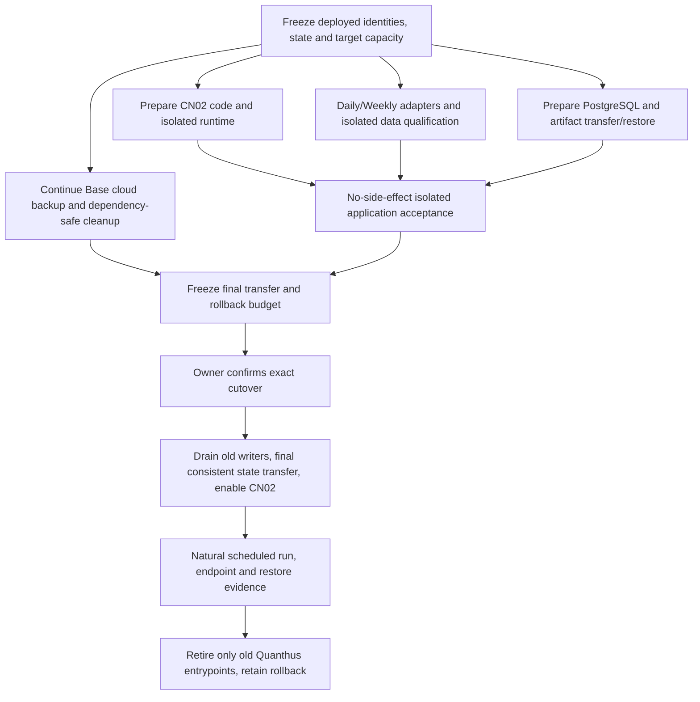

# META-OPS-CN02-001: Move the Quanthus project to CN02

| Field | Value |
| --- | --- |
| Parent | [Work-item index](index.md); [whole-system design](../design/hld.md) |
| Design status | draft |
| Delivery gate | blocked |
| Authority | Owner clarification, 2026-10-20: CN02 replaces CN01 and OCI for the entire Quanthus project |
| Data work | [P10 Base 2.4 and Daily/Weekly continuation](base24-build.md) |
| Platform design | [Platform Kernel](../design/lld/11-platform-kernel.md); ADR 0010 and ADR 0012 |
| Current runtime | Read the exact deployment inventory in the sole live ledger; repository examples are not installed-state evidence |

## Goal and completion boundary

CN02 must host the Quanthus code, acquisition/build schedules, ODS/DWD Base and
increments, existing application-specific analytical artifacts, PostgreSQL platform
state, API, Web, Workers, production control interface, notifications and backup
operations currently assigned to CN01 and OCI. Ordinary Quanthus operation must no
longer require either old node. Base 2.4 is the completed data foundation; its image
acceptance does not establish project migration or consumer activation.

The Owner's clarification supersedes the earlier restriction that the migration
queue covered OCI DWS/ADM data but excluded platform/business services. It authorizes
inventory and migration preparation across the project. The previously requested
separate confirmation for formal node/production cutover remains applicable. Prepare
the exact executable cutover and rollback result before requesting that confirmation.
No service, timer, pointer, queue writer, public endpoint or source ACL changes follow
from this document. Do not move unrelated OCI/CN01 applications or CN02's Xianyu
service. A whole-node shutdown is not a Quanthus retirement procedure.

Migration changes location, not research/data/business authority. Preserve P10
ownership, expert/veto routing, frozen P3/P5/P6 contracts, the permanent blind
partition, unavailable knowledge times and existing activation gates. Do not run
research, training or strategy/economic evaluation to demonstrate infrastructure
health. Existing protected artifacts may be transferred as opaque, access-controlled
bytes under an exact inventory; they must not be rendered into review reports.

## One deployment inventory and one live status

Use the existing `current-gaps.json` under
`/srv/agentdock/AgentDock/base22-review-afe2526/base231-budget-exhaustion-continuation-20261015T153555Z-c887578`.
Add the project migration scope there; do not create another mutable gap table.
Read-only inventory evidence is under
`/srv/agentdock/AgentDock/base22-review-afe2526/quanthus-cn02-migration-20261020T050831Z-236f28b`.
Earlier inventory attempts remain historical; use the latest per-unit census and
record failed/unproven entries rather than counting a partial batch as complete.

Inventory only known deployment roots, runtime mount paths, unit definitions and
versioned repository state. Record actual Git SHA, tracked drift, container image
digest/platform, Compose path, unit/timer/path/socket triggers, code/data/config
dependencies, volumes, logical/allocated size, ownership, port and credential-file
references. Do not output environment values, secrets, raw process arguments,
database application rows, protected prices or economic results. Existing OCI
`sudo -n` access was verified under the Owner's direction; do not alter ACLs,
credentials or host trust to resolve an unrelated failure.

The first census identified an OCI `quanthus-platform` deployment with API, Web,
Replay Worker, Event Worker and PostgreSQL, plus a Quanthus backup sidecar and a
production-control systemd service. Its actual mounted Run volumes and
`/home/ubuntu/data/quanthus` roots are migration inputs. The old
`/srv/quanthus/dwd-dws-v2` directory currently contains notifications; it is not a
complete inventory of OCI analytical artifacts. The retained development bundle
is legacy ADS evidence, not proof of an active generic DWS service or of Base 2.4
compatibility. Inventory what exists; do not build a new generic warehouse layer.

## Dependency graph and parallel execution

Cloud transfer, source/domain qualification and deployment inventory can overlap.
Do not wait for ODS upload to discover application or database dependencies. Only
deletions whose recovery proof depends on that upload must wait for its cloud
commit. Do not start duplicate collectors or Workers against the production queue
as a way to parallelize the migration.

Each prerequisite has one materialization owner. The existing accepted Base,
Daily and Weekly products keep their original producer/input identities; reuse
them when their closure is unchanged. Job-local transfer/check scratch is TMP.
Published Run/ADM/evidence volumes and durable PostgreSQL state are not TMP and
must not be swept by the earlier non-2.4 backup cleanup request.

## Work packages and acceptance

| Package | Concrete work | Completion evidence |
| --- | --- | --- |
| M1 deployment closure | Resolve every Quanthus writer, reader, service, timer, path/socket trigger, container, volume, code SHA, public route and backup destination on both old nodes | All installed entries accounted for; unproven entries named; exact retained configuration identities; no reliance on repository examples alone |
| M2 target runtime | Distribute pinned code through GitHub; build target-platform images; prepare distinct CN02 paths, mounts, loopback ports and bounded resources | Clean source identities, image digests, target architecture, collision/capacity checks and isolated startup; no credentials committed or old production volumes mounted writable |
| M3 data continuation | Finish existing-source Daily/Weekly adapters, exact Base binding, late revision and domain qualification | Per-date/domain receipts, source truth and existing cold tests; unresolved local uses explicitly held; no rewriting the sealed Base or changing frozen gates |
| M4 durable state and artifacts | Freeze PostgreSQL/Run/ADM/publication/config inventories; perform consistent logical database backup and exact opaque artifact transfer | Full input/output hashes, database schema/state census, artifact-reference closure, source preservation and isolated restoration; separate secret provisioning |
| M5 application and edge | Qualify API/Web, auth/MFA continuity, Workers, control interface, notifications, backups and public route on CN02 | Allowed read/health/synthetic checks, port/TLS/access checks, database/queue/lease behavior and backup restoration; no trading/research activation or accidental production notification |
| M6 single-writer cutover | Produce and review drain order, final transfer, exact commands, failure conditions and paired rollback; then execute only the separately confirmed cutover | Old writers/submitters fenced before enabling new writers; actual CN02 scheduled run and delivery; no normal runtime reads, code, database, queue, remote fetch or proxy dependency on CN01/OCI |
| M7 retirement | Disable only superseded Quanthus entrypoints after acceptance; preserve old code/state/config for the agreed rollback window | Independent restore proof, exact allowlist and retained recovery identities; unrelated applications and sealed research ledgers unchanged |

## Database, artifacts and secrets

PostgreSQL contains users, sessions/MFA bindings, security audit, Job/lease state,
Run indexes and active evidence pointers. Copying Parquet alone is not application
migration. Use a version-matched logical dump and isolated restore; copying a live
`PGDATA` directory is not a consistent backup or a cross-architecture migration.
Record exact versions, extension/schema migration identities, sizes and safe
counts without exporting database row contents. Treat database estimates and
live filesystem counts as preflight measurements, not a frozen transfer receipt.

Fence submissions and let existing accepted Jobs drain before the final consistent
snapshot. Final old-queue/lease checks precede starting any new Worker. The isolated
restore must use its own database and volumes, loopback-only ports, and disabled
collectors, Workers, schedulers, P6 controller, outbound notification and source
network by default. Use existing versioned recovery procedures where compatible;
do not blindly execute an old script that packages ARM images, requires a different
Git identity or assumes production volume names. Qualify any necessary successor
through repository code and targeted tests.

Match database artifact references against the independently transferred Run and
publication roots. Preserve historical Run/config/source identities and access
boundaries. Bind future consumers explicitly to qualified Base 2.4 inputs;
changing a directory name or pointing an old Base 2.3 path at new bytes is not
compatibility. A historical artifact requiring an old input remains historical,
with an exact recoverable archive if that input is not retained live.

Use existing private secret provisioning/backups for database passwords, MFA keys,
notification credentials, cloud tokens and certificates. A database dump does not
contain the external MFA key. Do not generate a replacement key and claim old MFA
bindings still work. Record paths/ownership and continuity checks, never secret
contents or private keys in the repository or readable review export. Stop only
the affected step if a new credential, permission or provider purchase is required.

## Capacity and runtime differences

Freeze same-UTC filesystem/device capacity and memory for each actual write batch.
Budget existing Base files, current upload scratch, incoming logical dump/artifacts,
new image layers, isolated restore, comparison TMP, final delta and rollback
retention. Keep the existing per-device free floor and Xianyu dependencies. Do not
sum free space across devices for an individual file or assume reflink savings.

The inspected OCI runtime is ARM64; CN01 and CN02 are x86-64. Build and verify CN02
images from the exact selected Git code rather than loading incompatible OCI
application image archives. The initial snapshots show approximately 24 GiB RAM on
OCI and 16 GiB on CN02, shared with Xianyu and ongoing data jobs. Do not inherit
two 16 GiB Worker limits as a safe simultaneous CN02 workload. Measure representative
per-role peaks and the combined live set, then version the necessary scheduling/
resource configuration while preserving application semantics and lease contracts.
The financial/domain sample's 2 GiB DuckDB limit is not a whole-platform budget.

## Cutover, rollback and final completion

Prepare commands against actual deployed units and Compose versions. Include path
and socket activation, queue submitters, manual entrypoints and backup jobs, not
just timers. Freeze old/new code, Base, database, artifacts, secret references,
public route and validation identity as one migration set. Define stop conditions
and the last safe rollback point before the first CN02 authoritative write.

Before CN02 writes, rollback can restore the unchanged old set. After CN02 has
accepted new Jobs or data, do not blindly restart stale old writers: first fence
CN02, preserve/reconcile new authoritative state and require the reviewed recovery
procedure. Never run both sides against a cloned queue or two divergent databases.
DNS/HTTP switching and code/data readiness are separate checks. An OCI reverse
proxy still required by ordinary CN02 operation is a remaining OCI dependency.

Declare project migration complete only after the exact confirmed cutover,
natural CN02 Daily/Weekly evidence or the applicable scheduled observation window,
API/Web/control/notification/backup checks, artifact/database consistency and the
no-CN01/no-OCI dependency check pass. A Weekly not yet due is not a fabricated
successful run. Consumer and research gates remain unchanged. The separately
accepted Base image remains complete even while these migration gates are open.

## Reporting and validation

Report separately: Base 2.4 data product, Daily/Weekly continuation, platform/state
migration, and final cutover/retirement. The former 70% engineering estimate covers
only the previous smaller post-build scope. Preserve it as historical; do not
reuse it for this expanded whole-project denominator. First close M1 and freeze
the actual package weights and measured transfer/runtime dependencies before
publishing another whole-project completion percentage or final ETA.

Docs-impact: the HLD records the Owner's new target placement and the Base work
item links this broader successor. Installed topology, executable policies,
accepted artifacts and deployment status are not changed by this preparation.
Run focused documentation/ownership contracts and `make check` before handoff.
Unit and synthetic checks are engineering evidence, not migration acceptance.
