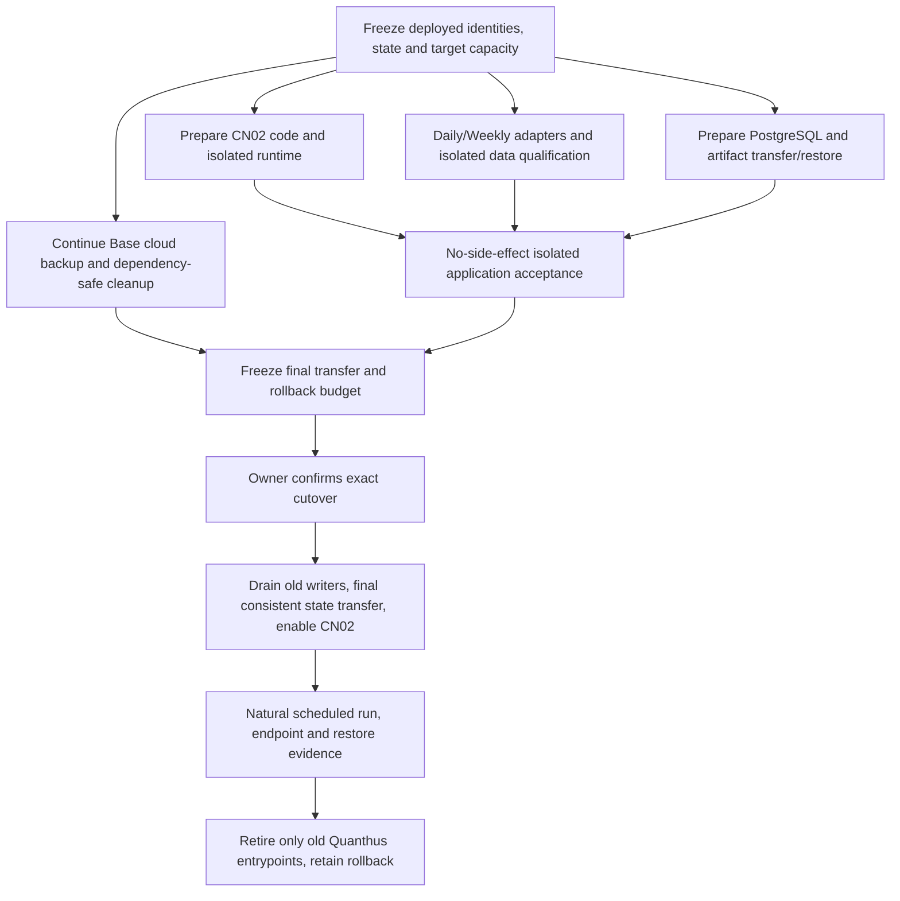

# META-OPS-CN02-001: Move the Quanthus project to CN02

| Field | Value |
| --- | --- |
| Parent | [Work-item index](index.md); [whole-system design](../design/hld.md) |
| Design status | draft |
| Delivery gate | blocked |
| Authority | Owner clarification, 2026-10-20: CN02 replaces CN01 and OCI for the entire Quanthus project |
| Data work | [P10 Base 2.4 and Daily/Weekly continuation](base24-build.md) |
| Platform design | [Platform Kernel](../design/lld/11-platform-kernel.md); ADR 0010 and ADR 0012 |
| Current runtime | Read the exact deployment inventory in the sole live ledger; repository examples are not installed-state evidence |

## Goal and completion boundary

CN02 must host the Quanthus functions and retained state needed to replace CN01 and
OCI: code, acquisition/build schedules, ODS/DWD Base and increments, referenced
application-specific analytical artifacts, PostgreSQL platform state, API, Web,
necessary Workers, production control interface, notifications and backups.
Migration selects the required functions and dependencies; it does not reproduce
every historical image, service or data copy on the old nodes. Ordinary Quanthus
operation must no longer require either old node. Base 2.4 is the completed data
foundation; its image acceptance does not establish project migration or consumer
activation.

### Current sequence: preserve data first, defer OCI systems

The Owner subsequently directed on 2026-10-20 that OCI application/system rebuilds
may wait until development needs them. This supersedes the immediate runtime-build
sequence below, without discarding the eventual consolidation target. The current
batch inventories and preserves selected data on CN02; it does not rebuild, load,
start or switch OCI API/Web/Workers/control/backup services. Keep a separate deferred
service/image list with source identity, purpose, data/configuration/secret references
and the condition for reconsidering it. Existing OCI services remain unchanged.

Data preservation does not wait for ARM-to-x86 application builds or application
consumer qualification. Copy retained artifacts as private opaque bytes under a
frozen file inventory and detect source changes before sealing the archive. Direct
file copies require every destination file to match its source SHA256. A recovery
archive requires source-to-target archive SHA256 and a checksum-bound exact source
namespace. Report archive preservation separately from payload extraction, semantic
validation and application restoration. Record original lineage and use
restrictions; do not label preserved historical data Base 2.4-compatible. If a live
root changes, hold that root or copy a provably immutable subset; continue other
roots. A live PostgreSQL data directory is excluded: preserve a consistent logical
dump separately, without deploying a target database now. Authentication secrets
are not included in the readable inventory or review export.

The data list must show exact source/destination, type, bytes/file count, source
identity, use/consumer, dependencies, verification and current disposition. Initially
observed roots include candidate/event/expert Runs, two historical Daily trees,
attribution publications and the portable development bundle. Treat those roots as
candidates pending exact inventories, not an instruction to duplicate obsolete data
or a claim that all OCI analytical data has been found. Preserve originals until a
separately approved dependency-safe retirement. Future rebuild is triggered by an
actual development/consumer need, followed by the original isolation, compatibility,
resource and activation checks. Data preserved, application restored and production
cutover must be reported as distinct states.

The Owner's clarification supersedes the earlier restriction that the migration
queue covered OCI DWS/ADM data but excluded platform/business services. It authorizes
inventory and migration preparation across the project. The previously requested
separate confirmation for formal node/production cutover remains applicable. Prepare
the exact executable cutover and rollback result before requesting that confirmation.
No service, timer, pointer, queue writer, public endpoint or source ACL changes follow
from this document. Do not move unrelated OCI/CN01 applications or CN02's Xianyu
service. A whole-node shutdown is not a Quanthus retirement procedure.

Migration changes location, not research/data/business authority. Preserve P10
ownership, expert/veto routing, frozen P3/P5/P6 contracts, the permanent blind
partition, unavailable knowledge times and existing activation gates. Do not run
research, training or strategy/economic evaluation to demonstrate infrastructure
health. Existing protected artifacts may be transferred as opaque, access-controlled
bytes under an exact inventory; they must not be rendered into review reports.

### Daily activation successor authority

The Owner explicitly approved real CN02 Daily activation on 2026-10-20 and
requested backfill from October 8 through the current date. This fulfills the
separate confirmation requirement for this Daily acquisition/build single-writer
handover. It does not authorize an OCI application rebuild, P3/P5/P6 activation or
whole-node shutdown. Preserve the drained CN01 definitions, enabled states and
exact rollback commands before changing replaced Daily triggers. The source-only
trial and installation/old-writer fencing are separate facts in the live ledger.

`ops/bin/run-cn02-base24-cycle` runs the actual collector/controller with
`QUANTHUS_DAILY_CYCLE_CONFIG` and `QUANTHUS_DAILY_PYTHON` set in a private node-local
environment file. Its `cn02_base24_daily_cycle_v1` JSON pins the physical root,
Base manifest/policy digests, published collector revision and local pipeline
revision; no credential belongs in the JSON or repository. `--day YYYY-MM-DD`
selects a backfill date. Explicit `--market`, `--events`, and optional `--native`
reuse exact sealed sources; `--native-only` prepares only a source product and
cannot claim a complete Daily. No option requests 1m or waits for Weekly.
`--recovery` records late operation explicitly. Core-only quality holds and local
machine-readable alerts remain visible; they never count as complete 1d/5m dates.
The examples `cn02-base24-cycle.{service,timer}.example` and
`cn02-base24-recovery.{service,timer}.example` target calendar-aware 17:30 collection
and one 21:15 bounded recovery opportunity. Installed and enabled state must be
verified on the node, not inferred from these files. A full product still requires
real source qualification and independent cold evidence, including on new paths.

## One deployment inventory and one live status

Use the existing `current-gaps.json` under
`/srv/agentdock/AgentDock/base22-review-afe2526/base231-budget-exhaustion-continuation-20261015T153555Z-c887578`.
Add the project migration scope there; do not create another mutable gap table.
Read-only inventory evidence is under
`/srv/agentdock/AgentDock/base22-review-afe2526/quanthus-cn02-migration-20261020T050831Z-236f28b`.
Earlier inventory attempts remain historical; use the latest per-unit census and
record failed/unproven entries rather than counting a partial batch as complete.

Inventory only known deployment roots, runtime mount paths, unit definitions and
versioned repository state. Record actual Git SHA, tracked drift, container image
digest/platform, Compose path, unit/timer/path/socket triggers, code/data/config
dependencies, volumes, logical/allocated size, ownership, port and credential-file
references. Do not output environment values, secrets, raw process arguments,
database application rows, protected prices or economic results. Existing OCI
`sudo -n` access was verified under the Owner's direction; do not alter ACLs,
credentials or host trust to resolve an unrelated failure.

The first census identified an OCI `quanthus-platform` deployment with API, Web,
Replay Worker, Event Worker and PostgreSQL, plus a Quanthus backup sidecar and a
production-control systemd service. Its actual mounted Run volumes and
`/home/ubuntu/data/quanthus` roots are migration inputs. The old
`/srv/quanthus/dwd-dws-v2` directory currently contains notifications; it is not a
complete inventory of OCI analytical artifacts. The retained development bundle
is legacy ADS evidence, not proof of an active generic DWS service or of Base 2.4
compatibility. Inventory what exists; do not build a new generic warehouse layer.

## Daily target: daily and native 5m, completed on T

The Owner confirmed on 2026-10-20 that CN01's historical T/T+1 acquisition covered
both 1m and 5m. The CN02 successor must instead use the Base 2.4 default in
`config/pipelines/base24-default-frequency.v1.json`: daily and supplier-native 5m.
Do not inherit an independent 1m collector, 1m checkpoint, shared 1m completion
marker, 1m alert or fixed T+1 wait as a prerequisite of this default product.
Shared source receipts still needed by 5m remain dependencies; do not remove
them solely because an old filename contains `1m`.

The main path is T-day market close -> daily/native-5m source availability -> one
immutable qualified ODS closure -> DWD projection -> validation and immutable
publication -> delivery. Record source availability, acquisition, validation,
publication and delivery times in Asia/Shanghai, with the exact date/universe,
input identities and required-domain outcome. Demonstrate completion on the actual
T day on CN02 before claiming T+0 acceptance. Removing the 1m dependency makes this
the target; it does not prove that every provider delivers complete 5m on T.

T+1 is a bounded recovery/revision path for failed or genuinely late observations,
not a scheduled prerequisite for publishing an already qualified T-day product.
Preserve actual knowledge/acquisition times and immutable revisions. Do not publish
missing 5m as complete, relax its qualification thresholds or infer same-day
knowledge. Delayed Weekly/noncritical domains carry their own scope and status;
they do not hold unrelated qualified Daily output unless its existing consumer
contract requires them. Data availability on T does not change the active
`close-to-next-open-v1` execution rule: earliest execution remains T+1 open.

### Frozen-input pipeline and proposed daily window

The Owner's 2026-10-20 window is a 17:00–18:00 start with delivery before 21:00
Shanghai. `config/pipelines/base24-daily-window.v1.json` selects 17:30 and enforces
the 21:00 upper bound, including final product replay. The implementation is
`daily_base24_job.py`; its executable entry is `ops/bin/run-cn02-base24-daily`.
This is an isolated frozen-input pipeline, not yet a CN02 collector or natural
T-day acceptance. It does not load the CN01 four-lane wrapper or legacy env files.
The `.example` systemd service/timer under `ops/systemd/cn02-base24-daily.*`
remain uninstalled. Their activation requires the source-intake plan producer,
notifications, reviewed Git deployment and single-writer handover to be ready.
The 17:30 collector start target and a sealed-input build are distinct: starting
a collector does not imply its sealed inputs already exist. Scheduled mode polls
only today's plan/seal, until the contract's 20:45 intake deadline, reserving the
last 15 minutes for build and replay. The intake producer publishes
`YYYY-MM-DD.json` plus `YYYY-MM-DD.json.READY` containing its full `sha256:` hash.
No plan, a bad seal or a late plan raises a scoped delivery failure; it never
selects yesterday's plan. Source acquisition and the intake producer must be
connected and measured before activation; an empty-plan wait is not T-day proof.

A frozen plan has `kind=cn02_base24_daily_frozen_job_v1`, an ISO `market_date`, a
full `code_revision`, absolute `source_root`, `native5m`, `base`, `release_config`
and `prior_pointer` paths. `lanes` contains exactly `market_daily_core` and
`calendar_daily_events`, each with its relative `release_path` and full `sha256:`
manifest hash. `control_sha256` pins the native and Base manifests, release config
and prior descriptor. `consumer_admission=NOT_GRANTED` and
`execution_authorized=false` remain mandatory. Existing catalog/core/native
verifiers qualify actual payloads; pinned declarations alone are insufficient.
Input/output/sibling-lock overlap and symlinks fail before writing. The pipeline
creates catalog -> one immutable core -> physical 1d/5m composite -> full product
replay -> job receipt/READY, with per-stage duration and bytes. It does not acquire
1m, wait for Weekly, advance CURRENT or send messages.

The input-plan publisher is
`src/quanthus/pipelines/securities_warehouse/daily_base24_intake.py` (run with
`PYTHONPATH=src .venv/bin/python -m quanthus.pipelines.securities_warehouse.daily_base24_intake`).
Supply the exact `--market-date`, full `--code-revision`, `--source-root`, relative
`--market-release` / `--events-release`, and absolute `--native5m`, `--base`,
`--release-config`, `--prior-pointer`, and `--plan-root`, with explicit
`--mode t-day` or `replay`. It checks source manifest/READY identities and scopes,
uses the same frozen control/date validator as the runner, and writes the dated
plan exclusively. Its checksum seal becomes visible atomically only after the
controls still match. The publisher reads control metadata, not market payloads;
its seal is not source qualification or a natural-day acquisition receipt. Payload
schema/keys/coverage/provenance remain checked by the existing Daily DAG once.
Exact unchanged retries preserve both files. An interrupted plan can gain its
missing seal only if the plan bytes and frozen inputs still match; a different
identity for that date must use a separate isolated plan root. Invalid paths,
overlap, symlinks, source dates/seals or an expired intake window reject without
creating a plan or lock. No source discovery, provider calls, notification or
service activation is performed. Collector integration remains a separate step.

For a preflighted unique isolated output, run:

```bash
ops/bin/run-cn02-base24-daily --plan /absolute/frozen-day.json \
  --output /absolute/existing-parent/new-job --mode replay --max-seconds 900
```

Use `--mode t-day` only for the actual Shanghai business day inside the window.
It records on-day build completion, never an unproven CN02 acquisition claim.
Final READY is absent on timeout/rejection; preserve partial products and failure
evidence, then use a new Job/revision for bounded recovery. A complete exact-identity
rerun verifies and reuses its product without rebuilding catalog/core. It never
overwrites an incomplete prior attempt. A separate full natural-day test must
record source availability/acquisition and delivery/alert times. Full cold moves
and source/network denial remain explicit acceptance modes, not replaced by the
in-process product replay. Rollback before activation is to leave these examples
uninstalled; the old writer and all existing source/services remain unchanged.

## Select OCI assets before transfer

For each installed Quanthus unit, image, volume and artifact root, record its
actual consumer/reference, current function, source/configuration identity,
replacement and disposition in the sole live inventory. A running container, a
recent tag or a failed old unit alone proves neither necessity nor obsolescence.
Use the following dispositions; an undecided dependency blocks only that asset.

| Disposition | Required evidence and handling |
| --- | --- |
| Rebuild required role | An API, Web, Worker or control role is needed by the retained application; select reviewed Git/config identities, build for CN02 x86-64 and qualify the role in isolation |
| Migrate referenced state | Database or artifact bytes are referenced by retained users, Jobs, Runs, publication or recovery contracts; preserve exact identities and transfer/restore evidence |
| Archive for rollback/history | Old code, configuration, image identity or sealed data is needed only for rollback or historical reproduction; retain an exact recoverable archive, without enabling its old workflow on CN02 |
| Omit obsolete/redundant function | No retained consumer or rollback requirement remains and an approved replacement or explicit scope exclusion is recorded; do not install it on CN02 |
| Hold unresolved asset | Consumer, source identity, secret continuity or replacement is unproven; name the missing evidence, continue independent assets and make no retirement claim |

OCI-to-CN01 mirror clients become unnecessary in the target's ordinary local data
path. Historical cloud-restore units, one-off replay/repair units, duplicate caches,
temporary OAuth/proxy bridges and unused image versions are omission candidates,
not a default migration list. Check their remaining consumer/backup/rollback
dependencies first. A shared backup/notification/proxy function still needed by
Quanthus needs an explicit CN02 replacement; do not drop it on the strength of its
age. Unrelated applications stay outside this inventory and migration.

The initial OCI image inspection found ARM64 application images without a declared
Git revision label. Selected visible code/configuration bytes also differed from
the commit named by their tag. Preserve that drift evidence; do not relabel the
old image as an exact Git build, copy it as an x86-64 runtime, or silently carry
unknown patches into CN02. Resolve necessary changes against versioned repository
state before target builds. This finding is not evidence of market-data corruption.
Source services/images remain untouched until the separately confirmed retirement
procedure; selecting an asset out of the target does not authorize deleting it.

## Dependency graph and parallel execution



Cloud transfer, source/domain qualification and deployment inventory can overlap.
Do not wait for ODS upload to discover application or database dependencies. Only
deletions whose recovery proof depends on that upload must wait for its cloud
commit. Do not start duplicate collectors or Workers against the production queue
as a way to parallelize the migration.

Under the current data-first sequence, run the artifact inventory/transfer branch
directly after its capacity and source-stability checks. M2 and M5, and OCI's part
of M6/M7, are deferred until needed; they do not block preservation acceptance.
The graph retains the eventual application/cutover dependencies rather than asserting
that those deferred steps are executing now. CN02 Daily/Weekly preparation continues
independently of the deferred OCI application rebuild.

Each prerequisite has one materialization owner. The existing accepted Base,
Daily and Weekly products keep their original producer/input identities; reuse
them when their closure is unchanged. Job-local transfer/check scratch is TMP.
Published Run/ADM/evidence volumes and durable PostgreSQL state are not TMP and
must not be swept by the earlier non-2.4 backup cleanup request.

## Work packages and acceptance

| Package | Concrete work | Completion evidence |
| --- | --- | --- |
| M1 deployment closure | Resolve and classify every Quanthus writer, reader, service, timer, path/socket trigger, container, volume, code SHA, public route and backup destination on both old nodes | Each installed entry has a disposition and consumer/replacement evidence or a named hold; exact retained configuration identities; no reliance on repository examples alone |
| M2 target runtime | Distribute pinned code through GitHub; build target-platform images; prepare distinct CN02 paths, mounts, loopback ports and bounded resources | Clean source identities, image digests, target architecture, collision/capacity checks and isolated startup; no credentials committed or old production volumes mounted writable |
| M3 data continuation | Finish existing-source daily/native-5m and Weekly adapters, exact Base binding, T-day main path and bounded late revisions | Per-date/domain receipts, actual CN02 T-day timestamps and existing cold tests; no 1m or mandatory T+1 wait; unresolved uses explicitly held; no rewriting the sealed Base or changing frozen gates |
| M4 durable state and artifacts | Freeze PostgreSQL/Run/ADM/publication/config inventories; perform consistent logical database backup and exact opaque artifact transfer | Full input/output hashes, database schema/state census, artifact-reference closure, source preservation and isolated restoration; separate secret provisioning |
| M5 application and edge | Qualify API/Web, auth/MFA continuity, Workers, control interface, notifications, backups and public route on CN02 | Allowed read/health/synthetic checks, port/TLS/access checks, database/queue/lease behavior and backup restoration; no trading/research activation or accidental production notification |
| M6 single-writer cutover | Produce and review drain order, final transfer, exact commands, failure conditions and paired rollback; then execute only the separately confirmed cutover | Old writers/submitters fenced before enabling new writers; actual CN02 scheduled run and delivery; no normal runtime reads, code, database, queue, remote fetch or proxy dependency on CN01/OCI |
| M7 retirement | Disable only superseded Quanthus entrypoints after acceptance; preserve old code/state/config for the agreed rollback window | Independent restore proof, exact allowlist and retained recovery identities; unrelated applications and sealed research ledgers unchanged |

## Database, artifacts and secrets

PostgreSQL contains users, sessions/MFA bindings, security audit, Job/lease state,
Run indexes and active evidence pointers. Copying Parquet alone is not application
migration. Use a version-matched logical dump and isolated restore; copying a live
`PGDATA` directory is not a consistent backup or a cross-architecture migration.
Record exact versions, extension/schema migration identities, sizes and safe
counts without exporting database row contents. Treat database estimates and
live filesystem counts as preflight measurements, not a frozen transfer receipt.

Fence submissions and let existing accepted Jobs drain before the final consistent
snapshot. Final old-queue/lease checks precede starting any new Worker. The isolated
restore must use its own database and volumes, loopback-only ports, and disabled
collectors, Workers, schedulers, P6 controller, outbound notification and source
network by default. Use existing versioned recovery procedures where compatible;
do not blindly execute an old script that packages ARM images, requires a different
Git identity or assumes production volume names. Qualify any necessary successor
through repository code and targeted tests.

Match database artifact references against the independently transferred Run and
publication roots. Preserve historical Run/config/source identities and access
boundaries. Bind future consumers explicitly to qualified Base 2.4 inputs;
changing a directory name or pointing an old Base 2.3 path at new bytes is not
compatibility. A historical artifact requiring an old input remains historical,
with an exact recoverable archive if that input is not retained live.

Use existing private secret provisioning/backups for database passwords, MFA keys,
notification credentials, cloud tokens and certificates. A database dump does not
contain the external MFA key. Do not generate a replacement key and claim old MFA
bindings still work. Record paths/ownership and continuity checks, never secret
contents or private keys in the repository or readable review export. Stop only
the affected step if a new credential, permission or provider purchase is required.

## Capacity and runtime differences

Freeze same-UTC filesystem/device capacity and memory for each actual write batch.
Budget existing Base files, current upload scratch, incoming logical dump/artifacts,
new image layers, isolated restore, comparison TMP, final delta and rollback
retention. Keep the existing per-device free floor and Xianyu dependencies. Do not
sum free space across devices for an individual file or assume reflink savings.

The inspected OCI runtime is ARM64; CN01 and CN02 are x86-64. Build and verify CN02
images from the exact selected Git code rather than loading incompatible OCI
application image archives. The initial snapshots show approximately 24 GiB RAM on
OCI and 16 GiB on CN02, shared with Xianyu and ongoing data jobs. Do not inherit
two 16 GiB Worker limits as a safe simultaneous CN02 workload. Measure representative
per-role peaks and the combined live set, then version the necessary scheduling/
resource configuration while preserving application semantics and lease contracts.
The financial/domain sample's 2 GiB DuckDB limit is not a whole-platform budget.

## Cutover, rollback and final completion

Prepare commands against actual deployed units and Compose versions. Include path
and socket activation, queue submitters, manual entrypoints and backup jobs, not
just timers. Freeze old/new code, Base, database, artifacts, secret references,
public route and validation identity as one migration set. Define stop conditions
and the last safe rollback point before the first CN02 authoritative write.

Before CN02 writes, rollback can restore the unchanged old set. After CN02 has
accepted new Jobs or data, do not blindly restart stale old writers: first fence
CN02, preserve/reconcile new authoritative state and require the reviewed recovery
procedure. Never run both sides against a cloned queue or two divergent databases.
DNS/HTTP switching and code/data readiness are separate checks. An OCI reverse
proxy still required by ordinary CN02 operation is a remaining OCI dependency.

Declare project migration complete only after the exact confirmed cutover,
natural CN02 Daily/Weekly evidence or the applicable scheduled observation window,
API/Web/control/notification/backup checks, artifact/database consistency and the
no-CN01/no-OCI dependency check pass. A Weekly not yet due is not a fabricated
successful run. Consumer and research gates remain unchanged. The separately
accepted Base image remains complete even while these migration gates are open.

## Reporting and validation

Report separately: Base 2.4 data product, Daily/Weekly continuation, platform/state
migration, and final cutover/retirement. The former 70% engineering estimate covers
only the previous smaller post-build scope. Preserve it as historical; do not
reuse it for this expanded whole-project denominator. First close M1 and freeze
the actual package weights and measured transfer/runtime dependencies before
publishing another whole-project completion percentage or final ETA.

Docs-impact: the HLD records the Owner's new target placement and the Base work
item links this broader successor. Installed topology, executable policies,
accepted artifacts and deployment status are not changed by this preparation.
Run focused documentation/ownership contracts and `make check` before handoff.
Unit and synthetic checks are engineering evidence, not migration acceptance.
