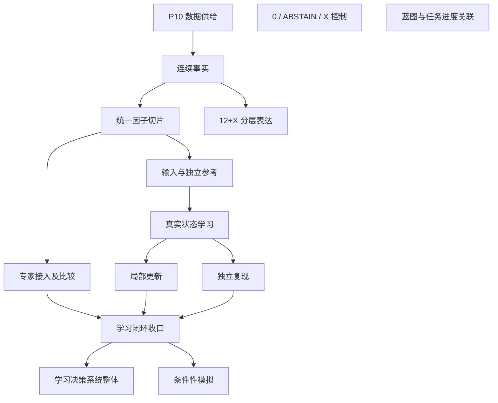

# 学习系统蓝图与模块进度

<!-- Generated by scripts/blueprint_progress.py; do not edit. -->

记录截至：2026-11-12T08:26:37.957032+00:00；这不是实时 GitHub 状态。

任务关闭、工程完成、研究质量、用途价值和使用资格分别记账。
本视图不授予训练、数据访问、P6 或生产权限；不会按 issue 关闭比例计算产品完成率。

[更新机制](../design/blueprint-progress.md) · [总任务 #540](https://github.com/rv198-star/Quanthus/issues/540)

## 模块能力（范围以最新记录为准）

| 模块 | 工程 | 研究质量 | 用途价值 | 使用资格 |
| --- | --- | --- | --- | --- |
| MVP · 学习决策系统整体 | 部分完成 | 仅研究 | 未得明确结论 | 未授予 |
| DATA · P10 数据供给 | 限定范围通过 | 受阻 | 未评估 | 未评估 |
| FACTS · 连续事实 | 限定范围通过 | 仅研究 | 未评估 | 仅研究 |
| FACTORS · 统一因子切片 | 限定范围通过 | 限定范围通过 | 未得明确结论 | 仅研究 |
| REFERENCE · 输入与独立参考 | 限定范围通过 | 仅研究 | 未评估 | 未授予 |
| STATES · 12+X 分层表达 | 限定范围通过 | 未得明确结论 | 未评估 | 仅开发 |
| TRAIN · 真实状态学习 | 限定范围通过 | 未得明确结论 | 未评估 | 未授予 |
| UPDATE · 局部更新 | 限定范围通过 | 未得明确结论 | 未评估 | 未授予 |
| EXPERT · 专家接入及比较 | 限定范围通过 | 仅研究 | 本候选拒绝 | 未授予 |
| REPRO · 独立复现 | 限定范围通过 | 仅研究 | 未评估 | 未授予 |
| CLOSEOUT · 学习闭环收口 | 限定范围通过 | 仅研究 | 限定范围通过 | 未授予 |
| P6 · 条件性模拟 | 部分完成 | 未评估 | 未评估 | 未授予 |
| S00 · 无序震荡 | 部分完成 | 仅研究 | 未评估 | 未授予 |
| S01 · 止跌企稳 | 部分完成 | 仅研究 | 未评估 | 未授予 |
| S02 · 有序整理 / Head2 | 限定范围通过 | 仅研究 | 本候选拒绝 | 未授予 |
| S03 · 突破尝试 | 部分完成 | 未得明确结论 | 未评估 | 未授予 |
| S04 · 突破接受 | 部分完成 | 未得明确结论 | 未评估 | 未授予 |
| S05 · 上升趋势 | 部分完成 | 未得明确结论 | 未评估 | 未授予 |
| S06 · 回调检验 | 部分完成 | 未得明确结论 | 未评估 | 未授予 |
| S07 · 结构重建 | 部分完成 | 未得明确结论 | 未评估 | 未授予 |
| S08 · 上行加速/延伸 | 部分完成 | 仅研究 | 未评估 | 未授予 |
| S09 · 高位量价背离 | 部分完成 | 受阻 | 未评估 | 未授予 |
| S10 · 结构破坏 | 限定范围通过 | 仅研究 | 未得明确结论 | 仅开发 |
| S11 · 破坏后反弹 | 限定范围通过 | 仅研究 | 未得明确结论 | 仅开发 |
| S12 · 下降趋势 | 部分完成 | 未得明确结论 | 未评估 | 未授予 |
| CONTROL · 0 / ABSTAIN / X 控制 | 限定范围通过 | 仅研究 | 未评估 | 仅开发 |
| TRACE · 蓝图与任务进度关联 | 限定范围通过 | 未评估 | 未评估 | 仅开发 |

## 当前缺口与下一步

每个模块展示当前重点缺口；全部维度可通过 context 查看，旧记录保留在账本。

| 模块 / 维度 | 已核实范围 | 剩余缺口 | 下一步 | 记录 |
| --- | --- | --- | --- | --- |
| MVP / 用途价值 | 已完成批准三步：资格、一次新fit与完整资金比较、独立复现；本用途负结论成立 | 整体学习MVP的可靠增量价值仍未取得；不能以实验完成算产品通过 | 停放本入场过滤器；后续消费者/假说另行论证，不自动开新样本 | CP-540-20261028T202135817023Z |
| DATA / 使用资格 | P10是外部常设供给依赖 | 本轮未重新验收完整数仓 | 按实际消费者冻结准确输入，不为本蓝图重建数仓 | BASELINE-20261027 |
| FACTS / 识别/研究质量 | Fixed A2, consumed 2020-2021: independent 90648/90573, 75 blocks, all groups and 449 candidate days match | Latest-sealed raw-price description only; new scientific/PIT uses require their own contracts | Retain the result and select the next named signal question under existing governance | CP-612-20261111T121242422791Z |
| FACTORS / 工程 | 一个volume_ratio20研究队列切片；三项P2及CLI/import/handoff缺口关闭，66项回归，原结果全字节保持，8文件新进程隔离冷重建及损坏负测通过 | 不是全因子平台或现有专家工作流整合；全仓lint/type旧债务及远端Actions未通过事实单列 | 保留切片资产；新消费者先绑定可信receipt/完整身份，不扩建本量能筛选分支 | CP-541-20261027T220256362160Z |
| REFERENCE / 识别/研究质量 | 87机会/66公司均保留；83输入可用，58明确盲共识（23正35负），25未知4不可用 | 两AI参考非市场真值；四正训练最小pilot，训练IPO与成熟公司评价分布不同 | 保留已消费参考及不确定性；不重新投票、改样本或当作新holdout | CP-540-20261028T202135817023Z |
| STATES / 识别/研究质量 | 分层容器、共存和证据等级 | 各头资格独立，容器完成不等于全12头可用 | 复用已通过资产；按实际新缺口投入 | BASELINE-20261027 |
| TRAIN / 识别/研究质量 | 首个有限真实fit已执行 | 可用候选识别质量未闭合 | 复用已通过资产；按实际新缺口投入 | BASELINE-20261027 |
| UPDATE / 识别/研究质量 | 首个有限局部更新已执行 | 更新执行不等于新版本更优 | 复用已通过资产；按实际新缺口投入 | BASELINE-20261027 |
| EXPERT / 用途价值 | 本入场候选未胜原B；相对R0收益改善在去最大公司/入场日期贡献后消失 | 最大回撤更差；贡献剔除只是归因，不是资金重分配模拟 | 按固定失败分支收口，不以样本后调参救回 | CP-540-20261028T202135817023Z |
| REPRO / 工程 | Fixed2020-2021 native126members and qualified P10 exact-purpose input, composite/source clock identity,002 task/attempt and guarded P2 consumer delivered. Formal and independent cold inputs, choices, rights, cash cents, fills/orders/pool, all curves/trades/branch agree; role-separated acceptance passed. | Guarded retrospective research use; Draft631 atop630 main integration remains with the original integration line. General economic-event input debt remains P10/556. | Reuse accepted seam for original main integration; other consumers follow their own input/use gates and frozen requests; do not repeat this result computation. | CP-628-20261112T072129212925Z |
| CLOSEOUT / 用途价值 | Original research allocation decision delivered: full comparison and independent acceptance, +2.63407 percentage-point full-window increment, failed2021 and static top3 gates, scientific inconclusive and park this fixed holding use. Accepted scope is the completed resource decision. | Fixed candidate does not advance to robustness work; full active/model/billing cost unknown_not_zero. All old failures, effort and consumed-window exposure cumulative. | Park this fixed holding use, prioritize existing-asset main integration; direction layer chooses the next real consumer question, Workers follow actual capacity/task-pool benefit. | CP-628-20261112T072129212925Z |
| P6 / 使用资格 | 既有引擎可复用；新候选未启动 | 新候选价值与用途门槛未过 | 保留不启动决定 | BASELINE-20261027 |
| S00 / 识别/研究质量 | 保留中性/无序研究解释；ABSTAIN/X不是0 | 没有被当前用途要求的独立中性标签资格 | 只在具体消费者需要中性状态、且参考意义独立时冻结一小批；不为凑齐词汇采样 | CP-540-FOUR-BATCHES-20261027 |
| S01 / 识别/研究质量 | 原下跌背景内减速/企稳研究条件 | 独立意义和父背景12参考资格未闭合 | 先有一个真实的下跌背景用途，再决定条件1是否需要单独参考；保留连续事实 | CP-540-FOUR-BATCHES-20261027 |
| S02 / 识别/研究质量 | 58共识上BA82.86%对R0 71.80%；召回100%对52.17%，特异度65.71%对91.43% | 多检出同时增加误报，不支配R0；参考有限且群体差异仍在 | 保留研究级结果；不得由识别指标授予交易资格 | CP-540-20261028T202135817023Z |
| S03 / 识别/研究质量 | 旧参考结论保留；本轮12例仅开发方法验证，新候选未评分 | 新245行动闭包不合格，未证明新未消费episode与100/100/50语义数量 | 不补凑旧样本、不换尺度或阈值；按明确价值触发再投入 | CP-540-20261027T192528495073Z |
| S04 / 识别/研究质量 | 旧参考结论保留；本轮12例仅开发方法验证，新候选未评分 | 新245行动闭包不合格，未证明新未消费episode与100/100/50语义数量 | 不补凑旧样本、不换尺度或阈值；按明确价值触发再投入 | CP-540-20261027T192528495073Z |
| S05 / 识别/研究质量 | 旧5标签停放，连续趋势事实保留 | 没有足够新的可证伪趋势状态假说 | 实际消费者提出无法由现有连续事实解决的问题后，先冻结假说/负对照再给预算 | CP-540-FOUR-BATCHES-20261027 |
| S06 / 识别/研究质量 | 旧6标签停放，过程与支撑事实保留 | 回撤检验相对父背景的独立用途和参考不足 | 与具体回撤消费者绑定一个过程问题；不先启动全域补标签 | CP-540-FOUR-BATCHES-20261027 |
| S07 / 识别/研究质量 | 旧7标签停放，结构修复事实保留 | 新重建假说及相对现有事实的增量未确定 | 先提出可证伪的重建条件和用途，避免延长旧失败分支 | CP-540-FOUR-BATCHES-20261027 |
| S08 / 识别/研究质量 | 高侧加速/延伸作为modifier保留 | 实际消费者需求及覆盖/参考资格未闭合 | 仅在需要一个上行修饰量时做有限覆盖资格；不当作peer-primary标签 | CP-540-FOUR-BATCHES-20261027 |
| S09 / 识别/研究质量 | 高位量价背离修饰量仍受既有关系门槛限制 | 最小活动关系和限定参考没有闭合 | 消费者确需时先验证缺少的活动关系；不靠新阈值或空标签绕过 | CP-540-FOUR-BATCHES-20261027 |
| S10 / 识别/研究质量 | 本状态限定研究证据；独立于其他状态 | 实际用途价值未闭合 | 复用已有开发投影，不重复建设 | BASELINE-20261027 |
| S11 / 识别/研究质量 | 本状态限定研究证据；独立于其他状态 | 实际用途价值未闭合，反弹不等于修复 | 与10一并复用，不自动晋级 | BASELINE-20261027 |
| S12 / 识别/研究质量 | 原下跌背景研究解释与失败证据保留 | 背景参考路线no-pass，尚无新用途资格 | 先确认是否有必须依赖离散下跌背景的用途；不得以条件1反推12合格 | CP-540-FOUR-BATCHES-20261027 |
| CONTROL / 工程 | 中性/弃权/冻结拒绝路径 | 新消费者仍须保留这些边界 | 复用已通过资产；按实际新缺口投入 | BASELINE-20261027 |
| TRACE / 工程 | 当前工程要求、3条历史结论、只读context/preflight/check和追加历史约束通过本地验收；主线发布身份另存最终交接。 | 尚无持续执行服务；语义适用性、实际资源扣账和准入仍由Agent/TPlan/领域合同负责；既有全仓lint保留。 | 按新规则先确认一个已有资产的实际消费者，必要时最小接入；不自动重开Head2或3/4。 | CP-2-EXPLORATION-20261029T113141Z |

## 工作项到蓝图的关系

GitHub 状态只表示任务生命周期；实时检查：`make blueprint-audit`。

| 工作项 | 影响模块 | 对整体目标的贡献 | 最近登记的 issue 状态 |
| --- | --- | --- | --- |
| [META-LEARN-001 / #540](https://github.com/rv198-star/Quanthus/issues/540) | MVP, DATA, FACTS, FACTORS, REFERENCE, STATES, TRAIN, UPDATE, EXPERT, REPRO, CLOSEOUT, P6, S00, S01, S02, S03, S04, S05, S06, S07, S08, S09, S10, S11, S12, CONTROL | 统筹完整学习MVP；模块资格不能由子issue数量推出 | open |
| [P3-FACTOR-001 / #541](https://github.com/rv198-star/Quanthus/issues/541) | FACTS, FACTORS | 交付首批可复用、可追溯且有用途的因子切片 | open |
| [P5-STATE-002 / #542](https://github.com/rv198-star/Quanthus/issues/542) | REFERENCE, DATA, S00, S01, S02, S03, S04, S05, S06, S07, S08, S09, S10, S11, S12 | 逐头确认输入、参考、时间与预算；不自动打开训练 | open |
| [P5-STATE-003 / #543](https://github.com/rv198-star/Quanthus/issues/543) | STATES, TRAIN, CONTROL, S00, S01, S02, S03, S04, S05, S06, S07, S08, S09, S10, S11, S12 | 真实训练与状态评价；k个头的结果不外推全12头 | open |
| [P5-LOCAL-001 / #544](https://github.com/rv198-star/Quanthus/issues/544) | UPDATE, TRAIN, S02 | 真实局部更新及新旧比较；可拒绝新候选 | open |
| [P3-EXPERT-007 / #545](https://github.com/rv198-star/Quanthus/issues/545) | FACTS, EXPERT | 在实际持仓范围生成受限连续Facts并经原专家安全链验证完整决策差异；不自动取得策略价值或生产准入 | open |
| [META-LEARN-002 / #546](https://github.com/rv198-star/Quanthus/issues/546) | MVP, CLOSEOUT, REPRO, P6 | 独立复现，分别交付工程/质量/价值/资格结论 | open |
| [P3-EXPERT-008 / #547](https://github.com/rv198-star/Quanthus/issues/547) | EXPERT | 后续按边际价值扩展专家，未因规划而启动 | open |
| [P3-DECISION-001 / #548](https://github.com/rv198-star/Quanthus/issues/548) | EXPERT, CLOSEOUT | 后续有界优化组合机制，保留硬约束 | open |
| [META-TRACE-001 / #2](https://github.com/rv198-star/Quanthus/issues/2) | TRACE | 维护项目可追溯机制；本轮接入学习MVP，既有长期任务继续保留 | open |
| [P10-DATA-STAGE34-PREFIX-001 / #566](https://github.com/rv198-star/Quanthus/issues/566) | DATA, REFERENCE, S03, S04 | 固定128家2021上市前缀的限定来源资格；P10交接与P5参考、候选评价和消费者准入分开验收 | closed |
| [P10-DATA-STAGE34-ROUTE-002 / #571](https://github.com/rv198-star/Quanthus/issues/571) | DATA, REFERENCE, S03, S04 | 245家2021潜在身份路线的零采集现存来源资格；与旧128交接、研究参考、质量及消费者准入分开验收 | open |
| [META-GATE-001 / #3](https://github.com/rv198-star/Quanthus/issues/3) | TRACE | 本地make check统一入口、完整身份回执和保守复用；只服务当前工程交付，不提升研究/用途准入 | open |
| [META-RESEARCH-REVIEW-001 / #612](https://github.com/rv198-star/Quanthus/issues/612) | FACTS, REPRO, CLOSEOUT | 独立审阅 #609-611 的统计语义、工程交付与投入判断；记录缺陷、长期证据和模型分工，限定本批次成熟度。 | closed |
| [META-RESEARCH-SELECT-001 / #609](https://github.com/rv198-star/Quanthus/issues/609) | FACTS, CLOSEOUT | 重审事前问题合同、指标语义、阈值和准入；保留原曝光 | closed |
| [P3-RESEARCH-HF-001 / #610](https://github.com/rv198-star/Quanthus/issues/610) | REPRO | 修复并验收固定HF输入、资源边界与不可变结果包 | closed |
| [P3-RESEARCH-PILOT-001 / #611](https://github.com/rv198-star/Quanthus/issues/611) | FACTS, CLOSEOUT | 按有效设计复算与解释；保留原始代理统计及失败记录 | closed |
| [P3-RESEARCH-REUSE-001 / #613](https://github.com/rv198-star/Quanthus/issues/613) | FACTORS, REPRO, CLOSEOUT | 检验R1既有20日原始价格动量区间对次日开盘至收盘响应的增量，决定后续回放或停放；验证已验收输入与Worker的复用成本。 | closed |
| [P3-RESEARCH-REPLAY-001 / #627](https://github.com/rv198-star/Quanthus/issues/627) | FACTORS, REPRO, CLOSEOUT | 核对R2到既有P2资金回放的精确接缝，形成有预算、失败路径与用途门槛的后继计划 | closed |
| [P3-RESEARCH-CAPITAL-001 / #628](https://github.com/rv198-star/Quanthus/issues/628) | FACTORS, REPRO, CLOSEOUT | Complete fixed2020-2021 guarded capital comparison with explicit qualified P10 purpose input and independent cold/role acceptance; inconclusive original gates lead to park this fixed holding use. Draft631 main integration separate. | closed |
| [META-RESEARCH-INTEGRATION-001 / #633](https://github.com/rv198-star/Quanthus/issues/633) | TRACE | 将已独立验收的R1/R2/R4研究链保真集成main；审计历史导入、精确代码环境与普通merge身份，不新增研究结果或提升用途准入。 | open |

## 历史分支导入

原 checkpoint 的 recorded_at、内容和先后关系保留；imported_at 是并入本账本的时间。

| 导入 | 来源 Git | 目标前缀 Git | 导入时间 |
| --- | --- | --- | --- |
| IMPORT-R4-993ce0e0-20261112 | 993ce0e02f43ba9993a6280cb13b1b662fdbb0c7 | 28f6081b950dcf2b271ea81e3c8b8c79bc98d75d | 2026-11-12T08:20:56.522265+00:00 |

## 证据索引

Git 文档按完整 SHA 和内容哈希核验。外部回执仅登记身份，CI 不重新打开来源。

- `PORTFOLIO`：`28df28f295ebf696d67873aeb914c2403e4f2bc4:config/stage-learning/stage-whole-vocabulary-portfolio-synthesis.v1.json`；SHA256 `d71aac7893611f62b3ebc58df81f395b5d7b7c88a1dc255840f502c3e3638fe5`。历史语义与研究处置；不接受生产状态标签。
- `BUNDLE`：`28df28f295ebf696d67873aeb914c2403e4f2bc4:docs/work-items/stage-layered-proposition-bundle.md`；SHA256 `b9ecf3615c9b2859abebae4d9cf189c679122af234ad52f406a898e207bbb1e9`。已接受分层表示与开发视图；不授予新消费者使用。
- `PROJECTION`：`28df28f295ebf696d67873aeb914c2403e4f2bc4:config/stage-10-11-projection-delivery.v1.json`；SHA256 `dc8149c452994b494c7800ca052c3ef793f5399d86b4505a229eabfe3db46e6a`。限定10/11开发投影及旧不可变证据；不证明交易收益。
- `THREE_FOUR`：`28df28f295ebf696d67873aeb914c2403e4f2bc4:docs/acceptance/stock-stage-learning-f-arbitration-inconclusive-20260909.md`；SHA256 `ca83aec94d41e7d670adff275a41b53de56256435f1f88026289c8f0899d766d`。旧外样本在评分前样本不足；不得改称识别质量失败或未消费盲样本。
- `UTILITY`：`28df28f295ebf696d67873aeb914c2403e4f2bc4:docs/acceptance/stage-p033-consumer-utility-20260916.md`；SHA256 `71c35e5ba4ad04b9d50b0ea0f1d9e14235ab10d9d6758c12b84f074b2c295501`。旧解释实验对照信息不等价；归因未闭合。
- `HEAD2_REVIEW`：`cn02:/srv/agentdock/AgentDock/base22-review-afe2526/head2-temporal-review-20261027T050025Z-7f4ecc9/review.md`；SHA256 `f273f3920a411610a05b14793f3d788c18b665fba57316744d2d9a037800d3f2`。7f4ecc9批次复审；九特征拒绝、七特征未取得消费者资格；非新独立训练。
- `FIT_UPDATE`：`cn02:/srv/agentdock/.codex/p10-mvp-window-run-20261025T211421Z-65d0788/rx6800-connect-20261026T062134Z/real-fit-and-reproduction.safe.json`；SHA256 `7d9dd8585dc8def5b01e8f793d42d6c3f1b25aa47368ba6590336d41ecd2abe5`。原有限真实拟合、局部更新和从头复现；不外推后续所有候选。
- `P3_INTERFACE`：`cn02:/srv/agentdock/.codex/learning-mvp-run-20261025T175208Z-4199786/evidence/step2-engineering-complete.safe.json`；SHA256 `9f47e69e8c189772f27955764c58b71406cc43219ac5de74b4c90dfd7361d301`。最小P3接口合成等价/拒绝验收，不代表真实经济比较。
- `MECHANISM`：`e964cf9eb7d8413b4592df5d174fb647ba0ef0dc:docs/design/blueprint-progress.md`；SHA256 `333c91a195f65ce0144cd17e32154bf881a748ba985b3344dae7d760568a8846`。关联机制设计及使用边界，不改变研究用途与执行授权。
- `IMPLEMENTATION_CHECKS`：`cn02:/srv/agentdock/.codex/blueprint-progress-20261027/implementation-checks.safe.json`；SHA256 `cbb00c8d2daf9c92fde2874728c7beb05cac2355d1cc2fcf145a04af20be9c91`。仅本轮项目关联机制工程验收；5,152通过/20跳过；不接受任何研究候选或自动启用GitHub事件。
- `PUBLICATION`：`cn02:/srv/agentdock/.codex/blueprint-progress-20261027/publication-blocker.safe.json`；SHA256 `3117d6cad296588154b87eadf537974c3945f12ec92da30dcdb9f25820398949`。只记录GitHub因OAuth缺少workflow权限拒绝发布；不影响本地工程验收，不构成凭据变更授权。
- `PUBLISHED`：`cn02:/srv/agentdock/.codex/blueprint-progress-20261027/publication-resolution.safe.json`；SHA256 `6c69caecfd498dde1e5a8b977a08ba8ac944833f01c8f92fcfd02a9c5497082f`。经Owner授权取得workflow权限，发布分支和待审PR；未合并。
- `ACTIONS`：`cn02:/srv/agentdock/.codex/blueprint-progress-20261027/github-first-check-details.safe.json`；SHA256 `0b034bf4dd784254b5e98d24ab50ade0f525ae652ff9edac836d460a339091c9`。GitHub Actions job未执行任何steps，注释说明付款或费用上限问题；不认定远端测试已运行。
- `FOUR_BATCHES`：`cn02:/srv/agentdock/.codex/state-portfolio-batches-20261027T072049Z-1c4d007/evidence/four-batch-assessment.safe.json`；SHA256 `5606e7b01806fdf16f302cdc9a8c5a3aa63e5e199bc3a6b51b9de000dc5b8794`。四批次的复用、固定范围可行性与条件处置；不是新3/4评分、研究MVP完成、消费者价值或生产准入。
- `SOURCE`：`cn02:/srv/agentdock/.codex/stage34-prefix-continuation-20261027T114739Z-fc2ffae/evidence/p10-source-handoff.safe.json`；SHA256 `b2242cbd4bf39a63bb1fee717aabef7d3b7dbbb86e634f29e8e21373b1b58615`。仅固定128家2021上市前缀的回溯日线坐标来源；不是全数仓、历史PIT或科学参考验收。
- `REFERENCE`：`cn02:/srv/agentdock/.codex/stage34-prefix-evaluation-20261027T125200Z-fc2ffae/assessment.safe.json`；SHA256 `e205fa56737460c9f82717d069d6005c5849d81de741501cddfe9e89d1c5051e`。318个参考；100/98/16低于100/100/50；候选未评分，非质量拒绝或消费者价值证据。
- `REPRODUCTION`：`cn02:/srv/agentdock/.codex/stage34-prefix-continuation-20261027T114739Z-fc2ffae/evidence/reference-replication.safe.json`；SHA256 `8e4780085ece539557171c0953977523e0cb8e81e2e522d3873f91bf12f83cfc`。同一固定输入的独立新进程重建参考一致，候选预测禁止；不是新样本或第二次科学投票。
- `ASTRA_PREFIX128_REVIEW`：`cn02:/srv/agentdock/AgentDock/base22-review-afe2526/stage34-astra-audit-20261027T144559Z-f0291b7/review.md`；SHA256 `563f0b8decb2d56ba345b296df6233ec2a45613c8b04fc4913f2932303f18c24`。本轮只读审计与下一步建议；125项独立focused通过，当前318参考不足保留；未训练、重评分、补采或授予消费者资格。
- `PREFIX128_ALLOCATION_AUDIT`：`cn02:/srv/agentdock/AgentDock/base22-review-afe2526/stage34-astra-audit-20261027T144559Z-f0291b7/evidence/capacity-audit.safe.json`；SHA256 `3035754a66d6b98afa4b3c2dac242dec0322770c6f16e8d18e7cef64832357f7`。同一固定128、321个episode的原分配容量诊断；199个reclaimed和18个mature被前层占用，不代表重新抽样或新参考通过。
- `CAPACITY`：`cn02:/srv/agentdock/.codex/stage34-purpose-execution-20261027T171432Z-9608a85/evidence/capacity-preflight-final.safe.json`；SHA256 `ce8f8612e15bba278d4432991965417e5d386677b2662f7d92c715ef3948a37a`。固定128的分配/曝光/历史容量诊断；321个episode中318已用，剩3；不产生新参考或评分。
- `ROUTES`：`cn02:/srv/agentdock/.codex/stage34-purpose-execution-20261027T171432Z-9608a85/evidence/remaining-routes.safe.json`；SHA256 `3e7ecde0cda3aa3409e6aa4f46c44cdb76b9acabcfb400380ffcdf8b1d600390`。373身份中剩245只有身份/日历可行性；选定交接不含其新资格，不声称原始数据全局不存在。
- `PURPOSE_DECISION`：`cn02:/srv/agentdock/.codex/stage34-purpose-execution-20261027T171432Z-9608a85/evidence/three-step-decision.safe.json`；SHA256 `f5db9e52afb1c6df0473af24d65af9fc8066bbd80fc76d3cce6584507a410dad`。一个K=5同输入同成本研究用途已冻结；前置未过，第三步NOT_RUN；非识别失败、用途价值或P6准入。
- `NATIVE_GUARD`：`cn02:/srv/agentdock/.codex/stage34-purpose-execution-20261027T171432Z-9608a85/evidence/native-access-verification.safe.json`；SHA256 `e84e66a9e95b482d7eb8f3694813d684557eadf2fb7ca28bb3a1aad89124be51`。OS openat/connect和Python守卫核验；最终容量进程旧native根打开与网络connect为0，非新科学独立真值。
- `AUDIT`：`cn02:/srv/agentdock/.codex/stage34-purpose-astra-audit-20261027T182956Z-3645cca/evidence/audit-disposition.safe.json`；SHA256 `ae9d084f99e86da423dc514670db6708b1ac69d08cc501a7c1dd4fbc3c061626`。代码/证据审计与下一轮设计缺口，不授予新参考、训练或使用权限。
- `CAPACITY`：`cn02:/srv/agentdock/.codex/stage34-purpose-astra-audit-20261027T182956Z-3645cca/evidence/capacity-reproduction.safe.json`；SHA256 `f16e7a5dd3871a18364c6ccb45b76ccd2dc28c2644aa0a19babbf7e31ce12987`。独立重现321/318/3；3是未重复ID容量上限，不是独立评价资格。
- `DAILY_UNIVERSE`：`cn02:/srv/agentdock/.codex/stage34-purpose-astra-audit-20261027T182956Z-3645cca/evidence/review-list-universe.safe.json`；SHA256 `e71dca8ecfb50ed538abb9617d3e93684ef91187c530a6333852593822c29695`。旧318抽样覆盖132天，仅9天候选数超过5；不外推新245。
- `NATIVE_GUARD`：`cn02:/srv/agentdock/.codex/stage34-purpose-astra-audit-20261027T182956Z-3645cca/evidence/native-access-audit.safe.json`；SHA256 `e1c1371133ffe24edef83f77592666493fa31f0c50a697c8f07d6d9d16e69283`。新审计进程旧native根打开和网络连接为0；不是新的科学参考。
- `NATIVE`：`cn02:/srv/agentdock/.codex/stage34-reference-route-20261027T185518Z-0c88602/source245/evidence/native-prefix-census.safe.json`；SHA256 `66c3899c9aeec8b64342e2bd82d0f833a6c1d49461aac19518dcd05f25e6cb64`。只证明固定245/2021原生与raw/日历的精确对应和保留状态；行动、参考、消费均未通过。
- `ACTIONS`：`cn02:/srv/agentdock/.codex/stage34-reference-route-20261027T185518Z-0c88602/source245/evidence/action-coverage-assessment.safe.json`；SHA256 `d084fcb4e1dcb3053b4a5c87248a80a25e6e5dc89c703dc4a45785308e7832fd`。仅选定inventory的行动原文/公告完整性缺口；不推断全局不存在，不授予本用途资格。
- `DISPOSITION`：`cn02:/srv/agentdock/.codex/stage34-reference-route-20261027T185518Z-0c88602/evidence/final-disposition.safe.json`；SHA256 `87c0b7d88a07d19c1a92a346c55c86153c7bc05d600090836bb5e6b79b2e0290`。前两步有界调查及条件不触发；本次NO_GO不接受状态3/4或整座数仓。
- `METHOD`：`cn02:/srv/agentdock/.codex/stage34-reference-route-20261027T185518Z-0c88602/evidence/reference-method-result.safe.json`；SHA256 `543b59162d0305ffbc9d1d353f83a93c0578906fd81a0053820944b999e94184`。12个已消费开发方法包的24份实际模型辅助意见和48处引用；不是正式样本、真人参考或候选质量。
- `COST`：`cn02:/srv/agentdock/.codex/stage34-reference-route-20261027T185518Z-0c88602/evidence/reference-method-cost.safe.json`；SHA256 `8827062d7e2f9407e96ffc880f15938a1ff6a76434d2ecd5cda361cd89021fd2`。673秒全流程方法成本及条件性规模场景；不伪造纯推理时间、token或两小时完整预算。
- `ENGINEERING`：`cn02:/srv/agentdock/.codex/stage34-reference-route-20261027T185518Z-0c88602/evidence/consumer-engineering-final.safe.json`；SHA256 `a716019c7a418d1a98be0af190a343d152e7870431938fe6a9b0a6b51c2c7fd9`。106项针对性回归、changed-file Ruff与isolated mypy；全仓检查结果另记，不是源数据或研究验收。
- `DISPOSITION`：`cn02:/srv/agentdock/.codex/stage34-reference-route-20261027T185518Z-0c88602/evidence/final-disposition.safe.json`；SHA256 `87c0b7d88a07d19c1a92a346c55c86153c7bc05d600090836bb5e6b79b2e0290`。精确1–3执行/NO_GO/NOT_RUN及预算；不授予正式参考、质量、消费或生产权限。
- `RECONCILIATION`：`cn02:/srv/agentdock/.codex/stage34-reference-route-20261027T185518Z-0c88602/source245/evidence/action-source-reconciliation.safe.json`；SHA256 `4a536640851dce8fed2723c9b9a5b54e9ad0b92884e42fb1938c55aec716403b`。244家观察并集、1家已查来源缺原文、1个额外日期及未知块；不是修复封板或历史PIT。
- `WEEKLY`：`cn02:/srv/agentdock/.codex/stage34-reference-route-20261027T185518Z-0c88602/source245/evidence/weekly245-action-assessment.safe.json`；SHA256 `beab5cabc1dcefb173028fad9ad6b9bece9beb8a06d4c837a15279044dd91e9d`。精确原release/READY和raw全哈希闭包的一次239家投影；日期一致不等于覆盖完整。
- `SWEEP`：`cn02:/srv/agentdock/.codex/stage34-reference-route-20261027T185518Z-0c88602/source245/evidence/weekly-six-identity-sweep.safe.json`；SHA256 `06bfd5b05ec52e3ea119d23c4d157f327a8f120471bbfa804c2b7dc2a682d3cc`。其余6快照对6缺失身份的有哈希身份核对；不读正文/价格，不扩大为全局无原件。
- `DISPOSITION`：`cn02:/srv/agentdock/.codex/stage34-reference-route-20261027T185518Z-0c88602/evidence/final-disposition.v2.safe.json`；SHA256 `9d88a1d671f48fdbfa3707349d5889db0e5a933f03dee4f24658683a650b1b80`。本批1–3完整执行判定与47.40分钟预算；保留初始NO_GO快照，正式比较未启动。
- `DISPOSITION`：`cn02:/srv/agentdock/.codex/stage34-reference-route-20261027T185518Z-0c88602/evidence/final-disposition.v2.safe.json`；SHA256 `9d88a1d671f48fdbfa3707349d5889db0e5a933f03dee4f24658683a650b1b80`。当前1–3判定；47.40分钟完成研究/来源评估，后续工程验收不延长研究。
- `RECONCILIATION`：`cn02:/srv/agentdock/.codex/stage34-reference-route-20261027T185518Z-0c88602/source245/evidence/action-source-reconciliation.safe.json`；SHA256 `4a536640851dce8fed2723c9b9a5b54e9ad0b92884e42fb1938c55aec716403b`。原文并集244，缺1家及精确日期/未知块/闭包数据债，不接受新状态或消费。
- `SLICE`：`cn02:/srv/agentdock/.codex/factor541-consumer-20261027T200319Z-ca52277/evidence/factor541-assessment.safe.json`；SHA256 `08e31477f5bf04368507b793bbc3110bca12cf54b22b5bd6383f93b4e93ebb60`。一个既有因子的真实研究队列筛选、精确算术和实际名额成本；不外推市场质量、策略或P6。
- `COLD`：`cn02:/srv/agentdock/.codex/factor541-consumer-20261027T200319Z-ca52277/evidence/cold-reproduction.safe.json`；SHA256 `708e4309eac7eb4ee20bc95dc7c9e2ae0ac2fb2f3e9fe4c608ef0f3521205e16`。独立文件/新进程完整Facts和队列一致，旧源隐藏/IP网络隔离；不是独立市场真值。
- `NEGATIVE`：`cn02:/srv/agentdock/.codex/factor541-consumer-20261027T200319Z-ca52277/evidence/negative-and-namespace.safe.json`；SHA256 `55378ab3bc7dd4357b49f874c1ceb9390c8b293e46df6e00315efe45b1b8c2d1`。仅一次性副本损坏/缺文件失败关闭；命名空间阻断旧源及外网。
- `AUTHORITY`：`cn02:/srv/agentdock/.codex/factor541-consumer-20261027T200319Z-ca52277/evidence/owner-authority.safe.json`；SHA256 `2beca5b820b961598c45bbc41037cba6aaa3196847b33ef17e07c3a1760086a4`。Owner只批准既有合格Facts的一个实际消费者切片，不扩大PIT/训练/生产。
- `CHECKS`：`cn02:/srv/agentdock/.codex/factor541-consumer-20261027T200319Z-ca52277/evidence/make-check.safe.json`；SHA256 `eb1f701e4d78247c36e0080977ca4348ff9053b4e91cfb8ff65dcd5c860e530b`。全仓pytest5348通过20跳过和阶段PASS输出；make最终wait status未捕获，不宣称远端CI或全仓lint/type绿色。
- `REVIEW`：`cn02:/srv/agentdock/.codex/factor541-review-20261027T204749Z-8c4bd03/evidence/review-verdict.safe.json`；SHA256 `a6e5125653d8d7689010e915abb555771145d27e95bb1c29a7ee4580a55a4267`。三项合成复现与结论校准；不宣称原固定数据有错、用途有效或新增准入。
- `RECOUNT`：`cn02:/srv/agentdock/.codex/factor541-review-20261027T204749Z-8c4bd03/evidence/independent-recount.safe.json`；SHA256 `e674ecfc0e2acf603796875e3432fef2b0b44df3f8e3f85862e32fc58529dbb7`。限定2021原输入全量算术与队列重算；共享原native admission adapter，不是完全独立源资格。
- `CAPACITY`：`cn02:/srv/agentdock/.codex/factor541-review-20261027T204749Z-8c4bd03/evidence/equal-cost-capacity.safe.json`；SHA256 `6b1085e4d0a7e3deb6efe324b93090fd8b29a3bce271e99e2f5b86ea4387868a`。同数量395条中18处选择变化；未读未来结果，不是价值试验。
- `CHECKS`：`cn02:/srv/agentdock/.codex/factor541-review-20261027T204749Z-8c4bd03/evidence/make-check.safe.json`；SHA256 `0894d88bdd168452a542af4cb13da15763f5611b49b29b863a346c3f1476d21b`。本轮全新make check直接exit0，5348/20；不代表远端CI或全仓lint/type通过。
- `SYNTHETIC`：`cn02:/srv/agentdock/.codex/factor541-convergence-20261027T212415Z-f23057a/evidence/p2-synthetic.safe.json`；SHA256 `c60158ba5f32baaf18d76e1959cd82f8ca6b0a91e0dc51c4c40508d5cdf280a5`。ThreeP2 boundary regressions pass; real fixed-result identity, new diagnostic and cold acceptance not yet run.
- `REPAIR`：`cn02:/srv/agentdock/.codex/factor541-convergence-20261027T212415Z-f23057a/evidence/retained-original-result.safe.json`；SHA256 `83190b1d56cf53281b9e67f6371cce46a91414d1b9c0f28d23d827422b7371a0`。Complete original Facts and queue bytes unchanged; not usefulness.
- `COLD`：`cn02:/srv/agentdock/.codex/factor541-convergence-20261027T212415Z-f23057a/evidence/cold-reproduction.safe.json`；SHA256 `e43ad7adbfbe69c37a272bde926926ba058b86ad5a2c9a2d3f59b385743d3b4b`。Independent construction from copied source, prior outputs/cache/network unreachable; eight deterministic files equal; not independent market truth.
- `NEGATIVE`：`cn02:/srv/agentdock/.codex/factor541-convergence-20261027T212415Z-f23057a/evidence/negative-tests.safe.json`；SHA256 `acdfcf37a9da20fb5e7aa341663dee3685a8edadfae65db22d850bcaf4ca576d`。Disposable missing/corrupt source copies fail closed without READY or fallback.
- `TARGET`：`cn02:/srv/agentdock/.codex/factor541-convergence-20261027T212415Z-f23057a/evidence/independent-target-oracle.safe.json`；SHA256 `44931f5698c84acf15a15d0c446c78b06911c183457bfd98fec5c8d97dc4e96a`。Independent target algorithm agrees585 rows using shared native admission boundary.
- `USE`：`cn02:/srv/agentdock/.codex/factor541-convergence-20261027T212415Z-f23057a/run-1/utility.safe.json`；SHA256 `5a941c22104eaea76c4e6124c79d75f320a7e087005c4e4ed4a5c75e83419af4`。Previously exposed2021 conditional equal-count diagnostic; benefit1–3/395, failed frozen robustness, park/no promotion.
- `CHECKS`：`cn02:/srv/agentdock/.codex/factor541-convergence-20261027T212415Z-f23057a/evidence/make-check.safe.json`；SHA256 `045b25065a900cb0029eb2bd318f5da0aac28e00620f3eee5bde32613db52fd7`。New make check directly exits0,5386/20; not remote CI or whole-tree lint/type acceptance.
- `REVIEW`：`cn02:/srv/agentdock/.codex/factor541-convergence-20261027T212415Z-f23057a/evidence/independent-interpretation-review.safe.json`；SHA256 `f24df6b9ee2ebc8f88c25ba9b1c18f302c9df1be3ff2d8c6676d8ecb093a545b`。Read-only aggregate interpretation independently supports park, no private row review.
- `CONTRACT`：`cn02:/srv/agentdock/.codex/factor541-convergence-20261027T212415Z-f23057a/evidence/contract-and-disposition.safe.json`；SHA256 `e4da73748db4297ff17e06a5834c844ef12addcef817ff2de52a401941b3d3c1`。Frozen contract bytes identical,497 code/config members, no new collection/tuning.
- `REVIEW`：`cn02:/srv/agentdock/.codex/factor541-postfix-review-20261027T221927Z-5b73a19/evidence/review-verdict.safe.json`；SHA256 `b90e8a381948de2460014135a8d56a294cf9c7e11668de901eacc2db935c1015`。Three P2 closures accepted in the fixed slice; no value/admission promotion.
- `RECOUNT`：`cn02:/srv/agentdock/.codex/factor541-postfix-review-20261027T221927Z-5b73a19/evidence/independent-recount.safe.json`；SHA256 `5033225a7853814404e8371d5eaad31f134f37cf3ad047aadb4bd73c3c8fcbdb`。Fresh independent same-count recount; sample missing-data bounds, not confidence intervals.
- `TARGET`：`cn02:/srv/agentdock/.codex/factor541-postfix-review-20261027T221927Z-5b73a19/evidence/target-review.safe.json`；SHA256 `d42af0bee0d5253cb36fca8c5ee9914e1ad1214bb4c7fa50d38adb3ed19fff1a`。Fresh independent target arithmetic with shared native admission only.
- `CHECKS`：`cn02:/srv/agentdock/.codex/factor541-postfix-review-20261027T221927Z-5b73a19/evidence/make-check.safe.json`；SHA256 `3d7e0a4cf9b1fa2fd942915babe47fafbc06a8edf5aa41f7c4079cd12fd9c012`。Fresh direct make check exit0; not remote CI or full lint/type acceptance.
- `PLAN`：`cn02:/srv/agentdock/.codex/factor541-postfix-review-20261027T221927Z-5b73a19/next-plan.md`；SHA256 `557e31114570248732adf34847994bfdcc17a9c37666ed2ac76bd3ff80e2fb41`。Non-governing 2.5–3h proposal only; no data, mapping, experiment or P6 authority.
- `ADMISSION`：`cn02:/srv/agentdock/.codex/expert545-preflight-20261028T070134Z-bd9543a/evidence/consumer-input-admission.safe.json`；SHA256 `b028f1af83b9903d2a2dff5ff4b0009c22903483d80ae165614b9d378e515039`。精确已选来源兼容性/用途矩阵；不代表全局来源缺失或新实验准入。
- `FOOTPRINT`：`cn02:/srv/agentdock/.codex/expert545-preflight-20261028T070134Z-bd9543a/analysis-final/decision-footprint.safe.json`；SHA256 `a5ca6ba9f65d782821bc33875405033af23101e63095f45999f39c8cf2303e88`。全25930持仓元数据分母和路径差异；不代表完整状态配对、独立样本数或经济价值。
- `REVIEW`：`cn02:/srv/agentdock/.codex/expert545-review-20261028T082051Z-f26f550/evidence/review-verdict.safe.json`；SHA256 `8c0cf43fb3a000e44ddb2a24eae363fd48d5fb307071ad2911c3ddc073d383f2`。限定本批预检和NO_GO的独立审查；不是整体#545或新专家通过。
- `RECOUNT`：`cn02:/srv/agentdock/.codex/expert545-review-20261028T082051Z-f26f550/evidence/independent-recount.safe.json`；SHA256 `26a9ca413146d0b5a95db30f4c176f1cddf2a247841085b9fa98a5e78ebbb7c4`。独立从成交及持仓事件还原固定25930条身份；不推导经济价值或独立样本数。
- `PLAN`：`cn02:/srv/agentdock/.codex/expert545-review-20261028T082051Z-f26f550/next-plan.md`；SHA256 `715517b2778ce233f5456da4363dd87eec7f837411b53d046ca82178063664b7`。消费者实际分母上的三小时提案；本文件无执行或新政策授权。
- `INPUTS`：`cn02:/srv/agentdock/.codex/expert545-held-structure-20261028T085018Z-0e07ed8/inputs.final.frozen.json`；SHA256 `1561894ab8e89ff75c6dcd8997d30a8f05c15154580afc3b2b6f70eb48e7bc3c`。固定8393/343/538、11个直接源完整哈希、原生坐标/日历/时钟和代码配置；仅回溯用途
- `FACTS`：`cn02:/srv/agentdock/.codex/expert545-held-structure-20261028T085018Z-0e07ed8/evidence/qualified-facts-full-census.safe.json`；SHA256 `3511065bcb1ef399998f2d4d2bc699d23e69ec59683d5cfd6b4a36de843a9a98`。343个一次合格物化文件，8380唯一证券日供8393持仓上下文复用；不接受整个Facts库或历史PIT
- `TRACE`：`cn02:/srv/agentdock/.codex/expert545-held-structure-20261028T085018Z-0e07ed8/trace/receipt.safe.json`；SHA256 `68011e4e1dd49efd2619097ecc64ede33865e2c80ce82d8c72e39436877f29c2`。仅一次原B工程trace，3个旧产物逐字节一致；不是新科学结果
- `COMPARE`：`cn02:/srv/agentdock/.codex/expert545-held-structure-20261028T085018Z-0e07ed8/evidence/decision-comparison.safe.json`；SHA256 `27f9c01b57922e683702bcb99260fc860777fe4877ed6572325b5bc4f81ae255`。原B固定状态上的16提议/1动作差异；不是完整资本路径或价值提升
- `REVIEW`：`cn02:/srv/agentdock/.codex/expert545-held-structure-20261028T085018Z-0e07ed8/evidence/comparison-self-review.safe.json`；SHA256 `3d22e57466a2a85b01fab314544e5426d3363808055124da159ac9742f59322b`。全8393复核和OS读取/网络核对，按冻结单开仓段停止规则停放；无新经济回测
- `AUTHORITY`：`cn02:/srv/agentdock/.codex/expert545-held-structure-20261028T085018Z-0e07ed8/scope.frozen.json`；SHA256 `64d280e1ccb9dd3b71ac9a5b75ab8246efca77e6352a5cbca286799e21522bfc`。Owner采用本次三步离线方案；不授予生产/P6/保护分区或新经济实验
- `VERDICT`：`cn02:/srv/agentdock/.codex/learning546-closeout-20261028T110945Z-8a1565c/evidence/four-facet-verdict.safe.json`；SHA256 `708723ae95158066855cb0d4c3443b5e402ea86ae4837b600987a74e02e3c1d7`。本轮四类资产结论；不是产品MVP通过、准入或新训练。
- `READER`：`cn02:/srv/agentdock/.codex/learning546-closeout-20261028T110945Z-8a1565c/evidence/retention-reader.safe.json`；SHA256 `941f09eece4b7d6f32a613024d1746a17771f36e1756f6eb02f54188333cdc98`。6封存模型按11文件固定旧代码在新进程可读且不变；18个内存负测，不是从头refit。
- `REPRO`：`cn02:/srv/agentdock/.codex/learning546-closeout-20261028T110945Z-8a1565c/evidence/existing-independent-reproduction.safe.json`；SHA256 `e5db63d30fe1e7322c3ddd0e87882e532bf9cbea7e967d274986017d88d2f629`。重核首轮fit/update原两进程各3产物；新refit为0，不外推7/9特征。
- `INVENTORY`：`cn02:/srv/agentdock/.codex/learning546-closeout-20261028T110945Z-8a1565c/evidence/receipt-inventory.frozen.json`；SHA256 `a7abb3deaf45fb9e629200868abb5640960410f5bf21ce560ec4076e27ba3329`。12份既有安全回执的精确身份匹配；不重新接受其底层市场来源。
- `INTEGRATION`：`cn02:/srv/agentdock/.codex/learning546-closeout-20261028T110945Z-8a1565c/evidence/integration-gap.safe.json`；SHA256 `69176eca147188b77fea30c7f6f170a8635461b3179c8f1f1f6150e064fcc517`。固定main与堆叠PR元数据和路径缺口；不建立主分支交付或合并授权。
- `OS_READS`：`cn02:/srv/agentdock/.codex/learning546-closeout-20261028T110945Z-8a1565c/evidence/reader-os-open-audit.safe.json`；SHA256 `be7b0166df871f746c3f22b7bed5793850af87eb5905bbde17513314e1001ad8`。实际成功文件打开和Internet connect观察；启动nscd Unix失败单列，不是内核沙箱。
- `FINAL`：`cn02:/srv/agentdock/.codex/learning546-closeout-20261028T110945Z-8a1565c/evidence/acceptance.final.safe.json`；SHA256 `ab02a3cd6427194ee5f6d47434af877e2bf5b2f8515de68019c797aaedce0e33`。本批验收与检查完成；产品MVP仍未达成，546保持开放。
- `CHECKS`：`cn02:/srv/agentdock/.codex/learning546-closeout-20261028T110945Z-8a1565c/checks.json`；SHA256 `e7a90d6e8e92b5126247fff1dd42a1617823d436c190860fe9741d557facbd9c`。本机实际命令结果；make5448/20，lint216既有失败，未运行/跳过分开，不接受真实训练或生产。
- `LOCAL_ONLY`：`cn02:/srv/agentdock/.codex/learning546-closeout-20261028T110945Z-8a1565c/evidence/git-source-availability.safe.json`；SHA256 `d6a4ae23255c265de0a09733db1e31b9f8033e4e71dd4c53ff7db3603b3cfb47`。两旧SHA本地存在而GitHub API未解析；不证明全局不存在，不代表已交付。
- `AUDIT`：`cn02:/srv/agentdock/.codex/learning545-546-review-20261028T115537Z-8afa62b/evidence/review-verdict.safe.json`；SHA256 `d6213a562327699443b3687a2c4babb1166202d625730424cf397b7ced0d320c`。独立复审的代码缺口和限定结论；非修复完成、非市场准入
- `RECOUNT`：`cn02:/srv/agentdock/.codex/learning545-546-review-20261028T115537Z-8afa62b/evidence/asset-audit.v2.safe.json`；SHA256 `0c7cc4d12fb82635c64374bc480e4da224c77f9e333ec27e8e7c234a1fbe091e`。重算既有8393决定及343文件身份；不是raw重建或新经济回放
- `PROBE`：`cn02:/srv/agentdock/.codex/learning545-546-review-20261028T115537Z-8afa62b/evidence/compare-binding-probe.safe.json`；SHA256 `83d368c0ecfb909f75747fcc37d596fed73baca3cb63be769f796b65a9a67f32`。一次性合成CLI反例，不证明旧真实数据损坏
- `READER`：`cn02:/srv/agentdock/.codex/learning545-546-review-20261028T115537Z-8afa62b/evidence/reader-trace-audit.safe.json`；SHA256 `005ac39eeb4a4dddad6062d70fed49f6c157ee609463dad89d69bdaa18f8dcb9`。新进程6模型18负测；不是新训练或独立refit
- `GH`：`cn02:/srv/agentdock/.codex/learning545-546-review-20261028T115537Z-8afa62b/evidence/live-github.safe.json`；SHA256 `1026ddd3f3a0f4be5a20f84e34753ebc9759fe92ee64226f3d8dd0d678a2061d`。实时GitHub元数据与本地版本交付缺口，不是新研究授权
- `AUDIT_FINAL`：`cn02:/srv/agentdock/.codex/learning545-546-review-20261028T115537Z-8afa62b/evidence/review-verdict.v2.safe.json`；SHA256 `16e7491183642b96649a5860971868be3a223f51efa5dd7566043952711da44b`。两轮复审及分支提案；Head2不作风险概率或清仓信号；不授予研究执行
- `CHECKS`：`cn02:/srv/agentdock/.codex/learning545-546-review-20261028T115537Z-8afa62b/checks.json`；SHA256 `b474535a57eb087453d013722f713da4e6d3e49999b15e636137fd057994d881`。本轮实际检查；全仓lint216旧债和远端零步骤失败单列；不证明价值
- `READER_AFTER`：`cn02:/srv/agentdock/.codex/learning545-546-review-20261028T115537Z-8afa62b/evidence/retained-inputs.after-focused.safe.json`；SHA256 `7d91d4da1f8ae8c238bc697b6bc512726b466aa92cffbce08024527a0fc390a5`。两组既有源码模型身份未变，非新市场重建
- `ENTRY`：`cn02:/srv/agentdock/.codex/learning-first-tranche-20261028T134000Z-82c4d34/evidence/step1-integrity.safe.json`；SHA256 `63bc36d365e37d167e9b4d312225149ab8a4881eb4940850bcc349d4f2c5bb8c`。20项新入口回归及原30项持仓测试；capture只测合成编排；不宣称旧缺失启动身份恢复或真实重放通过
- `ASSETS`：`cn02:/srv/agentdock/.codex/learning-first-tranche-20261028T134000Z-82c4d34/evidence/minimum-integration-inventory.safe.json`；SHA256 `6a2008c80095f2c9245327a38f02d0e6cd53509c4e0b0f111481d58929b81b4a`。只确认选定原模块/契约身份与范围；最终Git发布和冷读取另有回执
- `READER`：`cn02:/srv/agentdock/.codex/learning-first-tranche-20261028T134000Z-82c4d34/evidence/clean-reader-v2-result.safe.json`；SHA256 `8036502448425528583eaaa12635f89dc920c4e9361a42f614539992c7cb5157`。原六模型字节/语义读回，非独立重训
- `OS`：`cn02:/srv/agentdock/.codex/learning-first-tranche-20261028T134000Z-82c4d34/evidence/clean-reader-v3-os-audit.safe.json`；SHA256 `259a9bc45218e1a7f0a79d94d24bd3f0c46d2a50eb57a916cd9d275d47c3c6c9`。-I -S -B新进程，无旧代码根/行情或INET读取，非OS隔离沙箱
- `GIT`：`cn02:/srv/agentdock/.codex/learning-first-tranche-20261028T134000Z-82c4d34/evidence/git-minimum-delivery.safe.json`；SHA256 `0c110cdb3a6c949c991d0b0872f7af1094c02bb504e0cef2b57d673cccc27519`。最小原代码/契约GitHub分支可取，PR草稿，未合并main
- `USE`：`cn02:/srv/agentdock/.codex/learning-first-tranche-20261028T134000Z-82c4d34/evidence/consumer-opportunity.safe.json`；SHA256 `6ab2cd933d212656f845201d23406016126d08e632e817adc0dfef0c9b98038e`。实际旧研究消费者存在，但新增持仓优先队列不具新实验资格；不证明所有结构用途无价值
- `GIT`：`cn02:/srv/agentdock/.codex/learning-first-tranche-20261028T134000Z-82c4d34/evidence/git-minimum-delivery.safe.json`；SHA256 `0c110cdb3a6c949c991d0b0872f7af1094c02bb504e0cef2b57d673cccc27519`。必要入口修复/读者/契约已提交并发布草稿PR，未合并或开放消费者
- `QUAL`：`cn02:/srv/agentdock/.codex/learning-route4-7-20261028T144800Z-66be543/evidence/route4-7-qualification.safe.json`；SHA256 `a8136b01101ec6d7426197fd6467f50e73d4aa41a9a4189b5620839e73dec5f1`。第4步身份/用途资格评估，不是新模型/消费者资格
- `CAPACITY`：`cn02:/srv/agentdock/.codex/learning-route4-7-20261028T144800Z-66be543/evidence/identity-capacity.safe.json`；SHA256 `9f6a9010767e66844c5fac038162fcb802522eceb48129bb71a65e10dd7b5d7e`。原排除规则下13发行人上限，仅身份/日历，非全历史可用池
- `PORT`：`cn02:/srv/agentdock/.codex/learning-route4-7-20261028T144800Z-66be543/evidence/consumer-port-review.safe.json`；SHA256 `4ef58b3948b0792ffa732128925d42a67ee52b0bc30b6aa82955108f362b3d2e`。原算法消费者静态端口/语义检查，非决策价值实验
- `AUDIT`：`cn02:/srv/agentdock/.codex/learning1-4-astra-audit-20261028T160224Z-5a89997/evidence/review.safe.json`；SHA256 `e24fd8cabebbfd57267275070e33c17053658b6e4b2719a15212eeec22880195`。1–4范围审计及路线建议；不是新训练、用途评价或执行授权
- `CHECK`：`cn02:/srv/agentdock/.codex/learning1-4-astra-audit-20261028T160224Z-5a89997/evidence/make-check.safe.json`；SHA256 `08e565972b8873888b2b5da7d289d9e0d3c235491dc74d217b4db1bd0b7b887a`。审计基线的完整工程检查；不代表状态/决策价值
- `COUNT`：`cn02:/srv/agentdock/.codex/learning1-4-astra-audit-20261028T160224Z-5a89997/evidence/identity-scope-recount.safe.json`；SHA256 `3a8042648cb1385ccb0587133cdffcdae4e35e709d9e50c9cb14045f9ee750ca`。独立身份元数据计数，限定旧池；不是全局可用容量或来源/参考资格
- `DIAGNOSTIC`：`cn02:/srv/agentdock/.codex/learning-entry-diagnostic-20261028T164040Z-e9b7634/evidence/entry-comparison.safe.json`；SHA256 `b8075fd907d609e3552ffcea4feca0ef8c8938e4813a81d9558e3de7c66acc5f`。既有开发790机会上的固定C0/C1/C2差异，仅诊断；非新评价、质量或经济通过
- `AUDIT`：`cn02:/srv/agentdock/.codex/learning-entry-diagnostic-20261028T164040Z-e9b7634/evidence/separate-arithmetic-audit.safe.json`；SHA256 `dfc47b8c8a4fc23048b54b6486c2b6a18c14345513bb0a337af6ca8c6f18edcf`。单独算术复核及同一选择/原决策对应；不是外部独立科学审查或新来源重建
- `CHECK`：`cn02:/srv/agentdock/.codex/learning-entry-diagnostic-20261028T164040Z-e9b7634/evidence/make-check.safe.json`；SHA256 `79849e32cd6efa27f65de4a2471b46a1eea8ac162013a08137e58dd8750879fc`。完整工程检查5548通过/20跳过，既有全仓Ruff216项未修复
- `BATCH`：`cn02:/srv/agentdock/.codex/learning-entry-diagnostic-20261028T164040Z-e9b7634/evidence/batch-summary.safe.json`；SHA256 `3debd5bd46cf5a7afc8db546e1eadce029ac51119b78c92b0cdff32d6dfc5a4a`。仅本次批准1–3完成；后续独立比较未资格化，学习MVP未接受
- `QUAL`：`cn02:/srv/agentdock/.codex/entry-confirmation-20261028T173600Z-5ff45e0/attempt-v2/evidence/qualification.safe.json`；SHA256 `2323e64cd52966b16793af5dcc0b932da6e868c8ded231f041f2c38feb858dff`。完整固定B流独立样本为0；非全局历史数据不存在，非模型/价值失败
- `AUDIT`：`cn02:/srv/agentdock/.codex/entry-confirmation-20261028T173600Z-5ff45e0/attempt-v2/evidence/separate-set-audit.safe.json`；SHA256 `c434b608ad94986d7cb012a8adf62c9b4d26b78acf0d5ef6224c39b98baa567c`。实际790消费记录及完整排除集合的计算复核，非新独立科学参考
- `CHECK`：`cn02:/srv/agentdock/.codex/entry-confirmation-20261028T173600Z-5ff45e0/checks.json`；SHA256 `665001ed7c07f8a6f1ee758c1e7e4e77b15067de37a024f6e5de124d69c97370`。39针对性通过；全仓输出5568/20，make外层监控退出码未捕获，其他组件补验0；216既有lint
- `ACTIVATION`：`869914380f233f1e792040a9a444f2d98b882e90:config/research/learning-mvp/entry-confirmation-activation.v1.json`；SHA256 `393049d666d395178b0f68302a3206096bfb3ad26b1f55451f9c399245c024d3`。Owner仅授权先资格化，全部门槛通过才比较；不授予实际使用、训练、采集或受保护年份
- `ZERO`：`cn02:/srv/agentdock/.codex/entry-inventory-review-20261028T182251Z-a725623/evidence/independent-zero-review.safe.json`；SHA256 `0f62d02b88bbe39bd3e0995469556a0b49d6e13cb54796d9dbfa486f18d3f0a4`。独立重算固定B的零结论；不代表历史数据全局耗尽
- `POOL`：`cn02:/srv/agentdock/.codex/entry-inventory-review-20261028T182251Z-a725623/evidence/inventory-metadata.safe.json`；SHA256 `b109f0832afc9b97af69a66a14709e9f510e46023779d1985d1d6f7c23db7455`。975身份记录及训练截止可行性网格；非已接受样本
- `EXPOSURE`：`cn02:/srv/agentdock/.codex/entry-inventory-review-20261028T182251Z-a725623/evidence/cross-purpose-exposure.safe.json`；SHA256 `9f9071fe770d32cb42a8eede13464e9db1751a76d2e73d69d904f54ad90e5d9a`。另34家公司曾用于持仓结构研究；保守排除的预先敏感性
- `READY`：`cn02:/srv/agentdock/.codex/entry-inventory-review-20261028T182251Z-a725623/evidence/source-readiness.safe.json`；SHA256 `2919e4071c15032d3bcabf37184c0c33223c2300f4d67eb04652a0c038f5c241`。现有数据有效性布尔检查；非独立参考或资金结果
- `FILES`：`cn02:/srv/agentdock/.codex/entry-inventory-review-20261028T182251Z-a725623/evidence/runtime-training-closure.safe.json`；SHA256 `a9db11c9038d9e7a4580e502b41c2d5ce0817b6417ecbc1b476f29716dae90b9`。124运行来源成员及719训练来源成员哈希完整；未执行新训练或回放
- `PLAN`：`cn02:/srv/agentdock/.codex/entry-inventory-review-20261028T182251Z-a725623/evidence/successor-proposal.safe.json`；SHA256 `74c60607837be2a6d07c1e7e454b4eed5747e72a589cf183c68ac84cad7de492`。TRAIN20/EVAL87草案身份已登记，非运行授权或研究准入
- `SHIFT`：`cn02:/srv/agentdock/.codex/entry-inventory-review-20261028T182251Z-a725623/evidence/cohort-shift.safe.json`；SHA256 `d23672fa5c023b12d607f3d9222068f10483d29493d0259e10a1e58912355396`。训练IPO2020与评价1993–2019存在群体差异；不能宣称全市场代表性
- `QUAL`：`cn02:/srv/quanthus-base22-data/jobs/entry-march-confirmation-20261028T191129Z-8aee69a/evidence/qualification.safe.json`；SHA256 `20fc610c2c9dc0cdca26160b036118621dfe21db052805d0ed3a52b039cfaf09`。87全量Facts资格；4不可用保留，非历史PIT资格
- `REF`：`cn02:/srv/quanthus-base22-data/jobs/entry-march-confirmation-20261028T191129Z-8aee69a/evidence/reference-support.safe.json`；SHA256 `1bdbd4da1910163b7073173054f68b638c2ff3e2560174ec0ea043c50597145b`。两份候选盲AI操作性参考；58明确共识，不是独立市场真值
- `FIT`：`cn02:/srv/quanthus-base22-data/jobs/entry-march-confirmation-20261028T191129Z-8aee69a/evidence/prediction-commitment.safe.json`；SHA256 `71e6da2e0145439ae559c2e1e38731c1d8929f0f3cff4af4a0541cc29c0e0324`。固定20行一次新fit与87预测先封存；非使用资格
- `QUALITY`：`cn02:/srv/quanthus-base22-data/jobs/entry-march-confirmation-20261028T191129Z-8aee69a/evidence/recognition.safe.json`；SHA256 `b857780f9533ab21419bd393ace1f23ea8c7095694219e84110cf25c109ef2dc`。58共识的描述性识别比较，敏感度提高且特异度下降
- `CAP`：`cn02:/srv/quanthus-base22-data/jobs/entry-march-confirmation-20261028T191129Z-8aee69a/evidence/capital-comparison-v2.safe.json`；SHA256 `a922ce86fa86303e07eebd1dc2a98060fbf83696c0e3a4f08e61e11fbb1e58bf`。新范围真实资金账本比较，非原全市场B复现；bootstrap仅描述性
- `COLD`：`cn02:/srv/quanthus-base22-data/jobs/entry-march-confirmation-20261028T191129Z-8aee69a/evidence/independent-capital-comparison.safe.json`；SHA256 `59a8b790faa8bf4f80a9f33882e8265b885e9d97ee066b83db8f3b7a533d0788`。独立物理输入、新进程原源/网络拒绝，21资金文件一致；非重建十年原始feature lane或外部科学审查
- `SOURCE`：`cn02:/srv/quanthus-base22-data/jobs/entry-march-confirmation-20261028T191129Z-8aee69a/evidence/source-postcheck.safe.json`；SHA256 `945a73335183db829779e3e370841c16b6a753aa57f8314a7752b5a764f2e711`。已选895成员哈希未变；不宣称全数仓验收
- `RECOUNT`：`cn02:/srv/agentdock/.codex/entry-march-astra-review-20261029T065252Z-b1dbc37/evidence/independent-recount.safe.json`；SHA256 `c45f16578471b3c71ca6cb303f799776b17ad7d88bc41d265c140ffc210efe04`。独立标准库复算20训练/87预测、参考及资金算术，21冷文件一致；不重跑市场/模型
- `GAP`：`cn02:/srv/agentdock/.codex/entry-march-astra-review-20261029T065252Z-b1dbc37/evidence/derived-input-gap.safe.json`；SHA256 `f3e35d07f33a3f0a5544e7f5578396b57e6a5366c89b2f8a7e9f4922e677d346`。纯合成改特征/换标签仍进入fitter哨兵；0实际训练，当前复用入口P2未修
- `ACTUAL`：`cn02:/srv/agentdock/.codex/entry-march-astra-review-20261029T065252Z-b1dbc37/evidence/derived-input-real-run-postcheck.safe.json`；SHA256 `85e74a34bd00da0a297691b196081863b2aa8f0d1064cc1f1795049875b87420`。本轮完整training20特征与标签等于原来源，5份冷产物一致；不否定已发生的负结果
- `CONTRACT`：`cn02:/srv/agentdock/.codex/entry-march-astra-review-20261029T065252Z-b1dbc37/evidence/issue-540.json`；SHA256 `7e484a9135a288ccf37bd4f6903b078b07ebec870243ecc96cead88109a68c36`。实时原MVP允许负结论，工程/质量/价值/准入分开；不是新增授权
- `DELIVERY`：`cn02:/srv/agentdock/.codex/entry-march-astra-review-20261029T065252Z-b1dbc37/evidence/live-pr-status.safe.json`；SHA256 `32d4c5d7c7b9746379968566ac8d6fec73d1c757850dd2fa4d2d4650da3e8731`。六份PR均draft/open；不宣称main已交付
- `MAIN`：`cn02:/srv/agentdock/.codex/entry-march-astra-review-20261029T065252Z-b1dbc37/evidence/main-tree.json`；SHA256 `9ecf651a3f305e7cc5781f9c36b5213c3772961de979a7f588683fdc4530ce2e`。实际main a332e79...树缺学习读取器/本轮fit等路径；不推断整个项目未交付
- `OLDUPDATE`：`cn02:/srv/agentdock/.codex/p10-mvp-window-run-20261025T211421Z-65d0788/rx6800-connect-20261026T062134Z/real-fit-and-reproduction.safe.json`；SHA256 `7d9dd8585dc8def5b01e8f793d42d6c3f1b25aa47368ba6590336d41ecd2abe5`。保留旧4特征真实fit/update与复现；非新7特征update/消费者资格
- `BOUNDARY`：`cn02:/srv/agentdock/.codex/learning-delivery-20261029T074601Z-bd474bf/evidence/delivery-boundary.frozen.json`；SHA256 `6d5d24d4dd7e97227f18242d03fa22da93595616aacc3a97b8398bd9b5dc2216`。已批准归档/排除March专用入口，P2保留开放；非修复或新训练
- `READERS`：`cn02:/srv/agentdock/.codex/learning-delivery-20261029T074601Z-bd474bf/evidence/main-reader-result.safe.json`；SHA256 `2831a5aa6770df5444c98d9d44b0fd286077ffb9d94d11d0a665dca7c302f198`。当前main目标代码读回6个原模型及18负测；非独立重训
- `OS`：`cn02:/srv/agentdock/.codex/learning-delivery-20261029T074601Z-bd474bf/evidence/main-reader-os-audit-v2.safe.json`；SHA256 `7534684f0665154ca1ed3adc9421ed078e0e35edbc827638147ef04e0af41655`。OS读取11个准确代码文件，无旧reader/项目缓存/行情/网络回退
- `CENSUS`：`cn02:/srv/agentdock/.codex/learning-delivery-20261029T074601Z-bd474bf/evidence/held-decision-census-final.safe.json`；SHA256 `37fc093b4f1a65eb083975d398973e77d611e10c5f65e2389962db54f61d0b72`。完整8393复核及351输入哈希保持；只诊断已消费回溯记录
- `NO_GO`：`cn02:/srv/agentdock/.codex/learning-delivery-20261029T074601Z-bd474bf/evidence/decision-needs-disposition.safe.json`；SHA256 `6a104d8b75a331c0f3d57d13db9fbb733e46b256bf73351bc4898cb895e114a8`。本分母未证明新的实质可处理决策缺口；不证明全项目无缺口
- `CHECKS`：`cn02:/srv/agentdock/.codex/learning-delivery-20261029T074601Z-bd474bf/evidence/final-engineering-checks.safe.json`；SHA256 `049b7ddfa36e48bc02d0b1ca5fb0843e52e1be49bf96f679469a8a02914b99d0`。5652通过/20跳过、选中lint/type通过；全仓193项既有lint非绿
- `CODE`：`cn02:/srv/agentdock/.codex/learning-delivery-20261029T074601Z-bd474bf/evidence/tested-production-closure.safe.json`；SHA256 `47621197851985914e4b706b3308433e25147722b76caf75d7d436ba5565e086`。主线目标可复用代码/CLI的完整20文件SHA；非main已合并或生产启用
- `PUBLISHED`：`cn02:/srv/agentdock/.codex/learning-delivery-20261029T074601Z-bd474bf/evidence/remote-publication.safe.json`；SHA256 `65d0468f00b01356eac91c4f491c30b402ef86d969f78ef8d8bf8ca714296a17`。代码提交bf0a928及两个独立历史Git ref已逐一核实；不是main已合并
- `PR`：`cn02:/srv/agentdock/.codex/learning-delivery-20261029T074601Z-bd474bf/evidence/pull-request.safe.json`；SHA256 `eeebd58652bd384fadb302bd28263bbec7e9691e634479d5a4a8196c0f97adf1`。PR577已创建为非草稿，基线main，准确代码head bf0a928；不是通过CI
- `CI`：`cn02:/srv/agentdock/.codex/learning-delivery-20261029T074601Z-bd474bf/evidence/ci-diagnosis.safe.json`；SHA256 `f3f5018424becbce7e9173eb1aa6d810c63c678cbbd7fdebe23b97ffad9b6a44`。Actions三组job均0步骤，账户付款/额度拒绝启动；不是新代码断言失败或CI通过
- `CHECKS`：`cn02:/srv/agentdock/.codex/learning-delivery-20261029T074601Z-bd474bf/evidence/final-engineering-checks.safe.json`；SHA256 `049b7ddfa36e48bc02d0b1ca5fb0843e52e1be49bf96f679469a8a02914b99d0`。本地完整检查5652通过20跳过；全仓193既有lint非绿
- `LOCAL_REVIEW`：`cn02:/srv/agentdock/.codex/local-ci-default-20261029T090122Z-9a7e40b/evidence/self-review.safe.json`；SHA256 `8a6c9d5bb8be1dbeeb4ef3582e48cd7f31e837080752236b2728ce58fd9b0b83`。执行者自审、本地工程验收及Owner默认CI不可用决定；不是独立审计或产品准入
- `CLOSURE`：`cn02:/srv/agentdock/.codex/local-ci-default-20261029T090122Z-9a7e40b/evidence/exact-closure-reuse.safe.json`；SHA256 `fc1844ba355e10b5025f9a292fa5575651c37e29ac9954484ebde4892591b68f`。1779个代码/配置/测试/依赖/workflow文件与已完整测试提交逐字节相同；复用不是新全量运行
- `REGRESSION`：`cn02:/srv/agentdock/.codex/local-ci-default-20261029T090122Z-9a7e40b/evidence/blueprint-tests.safe.json`；SHA256 `b197e94808388ad157fec1a656675d3034ae1db033f63e4796b32935de64726e`。本轮28项蓝图回归通过，不追加为新的全仓独立覆盖
- `RULES`：`56e5b700054fb721e2de473efeab851b1826e496:docs/design/exploration-governance.md`；SHA256 `1de30e5ebdb73ee6e737cfa6873815453ee462ff2bf79e64b256cf60c019bab2`。离线工程机制与设计边界；代码和规则不授予研究、数据或生产资格。
- `CHECKS`：`cn02:/srv/quanthus-base22-data/jobs/engineering-exploration-20261029/evidence/engineering-acceptance.json`；SHA256 `8d93c5a60eaa7ca61f6917ca56f2b2ea7dcffedd2e7d8c3e0357c7353ec526b8`。92项focused，5683项唯一Python通过及20跳过；noexec恢复和193项旧lint单列。不是新科学验收。
- `CALL`：`cn02:/srv/quanthus-base22-data/jobs/learning-consumer-cycle-20261029T120743Z/evidence/consumer-example.json`；SHA256 `89b971765c4228245f642fe5d2e82f26f27fe8dfc8caccb999cdcbe05a151b87`。现有正式消费API的合成调用与未知/弃权/否决保持；不是生产或科学验收。
- `SELECT`：`cn02:/srv/quanthus-base22-data/jobs/learning-consumer-cycle-20261029T120743Z/evidence/decision-selection.json`；SHA256 `80b9cc2fd2743d9f0f464083b5f7210a85dc12f628153e120dad532158564c6b`。已消费安全统计及原报告上的任务选择；不证明全局不存在其他决策缺口。
- `FOCUSED`：`cn02:/srv/quanthus-base22-data/jobs/learning-consumer-cycle-20261029T120743Z/evidence/focused.json`；SHA256 `efb3c11623cc68ecb2e9f7eddb0e5851fdef146be6dd540f91ccac3aeec101ed`。本轮134项消费者/账本/文档针对性回归；非全量新跑或科学验收。
- `FIELDS`：`cn02:/srv/quanthus-base22-data/jobs/decision-review-delivery-20261029T130059Z/evidence/independent-fields.safe.json`；SHA256 `8444ea65b55f6f6eb14bd7654a5c1b949503fdcd0edce7b9f8b808e7b2d953db`。全8393键及12类原字段独立读取核验；不是全量新科学验证
- `COLD`：`cn02:/srv/quanthus-base22-data/jobs/decision-review-delivery-20261029T130059Z/evidence/cold-acceptance.safe.json`；SHA256 `b45c0f129429c13ba24290cd0359eaf6c85e2296903775665dca30e4d2cf8a1a`。无源目录的隔离冷读和损坏/缺文件失败关闭；原模型用途等级不变
- `BUILD`：`cn02:/srv/quanthus-base22-data/jobs/decision-review-delivery-20261029T130059Z/evidence/independent-build.safe.json`；SHA256 `a2edfee2405605b9f90a8ae438c6165e41327d761c4455bdf0bbfa8886fe7dc8`。两份真实投影独立构建、文件字节一致及不同inode；没有重训模型
- `VIEW`：`cn02:/srv/quanthus-base22-data/jobs/decision-review-delivery-20261029T130059Z/evidence/review-deliverable.safe.json`；SHA256 `7a782593b3ad6e66ff6feda107c5ab303d497da775747ba1ac681bc1776fe753`。准确封存镜像和12类离线复盘视图可使用；不推断投资效用
- `CHAIN_FIELDS`：`cn02:/srv/quanthus-base22-data/jobs/decision-chain-delivery-20261029T145734Z/evidence/independent-fields.safe.json`；SHA256 `bb7ad5105bb6708a5e142a3763581de71fa4539117f1de973321f6aa8c148b44`。原B11文件逐字相等、完整入场/持仓/引擎分母及独立引用和行动单元核对；不做经济计算
- `CHAIN_COLD`：`cn02:/srv/quanthus-base22-data/jobs/decision-chain-delivery-20261029T145734Z/evidence/cold-acceptance.safe.json`；SHA256 `03cb08eda1786953bc38f328f0913048d481af9d281c6093afe3efa95de9ddb0`。一份独立实体副本两位置/两新进程、空文件系统与网络命名空间、native旧源打开/网络连接0和损坏/缺失拒绝
- `CHAIN_VIEW`：`cn02:/srv/quanthus-base22-data/jobs/decision-chain-delivery-20261029T145734Z/evidence/query-delivery.safe.json`；SHA256 `b4db69c640da046cb117a11e581f4cf23b2a05ff74086668f03bc15631d65974`。准确只读包及7类实际案例，未知和原模拟身份保留；不是新策略
- `CHAIN_CHECK`：`cn02:/srv/quanthus-base22-data/jobs/decision-chain-delivery-20261029T145734Z/evidence/post-test-code-closure.safe.json`；SHA256 `29b34aa101579ddcab4ba6b21e25089a97f7534fc9c861cbbbddc3657af71aae`。1479文件与本地全仓/环境复验完全同字节；不是GitHub CI通过
- `TRACE_BIND`：`cn02:/srv/quanthus-base22-data/jobs/decision-chain-delivery-20261029T145734Z/evidence/post-test-code-closure.safe.json`；SHA256 `29b34aa101579ddcab4ba6b21e25089a97f7534fc9c861cbbbddc3657af71aae`。只记录真实本批来源和检查身份；追溯工具代码和资格无变化
- `FUNNEL`：`cn02:/srv/agentdock/.codex/entry-allocation-delivery-20261029T163322Z/evidence/funnel-delivery.safe.json`；SHA256 `b18a548a9663fabfb7fd286dd23904b98ef263b43cd14ae9a0712245bc7fa5c3`。原B完整漏斗与独立连接；不是策略增益
- `AUDIT`：`cn02:/srv/agentdock/.codex/entry-allocation-delivery-20261029T163322Z/evidence/synthetic-behavior-cost.safe.json`；SHA256 `43285972cf1ab658eb57f2ac6d8d9ec913d3c54763eb735e4408f2bfd7117013`。原提交/开关audit七文件相等，仅合成
- `COLD`：`cn02:/srv/agentdock/.codex/entry-allocation-delivery-20261029T163322Z/evidence/cold-funnel.safe.json`；SHA256 `be4ae770c5ed9e405922c66303229dd6b979c3d4e431222a46df1c83bae91f2d`。隔离新进程无旧源/网络；旧包构建证明复用
- `pr589-review`：`cn02:/srv/agentdock/.codex/entry-allocation-review-20261029T174254Z/evidence/review-findings.safe.json`；SHA256 `dc7e62003bb190e769f72cf96d0db5b86d630338fd91ba55021f86d7adfed79d`。精确a5f9565版本的本地静态、合成、原包只读及隔离读取复核；最终仓库检查、提交与普通合并身份另存交接。不自动升级蓝图维度。
- `CALLER-ASSESSMENT`：`cn02:/srv/agentdock/.codex/entry-allocation-consumer-20261029T210011Z/evidence/caller-assessment.safe.json`；SHA256 `7099680e577d15a4bbb3c71c703424e50c74d3f56e093def0c0d8b0dca02c3df`。仅所列调用入口及当前任务的有界需求检查，不是全局无需求或策略价值负结果。
- `PROFILE`：`4ffeb72ef3947c019e12ef73f4a25b80ab4b37b4:config/local-acceptance.v1.json`；SHA256 `caad4a995fb33df7e89e5e07b1388092056b4fd260f336ad8b51cb14537d804f`。限定本地make check合同、预算和严格同输入复用，不是数据/科学/生产准入。
- `SYNTHETIC`：`cn02:/srv/agentdock/.codex/local-acceptance-20261029T221354Z/evidence/final-hardening.safe.json`；SHA256 `e2ce2f59613b0246385bcc3d4f767f06693041dbd033baa044745cc6b4165689`。已有35个实现回归加最终保护性回归和静态检查；实际完整make check与复用尚另行记账。
- `RACE-REPAIR`：`cn02:/srv/agentdock/.codex/local-acceptance-20261029T221354Z/evidence/sampling-race-repair.safe.json`；SHA256 `ad106995e723e605f14a8bece98aa9075044b9b82d7502542e29dc5c68951463`。只证明采样竞态修复及针对性合成回归；首次真实工程运行不完整，须新job完整验收。
- `ACTUAL`：`cn02:/srv/agentdock/.codex/local-acceptance-20261029T221354Z/actual-run-9c48086/receipt.json`；SHA256 `6217033792e1f89b566ac2fc61413ad4c72586a6ba4ac50dec1ad1386fbd2613`。精确9c480860提交的真实make check：5811通过/29跳过/8警告，退出0且输入前后相同；只适用当前本地工程profile。
- `REUSE`：`cn02:/srv/agentdock/.codex/local-acceptance-20261029T221354Z/evidence/actual-reuse.safe.json`；SHA256 `9a097530a66d8eeff6c45118b10d5f1893bd6e9c59f674d4dc66fe1fbc4b38d0`。同一提交/工作区/运行时的真实只读复用约3秒，2829项文件及元数据前后相同；不是新跑或独立复现。
- `PROFILE-FINAL`：`9c480860f2c9da3ac6f859959908e05d787f3116:config/local-acceptance.v1.json`；SHA256 `b5ede4fc59dee4ac59270465bc150166bca57dfc5e077ff3b722221442bacb7e`。160MiB新run+checkout与已保留约32MiB旧证据共用原192MiB任务总额；8GiB磁盘余量、1GiB采样RSS与30分钟stop threshold；非硬隔离配额。
- `REVIEW-REGRESSION`：`cn02:/srv/agentdock/quanthus-ops/historical-pr595-pr599-20261111/PR595-FOCUSED.json`；SHA256 `d58a280b5b6048abf043197b019489c6a77e7c0bc80eb6f668d26104277ab9ba`。本地验收工具的聚焦工程回归和格式检查；完整当前main运行待执行。
- `CURRENT-MAIN-RUN-AND-VERIFY`：`cn02:/srv/agentdock/quanthus-ops/historical-pr595-pr599-20261111/PR595-ACCEPTANCE.json`；SHA256 `81e4321f4f505386c9adab512174e02a8284d002168035b1bf964cf2ee50d494`。本地工程profile的完整检查及相同提交、路径、运行时的只读凭据验证。最终文档/账本提交的代码闭包等价核验另留PR交付证据，严格CLI复用仍仅适用原测试head。
- `AUDIT612`：`cn02:/srv/agentdock/quanthus-ops/research-audit612-20261111/retained/review-summary.json`；SHA256 `e2c820b1898abb901e077a9b2c814c1757409166c4caf65367974a531bb649ae`。仅#609-611固定批次独立审计；原统计复现和合同缺陷处置，消费者资格保持原门槛。
- `E609-SELF-AUDIT`：`cn02:/srv/agentdock/quanthus-ops/research-r1-repair-20261111/retained/609-self-audit.json`；SHA256 `61f1c256fed5328a6ac539cc7c67563b46b1ba6aca3aec7797ac2f705808bfb8`。#609新合同与元数据检查；没有新结果或策略采用。
- `E610-SELF-AUDIT`：`cn02:/srv/agentdock/quanthus-ops/research-r1-repair-20261111/retained/610-self-audit.json`；SHA256 `df1de87eef8c59927073aa6b97d637b463e3679d4c4092e1e85d286b15ba1b9a`。限定Linux/Python3.10.12和56成员的v2 Worker工程自审；采用待独立审阅。
- `E611-SELF-AUDIT`：`cn02:/srv/agentdock/quanthus-ops/research-r1-repair-20261111/retained/611-self-audit.json`；SHA256 `977e54733a82a26ec188dcba64dae8c727b3928ed4ad71be319a9ec59f24091e`。R1 v2已曝光开发窗的未复权价格筛选与T+1守卫描述自审；采用交独立审阅。
- `AUDIT612-V2`：`cn02:/srv/agentdock/quanthus-ops/research-audit612-v2-20261111/retained/audit-summary.json`；SHA256 `0b6b7722c2cece772e1e57bb6feabfc931bdab86137f3b6263cc7354a4727c22`。Independent fixed-A2 reconstruction/readback and three Worker counterexamples; bounded allocation accepted, Worker repair pending.
- `E610-F1F3-SELF-AUDIT`：`cn02:/srv/agentdock/quanthus-ops/research-r1-f1f3-20261111/retained/self-audit.json`；SHA256 `0f30b0ebbd1c892a0e402d406b4a6eaaa465cdb4a10226ffe6d1aa4fc1258800`。Author self-audit of F1/F2/F3 and failed-output reuse, exact A4 delivery; independent adoption pending at 612.
- `E612-F1F3-INDEPENDENT`：`cn02:/srv/agentdock/quanthus-ops/research-audit612-f1f3-20261111/retained/audit-summary.json`；SHA256 `1acb7405ce504b5458320ebfa0b3c6eea10190b9753338a3641356c3308f33fa`。Independent bounded Worker F1/F2/F3/C1 acceptance; 49+5 probes, 8929 complete checks and A4 immutable evidence. Research and consumer admission retain their prior scope.
- `HANDOFF-RULE`：`93736781fbba13b90da9c28104fc3170e9aa25d0:docs/design/exploration-governance.md`；SHA256 `b42c63e533ef2e957d7a7f4f50bf6c6c6b76ff10d6835bad05de9ba422bbbf6b`。Communication contract and value interpretation of the already accepted R1 evidence; current scientific results and module maturity remain unchanged.
- `R1-VALUE-BRIEF`：`93736781fbba13b90da9c28104fc3170e9aa25d0:docs/work-items/research-r1-value-brief.md`；SHA256 `3c70853e53f66e20c90b0a5e2d14e48901ee59ad22edc6707a850f639a51aa66`。Communication contract and value interpretation of the already accepted R1 evidence; current scientific results and module maturity remain unchanged.
- `R2-SELF-AUDIT`：`cn02:/srv/agentdock/quanthus-ops/research-r2-momentum-20261112/retained/audit-summary.json`；SHA256 `bcd7309412bab741b2c8aa701529ce4f09b0cae520bf9e55084c7ce0fb791f0d`。2020-2021 fixed raw-momentum descriptive response and resource routing, with independent implementation reconstruction and HF/CN02 readback; costed capital replay is the next separate assessment.
- `CAPITAL-SEAM`：`f0ca576d9b3154ac434ad6dbb8b7ab76f24262be:docs/acceptance/research-capital-seam-20261112.md`；SHA256 `5d0ed599c02cbdc70bf70070a83e4d43417ea9453830a4e6a1e7cea009afd637`。Code and frozen metadata seam/plan delivery; capital experiment not run; input-purpose qualification and successor allocation pending.
- `A-RELATIONS`：`cn02:/srv/agentdock/quanthus-ops/research-capital-qual-a-20261112/relations-a1/relations.json`；SHA256 `c3681728ac307937e1269d9f908eacdc2f89ede1517261aba29e113465c18d2d`。Exact key/unit/source-clock qualification only; capital consumer blocked before B; no PnL.
- `A-PUBLISH`：`cn02:/srv/agentdock/quanthus-ops/research-capital-qual-a-20261112/retained/publish-readback.json`；SHA256 `e003f956b9e2d8ecb896b5846dc489130598058e825fc58847e3cb81f8377201`。Qualification-only26-file immutable HF readback and CN02 verification; capital BCD not run.
- `CAPITAL-PUBLISH`：`cn02:/srv/agentdock/quanthus-ops/research-capital-replay-20261112/retained/publish-readback.json`；SHA256 `3be70ed3743db6e8d3b1146662779411dab2bd58478614326127b7f67dad76f1`。78-file fixed private HF/CN02 package, exact producer and independent cold identities; all completed financial receipts agree, comparison source-held; author self-review, no second-agent audit.
- `R4-PLAN`：`375f7f690b5bda1d1356e7c05e345bd4ccba920f:docs/design/research-capital-r4-recovery-plan-v1.md`；SHA256 `e4ac0aa1d9a59fe846e72b0c375898d12dbdb5d8ed08b1227c6fd6fc512855be`。Draft execution and handoff plan only; future scope/budget and all G1-G4 gates await actual execution. Existing economic comparison remains blocked/not_evaluated.
- `R4-PUBLISH`：`cn02:/srv/agentdock/quanthus-ops/research-capital-002/retained/publish-readback.json`；SHA256 `0589c7fdadf6dcb92105bad00b71d2993a63580923883e9327810d20d754a8b8`。Fixed private HF4e0d15571cf815024180d21cce1605391dc6a138 all26files899366B read back; completed full fixed2020-2021 comparison and independently cold-rebuilt cash/curve/branch.
- `R4-G4`：`cn02:/srv/agentdock/quanthus-ops/research-capital-002/retained/final-audit.json`；SHA256 `79f08a45db0d276f0d4cd713a8d084e75a0d43e99dba1365985e14b6b16f8a9d`。Independent role accepted actual8b1 formal/cold evidence; completed/inconclusive/park this fixed holding use; original R2 signal use retained.
- `EV-633-PRESERVATION`：`cn02:/srv/agentdock/quanthus-ops/r4-main-integration-20261112/MERGE-PRESERVATION.json`；SHA256 `bed1da4bb16ce966de2ddea7f8d450205f211df7f2634b2624a8495c778205d5`。Verified exact both-side file/catalog/ledger preservation before candidate engineering acceptance.
