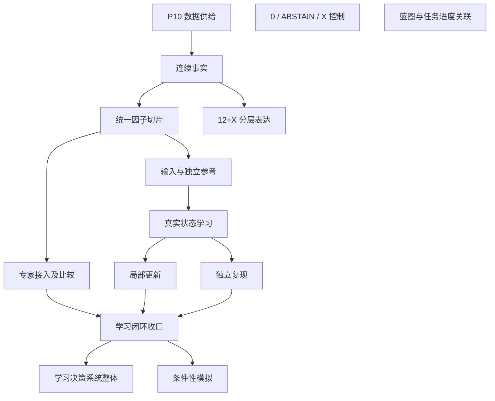

# 学习系统蓝图与模块进度

<!-- Generated by scripts/blueprint_progress.py; do not edit. -->

记录截至：2026-10-27T17:40:25.724590+00:00；这不是实时 GitHub 状态。

任务关闭、工程完成、研究质量、用途价值和使用资格分别记账。
本视图不授予训练、数据访问、P6 或生产权限；不会按 issue 关闭比例计算产品完成率。

[更新机制](../design/blueprint-progress.md) · [总任务 #540](https://github.com/rv198-star/Quanthus/issues/540)

## 模块能力（范围以最新记录为准）

| 模块 | 工程 | 研究质量 | 用途价值 | 使用资格 |
| --- | --- | --- | --- | --- |
| MVP · 学习决策系统整体 | 部分完成 | 未评估 | 未得明确结论 | 未授予 |
| DATA · P10 数据供给 | 限定范围通过 | 仅研究 | 未评估 | 未评估 |
| FACTS · 连续事实 | 限定范围通过 | 未得明确结论 | 未评估 | 仅开发 |
| FACTORS · 统一因子切片 | 部分完成 | 仅研究 | 未评估 | 未授予 |
| REFERENCE · 输入与独立参考 | 限定范围通过 | 未得明确结论 | 未评估 | 未授予 |
| STATES · 12+X 分层表达 | 限定范围通过 | 未得明确结论 | 未评估 | 仅开发 |
| TRAIN · 真实状态学习 | 限定范围通过 | 未得明确结论 | 未评估 | 未授予 |
| UPDATE · 局部更新 | 限定范围通过 | 未得明确结论 | 未评估 | 未授予 |
| EXPERT · 专家接入及比较 | 部分完成 | 未评估 | 未得明确结论 | 未授予 |
| REPRO · 独立复现 | 限定范围通过 | 仅研究 | 未评估 | 未授予 |
| CLOSEOUT · 学习闭环收口 | 部分完成 | 未评估 | 未得明确结论 | 未授予 |
| P6 · 条件性模拟 | 部分完成 | 未评估 | 未评估 | 未授予 |
| S00 · 无序震荡 | 部分完成 | 仅研究 | 未评估 | 未授予 |
| S01 · 止跌企稳 | 部分完成 | 仅研究 | 未评估 | 未授予 |
| S02 · 有序整理 / Head2 | 限定范围通过 | 未得明确结论 | 未评估 | 未授予 |
| S03 · 突破尝试 | 部分完成 | 未得明确结论 | 未评估 | 未授予 |
| S04 · 突破接受 | 部分完成 | 未得明确结论 | 未评估 | 未授予 |
| S05 · 上升趋势 | 部分完成 | 未得明确结论 | 未评估 | 未授予 |
| S06 · 回调检验 | 部分完成 | 未得明确结论 | 未评估 | 未授予 |
| S07 · 结构重建 | 部分完成 | 未得明确结论 | 未评估 | 未授予 |
| S08 · 上行加速/延伸 | 部分完成 | 仅研究 | 未评估 | 未授予 |
| S09 · 高位量价背离 | 部分完成 | 受阻 | 未评估 | 未授予 |
| S10 · 结构破坏 | 限定范围通过 | 仅研究 | 未得明确结论 | 仅开发 |
| S11 · 破坏后反弹 | 限定范围通过 | 仅研究 | 未得明确结论 | 仅开发 |
| S12 · 下降趋势 | 部分完成 | 未得明确结论 | 未评估 | 未授予 |
| CONTROL · 0 / ABSTAIN / X 控制 | 限定范围通过 | 仅研究 | 未评估 | 仅开发 |
| TRACE · 蓝图与任务进度关联 | 限定范围通过 | 未评估 | 未评估 | 仅开发 |

## 当前缺口与下一步

每个模块展示当前重点缺口；全部维度可通过 context 查看，旧记录保留在账本。

| 模块 / 维度 | 已核实范围 | 剩余缺口 | 下一步 | 记录 |
| --- | --- | --- | --- | --- |
| MVP / 用途价值 | 一个具体用途已定义；无新的识别/消费者价值通过，未训练Head2或重开P6 | 新3/4来源、未消费容量与独立参考未闭合；没有产品总百分比分母 | 后续投入先解决合格新来源/参考可行性；不自动新增轮次或机械补数 | CP-540-PURPOSE-20261028-174025 |
| DATA / 使用资格 | P10是外部常设供给依赖 | 本轮未重新验收完整数仓 | 按实际消费者冻结准确输入，不为本蓝图重建数仓 | BASELINE-20261027 |
| FACTS / 识别/研究质量 | 既有连续事实族 | 新用途需准确输入与时间绑定 | 复用已通过资产；按实际新缺口投入 | BASELINE-20261027 |
| FACTORS / 工程 | 同一资产可跨状态/专家复用，保留单位、时点与血缘 | 跨状态最小统一消费契约未全验收 | 只整理下个实际消费者需要的切片 | BASELINE-20261027 |
| REFERENCE / 识别/研究质量 | 原321个episode中318已被参考消费；排除后仅3，低于至少250必要量；原参考结论不变 | 原规则参考不是独立语义真值；剩245只是身份/日历路线 | 不重采同128或重评旧成绩；若重启，由P10精确资格化新来源，再审参考容量 | CP-542-PURPOSE-20261028-174025 |
| STATES / 识别/研究质量 | 分层容器、共存和证据等级 | 各头资格独立，容器完成不等于全12头可用 | 复用已通过资产；按实际新缺口投入 | BASELINE-20261027 |
| TRAIN / 识别/研究质量 | 首个有限真实fit已执行 | 可用候选识别质量未闭合 | 复用已通过资产；按实际新缺口投入 | BASELINE-20261027 |
| UPDATE / 识别/研究质量 | 首个有限局部更新已执行 | 更新执行不等于新版本更优 | 复用已通过资产；按实际新缺口投入 | BASELINE-20261027 |
| EXPERT / 用途价值 | 用途明确但本轮比较NOT_RUN，没有新增决策或收益价值证据 | 3个未用episode不足，独立参考与精确用途准入不存在 | 前置通过再一次比较；否则停放3/4标签，不拖累其他合格模块 | CP-545-PURPOSE-20261028-174025 |
| REPRO / 工程 | 首个fit/update从头复现；不代表时间特征批次独立refit | 各运行独立复现要求分别记录 | 复用已通过资产；按实际新缺口投入 | BASELINE-20261027 |
| CLOSEOUT / 用途价值 | 四类结论分别给出；负结果不能伪装产品可用 | 完整产品MVP尚未验收 | 复用已通过资产；按实际新缺口投入 | BASELINE-20261027 |
| P6 / 使用资格 | 既有引擎可复用；新候选未启动 | 新候选价值与用途门槛未过 | 保留不启动决定 | BASELINE-20261027 |
| S00 / 识别/研究质量 | 保留中性/无序研究解释；ABSTAIN/X不是0 | 没有被当前用途要求的独立中性标签资格 | 只在具体消费者需要中性状态、且参考意义独立时冻结一小批；不为凑齐词汇采样 | CP-540-FOUR-BATCHES-20261027 |
| S01 / 识别/研究质量 | 原下跌背景内减速/企稳研究条件 | 独立意义和父背景12参考资格未闭合 | 先有一个真实的下跌背景用途，再决定条件1是否需要单独参考；保留连续事实 | CP-540-FOUR-BATCHES-20261027 |
| S02 / 识别/研究质量 | 七特征保留研究排序备份；九特征拒绝记录不改 | 未取得新消费者资格；旧评价窗口不能重投票或重调参 | 暂停九特征分支；仅在新用途/证据提出可检验变化时重开投入 | CP-540-FOUR-BATCHES-20261027 |
| S03 / 识别/研究质量 | 旧3=100参考保留；新容量仅3，候选未评分，非质量拒绝 | 缺目的兼容的新参考/数量与独立语义资格 | 停放本次新评分；连续Facts继续按原资格复用 | CP-543-PURPOSE-20261028-174025 |
| S04 / 识别/研究质量 | 旧4=98/模糊16和未评分结论保留；稀缺优先诊断不改变旧结果 | 新未消费容量不足，且剩245未有本用途来源资格 | 不事后补2个4或34个模糊案例，不降低原100/100/50门槛 | CP-543-PURPOSE-20261028-174025 |
| S05 / 识别/研究质量 | 旧5标签停放，连续趋势事实保留 | 没有足够新的可证伪趋势状态假说 | 实际消费者提出无法由现有连续事实解决的问题后，先冻结假说/负对照再给预算 | CP-540-FOUR-BATCHES-20261027 |
| S06 / 识别/研究质量 | 旧6标签停放，过程与支撑事实保留 | 回撤检验相对父背景的独立用途和参考不足 | 与具体回撤消费者绑定一个过程问题；不先启动全域补标签 | CP-540-FOUR-BATCHES-20261027 |
| S07 / 识别/研究质量 | 旧7标签停放，结构修复事实保留 | 新重建假说及相对现有事实的增量未确定 | 先提出可证伪的重建条件和用途，避免延长旧失败分支 | CP-540-FOUR-BATCHES-20261027 |
| S08 / 识别/研究质量 | 高侧加速/延伸作为modifier保留 | 实际消费者需求及覆盖/参考资格未闭合 | 仅在需要一个上行修饰量时做有限覆盖资格；不当作peer-primary标签 | CP-540-FOUR-BATCHES-20261027 |
| S09 / 识别/研究质量 | 高位量价背离修饰量仍受既有关系门槛限制 | 最小活动关系和限定参考没有闭合 | 消费者确需时先验证缺少的活动关系；不靠新阈值或空标签绕过 | CP-540-FOUR-BATCHES-20261027 |
| S10 / 识别/研究质量 | 本状态限定研究证据；独立于其他状态 | 实际用途价值未闭合 | 复用已有开发投影，不重复建设 | BASELINE-20261027 |
| S11 / 识别/研究质量 | 本状态限定研究证据；独立于其他状态 | 实际用途价值未闭合，反弹不等于修复 | 与10一并复用，不自动晋级 | BASELINE-20261027 |
| S12 / 识别/研究质量 | 原下跌背景研究解释与失败证据保留 | 背景参考路线no-pass，尚无新用途资格 | 先确认是否有必须依赖离散下跌背景的用途；不得以条件1反推12合格 | CP-540-FOUR-BATCHES-20261027 |
| CONTROL / 工程 | 中性/弃权/冻结拒绝路径 | 新消费者仍须保留这些边界 | 复用已通过资产；按实际新缺口投入 | BASELINE-20261027 |
| TRACE / 工程 | PR565自审后已合并main；本地CLI、追加记录和生成视图可用 | GitHub Actions账户billing/spending导致job零步骤，远端执行未验收 | 继续用相同CLI本地审计；账户恢复后单独验收远端工作流，不改账单/分支保护 | CP-2-FOUR-BATCHES-20261027 |

## 工作项到蓝图的关系

GitHub 状态只表示任务生命周期；实时检查：`make blueprint-audit`。

| 工作项 | 影响模块 | 对整体目标的贡献 | 最近登记的 issue 状态 |
| --- | --- | --- | --- |
| [META-LEARN-001 / #540](https://github.com/rv198-star/Quanthus/issues/540) | MVP, DATA, FACTS, FACTORS, REFERENCE, STATES, TRAIN, UPDATE, EXPERT, REPRO, CLOSEOUT, P6, S00, S01, S02, S03, S04, S05, S06, S07, S08, S09, S10, S11, S12, CONTROL | 统筹完整学习MVP；模块资格不能由子issue数量推出 | open |
| [P3-FACTOR-001 / #541](https://github.com/rv198-star/Quanthus/issues/541) | FACTS, FACTORS | 交付首批可复用、可追溯且有用途的因子切片 | open |
| [P5-STATE-002 / #542](https://github.com/rv198-star/Quanthus/issues/542) | REFERENCE, DATA, S00, S01, S02, S03, S04, S05, S06, S07, S08, S09, S10, S11, S12 | 逐头确认输入、参考、时间与预算；不自动打开训练 | open |
| [P5-STATE-003 / #543](https://github.com/rv198-star/Quanthus/issues/543) | STATES, TRAIN, CONTROL, S00, S01, S02, S03, S04, S05, S06, S07, S08, S09, S10, S11, S12 | 真实训练与状态评价；k个头的结果不外推全12头 | open |
| [P5-LOCAL-001 / #544](https://github.com/rv198-star/Quanthus/issues/544) | UPDATE, TRAIN, S02 | 真实局部更新及新旧比较；可拒绝新候选 | open |
| [P3-EXPERT-007 / #545](https://github.com/rv198-star/Quanthus/issues/545) | EXPERT | 合格状态接入专家后验证完整决策影响 | open |
| [META-LEARN-002 / #546](https://github.com/rv198-star/Quanthus/issues/546) | MVP, CLOSEOUT, REPRO, P6 | 独立复现，分别交付工程/质量/价值/资格结论 | open |
| [P3-EXPERT-008 / #547](https://github.com/rv198-star/Quanthus/issues/547) | EXPERT | 后续按边际价值扩展专家，未因规划而启动 | open |
| [P3-DECISION-001 / #548](https://github.com/rv198-star/Quanthus/issues/548) | EXPERT, CLOSEOUT | 后续有界优化组合机制，保留硬约束 | open |
| [META-TRACE-001 / #2](https://github.com/rv198-star/Quanthus/issues/2) | TRACE | 维护项目可追溯机制；本轮接入学习MVP，既有长期任务继续保留 | open |
| [P10-DATA-STAGE34-PREFIX-001 / #566](https://github.com/rv198-star/Quanthus/issues/566) | DATA, REFERENCE, S03, S04 | 固定128家2021上市前缀的限定来源资格；P10交接与P5参考、候选评价和消费者准入分开验收 | closed |

## 证据索引

Git 文档按完整 SHA 和内容哈希核验。外部回执仅登记身份，CI 不重新打开来源。

- `PORTFOLIO`：`28df28f295ebf696d67873aeb914c2403e4f2bc4:config/stage-learning/stage-whole-vocabulary-portfolio-synthesis.v1.json`；SHA256 `d71aac7893611f62b3ebc58df81f395b5d7b7c88a1dc255840f502c3e3638fe5`。历史语义与研究处置；不接受生产状态标签。
- `BUNDLE`：`28df28f295ebf696d67873aeb914c2403e4f2bc4:docs/work-items/stage-layered-proposition-bundle.md`；SHA256 `b9ecf3615c9b2859abebae4d9cf189c679122af234ad52f406a898e207bbb1e9`。已接受分层表示与开发视图；不授予新消费者使用。
- `PROJECTION`：`28df28f295ebf696d67873aeb914c2403e4f2bc4:config/stage-10-11-projection-delivery.v1.json`；SHA256 `dc8149c452994b494c7800ca052c3ef793f5399d86b4505a229eabfe3db46e6a`。限定10/11开发投影及旧不可变证据；不证明交易收益。
- `THREE_FOUR`：`28df28f295ebf696d67873aeb914c2403e4f2bc4:docs/acceptance/stock-stage-learning-f-arbitration-inconclusive-20260909.md`；SHA256 `ca83aec94d41e7d670adff275a41b53de56256435f1f88026289c8f0899d766d`。旧外样本在评分前样本不足；不得改称识别质量失败或未消费盲样本。
- `UTILITY`：`28df28f295ebf696d67873aeb914c2403e4f2bc4:docs/acceptance/stage-p033-consumer-utility-20260916.md`；SHA256 `71c35e5ba4ad04b9d50b0ea0f1d9e14235ab10d9d6758c12b84f074b2c295501`。旧解释实验对照信息不等价；归因未闭合。
- `HEAD2_REVIEW`：`cn02:/srv/agentdock/AgentDock/base22-review-afe2526/head2-temporal-review-20261027T050025Z-7f4ecc9/review.md`；SHA256 `f273f3920a411610a05b14793f3d788c18b665fba57316744d2d9a037800d3f2`。7f4ecc9批次复审；九特征拒绝、七特征未取得消费者资格；非新独立训练。
- `FIT_UPDATE`：`cn02:/srv/agentdock/.codex/p10-mvp-window-run-20261025T211421Z-65d0788/rx6800-connect-20261026T062134Z/real-fit-and-reproduction.safe.json`；SHA256 `7d9dd8585dc8def5b01e8f793d42d6c3f1b25aa47368ba6590336d41ecd2abe5`。原有限真实拟合、局部更新和从头复现；不外推后续所有候选。
- `P3_INTERFACE`：`cn02:/srv/agentdock/.codex/learning-mvp-run-20261025T175208Z-4199786/evidence/step2-engineering-complete.safe.json`；SHA256 `9f47e69e8c189772f27955764c58b71406cc43219ac5de74b4c90dfd7361d301`。最小P3接口合成等价/拒绝验收，不代表真实经济比较。
- `MECHANISM`：`e964cf9eb7d8413b4592df5d174fb647ba0ef0dc:docs/design/blueprint-progress.md`；SHA256 `333c91a195f65ce0144cd17e32154bf881a748ba985b3344dae7d760568a8846`。关联机制设计及使用边界，不改变研究用途与执行授权。
- `IMPLEMENTATION_CHECKS`：`cn02:/srv/agentdock/.codex/blueprint-progress-20261027/implementation-checks.safe.json`；SHA256 `cbb00c8d2daf9c92fde2874728c7beb05cac2355d1cc2fcf145a04af20be9c91`。仅本轮项目关联机制工程验收；5,152通过/20跳过；不接受任何研究候选或自动启用GitHub事件。
- `PUBLICATION`：`cn02:/srv/agentdock/.codex/blueprint-progress-20261027/publication-blocker.safe.json`；SHA256 `3117d6cad296588154b87eadf537974c3945f12ec92da30dcdb9f25820398949`。只记录GitHub因OAuth缺少workflow权限拒绝发布；不影响本地工程验收，不构成凭据变更授权。
- `PUBLISHED`：`cn02:/srv/agentdock/.codex/blueprint-progress-20261027/publication-resolution.safe.json`；SHA256 `6c69caecfd498dde1e5a8b977a08ba8ac944833f01c8f92fcfd02a9c5497082f`。经Owner授权取得workflow权限，发布分支和待审PR；未合并。
- `ACTIONS`：`cn02:/srv/agentdock/.codex/blueprint-progress-20261027/github-first-check-details.safe.json`；SHA256 `0b034bf4dd784254b5e98d24ab50ade0f525ae652ff9edac836d460a339091c9`。GitHub Actions job未执行任何steps，注释说明付款或费用上限问题；不认定远端测试已运行。
- `FOUR_BATCHES`：`cn02:/srv/agentdock/.codex/state-portfolio-batches-20261027T072049Z-1c4d007/evidence/four-batch-assessment.safe.json`；SHA256 `5606e7b01806fdf16f302cdc9a8c5a3aa63e5e199bc3a6b51b9de000dc5b8794`。四批次的复用、固定范围可行性与条件处置；不是新3/4评分、研究MVP完成、消费者价值或生产准入。
- `SOURCE`：`cn02:/srv/agentdock/.codex/stage34-prefix-continuation-20261027T114739Z-fc2ffae/evidence/p10-source-handoff.safe.json`；SHA256 `b2242cbd4bf39a63bb1fee717aabef7d3b7dbbb86e634f29e8e21373b1b58615`。仅固定128家2021上市前缀的回溯日线坐标来源；不是全数仓、历史PIT或科学参考验收。
- `REFERENCE`：`cn02:/srv/agentdock/.codex/stage34-prefix-evaluation-20261027T125200Z-fc2ffae/assessment.safe.json`；SHA256 `e205fa56737460c9f82717d069d6005c5849d81de741501cddfe9e89d1c5051e`。318个参考；100/98/16低于100/100/50；候选未评分，非质量拒绝或消费者价值证据。
- `REPRODUCTION`：`cn02:/srv/agentdock/.codex/stage34-prefix-continuation-20261027T114739Z-fc2ffae/evidence/reference-replication.safe.json`；SHA256 `8e4780085ece539557171c0953977523e0cb8e81e2e522d3873f91bf12f83cfc`。同一固定输入的独立新进程重建参考一致，候选预测禁止；不是新样本或第二次科学投票。
- `ASTRA_PREFIX128_REVIEW`：`cn02:/srv/agentdock/AgentDock/base22-review-afe2526/stage34-astra-audit-20261027T144559Z-f0291b7/review.md`；SHA256 `563f0b8decb2d56ba345b296df6233ec2a45613c8b04fc4913f2932303f18c24`。本轮只读审计与下一步建议；125项独立focused通过，当前318参考不足保留；未训练、重评分、补采或授予消费者资格。
- `PREFIX128_ALLOCATION_AUDIT`：`cn02:/srv/agentdock/AgentDock/base22-review-afe2526/stage34-astra-audit-20261027T144559Z-f0291b7/evidence/capacity-audit.safe.json`；SHA256 `3035754a66d6b98afa4b3c2dac242dec0322770c6f16e8d18e7cef64832357f7`。同一固定128、321个episode的原分配容量诊断；199个reclaimed和18个mature被前层占用，不代表重新抽样或新参考通过。
- `CAPACITY`：`cn02:/srv/agentdock/.codex/stage34-purpose-execution-20261027T171432Z-9608a85/evidence/capacity-preflight-final.safe.json`；SHA256 `ce8f8612e15bba278d4432991965417e5d386677b2662f7d92c715ef3948a37a`。固定128的分配/曝光/历史容量诊断；321个episode中318已用，剩3；不产生新参考或评分。
- `ROUTES`：`cn02:/srv/agentdock/.codex/stage34-purpose-execution-20261027T171432Z-9608a85/evidence/remaining-routes.safe.json`；SHA256 `3e7ecde0cda3aa3409e6aa4f46c44cdb76b9acabcfb400380ffcdf8b1d600390`。373身份中剩245只有身份/日历可行性；选定交接不含其新资格，不声称原始数据全局不存在。
- `PURPOSE_DECISION`：`cn02:/srv/agentdock/.codex/stage34-purpose-execution-20261027T171432Z-9608a85/evidence/three-step-decision.safe.json`；SHA256 `f5db9e52afb1c6df0473af24d65af9fc8066bbd80fc76d3cce6584507a410dad`。一个K=5同输入同成本研究用途已冻结；前置未过，第三步NOT_RUN；非识别失败、用途价值或P6准入。
- `NATIVE_GUARD`：`cn02:/srv/agentdock/.codex/stage34-purpose-execution-20261027T171432Z-9608a85/evidence/native-access-verification.safe.json`；SHA256 `e84e66a9e95b482d7eb8f3694813d684557eadf2fb7ca28bb3a1aad89124be51`。OS openat/connect和Python守卫核验；最终容量进程旧native根打开与网络connect为0，非新科学独立真值。
