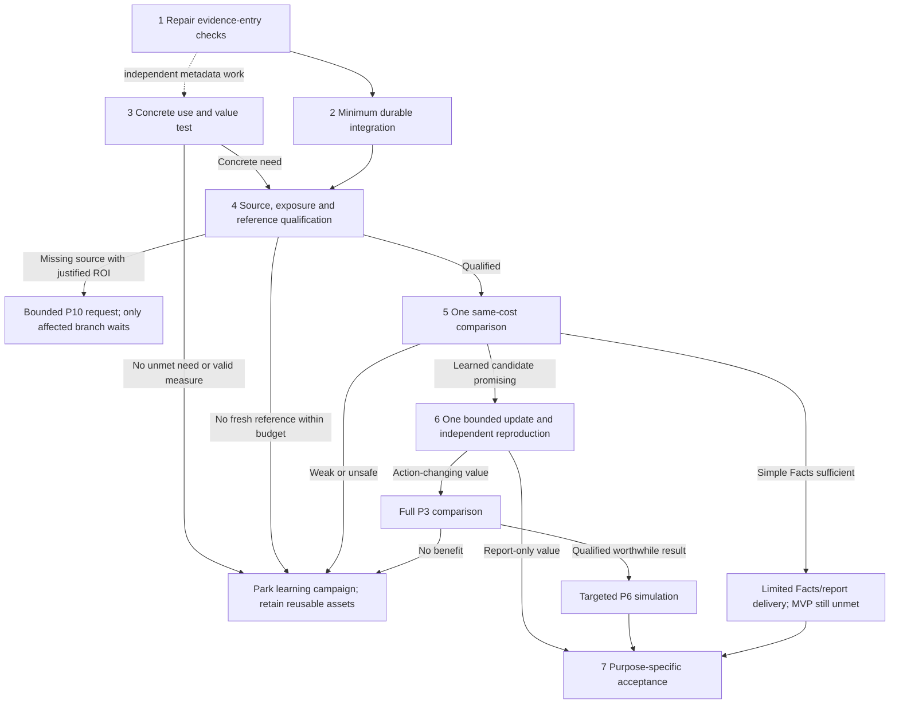

# Learning system: conditional continuation after #545 / #546

| Field | Value |
| --- | --- |
| Design status | approved — Owner continued steps4–7 conditionally on 2026-10-28; material purpose/reference redesign still needs the specified review |
| Delivery gate | blocked for new result-bearing research until its exact request qualifies |
| Work items | #540 coordination; #545 consumer impact; #546 retention/integration; #542–544 conditional learning |
| Governing parents | [blueprint mechanism](../design/blueprint-progress.md), [layered portfolio](../design/stock-stage-vocabulary-portfolio.md), original immutable MVP contract at `e79eeb0...` |
| Audit basis | [independent two-round review](../acceptance/learning545-546-independent-review-20261028.md) |
| Current state | [one generated progress/gap view](learning-blueprint-progress.md) |
| Execution default | Sol 6.1 Max, following the Owner's standing preference; Astra for consequential research-design or adoption review |

This plan grants no training, acquisition, partition, merge or production authority.
It does not redefine the original learning MVP as a report-only product. Estimates
are bounded agent/script wall time, not required human workdays or a promise of
positive findings. Scope and budget must be frozen before each result-bearing batch.

The first-batch [integration contract](learning-asset-integration-20261028.md)
and [consumer opportunity card](../../config/planning/learning-held-review-opportunity.v1.json)
record the implementation boundary and the actual step3 eligibility decision.
The proposed held-priority queue is parked: an existing all-position research
review consumer is verified, but neither an unmet priority-workflow need nor a
fresh compatible value reference has been established. This is the planned negative
branch, not acceptance of the learning product or a claim that all future uses lack value.

That finding concerns the **proposed human queue only**. It is not an additional
prerequisite for the original algorithmic learning MVP. The Owner's continuation
therefore first checked actual entry/held consumers and remaining identity capacity;
the [step4 assessment](../acceptance/learning-route4-7-20261028.md) and
[machine-readable disposition](../../config/planning/learning-route4-7-qualification.20261028.json)
record the result. Step4's assessment is complete, its experiment gate has **not**
passed, steps5–6 have not run, and step7 grants no new admission. These are not four
completed product steps.

## Objective and reason for the route

Deliver one useful learning-to-consumer loop, with a preserved old version when a
candidate fails. Existing Facts, a working fitter and reader, and safe decision
interfaces are assets. No qualified incremental decision benefit has yet been
established. More features, more state labels, a merged PR or repeated old-sample
scores do not independently close that gap.

The next batch should combine **small engineering repairs and durable asset
handoff with one concrete consumer-opportunity decision**. Do not spend the whole
batch polishing infrastructure, and do not restart Head2/3/4 by default. The
three first steps below have a proposed total ceiling of **4 hours**; checkpoints
can preserve partial completion without consuming the later research budgets.

## Steps and branching criteria

| Step | Deliverable and acceptance | Estimated effort / ceiling | If it fails or finds no useful opportunity |
| --- | --- | --- | --- |
| 1. Repair the reusable comparison boundary | Reject altered held bytes/episode keys and code/config drift before output; pin the next capture launch; normalize no-process counts in new output. Keep original 8,393-row evidence unchanged and add disposable negative tests | 45–90 min; ceiling 90 min | Block this runner's reuse/merge, retain the old narrow negative result; do not rebuild historical sources to fix a CLI guard |
| 2. Preserve and integrate the minimum useful assets | Inventory exact local-only commits, source closure, contracts and tests; create a reviewed Git handoff. Clean-checkout reader smoke must load old v0/v1 and seven/nine checkpoints with old hashes; missing input stays UNAVAILABLE/ABSTAIN. Review PR570→572→573→574→575 in dependency order without blindly merging old histories | 1–2 h; ceiling 2 h | Keep protected local histories and a precise integration gap. Do not delete them or mistake absent remote CI for a failed model. Integrate only proved assets; isolate unrelated old branch failures |
| 3. Decide one actual consumer opportunity | Produce one frozen use card for an **offline, after-close held-position review queue**: current B decision/reason is the control; candidate adds qualified continuous evidence and uncertainty for review priority. Specify who/what consumes it, which decision changes, denominator, existing information, acceptable mistakes, fixed capacity, cost and independent evaluation method. Existing receipts may diagnose feasibility, not become fresh evaluation | 1–1.5 h; ceiling 90 min, shared first-batch cap applies | If existing B already covers the useful decisions, keep an explanation-only research asset and stop action-changing work. If no credible independent value measure exists, stop before new collection/training; do not invent a learning success |
| 4. Qualify a narrow, fresh comparison | Freeze source/member/code identity, feature contract, exposure ledger, train/update/evaluation separation, an independent purpose-compatible reference, material-error/cost criteria and sample capacity **before scoring**. First assess existing approved inventory/metadata | 1–2 h; ceiling 2 h | Missing shared sources go to a minimal P10 request with exact fields/windows and a cost/benefit case. Inadequate fresh reference or old exposure stops this branch; no moving to protected years, relabeling consumed evaluation, or relaxing an old request |
| 5. Run one same-cost consumer comparison | Compare C0=current review, C1=one predeclared simple continuous-Facts rule, C2=retained seven-feature Head2 only if its purpose-specific comparison qualifies. Freeze identical eligible universe, review slots and information timing. Report useful/error/unknown counts, issuer/date concentration and measured compute; unknowns stay in the denominator. No claim about actual human minutes without measuring them | 2–4 h; ceiling 4 h, then stop | C1 suffices → keep the simpler tool; no evidence that learning adds value. C2 fails or fragile → retain the old version and close the experiment negatively. Evidence insufficient → preserve inconclusive outcome. Do not tune thresholds or rerun nine features |
| 6. Complete a candidate-specific learning/update loop, only if warranted | If a qualified candidate has material promise and a defined learnable error, run at most one approved fit/update on disjoint training/development data, with untouched evaluation and an independent reproduction. Reuse the existing interfaces; preserve old checkpoint/scaler/parent identity. A seven-feature update must be proved for seven features, not inherited from the old four-feature fixture | 1.5–3 h; ceiling 3 h after a measured run budget | Reject the update on quality, safety, value or cost failure; old version remains readable. Do not require repeated training merely to obtain a positive result |
| 7. Follow the actual use to acceptance | Review-list/explanation-only use gets only that admission. An action-changing candidate first needs a separately frozen full P3 B-vs-candidate capital comparison, including the candidate's whole path and costs; only a worthwhile qualified result can justify targeted P6 simulation. Return to #546 with four independent engineering/quality/value/admission verdicts | P3 comparison engineering/run allowance provisionally 2–4 h; P6 estimate only after its concrete scenario and capacity are measured | No value → no P6; unsafe/inconclusive → keep old decision path. A useful non-learning report does not close the learning MVP. Preserve an explicit parked experiment while #540/#546 unmet product gates remain open |

Step 3 is a **proposed use**, not an assertion that a current operational review
queue has already been observed or needs a new service. First verify the actual
consumer and its present output. If there is no such unmet need, do not manufacture
one to keep training busy. The first batch must end with either a concrete,
testable use and eligibility verdict or a reasoned pause of the learning campaign.

The present pointwise #545 reduction rule stays parked. A changed purpose requires
a separately versioned request; the previous one-episode result is not its fresh
holdout and cannot be mined for a better threshold, horizon or issuer selection.

## Which assets enter which branch

| Asset | Disposition now | Unlock condition |
| --- | --- | --- |
| Continuous Facts and accepted expert safeguards | First reuse choice; preserve retrospective grade and missingness | Concrete purpose with a compatible qualified input; no automatic historical PIT or trading authority |
| Head2 seven features | Lowest engineering-cost learned candidate, retained but not automatically selected | A review-priority need it could plausibly improve, fresh purpose-qualified reference, and fixed comparison criteria |
| Head2 nine features | Park | A genuinely new hypothesis and evidence, not a retest of the rejected batch |
| Current 10/11 reduction mapping | Park | A different predeclared use justified independently of this one-episode result; no horizon/threshold rescue |
| Stage3/4 | Park | Material consumer need plus an actual source-closure/fresh-reference capacity improvement; metadata agreement alone is insufficient |
| Other 12+X states and extra experts | Demand-driven reserve | A named decision that cannot be solved sufficiently with existing Facts/simple rules; no completeness campaign |

Seven being cheaper to reuse is an engineering judgment, not evidence it is the
best financial predictor. C1 winning is a useful product result but not evidence
that a trained state head is qualified. Keep these outcomes separate in the ledger.
Head2 assesses orderly consolidation; its raw score is not a support-damage,
loss-probability or liquidation signal. If step 3 identifies a risk-explanation
need rather than an orderly-consolidation distinction, exclude Head2 from that
comparison and reuse continuous Facts only. Do not change the consumer's question
merely to give the retained model a role. A qualified entry-candidate follow-up
queue is a separate possible use if its actual need, reference and exposure
budget are established before evaluation.

## Parallelism and stop decisions

Integration tests can run while the consumer card and existing-source metadata are
assessed. Share one immutable Facts materialization inside each Job. An independent
reproduction remains independent when the contract requires it. P10 can handle an
approved narrow source request without freezing unrelated documentation, tests or
asset preservation. Do not schedule multiple result-bearing experiments in parallel
against the same evaluation population, or count old consumed windows as fresh.
Reusing the prior Facts TMP in a different Job requires its complete identity and
purpose/retention disposition; calling it a cache does not create that qualification.

First-batch target is **3–4 hours** with no new acquisition/training. If steps 4–6
qualify, their additional bounded allowance is roughly **4.5–9 hours**; it is not a
promise that the product will become useful within that time. External evidence
recovery, permission/account remediation, and possible P6 are excluded, with no
invented deadline. Each failed branch can finish earlier with a valid negative
decision; there is no mandatory twelve-state completion or future 66-day wait.

Sol 6.1 Max can execute the repairs, integration, frozen comparisons and receipts.
Use Astra for a material sample/reference/purpose redesign, conflicting evidence,
or a candidate that would change action authority, and for final scientific
adoption review. Routine safe failures and code debugging do not require another
model approval. Human authorization is only required where a genuinely new scope
crosses existing data/research/production boundaries; elapsed time is not approval.

## Project linkage and completion

Track step 1 under #545 and asset retention/integration under #546. #540 owns the
use selection and the four-facet product status. Register any genuinely new scoped
work item/module contribution before implementation; do not create an unrelated
generic platform. Conditional input/reference, training and local-update work maps
to #542, #543 and #544. P10 owns shared source deficiencies; P6 is a conditional
consumer, not a reason to run a candidate without value evidence.

At each acceptance, rejection, block or stop, append one evidence-bound blueprint
checkpoint: exact version, relevant module/facet, remaining gap, next executable
action. Do not reopen completed negative experiments, repeat full-history scans
without changed inputs, or use a completed Mission/PR as a product acceptance flag.

## Current decision for the next qualified request

The verified original consumer is algorithmic: `FormalStrategyRunner.evaluate_entry`
and its P4 pass-through control feed the existing expert/veto/constraint path;
`evaluate_held` handles positions. `pending_assessment` deliberately gives Head2 no
action authority. The 3/4 and #541 research queues do not supply a purpose-compatible
Head2 reference or an observed human capacity limit.

The next scientific review should decide **whether current20 orderly consolidation
has a plausible, testable role at the algorithmic entry decision**. This is the
preferred question over inventing a human queue or treating Head2 as a risk score.
It is a proposal, not an approved score-to-action rule. Astra should review:

1. A concrete entry decision change and its hypothesis, against the existing B
   control and one simple continuous-Facts alternative, with all hard guardians
   preserved. Define the action mapping and cost/error criteria before reading new
   outcomes; do not select a threshold from old comparisons.
2. Separate independent **state-quality** reference from **decision-value** evidence.
   A blind consolidation assessment can evaluate state recognition; it does not
   prove profitable entry selection. A subsequent action-changing use needs its
   own complete P3 capital comparison before any targeted P6 proposal.
3. Choose a defensible evaluation cohort before scoring. The old Head2 exclusion
   rules leave at most 13 issuers in the inspected pool, the same issuers in both
   months. They cannot reproduce the old 48-distinct-issuer evaluation, and they
   have no new source/action or reference qualification. A smaller pilot would
   answer a narrower question and needs a new design; a broader cohort inside
   authorized history needs explicit exposure qualification. This census is not
   evidence that no other historical cohort exists.

If that review cannot state a useful decision, independent reference and finite
qualification path, park this learning campaign and preserve the existing assets.
Do not commission source work or refit a model merely to keep the pipeline active.
If it can, freeze one new request and its exact input closure/split, then resume
steps4→5→6 only as their conditions pass. No new data acquisition, protected-year
access, threshold or production authority is granted by this proposal.
