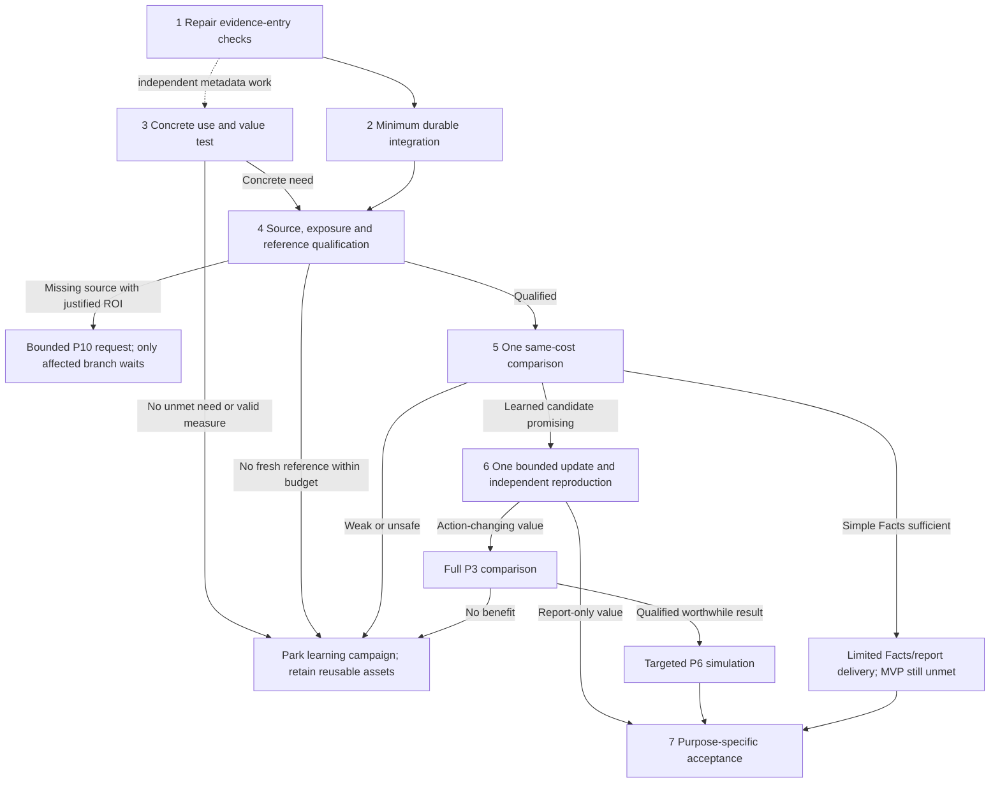

# Learning system: conditional continuation after #545 / #546

| Field | Value |
| --- | --- |
| Design status | approved — Owner continued steps4–7 conditionally on 2026-10-28; material purpose/reference redesign still needs the specified review |
| Delivery gate | blocked for new result-bearing research until its exact request qualifies |
| Work items | #540 coordination; #545 consumer impact; #546 retention/integration; #542–544 conditional learning |
| Governing parents | [blueprint mechanism](../design/blueprint-progress.md), [layered portfolio](../design/stock-stage-vocabulary-portfolio.md), original immutable MVP contract at `e79eeb0...` |
| Audit basis | [independent two-round review](../acceptance/learning545-546-independent-review-20261028.md) |
| Latest review | [Steps1–4 review](../acceptance/learning1-4-astra-review-20261029.md); the proposed amendment at the end replaces another open-ended purpose-review task |
| Current state | [one generated progress/gap view](learning-blueprint-progress.md) |
| Execution default | Sol 6.1 Max, following the Owner's standing preference; Astra for consequential research-design or adoption review |

This plan grants no training, acquisition, partition, merge or production authority.
It does not redefine the original learning MVP as a report-only product. Estimates
are bounded agent/script wall time, not required human workdays or a promise of
positive findings. Scope and budget must be frozen before each result-bearing batch.

## Current recovery checkpoint — March successor completed

The Owner separately approved the fixed 2021-03-31 TRAIN20 / EVAL87 successor on
2026-10-29. Its [three-step execution and negative conclusion](../acceptance/learning-entry-march-confirmation-20261029.md)
supersede the unexecuted status of the reviewed successor proposal below, without
changing that proposal or any older frozen request retroactively. All 87 cases
were retained, the blind-reference support gate passed, one early model was fitted,
and three complete capital paths plus independent reproduction finished.

**Park this Head2 entry-filter candidate:** it trails original B after fees and
has worse drawdown than both controls. Usage remains `NOT_GRANTED`; the learning
MVP remains unaccepted. Retain the engineering assets, not an automatic next cutoff
or P6 activation. Current gaps and scoped module verdicts are recorded through the
[blueprint ledger](learning-blueprint-progress.md). Historical proposals below are
context, not outstanding instructions to repeat the completed comparison.

The first-batch [integration contract](learning-asset-integration-20261028.md)
and [consumer opportunity card](../../config/planning/learning-held-review-opportunity.v1.json)
record the implementation boundary and the actual step3 eligibility decision.
The proposed held-priority queue is parked: an existing all-position research
review consumer is verified, but neither an unmet priority-workflow need nor a
fresh compatible value reference has been established. This is the planned negative
branch, not acceptance of the learning product or a claim that all future uses lack value.

That finding concerns the **proposed human queue only**. It is not an additional
prerequisite for the original algorithmic learning MVP. The Owner's continuation
therefore first checked actual entry/held consumers and remaining identity capacity;
the [step4 assessment](../acceptance/learning-route4-7-20261028.md) and
[machine-readable disposition](../../config/planning/learning-route4-7-qualification.20261028.json)
record the result. Step4's assessment is complete, its experiment gate has **not**
passed, steps5–6 have not run, and step7 grants no new admission. These are not four
completed product steps.

## Objective and reason for the route

Deliver one useful learning-to-consumer loop, with a preserved old version when a
candidate fails. Existing Facts, a working fitter and reader, and safe decision
interfaces are assets. No qualified incremental decision benefit has yet been
established. More features, more state labels, a merged PR or repeated old-sample
scores do not independently close that gap.

The next batch should combine **small engineering repairs and durable asset
handoff with one concrete consumer-opportunity decision**. Do not spend the whole
batch polishing infrastructure, and do not restart Head2/3/4 by default. The
three first steps below have a proposed total ceiling of **4 hours**; checkpoints
can preserve partial completion without consuming the later research budgets.

## Steps and branching criteria

| Step | Deliverable and acceptance | Estimated effort / ceiling | If it fails or finds no useful opportunity |
| --- | --- | --- | --- |
| 1. Repair the reusable comparison boundary | Reject altered held bytes/episode keys and code/config drift before output; pin the next capture launch; normalize no-process counts in new output. Keep original 8,393-row evidence unchanged and add disposable negative tests | 45–90 min; ceiling 90 min | Block this runner's reuse/merge, retain the old narrow negative result; do not rebuild historical sources to fix a CLI guard |
| 2. Preserve and integrate the minimum useful assets | Inventory exact local-only commits, source closure, contracts and tests; create a reviewed Git handoff. Clean-checkout reader smoke must load old v0/v1 and seven/nine checkpoints with old hashes; missing input stays UNAVAILABLE/ABSTAIN. Review PR570→572→573→574→575 in dependency order without blindly merging old histories | 1–2 h; ceiling 2 h | Keep protected local histories and a precise integration gap. Do not delete them or mistake absent remote CI for a failed model. Integrate only proved assets; isolate unrelated old branch failures |
| 3. Decide one actual consumer opportunity | Produce one frozen use card for an **offline, after-close held-position review queue**: current B decision/reason is the control; candidate adds qualified continuous evidence and uncertainty for review priority. Specify who/what consumes it, which decision changes, denominator, existing information, acceptable mistakes, fixed capacity, cost and independent evaluation method. Existing receipts may diagnose feasibility, not become fresh evaluation | 1–1.5 h; ceiling 90 min, shared first-batch cap applies | If existing B already covers the useful decisions, keep an explanation-only research asset and stop action-changing work. If no credible independent value measure exists, stop before new collection/training; do not invent a learning success |
| 4. Qualify a narrow, fresh comparison | Freeze source/member/code identity, feature contract, exposure ledger, train/update/evaluation separation, an independent purpose-compatible reference, material-error/cost criteria and sample capacity **before scoring**. First assess existing approved inventory/metadata | 1–2 h; ceiling 2 h | Missing shared sources go to a minimal P10 request with exact fields/windows and a cost/benefit case. Inadequate fresh reference or old exposure stops this branch; no moving to protected years, relabeling consumed evaluation, or relaxing an old request |
| 5. Run one same-cost consumer comparison | Compare C0=current review, C1=one predeclared simple continuous-Facts rule, C2=retained seven-feature Head2 only if its purpose-specific comparison qualifies. Freeze identical eligible universe, review slots and information timing. Report useful/error/unknown counts, issuer/date concentration and measured compute; unknowns stay in the denominator. No claim about actual human minutes without measuring them | 2–4 h; ceiling 4 h, then stop | C1 suffices → keep the simpler tool; no evidence that learning adds value. C2 fails or fragile → retain the old version and close the experiment negatively. Evidence insufficient → preserve inconclusive outcome. Do not tune thresholds or rerun nine features |
| 6. Complete a candidate-specific learning/update loop, only if warranted | If a qualified candidate has material promise and a defined learnable error, run at most one approved fit/update on disjoint training/development data, with untouched evaluation and an independent reproduction. Reuse the existing interfaces; preserve old checkpoint/scaler/parent identity. A seven-feature update must be proved for seven features, not inherited from the old four-feature fixture | 1.5–3 h; ceiling 3 h after a measured run budget | Reject the update on quality, safety, value or cost failure; old version remains readable. Do not require repeated training merely to obtain a positive result |
| 7. Follow the actual use to acceptance | Review-list/explanation-only use gets only that admission. An action-changing candidate first needs a separately frozen full P3 B-vs-candidate capital comparison, including the candidate's whole path and costs; only a worthwhile qualified result can justify targeted P6 simulation. Return to #546 with four independent engineering/quality/value/admission verdicts | P3 comparison engineering/run allowance provisionally 2–4 h; P6 estimate only after its concrete scenario and capacity are measured | No value → no P6; unsafe/inconclusive → keep old decision path. A useful non-learning report does not close the learning MVP. Preserve an explicit parked experiment while #540/#546 unmet product gates remain open |

Step 3 is a **proposed use**, not an assertion that a current operational review
queue has already been observed or needs a new service. First verify the actual
consumer and its present output. If there is no such unmet need, do not manufacture
one to keep training busy. The first batch must end with either a concrete,
testable use and eligibility verdict or a reasoned pause of the learning campaign.

The present pointwise #545 reduction rule stays parked. A changed purpose requires
a separately versioned request; the previous one-episode result is not its fresh
holdout and cannot be mined for a better threshold, horizon or issuer selection.

## Which assets enter which branch

| Asset | Disposition now | Unlock condition |
| --- | --- | --- |
| Continuous Facts and accepted expert safeguards | First reuse choice; preserve retrospective grade and missingness | Concrete purpose with a compatible qualified input; no automatic historical PIT or trading authority |
| Head2 seven features | Lowest engineering-cost learned candidate, retained but not automatically selected | A review-priority need it could plausibly improve, fresh purpose-qualified reference, and fixed comparison criteria |
| Head2 nine features | Park | A genuinely new hypothesis and evidence, not a retest of the rejected batch |
| Current 10/11 reduction mapping | Park | A different predeclared use justified independently of this one-episode result; no horizon/threshold rescue |
| Stage3/4 | Park | Material consumer need plus an actual source-closure/fresh-reference capacity improvement; metadata agreement alone is insufficient |
| Other 12+X states and extra experts | Demand-driven reserve | A named decision that cannot be solved sufficiently with existing Facts/simple rules; no completeness campaign |

Seven being cheaper to reuse is an engineering judgment, not evidence it is the
best financial predictor. C1 winning is a useful product result but not evidence
that a trained state head is qualified. Keep these outcomes separate in the ledger.
Head2 assesses orderly consolidation; its raw score is not a support-damage,
loss-probability or liquidation signal. If step 3 identifies a risk-explanation
need rather than an orderly-consolidation distinction, exclude Head2 from that
comparison and reuse continuous Facts only. Do not change the consumer's question
merely to give the retained model a role. A qualified entry-candidate follow-up
queue is a separate possible use if its actual need, reference and exposure
budget are established before evaluation.

## Parallelism and stop decisions

Integration tests can run while the consumer card and existing-source metadata are
assessed. Share one immutable Facts materialization inside each Job. An independent
reproduction remains independent when the contract requires it. P10 can handle an
approved narrow source request without freezing unrelated documentation, tests or
asset preservation. Do not schedule multiple result-bearing experiments in parallel
against the same evaluation population, or count old consumed windows as fresh.
Reusing the prior Facts TMP in a different Job requires its complete identity and
purpose/retention disposition; calling it a cache does not create that qualification.

First-batch target is **3–4 hours** with no new acquisition/training. If steps 4–6
qualify, their additional bounded allowance is roughly **4.5–9 hours**; it is not a
promise that the product will become useful within that time. External evidence
recovery, permission/account remediation, and possible P6 are excluded, with no
invented deadline. Each failed branch can finish earlier with a valid negative
decision; there is no mandatory twelve-state completion or future 66-day wait.

Sol 6.1 Max can execute the repairs, integration, frozen comparisons and receipts.
Use Astra for a material sample/reference/purpose redesign, conflicting evidence,
or a candidate that would change action authority, and for final scientific
adoption review. Routine safe failures and code debugging do not require another
model approval. Human authorization is only required where a genuinely new scope
crosses existing data/research/production boundaries; elapsed time is not approval.

## Project linkage and completion

Track step 1 under #545 and asset retention/integration under #546. #540 owns the
use selection and the four-facet product status. Register any genuinely new scoped
work item/module contribution before implementation; do not create an unrelated
generic platform. Conditional input/reference, training and local-update work maps
to #542, #543 and #544. P10 owns shared source deficiencies; P6 is a conditional
consumer, not a reason to run a candidate without value evidence.

At each acceptance, rejection, block or stop, append one evidence-bound blueprint
checkpoint: exact version, relevant module/facet, remaining gap, next executable
action. Do not reopen completed negative experiments, repeat full-history scans
without changed inputs, or use a completed Mission/PR as a product acceptance flag.

## Current decision for the next qualified request

The verified original consumer is algorithmic: `FormalStrategyRunner.evaluate_entry`
and its P4 pass-through control feed the existing expert/veto/constraint path;
`evaluate_held` handles positions. `pending_assessment` deliberately gives Head2 no
action authority. The 3/4 and #541 research queues do not supply a purpose-compatible
Head2 reference or an observed human capacity limit.

The next scientific review should decide **whether current20 orderly consolidation
has a plausible, testable role at the algorithmic entry decision**. This is the
preferred question over inventing a human queue or treating Head2 as a risk score.
It is a proposal, not an approved score-to-action rule. Astra should review:

1. A concrete entry decision change and its hypothesis, against the existing B
   control and one simple continuous-Facts alternative, with all hard guardians
   preserved. Define the action mapping and cost/error criteria before reading new
   outcomes; do not select a threshold from old comparisons.
2. Separate independent **state-quality** reference from **decision-value** evidence.
   A blind consolidation assessment can evaluate state recognition; it does not
   prove profitable entry selection. A subsequent action-changing use needs its
   own complete P3 capital comparison before any targeted P6 proposal.
3. Choose a defensible evaluation cohort before scoring. The old Head2 exclusion
   rules leave at most 13 issuers in the inspected pool, the same issuers in both
   months. They cannot reproduce the old 48-distinct-issuer evaluation, and they
   have no new source/action or reference qualification. A smaller pilot would
   answer a narrower question and needs a new design; a broader cohort inside
   authorized history needs explicit exposure qualification. This census is not
   evidence that no other historical cohort exists.

If that review cannot state a useful decision, independent reference and finite
qualification path, park this learning campaign and preserve the existing assets.
Do not commission source work or refit a model merely to keep the pipeline active.
If it can, freeze one new request and its exact input closure/split, then resume
steps4→5→6 only as their conditions pass. No new data acquisition, protected-year
access, threshold or production authority is granted by this proposal.

## Astra-reviewed proposed amendment, 2026-10-29

| Field | Value |
| --- | --- |
| Design status | approved for A–C by Owner continuation on 2026-10-29; D/E remain conditional and unactivated |
| Delivery gate | A–C completed within the bounded request; independent confirmation remains blocked pending exact qualification |
| Parent and evidence | This conditional route; [steps1–4 review](../acceptance/learning1-4-astra-review-20261029.md) |
| Execution | Sol 6.1 Max for bounded implementation and execution; another Astra review is needed only for conflicting scientific evidence or adoption, not routine preparation |

The selected next question is: **among the existing B/P4 entry opportunities, does
orderly consolidation immediately before the signal add useful selection information
beyond a simple frozen rule?** It is not a held-risk or human-ranking experiment.
The mechanism is plausible enough for a small development diagnostic, not established
enough to justify training, fresh annotation or a full replay as the first action.

### Concrete comparison, frozen before any outcome inspection

- **Decision coordinate:** an existing entry event on T. Compute the unchanged
  prior20/current20 feature contract over the 40 sessions ending **T−1**, so the
  breakout on T does not redefine the consolidation being assessed. This changes
  the consumer anchor in a new request, not the old model target or old results.
  All assessments occur after T close; an admitted simulated fill is no earlier
  than T+1 open. The retained checkpoint's last training observation must precede
  every scored anchor. Source knowledge gaps stay explicitly retrospective.
- **C0:** the exact existing B/P4 control, including its actual position-risk
  setting, capacity, allocation, exit, cost and execution policies, pinned by SHA.
  Do not choose a favorable control variant after observing differences.
- **C1:** C0 plus one research entry filter using the unchanged R0 Stage2 predicate
  from `order-rule-screen.v1.json` and its exact `stage2_predicate` adapter:
  absolute efficiency ≤0.33, width ≤0.18, width change ≤−0.20 and absolute center
  shift ≤0.04. These are existing control parameters, not newly optimized values.
  False means no positive assertion; it is not an independent negative state label.
- **C2:** the same filter position using the frozen seven-feature checkpoint and
  its existing raw diagnostic threshold 0.5. No nine-feature retry, new features,
  calibration or fitting. The score is not a probability of a winning trade.
- **Action meaning:** the experimental filter only withholds an otherwise eligible
  new entry; it cannot create an entry rejected by B or any hard guardian, force a
  sale, change position sizing or suppress an original risk exit. Missing required
  candidate inputs block that candidate's new entry and raise its reason; unknown
  cases remain in the complete opportunity denominator. C0's own missingness
  behavior stays unchanged. No live policy is changed by this proposal.
- **Fairness:** same opportunity universe, timing, source closure, code, capital
  and fees. Report both the complete population and common known-input subset;
  never drop unknowns or force equal trade counts to make results look comparable.
  A filter leaves cash uninvested, which the later whole-capital comparison must
  account for. A five-slot report queue supplies none of these capital assumptions.

The native rule and model are **research controls** at this point. Their inclusion
does not establish state truth or consumer admission. A synthetic adapter must
keep `pending_assessment` and all existing live activation gates unchanged.

### Ordered execution and stop rules

| Block | Exact work and deliverable | Ceiling / branching rule |
| --- | --- | --- |
| A. Complete the small input bridge | Bring only the unchanged seven-feature/R0 dependency closure from retained code into the task branch; bind exact code/config/checkpoint/scaler/source identities. Synthetic tests cover T−1, model-training cutoff, unknown input, original guardian precedence and no new sale. Freeze the purpose card and reuse/disposition ledger before real use | 45 minutes; no whole old-branch merge or general learning platform. Missing an exact code dependency is an engineering gap, not a P10 source issue |
| B. Development decision-difference census | Use already qualified and explicitly designated development inputs only. Begin with the original B/P4 opportunity metadata, exclude all applicable sealed evaluation/holdout roles, and require complete 40-session/source/action scope and post-training anchors. Record every inclusion/exclusion before scoring. Materialize shared Facts once; compute C0/C1/C2 applicability, entry-decision differences, issuer/date/episode concentration and actual compute cost. Do not inspect future returns in this block | 90 minutes; zero new collection, fit, update, labels or economic replay. This is reused development evidence, never fresh confirmation. If sources or usable decisions are absent, report the exact gap; do not hunt archives or replace samples |
| C. Choose the smallest justified continuation | If C2 makes no additional decision difference from C1, stop the learned branch. If all its differences disappear when the largest issuer or largest decision-date cluster is removed, stop for concentration. Otherwise freeze a single independent confirmation request. A useful C1-only hypothesis can continue separately without claiming learning-MVP acceptance | 30 minutes; the concentration test is a low-cost futility rule, not a statistical-power or profitability test. No threshold/horizon rescue after seeing differences |
| D. Qualify and run the surviving comparison | Freeze a new exact source/exposure/split ledger and later evaluation anchors within authorized 2012–2021 history. Use the old reference protocol only for the same consolidation meaning, blinded to candidate scores and future returns. Freeze finite sample/support/error/value criteria before opening new reference or outcome data. Independently evaluate state recognition and complete capital-path value; reuse one immutable in-Job panel for the three paths | Additional 2–4 hours only after a measured budget and qualification. First inspect existing exact inventory; a genuine shared-source deficit becomes one minimal P10 request, not a speculative source hunt. No collection authority is implied |
| E. Candidate update and adoption | Only a qualified, promising learned candidate with a specific error established on training/development data justifies one seven-feature fit/update and required independent reproduction. Preserve old version/scaler/parent. Use an untouched, separately reserved final evaluation for an updated candidate | Conditional, at most one additional 3-hour batch after resource measurement. If D's evaluation motivates a change, it is consumed and cannot evaluate that update afresh. No new P6 unless qualified complete-path value warrants its separate scenario |

Blocks A–C have an approved combined **2 hours 45 minutes maximum**, including a safe final
receipt. They need not spend the whole allowance. Reserve at most 128 MiB new
system-disk files and 1 GiB new data-disk files, use one worker and a 2 GiB RSS stop
threshold; freeze the actual mounted-device/free-space snapshot and preserve the
8 GiB floor on each written device before launch. If the measured fixed inputs do
not fit, stop that block and report a specific budget adjustment; do not start a
full-history scan. These are proposed next-job ceilings, not claims that a real
new batch has been measured or run. No more asset preservation passes are needed
when their exact input identities are unchanged.

### Reference and value are separate decisions

Block B needs no new independent state label to determine whether two frozen
functions produce different proposed entries. It does need qualified inputs and
explicit research-use scope. This does not bypass the independent-reference
requirement for declaring a state head correct or admitting its real decision use.

For D, sample size follows the **new** question and measured available support.
The former 48-issuer design is not a universal requirement; 13 remaining old-pool
issuers are not universal capacity. The existing 1,453 identity records are only
an inventory, not a fresh cohort. Audit issuer/alias exposure and timing across
all applicable previous selections before selecting anything. Retain sealed
evaluation roles; do not turn them into development data by changing a name.
If only a small pilot can qualify, predeclare its limited claim and uncertainty,
or stop. Do not shrink an old frozen evaluation or invent a powered test.

The later capital comparison must report net whole-capital return, drawdown,
turnover/fees, time invested, coverage and issuer/date concentration, and show
the effect of removing the largest contributing issuer. Any materiality tolerance
must be fixed from the applicable contract or declared cost/risk objective before
opening those outcomes. A tiny development improvement, fewer trades or a higher
state-label agreement alone cannot justify adoption. If simple Facts suffice,
retain that limited product evidence and leave the learning MVP's unmet gates
explicit; do not train a model just to satisfy a checklist.

### What changes now and what does not

The audit resolved the pending scientific direction review with the above bounded
proposal. The subsequent Owner request activated A–C only, under the separately
frozen diagnostic and exact existing development inputs. It grants no holdout
opening, collection, consumer authority or production changes. The old human-queue card and step4
negative receipt remain immutable historical evidence. The blueprint records the
new next action while keeping quality/value/admission unaccepted. Old 48/80
evaluation, nine-feature rejection, 10/11 reduction stop and 3/4 disposition are
not reopened. If A–C fail their inexpensive feasibility test, close this particular
entry hypothesis and retain the assets; do not automatically launch another head.

### A–C completion

The [executed three-step receipt](../acceptance/learning-entry-diagnostic-20261029.md)
records790 frozen opportunities,760 known inputs and221 C1/C2 differences across208
issuers/75 dates. Both predeclared futility checks pass. These are reused development
differences, predominantly a more permissive model filter, not quality or economic
acceptance. The next [independent qualification request](../../config/research/learning-mvp/entry-confirmation-qualification-request.v1.json)
pins the candidate and remaining exact gates; it does not activate D/E. No threshold,
feature, fit, protected-year access, production or P6 change occurred.

### D qualification disposition,2026-10-29

The Owner next authorized independent qualification followed by a full capital-path
comparison **only after its gates pass**, and a use-admission verdict. This later
authority is recorded in the new [activation](../../config/research/learning-mvp/entry-confirmation-activation.v1.json);
it does not rewrite the earlier inactive qualification request or activate E.

The [executed qualification](../acceptance/learning-entry-confirmation-20261029.md)
accounts for all22,955 original B events:22,041 before the model time boundary,
116 previously excluded issuer aliases,8 T−1 anchors at/before that boundary and
790 already consumed development opportunities. **Zero unconsumed independent B
opportunities remain in this fixed stream.** The other975 metadata inventory
identities are not qualified fresh entry samples. This is a scoped sample-capacity
finding, not a claim that all historical data or all new purposes are exhausted.

The dependent capital comparison is NOT_RUN and admission stays NOT_GRANTED.
No source hunt, new collection, score/threshold change, reference/outcome inspection
or protected-history opening follows from this finding. The12 old terminal calendar
coordinates close with2021-12-31 context, without claiming execution-price closure.
Further actual entry-use research needs a reviewed new candidate/cohort design;
rerunning the used790 is at most separately labeled development evidence.

### Reviewed successor proposal: qualify the inventory before choosing the run

| Field | Value |
| --- | --- |
| Design status | draft — reviewed proposal, not a new frozen experiment |
| Delivery gate | blocked on new reference/use-specific qualification and successor activation |
| Evidence | [Independent inventory and training-cutoff review](../acceptance/learning-entry-inventory-astra-review-20261029.md) |
| Objective | One bounded retrospective company-held-out test of B + consolidation screening, followed by complete capital paths if qualified |

The975 metadata records correspond to973 companies. After conservatively excluding
the34 companies also used in #545's held-structure study,941 records/939 companies
remain. The review has already checked their old B opportunities, historical key
coverage, numerical validity flags, source-file identities and existing training
prefix. Do not start again by selecting an arbitrary number from that inventory.

**Recommended branch:** train a new seven-feature generation0 checkpoint using
the exact20 previously qualified training rows through2021-03-31, with the
existing200-step optimizer, training-only scaler and threshold0.5. This is the
earliest reviewed cutoff meeting the unchanged12-definite/four-per-class/two-block
pilot floor; it has4 positives and16 negatives. Keep the old40-row checkpoint
unchanged. No update, calibration, threshold, feature or sample search is proposed.

Use every original B opportunity after that cutoff in the conservatively eligible
company set:87 events/66 companies, including the three known action-boundary
unavailables.84 pass the current source screen;47 of those were B trial-entry
decisions, across37 companies. These are opportunities, not promised fills or
independent labels. Exact proposed TRAIN20 and EVAL87 manifests are frozen as
**proposals**, with hashes in the review; their purpose/execution activation remains
absent. Do not drop unavailable events or select only B winners/filled positions.

All20 training issuers are2020 listings; evaluation issuers are1993–2019 listings.
The stronger exclusion also removes old B-held companies. Keep this cohort shift
and selection limitation in the report; the pilot is a scoped test of transfer,
not a representative or historically available full-market strategy. The less strict
111-event Head2-only exposure census is disclosed as sensitivity, not silently mixed
into the87-event primary set if the primary fails.

| Block | Concrete work and output | Gate / stop rule | Planning allowance |
| --- | --- | --- | --- |
|1. Finish qualification and freeze one successor|Verify the two exact identity manifests; preserve all company aliases and exposure exclusions. Build one immutable87-window T−1 Facts TMP from the existing source closure. Check train-only mask support, complete input/code/config identities, next-open execution semantics and the six remaining normalized action rows. Prepare anonymized current20/preceding20 reference packets. Obtain two separately committed, candidate-blind references; preserve disagreement/UNKNOWN. Freeze the new purpose, dates, universe, initial capital, controls, metric/error policy, resources and all input identities before any scoring/outcomes.|No new acquisition. Preserve original evaluation support floor:12 definite references, at least5 distinct issuers per class, and at least two time blocks. Reveal support/disposition receipts before label values; inadequate support ends this branch without refitting, replacing issuers or relaxing criteria. An unseen mask remains unavailable. Source gaps are NOT_CHECKED or exact deficiencies, never fabricated labels.|45–90min; implementation skeleton may proceed while reference work runs, but no new scoring or outcomes before admission.|
|2. One fit and complete C0/C1/C2 capital paths|Fit only TRAIN20; commit checkpoint, scaler, complete use ledger and all87 predictions before opening evaluation opinions. C0 is original B policy on this new fixed universe; C1 adds unchanged R0; C2 adds the new raw score>=0.5. Apply both filters before allocation. Reuse the exact accepted parent-feature + affected-patch lane; no10-year feature rebuild. Compute each arm's complete cash, allocation, holdings, actions, exits, fees and daily equity independently.|Use the same five100,000 capital units, sizing, lot/fee/execution/exit/guardian policies. Start each arm from the same empty portfolio in April2021; retain calendar/execution and terminal valuation through2021-12-31. All87 remain in the denominator; C1/C2 unknown blocks their new entry only. Never substitute old B fills, held quantities or pointwise hypothetical wealth. Zero or single-issuer/date incremental differences triggers the existing futility stop before economic interpretation.|60–120min, including the small versioned adapter and synthetic state-divergence/ledger cases; actual replay is a bounded subset, not a new market-wide study.|
|3. Independently reproduce and decide the use ceiling|New process and independently copied exact inputs; independently rebuild this job's Facts, deterministic fit and each portfolio. Preserve old source/cache/network isolation evidence and compare decisions, fills, daily cash/equity and final ledger identities. Review reference errors separately from capital outcomes. Record results and blueprint once.|Report the full denominator and common-known diagnostics separately. Net capital, drawdown, idle capital, turnover, fees, coverage and issuer/date concentration are required. Report paired time-block uncertainty; an interval crossing zero is inconclusive, not a pass. No direct production/P6 promotion. A failed or inconclusive result parks this entry filter; do not launch a rescue cohort automatically.|45–90min, including checks and handoff.|

Before block2, the new request must explicitly freeze the value decision: retain a
proposal for further use only when C2 beats **both** C0 and C1 after the same fees,
does not worsen drawdown, and its incremental benefit is not confined to one issuer
or decision-date cluster. Use a preregistered paired time-block uncertainty procedure;
do not import the old ten-year1pp hurdle into this short pilot. Report clustered
issuer sensitivity without treating events or overlapping windows as independent
observations. Do not tune the block choice after seeing outcomes. These are proposed
continuation criteria, not retroactive amendments of prior acceptance thresholds.
Even a favorable pilot supports only this scoped research-use proposal: limited
support, repeated market periods and unknown historical knowledge times prevent
unrestricted live screening admission. A state-quality failure cannot be renamed a
successful Head2 recognizer because one return happened to improve.

The engine review found that B's original entry pass-through uses an empty-position
context and source/feature guardians; it is not itself a realized fill. The downstream
allocator and held engine are stateful. The successor must use the actual
`RestructuringRuntime`/accepted composed feature lane, then a small versioned consumer
adapter. Do not invoke the abstract historical runtime expecting a nonexistent child
`features.parquet`, or silently edit its hardcoded source/window contract. Synthetic
tests must make one arm reject a candidate and prove later holdings, available cash,
orders and exits diverge correctly while all ledgers reconcile.

The review verified124 runtime members and719 training-package members. Files and
qualified training material exist; fresh reference support and use semantics remain
the uncertainty. Start with a fresh physical job root on the data disk, one shared
primary Facts TMP and one rotating independent input/output copy. A proposed ceiling
is3GiB new data-disk writes,64MiB system writes,2GiB RSS and8GiB free per written
device; freeze actual paths, copied member bytes, stage peak and final deadline before
starting. The1.72GB runtime member closure is already measured. Avoid full market
duplication and repeated hashes inside each immutable stage. The current system
disk cannot host unrestricted full-suite TMP; declare an executable test-TMP location
and measured check budget before restarting a full test suite. Never lower the free
space floor or delete source/old evidence to finish a check.

The total planning range is approximately3–5hours after activation, primarily for
reference/adaptation/review. It is not a promise that the sample will qualify or a
request to run all time if a gate fails. One failed qualification ends this request;
record the exact failure and avoid repeated selection, collection or cutoff rescue.

**Alternatives, not automatic fallbacks:**

-2020-12-31 offers117 events/114 source passes/64 B trial entries, but existing
  training has only3 positives. Do not lower the four-positive floor or label cases
  until a fourth positive appears. A fixed new training-reference batch would need
  its own design and authority; it is not the cheapest next action.
-2021-06-30 provides28 training rows/9 positives, but only40 events/38 source passes/
  24 B trial entries. It buys training support by materially shrinking evaluation;
  do not use it as an after-results retry of the March model.
-2019-12-31 provides314 events/290 source passes/144 B trial entries across2020–2021,
  but none of the current qualified training rows predates that cutoff. It needs a
  newly fixed early training/reference cohort with company-disjoint roles and a new
  budget. Reserve it for an explicit broader-study decision, not an assumed free reuse.

The successor is retrospective company-held-out research, not a model historically
available in March2021: feature design and source acquisition occurred later. A
March training cutoff controls observations used by the fit; it does not backdate
design knowledge, recover historical PIT, or authorize2022–2026 access. Keep current
MVP/value/admission inconclusive until this exact new request actually supplies evidence.
