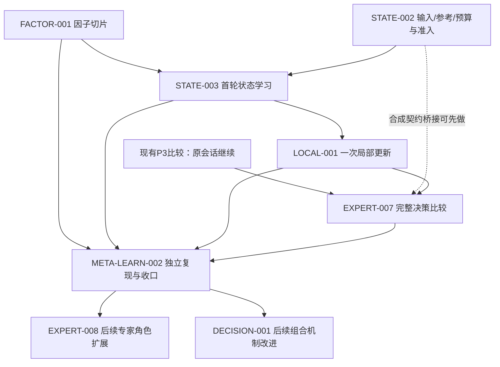

# Learning Decision System MVP：状态、因子、多专家与局部训练

| 字段 | 内容 |
| --- | --- |
| Design status | approved |
| Delivery gate | blocked |
| 决策日期 | 2026-10-23，Asia/Shanghai |
| 总目标 | 先形成实际可学习、可比较、可保留旧版的有限MVP，再逐项扩展专家和决策机制 |
| 本轮权限 | PRD/HLD/LLD、计划、合成规划契约检查和issue维护；不新增结果训练、数据读取、晋级或生产权限 |
| 治理父级 | [PRD 0.8.2](../product/prd.md)、[HLD 0.18.2](../design/hld.md)、[LLD09](../design/lld/09-roadmap.md) |
| 任务事实源 | [版本化规划清单](../../config/planning/learning-system-mvp.v1.json)；不是运行授权文件 |
| 已有独立任务 | [P3 #317](https://github.com/rv198-star/Quanthus/issues/317) 原会话继续；P10常设数据线并行 |

## 用户要得到什么

输入当时有资格使用的数据，系统给出个股状态、因子依据及各专家判断，经约束/否决后
形成决策。随后根据预先定义的评价，定位一个薄弱环节，局部训练或拟合一个新版本，
比较它是否有帮助；合格才替换，不合格保留旧版。该过程逐步改善决策，不能承诺胜率。

第一轮不要求全部12头有资格，不要求专家数量很多，不强制复杂神经网络。
但至少一个有独立参考资格的状态头必须**实际训练和评价**，并完成一次真实局部更新。
仅完成文档、接口、合成测试或“所有头不可用”不能称为学习MVP完成。
实验可得到负结果：工程闭环完成与模型/策略有增益分别下结论。

## 产品与模块边界

| 能力 | 第一轮具体内容 | 后续扩展与边界 |
| --- | --- | --- |
| 状态识别 | 1..12分层命题、逐头资格/支持度/证据；可先k/12 | 0为中性，ABSTAIN为证据不足，X为正常推断失效/冻结；不能强制top-1或将X当卖出 |
| 因子目录 | 复用现有日频特征/Continuous Facts，形成首批有用途的最小切片 | 按业务领域检索；形成链、输出类型和证据分别描述；同一特征可跨领域复用 |
| 专家决策 | 复用既有两专家和P2，接入一个有资格的状态候选映射 | 专家可共用证据，不能当独立投票；职责和边际贡献有证据再增加角色 |
| 局部训练 | 一个明确模块、一个新候选及预登记对照；其他模块冻结 | 共享encoder/scaler/校准的影响须检查；不动资金/PIT/风控/否决硬约束 |
| 整体机制 | 固定旧组合与候选组合的完整比较 | 基础MVP后再有界改进适用情境、组合权重或冲突规则，不做自动自我晋级 |
| 使用反馈 | 本轮产物为研究/决策候选和可读报告 | P7另行准入使用与实际操作核对；P7完成也不是产品学习的终点 |

“客观/算法/定性”是用户举例，设计评估认为三者混合了不同维度，不能作为互斥的三个库。
采用一个逻辑目录，业务领域视图可重叠；具体依据、示例和资产边界由
[LLD03](../design/lld/03-label-feature-system.md#learning-system-factor-organization) 管理。
人工/模型解释必须保留原证据、判断者/抽取器版本、修订与真实知识时间。数值输出不意味着
客观事实或已校准概率。状态参考的“当时可知”与后验结果评价是不同用途，不能混进模型输入。
规则silver可作弱监督/对照，但不能作为独立真值来证明模型识别正确。

## 依赖与可并行部分

因子盘点、状态资格准备和原P3比较可并行；现有P3实验窗口/候选不被新计划改写。
EXPERT-007的接口/合成桥接可提前，真实比较等依赖与用途准入。P10独立处理共享源缺口；
某头缺证据只停止该头的受影响步骤，不能放宽既有硬门槛，也不无条件阻塞其他合格头。
每一任务只有一个当前缺口表，至少记录影响产物、缺字段/证据、可复用身份、下一动作与负责人。

## 实施任务

下面状态表示规划/前置关系。`ready`仅表示允许准备契约与申请精确准入，不是可以读任意
行情或开始结果训练。任务的源输入、用途和执行预算必须在对应运行单明确后才能运行。

### META-LEARN-001：交付状态识别、因子、多专家与一次局部训练的基础MVP

- 阶段：mvp；状态：ready；优先级：high。
- 前置：无结果前置；按本轮规划权限开始。
- 复用：P3 #317 的比较基线；P10 当前已资格化供给；既有 Feature Registry、P2、专家与 Worker。
- 实施落点：`docs/work-items/learning-system-mvp.md`。这些是复用/修改落点；新运行配置另建有身份版本，不改旧冻结request。

执行：

1. 统筹六个MVP子项，按精确产物复用前置数据；保持一份当前缺口表。
2. 分别记录工程闭环、状态识别质量、策略增量和生产启用，不以工单关闭相互替代。

验收：

- 六个MVP子项有精确交接，至少一个具备参考资格的状态头完成真实训练与独立比较。
- 实际完成一次局部更新，能接受新候选或保留旧版；不要求结果必须正向。
- 若所有状态头均未资格化，记录受阻/无结论，不能把纯合成闭环称为产品MVP完成。

### P3-FACTOR-001：统一因子目录与分类契约并交付首批有用途证据的因子切片

- 阶段：mvp；状态：ready；优先级：high。
- 前置：无结果前置；按本轮规划权限开始。
- 复用：既有八项日频特征、Continuous Facts、Catalog及血缘。
- 实施落点：`src/quanthus/feature_registry.py`, `src/quanthus/label_registry.py`, `config/p3-baseline-features.research.v1.json`。这些是复用/修改落点；新运行配置另建有身份版本，不改旧冻结request。

执行：

1. 在统一目录清点现有资产，按业务领域建立视图；分别记录形成链、输出类型及证据，区分事实、特征、状态评估与决策，不拆成客观/算法/定性三个互斥库。
2. 选择支持首批状态/专家用途的最小因子集，冻结单位、版本、知识时间、缺值语义、依赖和相关重复暴露。
3. 通过新增版本/sidecar接入既有严格Registry，保留旧schema和公式；人工/模型解释绑定原证据及判断者版本，模型输出复用须有无环依赖和时序隔离。

验收：

- 同一输入与定义得到可复现面板；来源、时点、修订、缺失均可追溯。
- 分类可容纳跨领域和多步形成链且不重复资产；公式正确性与增量用途价值分开报告，不要求每个领域填满或以数值输出证明客观性。
- 明确哪些来源是P10问题，领域计算不私自补采；一个Job共享前置数据只物化一次。

### P5-STATE-002：冻结首轮状态学习的输入、独立参考、可训练头与预算

- 阶段：mvp；状态：ready；优先级：high。
- 前置：无结果前置；按本轮规划权限开始。
- 复用：#400/#402 的目标、census和失败证据；旧request仅作复用来源。
- 实施落点：`config/planning/learning-system-mvp.v1.json`, `src/quanthus/stage_learning/p5_input_census.py`, `src/quanthus/stage_learning/p5_contracts.py`。这些是复用/修改落点；新运行配置另建有身份版本，不改旧冻结request。

执行：

1. 逐项判定当前Base 2.4可用字段、时间语义、参考标签与旧P5输入契约的兼容性；现有授权之外的读取先停在精确请求。
2. 形成新的有界输入/request身份，保留12头词汇及0/X/ABSTAIN差异；逐头给出可训、可评或明确缺口。
3. 冻结train/validation/calibration/evaluation时间隔离、独立episode、因子闭包、基线、主指标和严重错误切片。
4. 按代表性样本测量后登记trial、CPU/GPU时间、RSS、磁盘峰值与停止预算，再形成明确的结果性执行准入。

验收：

- 不把规则silver当独立真值，不用未来信息改写当时状态；无独立参考的头保持不可评。
- 至少一个可执行状态头的资格证据，或精确的缺证据/资源阻塞结论；禁止用空表和零样本补齐。
- 旧2012–2021/受保护分区边界不自动改变；新来源不继承P3的2025/2026授权。
- 为P5-STATE-003留下明确可运行身份、预算、接受/拒绝标准及权限状态。

### P5-STATE-003：训练并评价首个有资格的12+X分层状态模型版本

- 阶段：mvp；状态：blocked；优先级：high。
- 前置：P3-FACTOR-001, P5-STATE-002。
- 复用：旧P5 R/L/G/T0/T1接口、Worker与恢复实现；按实测与准入选择最小充分模型。
- 实施落点：`src/quanthus/stage_learning/`, `config/planning/learning-system-mvp.v1.json`。这些是复用/修改落点；新运行配置另建有身份版本，不改旧冻结request。

执行：

1. 仅在新运行单明确准入后执行冻结的规则/简单学习基线和一个状态候选，不做架构搜索。
2. 以同一信息集比较状态支持程度；需要概率时独立校准。允许仅k/12头可用，其余明确未知。
3. 记录模型/因子/数据/标签/代码/超参/seed身份，真实训练成本、恢复和独立评价。

验收：

- 交付真实checkpoint、逐头覆盖/歧义/错误/校准与时间外评价；合成测试不能替代训练完成。
- 嵌套状态可共存，父状态未知不转成子状态负例，X不等于看空或强制卖出。
- 结论允许增益、不增益、退化或无结论；完整12头有效性不得从部分头外推。

### P5-LOCAL-001：完成一次单模块局部训练及新旧版本比较

- 阶段：mvp；状态：blocked；优先级：high。
- 前置：P5-STATE-003。
- 复用：已资格化checkpoint、旧模型、固定评价器与输入切片。
- 实施落点：`src/quanthus/stage_learning/`, `src/quanthus/expert_evaluation/`。这些是复用/修改落点；新运行配置另建有身份版本，不改旧冻结request。

执行：

1. 根据训练/开发数据定位一个具体薄弱点；冻结只改一个状态头、因子、专家assessment或策略映射的候选方案。
2. 冻结其他模块；除预登记对照外只训练一个新候选，不根据封存评价继续试到成功。
3. 检查共享encoder、归一化、校准等间接影响，列出需重算的依赖；真正独立的旧产物复用。

验收：

- 存在一次实际训练/拟合与可复验的新旧差异；未执行则不能称学习闭环完成。
- 比较局部质量和受影响的未修改头/模块，记录接受、拒绝或无结论；负结果保留旧版。
- 正式候选映射/权重变更必须是新版本；数据、风控、资金和否决守护不可作为可优化参数。

### P3-EXPERT-007：把合格状态输出接入候选专家并验证完整决策影响

- 阶段：mvp；状态：blocked；优先级：high。
- 前置：P5-LOCAL-001, P3-STRAT-003。
- 复用：现有两专家、P2、评分/约束/否决接口和P3比较结果；不改冻结候选。
- 实施落点：`src/quanthus/expert_evaluation/`, `src/quanthus/aggregator.py`, `config/expert-strategies/`。这些是复用/修改落点；新运行配置另建有身份版本，不改旧冻结request。

执行：

1. 契约与合成桥接可在STATE-002后并行准备；真实比较等待依赖和独立用途准入。
2. 为取得研究比较资格的状态输出冻结一个新expert assessment及policy mapping；该资格要求输入、独立参考、PIT、安全与精确研究运行准入，不要求候选已胜过规则；记录适用/弃权和共同源依赖。
3. 使用相同输入、成本、资金与候选分母比较旧组合和新组合；按显式实验身份复用现有P3证据，不另跑同一已接受实验。
4. 在本项既有准入包绑定P3产物/控制版本、参考用途、窗口及比较条件；有效负结果可按证据范围使用，无效执行不能充当有效基线。证据不兼容或不可用时记录受影响步骤受阻；替代比较另需用途准入，依赖变更由总项明确处理，不继承旧分区权限。

验收：

- 每次行动变化可追到因子、状态与专家版本；未知数据不变成卖出原因。
- 报告胜率及样本分母、盈亏比、成本、回撤、覆盖和分情形稳定性；不能只选一个好看的指标。
- 完整策略无增益/退化时保留旧组合；研究准入不自动授予P7、盘中、邮件或实盘权限。
- 研究比较资格与模型采用资格分别记录；采用/晋级仍须冻结的质量、价值、安全门槛与独立许可，不因完成隔离比较而取得。

### META-LEARN-002：验收首轮学习闭环、复现与安全保留旧版能力

- 阶段：mvp；状态：blocked；优先级：high。
- 前置：P3-FACTOR-001, P5-STATE-003, P5-LOCAL-001, P3-EXPERT-007。
- 复用：各子项精确产物、成本日志、已有读取器与独立复现方式。
- 实施落点：`docs/acceptance/`, `docs/work-items/learning-system-mvp.md`。这些是复用/修改落点；新运行配置另建有身份版本，不改旧冻结request。

执行：

1. 将同一次资格化特征/状态中间数据传给所需消费者，记录依赖图、构建/复用和时间/空间成本。
2. 独立重建合同要求的部分，核对局部升级、组合比较、决定和旧版保留；故障演练不触碰生产。
3. 给出工程闭环、识别质量、策略价值、使用授权四个独立结论。

验收：

- 至少一项真实状态学习及一次局部更新可复现；不能只凭接口、issue关闭或训练进程结束验收。
- 候选被拒绝时旧版本仍可读取且身份不变；若无可用状态头则产品MVP仍未达成。
- 生命周期评审可为接受、拒绝或无结论；拒绝/无结论保留旧版且Shadow保持关闭，不以规则转换或实际Shadow作为本MVP必达产物。
- 保留成本、限制与下一次最小改进问题；不自动启动P6前瞻、P7或下一轮训练。

### P3-EXPERT-008：在基础MVP后按职责和边际贡献逐个扩展专家角色

- 阶段：expansion；状态：blocked；优先级：normal。
- 前置：META-LEARN-002。
- 复用：既有专家协议、因子库、弃权及归因能力。
- 实施落点：`src/quanthus/expert_evaluation/experts/`, `config/expert-evaluations/`。这些是复用/修改落点；新运行配置另建有身份版本，不改旧冻结request。

执行：

1. 先定位现有组合确有遗漏的决策问题，选择一个有独立职责及合格输入的专家。
2. 分别固定assessment与policy effect，比较加入前后及共用因子/相关暴露；首批不以专家数量作为目标。

验收：

- 有贡献、无增益或有害均可形成明确处置；没有输入资格的新闻/基本面专家只阻塞自身。
- 一份候选、一套预登记对照和资源预算，禁止专家角色穷举或自动晋级。

### P3-DECISION-001：在基础MVP后有界改进专家组合和整体决策机制

- 阶段：expansion；状态：blocked；优先级：normal。
- 前置：META-LEARN-002。
- 复用：既有固定优先级聚合与完整P2策略评价。
- 实施落点：`src/quanthus/aggregator.py`, `config/expert-strategies/`, `src/quanthus/expert_evaluation/`。这些是复用/修改落点；新运行配置另建有身份版本，不改旧冻结request。

执行：

1. 选择一个明确的场景适用、评分映射、冲突处理或组合权重问题，提出新策略版本。
2. 冻结可变参数和不可变守护，按预算比较固定组合与一个候选机制；其他条件和数据相同。

验收：

- 组合改进通过完整策略评价和版本契约，局部专家分数不能替代经济影响。
- 保留硬否决、数据/PIT、可交易性与资金约束，原生产聚合逻辑不被运行时自动改写。
- 可回退、无增益即保留旧版；P7使用与资本扩展仍单独决定。

## MVP之后如何继续学习

首轮收口后，从实际误差和缺口表选择下一项有价值的改进：增加一个具备参考资格的状态头、
增加/修正一个有用因子、改善某专家assessment，或另行试验组合机制。每轮另建有预算、
输入/版本身份和停止标准的局部任务，复用本次流水线；不自动启动，也不预先为12头拆出
一串没有合格参考的训练工单。#547/#548专门承接专家角色和整体机制扩展。
专家角色表达职责，不强制某种模型技术；规则、统计/学习模型与有证据的定性抽取按用途选择。

## 旧工单映射与不重复实施

| 既有工作 | 本轮复用/承接 | 保留边界 |
| --- | --- | --- |
| P3-STRAT-003 #317 / B-R1 #412 | 独立基线与当前策略问题；EXPERT-007引用其准确结果 | 原会话负责；不改变冻结输入、窗口和验收，不以新计划重复计进度 |
| P5 #400 / #402 | STATE-002复用目标、源清单、参考资格与失败原因 | 旧B未接受；新的来源/预算/权限须有新身份 |
| P5 #403 / #404 | 复用部分工程、Worker恢复、R/L/G/T0/T1接口 | 合成通过不是训练通过；#403关闭历史保留，#404未完成验收不伪造 |
| P5 #405–408 | 保留NOT_RUN/closeout记录 | 不重新打开或改写成已接受训练 |
| P5 #112–115 | 目标→STATE-002；基线/有界模型→STATE-003；晋级职责→EXPERT-007/LEARN-002 | 复用职责，不额外排四套训练/治理项目；复杂模型需本轮证据支持 |
| P3-EXPERT-000及已接受子项 | 两专家、独立assessment/policy、生命周期、P2及归因 | 原MVP的inconclusive和Shadow disabled保持真实 |
| P6已收口工作 | 复用历史机制/纸面流程；无需等未来66+20交易日 | 取消的前瞻任务未被通过；不重新激活 |
| P7 #121–123 | 后续使用、实际操作反馈、扩容决定 | 目的/候选明确后单独准入；不是本轮默认开始 |
| P10 #478、#537/#538/#539 | 常设数据供给、运行与有界修复 | 新问题按P10登记，业务线不恢复源、不补采、不改知识时间 |

## 成本与复用约束

不按“工单数×天数”估计。STATE-002先复用现有资格证据和测量，冻结可训练头、时间范围、
独立episode数量、trial上限和样本实测，再提供CPU/GPU时间、峰值RSS、磁盘/临时产物上限。
没有实测前不把旧P3的耗时套给P5，也不承诺固定两天。遇到超预算或零合格头，给出明确
部分结果/阻塞及有界下一步；不能无限补数、扫架构或反复增加规则。

一个Job只构建一次共同前置面板，baseline/candidate/local比较共享不可变输入。缓存必须
覆盖完整语义身份，独立复现按接受契约另建；TMP、缓存与长期发布资产分别管理。
数据参考质量、训练可运行、策略有益和生产准入分别记录，禁止用绿色测试相互替代。

## 总项关闭条件

META-LEARN-001只以六个MVP子项的准确证据收口；两项expansion不是它的阻塞子项。
独立验收必须核对真实训练/局部更新发生、基线与新版本的实际差异、时间隔离、完整决策路径、
身份复现和旧版可保留/恢复。至少分别报告：

1. 工程闭环是否完成。
2. 哪些状态头有效、受限或不成立。
3. 专家/策略是否有增益、退化或无结论及其适用范围。
4. 哪种用途已准入；无单独批准则不包含生产、盘中、实盘或新增保护分区。

## 在线工单映射

总项 [#540](https://github.com/rv198-star/Quanthus/issues/540) 已建立实际子issue关系，
六个MVP子项纳入 **Learning Decision System MVP** milestone。两个后续扩展项挂在路线图
[#32](https://github.com/rv198-star/Quanthus/issues/32) 下，未纳入MVP关闭条件。

| 工作ID | issue | 当前准备/依赖 |
| --- | --- | --- |
| META-LEARN-001 | [#540](https://github.com/rv198-star/Quanthus/issues/540) | ready；规划准备可开始 |
| P3-FACTOR-001 | [#541](https://github.com/rv198-star/Quanthus/issues/541) | ready；规划准备可开始 |
| P5-STATE-002 | [#542](https://github.com/rv198-star/Quanthus/issues/542) | ready；规划准备可开始 |
| P5-STATE-003 | [#543](https://github.com/rv198-star/Quanthus/issues/543) | blocked；P3-FACTOR-001、P5-STATE-002 |
| P5-LOCAL-001 | [#544](https://github.com/rv198-star/Quanthus/issues/544) | blocked；P5-STATE-003 |
| P3-EXPERT-007 | [#545](https://github.com/rv198-star/Quanthus/issues/545) | blocked；P5-LOCAL-001、P3-STRAT-003 |
| META-LEARN-002 | [#546](https://github.com/rv198-star/Quanthus/issues/546) | blocked；P3-FACTOR-001、P5-STATE-003、P5-LOCAL-001、P3-EXPERT-007 |
| P3-EXPERT-008 | [#547](https://github.com/rv198-star/Quanthus/issues/547) | blocked；META-LEARN-002 |
| P3-DECISION-001 | [#548](https://github.com/rv198-star/Quanthus/issues/548) | blocked；META-LEARN-002 |
