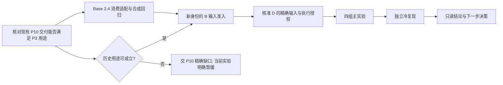

# P3 目标审计与 Base 2.4 落地方案

| 字段 | 内容 |
| --- | --- |
| 审计日期 | 2026-10-22，Asia/Shanghai |
| Parent | [P3-STRAT-003](p3-strat-003.md)、[工作项索引](index.md) |
| Governing design | [专家与聚合器](../design/lld/04-experts-aggregator.md)、[专家策略层](../design/lld/04-experts-aggregator/expert-strategy-layer.md) |
| Design status | draft；本文件是审计后的实施提案，不替代冻结设计或配置 |
| Delivery gate | blocked；P3-STRAT-003 的 B 输入准入未通过，D 未激活 |
| 工作项 | 复用 #317、#412；数据资格由 P10 #470/#473/#474 承接 |
| 本轮范围 | 目标、代码/契约、已交付元数据、GitHub 状态的只读审计及计划编写 |
| docs-impact | 文档与索引；没有改变运行逻辑、冻结门槛、研究授权或生产状态 |

## 1. 结论：把已有能力用于回答一个具体问题

P3 已经具备规则决策链、双专家、完整 P2 回放、归因及独立复现的工程能力。
当前最有价值的目标是完成一个尚未回答的问题：**在相同候选、资金、费用、执行和风控规则下，
Trend 与 Position Risk 相比简单候选规则，是否带来足够大的收益或回撤改善？**

已有开发期验收和归因证据不作废；它们不能代替 #317 冻结近期窗口的比较。
此前移除 Trend 的归因对照会 abstain，产生零入场；它验证了回退行为，
没有回答“双专家是否胜过一个仍会入场的简单规则”。#317 的非空 P4 基线正是补上这个缺口。
目标也不是保证获得正收益。得到可复现的“有效”“有害”“提升微不足道”或“证据不足”，
都能完成该问题的收口；发现输入无法支撑问题时，应明确停止这一实验，而不是无限补数。

建议本次推进只保留一条主线：



P6 独立推进，不是前置条件。日频足以覆盖当前 `close-to-next-open-v1` 问题；
1m、5m、完整 Stage 分类、公司新闻专家和训练平台都不是该实验的必需建设项。

## 2. 审计基线与证据边界

审计采用 GitHub 最新 `main`：`f5b87dab454a719240d56944cb2243ed8765113f`。
原工作区 `main` 为 `3382b63fcd29e3b1e67b2f90aee41372c27831ac`，未切换或覆盖。
另行检查了 CN02 的 `codex/base22-standalone`：
`ab261d0a02ea161ca4c7790b376be25134f7e9d2`，以辨别实际已交付的 Base 2.4 适配能力。
这些分支不同，不能把部署分支存在的代码视为主分支已经集成。

本轮读取版本化代码、冻结配置、问题记录和安全交接元数据；没有打开真实价格行、
2025/2026 策略结果、P6 结果账本，也没有启动 B/D、补采、数据重建或业务服务。
读取的五份 Base 2.4 交接文件与原 `SHA256SUMS` 相符；实体投影的 manifest SHA 亦相符。
这是元数据完整性复核，不是重跑七表载荷验收或授予 P3 准入。

### 2.1 已完成的部分与尚未完成的目标

| 层次 | 当前证据 | 本轮判断与处置 |
| --- | --- | --- |
| P3 原始规则能力 | `config/p3-gates.v1.json` 的历史能力验收通过 | 保留；fixture 不能拿来调参或当正式策略晋级 |
| 专家策略 MVP | 双专家、评估/策略作用分离、归因和生命周期交接已接受 | 复用；MVP 的工程验收不等于双专家经济增量已证实 |
| #317 的 A/C/C-R1 | #318/#320/#385 已关闭并有冻结契约与合成证据 | 保留；仅对新适配影响范围做回归 |
| #317 的 B | #319 已关闭，但正式结果为 `PARTIAL_INPUT_QUALIFICATION` / NO_PASS；#412 仍开放 | 需要独立的新输入资格，不能改写旧失败或重置旧尝试 |
| #317 的 D | #321 为 closed / not_planned，冻结四组比较未运行 | B 通过后核准新绑定与执行路由；不能把关闭当完成 |
| #317 的 E | #322 的关闭保留此前有界收口 | 不是对尚未发生的 D 结果验收 |
| Stage 研究 | 第一阶段明确 `CLOSED_CONVERGED_NO_AUTOMATIC_SUCCESSOR` | 保留 Continuous Facts 与可选分层语义；不补齐 0..12，不自动重开 |
| 人工标签与看板 | #97/#110 仍有显式恢复条件 | 当前不挡主线；有真实消费者需求再启动 |

2026-10-22 查询到的 9 个开放 `phase:P3` issue 是 #317、#412、#97、#110、
#244、#245、#246、#248、#384。它们不能直接变成九项“必须完成”的队列。
例如 #384 仍开放，正文却已经写着 blind-reference no-pass 后收口；Stage 父项仍开放，
版本化阶段收口配置却已明确无自动后继。需要处理的是追踪状态与证据的对应关系，
不是因为工单还开着就重跑研究。本轮未修改这些 issue。

### 2.2 Base 2.4 实际带来的进展与限制

已交付的共享投影位于：

`/srv/quanthus-base22-data/jobs/oci-base24-consumer-completion-20261020T184423Z-ca2b5c2/projection-shared`

- 投影代码提交：`ddc9f407efc45711abc603081d227f95aa8d9d4b`。
- manifest：`sha256:ec8adacf91b55062e4873ca6f18216fc4d41c1c6c6f59bc172255606a2f0a6dd`。
- 输入视图：`sha256:d1786e74d9da0416ca1e76fa54f25b0820acd06f6a075a1a9d0347bdb19f0ce4`。
- 绑定 DWD Base 2.4 manifest：`sha256:04345d9cfb7d99dae9e65b11bd28591095156e48378b5b44245fc3d36a944b3a`。
- 现有投影覆盖 2020-01-01 至 2026-10-20，采用 2026-10-20 的知识快照；
  其七表来自 16 张原生表及所选九个 October Daily。交接明确 `legacy_equivalence=false`、
  `consumer_admission=NOT_GRANTED`，不是旧研究 bundle 的直接替代品。

| 可复用实体 | 当前行数 | 用于 P3 前还要证明什么 |
| --- | ---: | --- |
| `daily_ohlcv_none` | 8,101,975 | 正确历史版本、原生日频/价格口径、逐决策时点可用性 |
| `daily_universe` | 8,101,975 | 当日上市身份、原有候选准入规则，而非当前存续名单 |
| `price_limit_execution_daily` | 8,101,975 | ST/IPO、涨跌停与可成交资格的真实来源，不将 unknown 改为允许 |
| `security_code_validity` | 5,781 | 日期别名、上市与退市区间、历史知识版本 |
| `trading_calendar` | 7,214 | SSE/SZSE 的精确 warmup 与 T→T+1 配对 |
| `corporate_actions_normalized` | 78,111 | 单位、因子交叉验证与具体用途资格 |
| `corporate_action_exceptions` | 78,111 | 逐项保留原例外；不能以投影生成成功消除例外 |

现有交接记录七表全部执行状态资格仍保持未知、公司行动未由该投影自动获得执行权，
以及 7,821,932 条 bar 的知识日期晚于业务日期。**这些数值不能直接等同 P3 缺失行数或泄漏行数**：
它们覆盖更广的时间/市场，且 ingestion/acquisition 与经济事实可用时间不是同一概念。
必须按 P3 的具体字段和时点找资格证据，不能一律拒绝，也不能把时间替换成当日收盘。

已存在的缺 bar 安全统计中，258,804 条是历史 BSE，39 条是历史 SSE/SZSE，
另有 278 条非可交易状态。BSE 不因存在缺口就阻塞本次 SSE/SZSE 问题；
39 条 SSE/SZSE 涉及冻结年份，应在准入时按 warmup、候选、持仓管理依赖分类。
它们不等于 39 笔交易，也不能在看过收益后挑选排除。

### 2.3 本轮工程检查与运行时差异

本轮使用 CN02 现有交付环境的 Python 3.10.12，对本计划基线运行检查：

- 六个 P3 契约/单元测试文件：95 passed。
- `make check`：doctor、compile 通过；测试为 3332 passed / 20 skipped / 28 failed，
  因测试失败未继续其内置 planning-check；单独运行的 planning-check 通过。
- 在未修改的 `f5b87dab454a719240d56944cb2243ed8765113f` 隔离 worktree 中，
  逐一重跑这 28 个失败用例，全部同样失败。
- 27 个失败在旧 dual-lane runtime 严格身份检查，1 个在历史行业补充的 BaoStock 版本检查。
  当前环境 DuckDB 1.5.6、BaoStock 0.9.4；相应冻结契约声明 1.5.5、0.9.3。

因此本轮不能称全仓绿色，且没有把运行时不匹配当成文档变更造成的数据缺陷。
工作包 A 还需固定 P3 与新 reader 的专用运行时及测试边界；不要修改生产环境或降低冻结
版本检查来消除红灯。Markdown 引用/摘要与 whitespace 检查通过；本次无代码改动，
lint/type 与 Web 检查未运行。完整日志及环境版本在审计交接中保留。

## 3. 真正需要解决的四个差距

| 优先级 | 差距与可证伪问题 | 负责人边界 | 完成判据 |
| --- | --- | --- | --- |
| P0 | 现有交付是否足以证明冻结窗口的逐字段历史可用性？ | P10 提供资格；P3 判断用途 | 完整字段族资格表，每个必需字段有来源/时间证据或明确不可用处置 |
| P0 | 新 Base 2.4 表能否无语义漂移进入现有 P4/P2/P3 接口？ | P3 消费适配，复用 P10 已发表数据 | 新输入契约与合成测试；保留价格/时间/身份，unknown 不变成 true |
| P0 | 在同一候选及完整规则下，TR 是否比 B 有实质增量？ | P3 #317 | B 通过后，主实验及独立复现产生一致且可审计结论 |
| P1 | issue、历史验收与当前业务状态混淆 | P3 追踪维护 | 一份当前差距表；历史失败保留，未激活/已接受/暂缓明确分开 |

旧 #473 的 `none`/`UNADJUSTED` 问题已有 174,720 条原始日线的诊断和保持数值/时间的
适配证据；不能再当成要重采 174,720 条数据。新路径应在明确价格口径契约下复用该逻辑，
验证新表并补消费测试。#474 的历史时间资格则不能由字符串别名修复。

#470 曾有精确 5,251 证券的临时静态行业闭包。新输入必须证明覆盖的是此次精确候选集合，
同时保留日期身份；既不能用 5,201 原生快照覆盖数代替，也不能把静态行业倒填为历史事实。
如果冻结研究仅允许其作为静态集中度约束，应继续该限定用途，并在结论披露。

## 4. 最小输入契约与来源资格工作单

以下是计划中的工作单，不是已经获得的新资格。先检查现有 P10 交付的已知准确路径，
不在 P3 内查找跨节点档案、采集或补建数据。证据缺失时回填 P10 对应 issue 的精确缺口。

| 输入族 | 最小内容与判定 | 不得采用的捷径 |
| --- | --- | --- |
| bar / basis | 原生日频、未复权口径、Decimal、量额单位、revision/source SHA；按真实用途区分 acquisition 与经济可用时间 | 仅把 `none` 改名就宣布 PIT 合格；用收盘时间替代原知识时间 |
| calendar / listing | exactly 60 个前置共同交易日；venue/date 与 listing 对齐；T+1 开盘配对及 120 上市交易日门槛 | 当前代码别名回填历史、补造 session 或放宽上市要求 |
| tradability / execution | ST、IPO、停复牌、价格限制与 P2 同口径；未知时依现有规则禁新入场 | 全表 `can_buy=true`；以缺数强制卖出持仓 |
| factors / actions | 因子、公司行动、异常账本的精确版本及已声明用途；4173 visibility unavailable 保持不可用 | 使用后见修订假装早已知道；为了连贯收益抹掉例外 |
| industry | 精确 candidate/security 集合与来源；区分原生历史、临时静态和例外 | 当前行业快照冒充历史 PIT 或替换冻结约束 |
| candidate / features | 原 P4 价格量能转换规则；60 日特征预热/22 日候选历史；四组共用 entry complete-case mask | 从四组结果反推筛选条件、删亏损候选、改阈值 |
| P2 / evaluation | 同初始资金与仓位、费用、撮合、集中度、退出及结算；冻结目标与截尾 | 增加第三专家、修改风控以求显著、等待未来数据补熟目标 |

每项记录：`field_family`、`consumer_purpose`、manifest/member SHA、版本键、业务区间、
原 acquisition/publication/effective/knowledge 字段、资格依据、受影响键数、
处置 reason code、输出绑定、负责人和下一步。交接输出只含安全统计，不输出受保护价格/收益。

缺口按用途处置：不在范围内的字段不挡本实验；合同允许缺失的入场证据按同一 mask 禁入并计数；
缺失持仓专家证据继续原基础仓位管理；无法满足 PIT、身份、执行或账务硬门槛的部分不能假装合格。
不得借“局部缺陷可接受”缩小冻结窗口、改变市场范围或创造新缺失容忍度。

## 5. 分批实施：依赖、交付与停止条件

时间为工程估计，单位是代理工作的实际小时，不是需要 Owner 投入的人工工作日。
尚未进行新路径性能实测，估计不包含等待新来源资格、审批或新增采集的时间。
下面 A–F 是本提案的工作包编号，不替换已有研究 A–E 工单或消耗其尝试次数。

### 工作包 A：先用 2–4 小时判明是否具备开工条件

对应 #412；仅核对现有发布的元数据/资格证据和代码依赖，不触发旧正式 B CLI。

1. 固定 main 与 Base 2.4 交付代码的实际 SHA、依赖差异及可导入边界。
2. 在上节工作单标记每个字段族：已合格可复用、仅消费适配、必需证据缺失、非本用途。
3. 核对 P10 后续资格交付是否已改变七表的 unknown/晚到处置；旧交接不是当前全局状态。
4. 给出精确新 B 输入身份方案与已有产物复用清单、容量/任务冲突检查方案。

**交付：** `purpose-input-matrix`、`input-binding-proposal`、当前唯一缺口表。
**退出：** 没有新的已资格证据，就在 4 小时内写清缺哪个字段/身份/证明、影响什么用途，
将来源缺口交 P10；不追加一轮 P3 档案查找。不因这个门槛未过停止独立合成工程，
但也不盲目开展注定无法使用的全量物化。

### 工作包 B：6–10 小时完成最小消费适配

依赖 A 的接口判断；可与 P10 对既有交付的资格答复并行。先审查可复用代码，后做必要增量。

| 代码位置 | 复用或变更方式 |
| --- | --- |
| `src/quanthus/pipelines/securities_warehouse/base24_input_view.py`（交付分支） | 复用版本选择、范围过滤、来源闭包；不绑定生产 CURRENT |
| `src/quanthus/backtest/base24_semantic_projection.py`（交付分支） | 复用有界 join 和真实字段保持；不能把 Oct20 单快照直接当历史 as-of 视图 |
| `src/quanthus/expert_strategy/p3_temporary_daily_adapter.py` | 仅复用已审核价格/时间保持逻辑及回归，不继承临时来源授权 |
| `src/quanthus/expert_strategy/p3_strat_003_input_qualification.py` | 保留 legacy 行为；新增显式 Base 2.4 消费入口/独立模块，不进入旧链恢复/ODS 重建分支 |
| `src/quanthus/expert_strategy/p3_retained_input.py`、`p3_retained_audit.py` | 保留旧失败及 52 文件身份；新来源建新 binding，不覆写旧 receipt |
| `config/research/p3-strat-003/` | 拟新增版本化 input qualification / source-binding 契约，明确申请资格与授权；旧 request/runtime 不改 |

现有 B builder 从冻结 P6 runtime 读取 Base/correction/Daily，再可能查找或重建旧 Daily 链。
新路径不应修改 P6 runtime 来“接通”P3，也不应启动这些历史恢复函数。
如跨分支集成，审计最小代码及依赖闭包，经正常 GitHub 分发路径进入实现基线；不复制整个未合并分支树。
新代码/来源身份若与原冻结绑定不相容，应形成明确的版本化实施补充并审查；
不直接替换原请求中的 SHA，也不以相同表名冒充 legacy 输入等价。

新读取模式必须回答：原生输入是否保留冻结时点需要的历史版本？若只保留较晚快照且没有资格证明，
适配器不能从中重建不存在的过去。日期裁剪只限定业务范围，不制造知识资格。

**必要合成回归：** 日频口径与 Decimal/时刻不变；同业务键修订不覆盖历史；
未来知识不进入过去决策；unknown/late/zero/null 分别保留；跨日/venue/listing 引用拒绝；
4173 类不可用证据不被推定；不同候选 mask 失败；新入口不触发旧恢复/网络/P6；
manifest/哈希/资格漂移拒绝；损坏输入失败关闭。

**交付：** 最小代码差异、版本化契约、针对性测试、可用性说明。
**退出：** 10 小时内未能打通最小合成闭环，按具体技术缺口重新估算，不升级成通用平台。

### 工作包 C：3–5 小时完成一次新的 B 用途准入

依赖 A 的必需资格成立及 B 工程通过；先形成明确的新 scope/新输入绑定和准入授权记录。
旧正式 B 尝试已消耗，改名或删除标记不产生新额度。

1. 冻结业务窗口：决策 2025-01-01..2026-09-17；执行/目标截至 2026-09-18；
   warmup 为 2025 前 exactly 60 个 SSE/SZSE 共同交易日。无需消费 October Daily。
2. 先做 schema/路径/权限/所需分区/查询计划及最大分区检查，再读输入做完整安全统计。
3. 一次按用途构建不可变 job-local 中间数据，P4 候选、特征、输入验证共享它；
   按分区有界处理、全局键/版本和跨表引用另行完整核对。
4. 校验原始时刻、资格、完整来源闭包、身份、日历、共同 mask 和执行依赖。
   缺数按预先规则计数；不看策略结果决定是否保留证券。
5. 独立验证输入 artifact、配置/代码摘要及 candidate/provider manifest，输出明确 B verdict。

**交付：** 新输入 manifest、candidate manifest、用途资格表、共享中间数据复用收据及 B 验收报告。
**停止：** 仍有必需硬门槛失败则 B=NO_PASS，D 保持关闭；输出具体原因及可复用产物，
不把“文件都读完”或“非空候选已产生”写成准入通过。

### 工作包 D：2–3 小时准备最终执行，但不提前读结果

可在 C 的安全统计运行时准备合成/静态部分；真实 D 激活必须等 B 通过。

- 复用 `p3_strat_003.py`、`p3_strat_003_cli.py`、`formal_p2_replay.py` 的四组 runner，
  验证新 provider 接线，不重造回测或归因系统。
- 绑定冻结研究请求 digest、新 B/candidate/provider identity、代码/策略卡、日期和资源清单。
- 做合成数据端到端验收：四组顺序、共同风控、确定性、故障留证、恢复边界、禁止提前结果访问。
- 对齐 #317/#412 当前状态，保留 #319 失败历史；明确 #321/#322 的后继执行/验收路由。
  新 B 的消费者验收与 D 激活是两条证据，不能由 issue 状态或单元测试推导。
- 在所有门槛已具体可审查后处理必要执行授权；本计划本身不激活 D。

**交付：** 一个可直接执行的、manifest-bound 的双批次运行单及停止条件。
没有新增问题时不反复重新询问既有授权，也不改变策略研究问题。

### 工作包 E：2–3 小时执行与冷复现窗口

依赖新 B 通过及精确 D 激活。冻结实验是：

| 变体 | 策略效果 |
| --- | --- |
| B | 非空确定性 P4 候选基线，不使用 Trend/Risk 专家效果 |
| T | 仅 Trend |
| R | 仅 Position Risk，仍有相同 P4 入场基线 |
| TR | 现有 Trend + Position Risk |

主比较为 TR−B；其余是预注册诊断，不进行事后择优。四组共用候选、入场证据 mask、
资金/费用/风控/退出/P2 语义。若基线最终没有合格入场，不伪称验证了有效非空对照。

冻结预算：2 个 composite batch（主实验、独立冷复现），每批 worker concurrency=1，
每批 provider/feature panel 构建一次；14 GiB 预警工作集、16 GiB 硬内存，
每批最多 60 分钟、发布 artifact 最多 2 GiB。总时间估计另留编排与核验余量；
60 分钟是硬上限，不是已测得的运行时保证。

冷复现独立进程/工作目录，重新构建本批 provider，不复用主实验 TMP/cache。
可以引用同一份已封存输入，而不必复制整份数仓或重跑全部 Base 2.4 验收。
最多每批一次相同语义的结果前传输/环境恢复；结果后不重试、不调参。

### 工作包 F：2–3 小时完成可用于决策的收口

按冻结规则评估：TR−B 净收益增量至少 1 个百分点且配对区间支持正增量、回撤恶化不超过
1 个百分点，或者回撤改善至少 1 个百分点且配对区间支持改善、收益不恶化超过 1 个百分点。
其余负面/微小/不确定结论如实记录。使用原 22-session paired block、2,000 次重采样及
95% 区间，不更换显著性阈值。原 action-change materiality 保持 2%。

交付一页结论加可复验技术附件：B/T/R/TR 主指标、行动差异、缺失/禁入与持仓处置、
主要期间切片、两次摘要一致性、限制及一个明确下一步决议。
期末持仓按冻结规则估值、不强平；未成熟目标报告 pending，不延长窗口等待。

正向结果仅支持本次历史增量结论，不自动进入 P6、Shadow、实盘或升级专家。
负面结果也不是临时换指标继续追分的理由。最多提出一个新的有界问题，另行预注册。

## 6. 排期、并行与成本控制

| 工作包 | 预计投入 | 最早可并行内容 | 不能越过的依赖 |
| --- | ---: | --- | --- |
| A 资格可行性 | 2–4 h | 代码/契约静态分析 | 先有准确发布身份，不能查泛目录代替 |
| B 消费适配 | 6–10 h | P10 资格答复、合成测试 | 新输入证据不足时不做无效全量物化 |
| C B 准入 | 3–5 h | D 的静态运行单/合成准备 | 必需 P10 资格、B 适配、新 scope |
| D 执行准备 | 2–3 h | C 的安全统计 | 真实激活等 B 接受 |
| E 两次结果批次 | 2–3 h | 报告模板/摘要检查 | 主实验→独立冷复现；冻结单 worker |
| F 收口 | 2–3 h | 已完成产物的静态一致性检查 | 完整结果和独立复现 |

合计 **17–28 个工作小时**；扣除可重叠的准备工作，在现有资格证据足够、无新增工程故障时，
安排 **约 2–4 个工作日**的执行窗口。这里是规划估计，不是已开跑的倒计时。
若 A 发现历史用途确实无证据，**4 小时内给出明确阻塞和最小 P10 请求**，
不报一个包含未知补证时间的“总完成日期”。新的来源采集/购买不含在以上预算中。

节省时间的重点是复用和减少无效工作，不是把冻结的四组实验强行四进程并发：

- 按需读取本研究所需的日频/状态/引用字段，不扫 1m/5m 或整个 33 表。
- 每个确定性前置在同一 Job 内只构建一次；记录时间、行数、字节及 build/reuse。
- 不重复验收输入身份未变的历史产物；新用途与新代码影响范围仍须验收。
- 所有 TMP 明确归属、生命周期和失败证据保留；写前根据精确文件清单计算磁盘峰值。
- 在 CN02 日常采集/构建之外安排正式批次；先核对可用 RAM/磁盘、冲突进程和限额，
  不占用或重启 P6/生产 worker。是否能满足冻结 60 分钟应先做非结果工程预检。
- 某门槛失败只停依赖它的步骤。工单关闭、数据镜像完成和消费者资格不得相互代替。

## 7. 一份当前差距表与验收方式

执行时只维护 #412 对应的一份当前差距表；本文件的事实为 2026-10-22 审计快照。
表中每项包含：影响输入族/消费步骤、准确缺失字段或证据、现有产物能否复用、
下一动作、P3/P10 责任、预算已用/上限、PASS/NO_PASS/非本用途、验证收据。
旧 PENDING 留作历史，不混入当前待办。不要按 issue 数或测试数计算业务完成率。

机械验证使用仓库已有合成/契约测试，重点包括：

- `tests/contract/test_p3_strat_003_preregistration.py` 与 `test_p3_strat_003_planning.py`；
- `tests/unit/test_p3_strat_003_runner.py`、`test_p3_strat_003_candidate_input.py`、
  `test_p3_strat_003_input_qualification.py`、`test_p3_retained_input.py`；
- 新适配涉及的 `test_base24_input_view.py`、`test_base24_semantic_projection.py` 及新增针对性反例；
- 改动稳定后运行适用 lint/type 和 `make check`，记录实际通过/失败/跳过，不把测试绿色写成 B/D 接受。

本次文档审计的检查结果另在交接 `checks.json`/纯文本日志中报告，避免写成未来工程已完成。

## 8. 权限、暂缓项与终点

现在可以完成的范围是审计、计划、已有契约的合成工程准备；这份提案没有授予新的结果访问。
新 Base 2.4 B scope/输入身份需明确承接，D 仍需 B 通过与既有门槛允许的精确激活。
Owner 不需要参与逐文件读取、常规调试或机械验收；只有范围/硬门槛或最终业务决策改变时，
提交具体可审查的选择，不让 Owner 代做来源梳理。

暂缓：完整 Stage 标签库、#97 人工标签工程、#110 大看板、第三及更多专家、自动权重搜索、
新训练层、通用任务/缓存平台、P6 改造和生产推广。已有轻量结果展示可以复用，
但不能把这些暂缓项塞进本次关键路径。

本轮落地完成的定义是：**输入用途有结论；若合格则冻结比较与冷复现有结论；
若不合格则精确限定阻塞并给出合法业务处置；两种路径均有可审计交付。**
不合格收口可以完成调查工作，不能标记 B 通过或“多专家价值已验证”。

## 9. 核心证据索引

- [PRD](../product/prd.md)、[路线图](../design/lld/09-roadmap.md)、[P3 历史门槛](../../config/p3-gates.v1.json)。
- [MVP 交接](../acceptance/p3-expert-mvp-shadow-handoff-20260823.md)、
  [正式开发期归因验收](../acceptance/p3-attr-formal-production-20260823.md)。
- [冻结请求](../../config/research/p3-strat-003/request.v1.json)：semantic digest
  `sha256:9de79141514aa1941d276da854d734786bb2b5bb83310a1d3c7792d60c952bde`。
- [旧 B 契约](../../config/research/p3-strat-003/input-qualification.v2.json)、
  [结果盲工程 runtime](../../config/research/p3-strat-003/runtime.v1.json)。
- [P3 主工单 #317](https://github.com/rv198-star/Quanthus/issues/317)、
  [B-R1 #412](https://github.com/rv198-star/Quanthus/issues/412)、
  [旧 B #319](https://github.com/rv198-star/Quanthus/issues/319)、
  [D #321](https://github.com/rv198-star/Quanthus/issues/321)。
- [P10 所有权](../design/lld/12-permanent-data-line.md)、
  [用途与成本相匹配的质量原则](../architecture/adr-0016-value-proportional-warehouse-quality.md)。
- [Stage 阶段收口](../../config/stage-learning/stock-stage-research-phase1-closeout.v1.json)。
- CN02 安全交接根：
  `/srv/agentdock/AgentDock/base22-review-afe2526/oci-base24-consumer-completion-20261020T184423Z-ca2b5c2/`；
  具体采用 `handoff.md`、`readiness.json`、`consumer-interface.v1.json`、
  `successor-source-binding.v1.json`、`evidence/missing-source-observation-impact.safe.json`。
  对这些文件的摘要复核不代表载荷或后续业务状态的重新验收。

## 10. 2026-10-22 消费适配实现与运行方式

Owner 在本次审计后明确要求落实代码并认真审计。本节记录此次**输入工程**交付；
前面的完整研究排期仍是估计，不能作为脚本已运行的时长或 B/D 已获准的证据。

实现入口为 [p3_base24_native.py](../../src/quanthus/expert_strategy/p3_base24_native.py)，
契约为 [base24-native-consumption.v1.json](../../config/research/p3-strat-003/base24-native-consumption.v1.json)，
回归为 [test_p3_base24_native.py](../../tests/unit/test_p3_base24_native.py)。
这是独立于旧恢复程序的原生消费入口，没有复制整个 P10 交付分支或修改 P6 runtime。
`docs-impact: none` 对已接受策略/执行行为：本入口未获研究消费准入，不改变原策略、
缺失处置或发布接口。旧 LLD 已被冻结请求按 SHA 绑定，保持字节不变；新增未准入接口
只在本工作记录及其新版本契约说明，不能通过改旧设计解除 B/D 门槛。

### 已实现的依赖链

`固定 metadata/运行单 → 核验 16 表来源 → 一次物化窗口内原生版本 → 语义核验 → READY → 离线核验/按时点读取`。
它不生成 P4 candidate、P2 legacy bundle 或策略结果；这些不是可以用格式转换假定等价的输出。

- `metadata` 只读取原 manifest、READY、native-closure；不打开 Parquet。
- `prepare` 在任何写入前校验来源、输出及 sibling staging 的物理隔离和新运行单。
  每表按 8192 行 Arrow 批次写 Parquet，保留全部选中列、Decimal 和原始时刻。
  同一 Job 只有一个 native TMP，所有消费者使用它；不按变体再建四次。
- 每表核对源文件 SHA、复制前后双向 `EXCEPT ALL`、行数、消费所需字段类型及全列 schema 摘要。
  完成表有 checkpoint；相同输入、代码、契约、运行单和预算可复用，漂移拒绝。
  没有 checkpoint 的半文件保留为失败证据，需新的唯一运行目录，不能覆盖猜测完成。
- 精确固定 60 个共同 warmup 交易日；不能用起止区间顺带读额外的 2024 市场观察。
  业务日期截至 2026-09-18，决策截止 09-17，knowledge 时间不会被倒填到 session close。
- 冷验收仅使用包内原始元数据副本、完整文件清单/哈希和重算的 schema、行数、键、
  日期/venue、引用与知识区间检查。原 source_root 只可作历史字符串，不再解引用。
  `NativeView.market_batches(cutoff)` 根据原始半开知识区间选版本；unknown 不输出为已知，
  重叠版本和当时不可用的必要身份直接报错，缺失 state 保留空值而不补可交易标记。
- 输入包始终为 `consumer_admission=NOT_GRANTED`、`B_accepted=false`、`D_activated=false`；
  旧 candidate loader 明确拒绝这个新 schema，不能当作 legacy 接口使用。

### 自动执行、恢复与资源

整个链没有模型/API 调用或逐文件审批。输入单和用途确定后，一次 CLI 调用即可连续完成
输入物化与核验；出现已登记 checkpoint 可直接再次调用恢复。AI 的工作集中在规则实现、
审计、首次接线及具体异常处理，不需要在每批之间“点下一步”。

运行单绑定新 `P3-BASE24-INPUT-*` scope、授权记录、请求/来源/契约/实现摘要、Git SHA、
写入和时间预算，包内保留原单与摘要。示例
[base24-input-run-plan.example.v1.json](../../config/research/p3-strat-003/base24-input-run-plan.example.v1.json)
默认未激活；不能把它的布尔值改成 true 当作来源资格或新 B 授权。

DuckDB 限 2 线程、2 GB 内存、1 GB spill；默认输入示例最多写 4 GiB、每次 3600 秒。
写前需预算输出加 1 GiB spill 与 1 GiB 安全余量；运行中检查输出大小、剩余空间和时限，
SQL 到时中断。大型 Arrow 批次可能在下一检查前多写一批，失败文件不封存。
这些是工程上限，不是对真实窗口已测得的资源需求或运行时保证；实际运行单仍需登记。
查询 spill 在本 Job 的临时目录，完成或失败后关闭并清理；checkpoint/未完成成员保留。
输入验收副本按合成测试独立复制，不能据此替代正式 D 的独立重建要求。

运行方式（所有 JSON 输出仅含安全统计/原因码）：

```bash
PYTHONPATH=src python -m quanthus.expert_strategy.p3_base24_native metadata \
  --root "$P3_SOURCE" --manifest-sha256 "$P3_SOURCE_SHA"

# 只有新的精确 input-only 运行单已成立后执行；不复用旧 B attempt。
PYTHONPATH=src python -m quanthus.expert_strategy.p3_base24_native prepare \
  --root "$P3_SOURCE" --manifest-sha256 "$P3_SOURCE_SHA" \
  --run-plan "$P3_INPUT_PLAN" --output "$P3_PREPARED"

PYTHONPATH=src python -m quanthus.expert_strategy.p3_base24_native verify \
  --root "$P3_PREPARED" --manifest-sha256 "$P3_PREPARED_SHA"

PYTHONPATH=src python -m quanthus.expert_strategy.p3_base24_native census \
  --root "$P3_PREPARED" --manifest-sha256 "$P3_PREPARED_SHA" \
  --knowledge-cutoff "$P3_ADMITTED_CUTOFF"
```

`prepare` 非零退出后不会自动换来源、缩窗、重新采集或重启旧恢复流程。
输入单/代码变更须使用新 Job；正常同身份 checkpoint 恢复不消费旧正式 B 尝试额度，
也不会产生新的正式 B 额度。脚本完成物化仍不等于消费者接受输入。

### 当前唯一缺口表（本次检查范围）

启动阶段核验已定位 projection 的元数据身份：manifest
`sha256:ec8adacf91b55062e4873ca6f18216fc4d41c1c6c6f59bc172255606a2f0a6dd`，
native 清单为 **1,010,740,231 bytes**，声明保留原生版本、legacy equivalence=false。
后续端口工程又核对了下文八份已定位治理元数据，并引用原时钟测量的精确校验身份；
没有把该引用写成重新执行 payload 全量核验。#412 的最近查询为 OPEN，更新时刻为
2026-10-03；本轮不扩大查找来源档案、不补采、不读新的真实价格或策略结果、不重跑旧 B。

| 缺口/影响步骤 | 本轮可复用成果 | 还需要什么 | 当前处置 |
| --- | --- | --- | --- |
| 历史知识资格：日线值/版本、日期身份、日历、状态/IPO/限价、action/factor | 原始时间与版本保持、as-of 选择、unknown/late 统计代码；八份元数据复核与原时钟测量 | 覆盖冻结窗口且绑定实际来源的 P10 用途证据；权威 60 日 warmup；物理采集时间不能替代经济可用时间 | 选定证据不足，保持未准入；静态行业只作集中度映射，不另造历史行业 PIT 门槛 |
| 新 B 精确输入范围与接续 | metadata 验证、已封存原生消费契约、inactive 运行单 | #412 明确新 scope/输入身份与准入记录；保留旧失败及已用尝试 | 暂缓真实 B，继续合成工程 |
| P4 候选与共同缺失 mask、P2 执行消费 | 已实现原生域端口、四组共享 mask、P1/P2 适配及合成/搬迁回归；保留原 runner/规则 | 真实资格化闭包、候选/特征面板物化和正式运行器集成；端口不是全流程验收 | 端口工程已落实，真实候选与四组比较仍未运行 |
| D 主比较和独立复现 | 原四变体工程及冻结预算 | 新 B 接受、精确 D 激活、同身份主批次和独立重建 | NOT_RUN；无收益结论 |

这里的缺口不是宣称 Base 2.4 数据损坏或全局无证据，而是本次 P3 消费尚未绑定相应资格。
未满足资格前，不用已经声明较晚的快照批量生成无法接受的 candidate，也不据此延长脚本工期。
原 17–28 小时包含尚未完成的接口/资格工程，不能解释为单纯等机器跑完。

### 本轮审计覆盖

新增回归覆盖原模型 schema、Decimal/上海时刻、后见修订、unknown/零/空/晚到、4173 类
不可用记录保持、bar/state 日期与 venue、精确 warmup、来源变化、路径隔离、扫描失败、
预算、checkpoint 复用和末尾封存恢复，以及完整重新封装后的契约/用途篡改。
两次搬迁分别在新进程运行；合成来源已删除，环境/缓存隔离，libseccomp 在系统调用层
禁止创建网络 socket 后扫描并比较摘要。破坏只发生在一次性合成文件，不是实际 Base 数据。
这是本代理自审与测试，没有声称获得独立人员审查或真实 B/D 验收。
精确命令、通过/失败/跳过、基线差异和 SHA256 放在新的只读交接目录，不能把旧 95 项
回归结果当成新适配已通过。全仓检查如仍因冻结依赖版本不匹配失败，应保留该事实。

## 11. 2026-10-23 自审修正（输入工程，未准入）

对 `5ed74b5be3e49dd37f650f0d4d46db623bb6d8ad` 的复查发现以下实现缺陷。
先增加反例，原实现复现 10 项失败；继续检查观察区间后，另复现 4 项失败。
它们没有触及真实市场 payload 或策略结果，也不是 Base 2.4 源数据缺陷的证据。

| 级别/缺陷 | 可复现影响 | 修正及验收 |
| --- | --- | --- |
| P1：状态消费只按 knowledge 选版本，缺 observation 截止和当时关联校验；行情/状态允许反向观察区间 | 尚未结束或结束时刻未知的状态进入较早决策；状态借用后来日历/上市身份关联到错误日期/市场；结束早于开始仍可消费 | 未完成/未知结束的状态保持不可用；已完成状态按同一截止的 calendar/listing 校验日期与市场；构建和冷验收均拒绝反向区间。保留原始知识时刻，不推定可交易 |
| P1：warmup 在筛选 open 后聚合，冲突版本被掩盖 | 预热截止当时的开/闭市或 venue 冲突，可能被计算为合格的共同交易日；后来截止的检查发现不了已过期的冲突 | 在 `2025-01-01T00:00:00+08:00` 检查相关候选区间内的完整可见版本，再接受精确 60 日。构建和完整重封装冷验收均有反例，半开版本边界有正例 |
| P2：恢复任务时接受额外文件和提前出现的 READY | 构建可能报告完成，但自己的离线验收拒绝文件集合或 READY | 恢复先拒绝未知文件/无 manifest 的 READY，封存前再检查准确集合；已有 READY 必须匹配 manifest。反例证明已有 checkpoint 与外来文件字节均未变化；原正常恢复仍通过 |
| P2：按截止切换 16 张视图逐张生效 | 后一张表冲突时，前几张已切到新截止，读者可能看见混合快照 | 在一个事务内检查/切换全部视图；失败完整回滚。反例验证失败后 identity 与行情仍同属上一次成功截止 |

本次合成检查共 **71 项 native 回归（原 55 + 新 16）**，加原 P3 相关 95 项，
合计 **166 passed**。继续保留两次搬迁、新进程、原源删除和系统调用级网络拒绝检查。
完整仓库结果、命令和失败基线对照在本轮只读交接中单独记录，不将 focused 通过写成全仓绿色。

`docs-impact: none` 对已接受的策略/执行政策：这些修正实现既有时间、关联、不可变封存与
失败关闭要求；未改变冻结窗口、P6、数据来源资格、B/D 激活或旧失败记录。实际新输入运行
仍需绑定当前实现 SHA，不能把旧实现的 checkpoint 作为新实现的同身份恢复。

## 12. 2026-10-23 双角色审计修正（输入工程，未准入）

数仓和工程独立审计固定提交 `c9551624adab63315c72a28e80e9058418ed5636`，
确认 WHA-001/002/003、ENG-001/002 五项缺陷。本轮先将反例纳入合成回归，
再修正消费者代码及新消费契约；旧审计和旧失败证据保持原样。

- `warmup_calendar` 是 input-only 运行单的必需部分：版本
  `quanthus.p3-warmup-calendar.v1`、非空 `authority_reference`、
  `authority_evidence_sha256`，以及严格递增且唯一的 60 项 `sessions`。
  每项必须指定 `trade_date`、`XSHG` 和 `XSHE` 的精确 session ID。
  它应来自 P10 已资格化的权威交易日历证据，在行情行读取之前冻结；不能从待验
  行情/缺损日历自动向前凑满 60 日。构建和无源冷核验用同一绑定检查日期、
  session、市场和预热截止时的可知性；缺失、晚到、冲突或成员差异明确拒绝。
  保留整个预热跨度的日历元数据，市场观察仍只保留精确获准的 60 日。
  运行单声明及证据 SHA 本身不授予来源资格或真实输入读取授权；inactive 示例
  的 `warmup_calendar` 保持 null，必须另行填入已资格证据后才可激活。

## 13. 2026-10-23 P3 启动的实际结果

Owner 在复验后要求启动 P3。新增
[p3_base24_startup.py](../../src/quanthus/expert_strategy/p3_base24_startup.py)
只做已发布原生闭包的时间字段诊断，不修改来源，不使用旧 B attempt，不生成候选、标签、
策略收益或 P6 记录。运行前登记新 scope `P3-BASE24-INPUT-20261023-CLOCK-001`、精确输入、
代码、列投影、磁盘/内存快照和 300 秒上限；schema/目的/范围/授权/代码漂移在 payload 前拒绝。
DuckDB 保持 2 线程、2 GB、最多 1 GB spill；文件哈希及每表查询边界检查剩余空间和 4 GiB RSS
阈值，运行 SQL 设时限中断。RSS 边界检查不是内核硬限制。

实际代码 `4633f22cd2a8c953eef50f85d2f563ad22798f79`；来源仍为 §9 已交付 projection，
manifest `sha256:ec8adacf91b55062e4873ca6f18216fc4d41c1c6c6f59bc172255606a2f0a6dd`。
16 个原生文件共 1,010,740,231 bytes 的 SHA 全部匹配，读取前后文件及关键元数据指纹不变。
实际诊断耗时 49.41 秒，其中哈希 43.876 秒，峰值 RSS 618,217,472 bytes；没有构建研究 TMP
或写 READY。临时查询目录已由本次诊断回收；原始来源未改。

| 实际统计（原生版本数） | 诊断结果 | 解释限度 |
| --- | --- | --- |
| 2025-01-01..2026-09-18 日线 | 2,148,903 条，全部原始 `knowledge_from` 晚于各自上海业务日收盘；当日可见 0 条 | 所有来源市场的时钟诊断，不是已接受的 P3 证券/配对分母；不等于行情当年不公开 |
| 同范围状态 | 2,257,349 条，当日可见 0 条 | 不补造可交易或来源时间；不以状态缺失强制卖出 |
| 2024 日历元数据 | 1,098 个版本，2025 年初可见 0 个，基于这些可见版本的 SSE/SZSE 共同开市日 0 个 | 未选 60 日，不用更早日期补位；未读任何 2024 行情观察 |
| 现有 P10 readiness / source binding | 明确 P3 `NOT_ADMITTED`、历史 PIT `NOT_GRANTED_BY_PHYSICAL_VIEW` | 物理一致性不能代替历史用途合同；没有把晚入库直接判成泄漏 |

当前可复用：已复验的原生读取工程、新的只读时钟诊断、源身份和安全统计。原始时间保持，
`consumer_admission=NOT_GRANTED`、`B_accepted=false`、`D_activated=false`。
这次不是完整新 B、候选/common-mask/P2 消费桥或四组实验的验收。

最小下一步落在现有 P10 #474：对这个精确闭包给出 bar/state/security/listing/calendar/factor
各族的原仓库时间、来源观测/发布时刻、经济可知性和用途映射，绑定原文件/字段证据；不能
倒填收盘时间。日历须先独立提供精确 60 日资格。公司行动/执行语义若仍 unavailable，
在 P3 所需消费者中显式阻断；行业只要求已冻结的静态集中度用途，不新增历史行业 PIT 要求。
未知继续未知，4,173 项原例外不清零。#470/#473 各自资格仍需保留，不能被时钟诊断关闭。
若 P10 无法提供必要历史资格，冻结比较继续暂缓；不能自行改成回顾性 current-record 实验、
缩窗、补采或打开 D 结果。只有新来源合同成立后才有可检验语义接通剩余消费桥。

本次安全回执根为 `/srv/agentdock/.codex/p3-start-20261022T175857Z-3b702f8/`，包含运行前
`input-clock-plan.json`、`real-clock-assessment.json`、命令回执和实际检查日志。
只读导出与 SHA256 另见该轮 handoff；已有导出不覆盖。

复核同身份诊断（再次执行是新诊断，不是正式 B 或自动重试额度）：

```bash
PYTHONPATH=src python -m quanthus.expert_strategy.p3_base24_startup \
  --root "$P3_PUBLISHED_SOURCE" --manifest-sha256 "$P3_SOURCE_SHA" \
  --plan "$P3_STARTUP_CLOCK_PLAN" --temp-parent "$P3_ISOLATED_TEMP_PARENT"
```

它只投影时间、键和分类元数据；文件 SHA 会读取不透明字节，但不解码或输出真实价格。
完整物理 schema/业务键/跨表语义/PIT 接受仍由独立输入验收承担，不从本次计数推断。
- 16 表原生业务键逐一对齐锁定 DWD 模型，不把映射目标证券加入标识唯一键，
  不把独立状态观察合成版本冲突。每日行情消费另外明确选择同 listing/session
  下、知识截止可见且观察已完成的最新 `observation_start` 状态；保留所有原生观察，
  不补状态/可交易标志，同一原生键的歧义继续拒绝。
- 全闭包 `at()`/`input_census()` 保持严格。沪深 A 股行情接口只在同一截止下
  有明确证据证明市场或证券类型被排除时跳过该记录；范围未知继续拒绝。
  行情相关身份/日历/状态仍完整检查，不因未使用行业表或已证明范围外的记录
  阻断合格的行情流。
  独立复核进一步覆盖市场/证券类型未知不得静默变成空输出，以及 observation
  完成筛选不得掩盖同一原生键的重叠知识版本；先检查该键全部可见版本，再选择
  已完成观察。范围内未知继续明确 unavailable。
- 正常及 manifest 检查点恢复的发布路径均在写 READY 前计入精确 READY 字节，
  不扩大冻结预算。少一字节、刚好、富余一字节各有合成边界回归。
- SQL 准入、完成和冷核验成功返回均检查同一 wall deadline；保留正在运行
  查询的 interrupt，空闲期间已触发的 timer 不能让后续查询超时通过。

新增回归包括原缺陷触发、输入资格缺失时的写前拒绝、原生模型键对照、
范围内缺身份继续阻断的负例，以及原两次搬迁/新进程/无源/禁网验证。
实际检查命令、通过/失败/跳过、独立复查和 SHA256 随本轮只读交接导出。

`docs-impact: none` 对已接受的策略/执行政策：本节落实冻结 request 和既有数据模型，
未改受保护窗口、P10 职责、P6、历史失败、B 接受或 D 激活。新实现/契约/运行单
身份变化必须使用新 Job，不能覆盖旧封存输入或复用旧身份 checkpoint。

## 14. 原生消费端口与历史资格边界

Owner 要求修复后继续。本轮落实
[p3_base24_bridge.py](../../src/quanthus/expert_strategy/p3_base24_bridge.py)、
[端口契约](../../config/research/p3-strat-003/base24-domain-ports.v1.json)及针对性回归，
复用已验证的同一份原生中间数据；不重建旧 ODS/Daily，不走旧七表单快照接口。

执行顺序为：核对已封存的 P10 元数据 → 消费端口合成回归 → 原输入/搬迁回归 →
独立角色复核与仓库检查。仅元数据复核读取真实封板；本轮未解码新的真实价格或策略结果。
原启动时钟计数引用其精确 SHA，未将旧计数冒充重新执行。

消费端口提供：

- `ports_for_dates()` 只接受 `open_prepared()` 验证过的输入，流式转换选定日期，
  由调用 Job 一次写入共享 TMP；未构建跨 Job 缓存或正式 ADM。
- 原生 `A_SHARE`/MIC 明确映射到既有 P4 枚举；价格、Decimal scale、原始时间瞬间
  和所有未知状态保留。缺失状态是 missing，不冒充停牌；静态行业仅作集中度映射。
- `DailySupport` 逐来源 manifest、完整类型化行摘要、listing/date 和证据摘要绑定。
  它只声明已资格化输入的接口；构造对象、填 true 或提供一个 hash 都不建立历史资格。
  实际数据必须把相应原证据纳入新 B 闭包，由独立输入验收核对。
- `common_entry_mask()` 复用精确 P4 窗口规则，合并 Trend 四字段和 Position Risk
  两字段的必需证据。B/T/R/TR 共用同一个结果；历史候选价格窗口不额外要求旧日 P2
  执行资格。缺一个观察只拒绝受影响的入场，完整的其他键仍可继续。
  上市交易日数保留 `None`，只在信号当日要求已知并执行原上市年龄阈值；不会为旧日
  未被规则使用的年龄补数。现有 P4 参考和优化路径同样将当日未知记为 `missing_input`。
  静态行业的空值、空白或非法类型均局部阻断，不能冒充有效集中度分类。
- `execution_evidence()` 单独接到现有 `P1DailyExecutionEvidence` / `market_session_from_p1`。
  原生 `can_buy=true` 不授予 ST/IPO/公司行动或 P2 执行资格；未知保持 missing execution
  evidence，不产生强卖。T+1 日期须由准入输入绑定权威下一 session，端口不猜工作日。
  公司行动日的完整执行仍需要原有、另行资格化的 P2 action 路径。

端口是后续正式运行器的工程接点，尚未物化真实候选、特征面板或新的 B 输入；
不把三个纯接口和合成通过称为完整四组比较已打通。冻结 request/runtime、历史接受、
窗口、P10 职责与 P6 均未改，`docs-impact: none` 适用于这些已接受政策。

P10 本轮核对了 Base2.4 manifest、其绑定的 MATERIALIZATION、输入计划、来源描述、
前驱 manifest、限制文件、原 current-gap-ledger，以及上一轮时钟测量的精确校验身份。
八份元数据的哈希相符。实际剩余是五个用途字段族：日线值/版本历史可用性、日期身份、
权威日历与精确 60 日 warmup、状态/IPO/涨跌停执行资格、公司行动/因子连续性。
原封板已明确记录相关缺口，选定证据中未恢复原始可用性证明。此结论只覆盖该清单，
不宣称全局没有文件，也不因 optional 1m、BSE 或股东/财务领域而整体拒绝 P3。

后续先由 P10 绑定真实逐字段/版本证据和权威 warmup，再以新身份独立接受 B。
今天重新抓到一个历史值，不足以证明它当年就是那个版本；不得直接把入库时间改成 T close。
若证据确实不可恢复，应交付正式 unavailable 业务结论；不能靠多跑脚本得到 B/D 接受。
检查命令、独立发现、实际结果和安全逐族清单随本轮只读 handoff 导出。

两个只读角色的复核分别确认了历史上市年龄过度阻断和空白行业漏检。新增回归在修复前
复现 7 项失败（另 1 项既有正确的 None 行业负例通过），然后修复；未改规则卡、阈值或
冻结窗口。未知历史年龄保留原值；两条 P4 扫描路径的一致性另有回归。

## 15. 三项前置修复的实际交付

本节是 2026-10-23 的当前交付状态；前述测量和失败保留为历史。没有新 B 接受、D 激活或
真实策略结果。两项消费工程已有可运行代码，一项来源事实仍不可用，不能合称全部前置通过。

| 前置项 | 本轮实际完成 | 仍未通过的界限 |
| --- | --- | --- |
| #474 历史用途资格 | P10 按已授权准确路径实核另外 6 份封存元数据，共 2,222,133 字节；哈希和读取前后身份相符。区分覆盖、后来获知的修复和原始历史版本证据 | 日线值/版本、日期身份、状态/IPO/价格限制、公司行动连续性四族尚无充分的历史用途证明；日历成员对齐也不自动授予原仓库版本 as-of 资格 |
| 精确 60 个预热日 | 两交易所 2024 休市公告的官方声明相符；全年各 242 个开市日与 732 个原生日历元数据位置完全对应。最后 60 日为 2024-10-09 至 12-31，已绑定双市场原 session ID | 官方声明日期为 2023-12-26，正文是本轮新获取；保留真实获取时刻和原仓库知识时间，不伪造发布瞬间或旧价格可用性 |
| 原生候选、特征及四组运行器 | `p3_base24_batch.py` 接通已验证 native closure → P4 扫描 → 原特征 SQL → B/T/R/TR 原执行器。合成四组实际执行及 P2 成交/账本对账通过，共用一份候选、面板和 mask | 这是工程验收；真实全窗规模预算、独立新 B 的输入资格及 D 激活仍须满足冻结契约 |

本轮没有重做旧 B、读取真实价格/经济结果、使用 P6 资格或推送/部署。6 份元数据还明确
保留“后来获得的新知识”、原提供方时间未知及原 4,173 visibility unavailable 的限制。
结论只覆盖选定材料，不宣称全局找不到原始证据。1m/5m、未使用的财务/股东领域、BSE
全市场覆盖和静态集中度以外的行业 PIT 都不是本次增设的阻断条件。

工程入口是 `cutoffs_from_native`、`materialize_job` 和 `NativeCompositeBackend`，契约为
[base24-native-batch.v1.json](../../config/research/p3-strat-003/base24-native-batch.v1.json)。
输入中的 qualification/evidence digest 只是绑定，不会自行授予资格。没有新增可绕过工作流
激活的生产 CLI，原 legacy provider 及其冻结版本检查保留。9 月 18 日只允许作为已核对的
T+1 执行日，决策读取仍在 9 月 17 日结束。

每个 cutoff 按证券/日期有序流入一次有界 history TMP，使用原特征 SQL 一次，然后消费并
删除该份成功 TMP；候选的隔离、集中度及分区规则在全范围统一收口，不按日重置。四组只读
共用的面板，运行时使用 2 GB DuckDB 视图查询，不再全量复制到第二份数据库。独立复现
重新构建整份 Job；不能把同一份 Job 的缓存命中称为独立构建。

已资格化的公司行动端口保留 Decimal 条款、原 known_at 和来源，用既有 P2 参考价及账本
语义回放；未资格化条款不会变成零分红或无行动。缺少必需行动证据时只阻断相关持仓步骤，
不造价格、不强制卖出，也不改既有入场政策。当前端口要求每个证券/日期有明确汇总条款，
多个未经规范化的同日条款会拒绝，不能临时猜测叠加顺序。

新增 26 项回归覆盖完整链路、共同缺失、精度/时间、动作资格、来源/日期错误、独立重建、
两次搬迁及两个新进程的四组执行；新进程清空来源/缓存环境并在内核禁止 socket/connect，
损坏载荷不得回退旧路径。实际日志、日历官方正文、来源核验及剩余资格清单放入新的只读交接，
不将真实市场载荷写入仓库。全仓检查结果以交接 checks.json 为准。

## 16. 按用途收敛历史证据缺口

Owner 在当前会话同意试行低成本恢复、明确用途契约及保留不可恢复限制的路径。新增
[回溯输入用途契约](../../config/research/p3-strat-003/base24-retrospective-purpose.v1.json)
只允许结果盲的来源评估和独立输入准备，不改变原 request、严格 B、D 激活、窗口或阈值。
这是新增的输入用途，不能把它写成历史 PIT 证据已经恢复。

两个时间坐标必须始终分开：**信息截止**固定为所选 source manifest 的原始 snapshot
时刻；**业务边界**仍为 2025-01-01 至 2026-09-17 决策、09-18 执行以及精确 60 日
预热。真实 knowledge/acquisition/publication/effective 字段保持不变。未知 knowledge 的
行单独实体保留为 unavailable，不能把缺失行动解释成无行动，也不开放 4,173 项例外。

执行依赖为一次 P10 来源普查 → 明确分级 → 一次 job-local snapshot 物化 → 离线检查。
`p3_purpose.py` 的结果只有安全的数量/缺陷统计。它检查 16 个精确原生文件的物理哈希、
固定 snapshot 的键/版本、血缘、日期/venue 和精确预热成员。晚入库本身不拒绝这一较弱
用途；身份/版本/血缘错误仍拒绝。`p3_retrospective_input.py` 把每张表的 snapshot 和
未知时间行分别写入独立 Parquet，实际值、Decimal 精度及时间瞬间保留，READY 最后写。
只有同 Job 明确失败时保留 staging，不清理他人产物、旧证据或真实来源。

新格式没有原旧路径回退；离线验证只读取包内 plan、来源评估和 32 个实体分区。原严格
NativeView 不接受此格式，避免把用途降级隐式带入原策略。后续候选/特征与四组执行必须
显式消费这个双时间用途，绑定新的输入身份、共同 mask、行动及执行资格、现实规模预算，
并取得相应研究激活。当前契约不声称这些步骤已经完成，也不以改一处时间筛选冒充完成。

本轮投入上限为单次评估 600 秒、2 GB DuckDB、4 GiB RSS、1 GiB spill，零新来源请求；
物化最多 2 GiB，写前至少 8 GiB 可用。代码/合成检查与真实输入回执分开记录。已授权
清单中无原件线索的历史版本追补暂缓，保留 #474；独立合格的输入准备继续。

### 本次真实执行结果与唯一剩余边界

所选来源 manifest 为
`sha256:ec8adacf91b55062e4873ca6f18216fc4d41c1c6c6f59bc172255606a2f0a6dd`，
16 个文件共 1,010,740,231 字节。最终来源评估 94.734 秒，物化及首次离线验证
53.544 秒；输入实体 232,280,216 字节，manifest 为
`sha256:6d680dc7685e40582439e99c0d1bf19637afc0bbfd28605bcbbdbc929c787735`。
它绑定生成代码 `d2c749e998b5381652f56c1eca015c7afccf9a73`，是本 Job 的 TMP，
不是新的 Base 或已经接受的研究产品。

| 检查/缺口 | 实际结果 | 处置及剩余工作 |
| --- | --- | --- |
| 数值、Decimal、原始时间及空值序列化 | 16 表按唯一业务键做完整 typed-row 对照，差异均为 0；源文件身份未变 | 复用本次输入，不重新读取同一来源做相同物化 |
| 两次独立搬迁及冷读取 | 两份副本均为独立文件；新进程读取全表，Landlock 阻断旧来源的 Python 和原生 Arrow 读取，seccomp 阻断网络 | 收据一致；第一副本完成使命后回收，第二副本用于负测并保留失败证据 |
| 缺文件/损坏 | 仅破坏一次性副本，分别报 `RETRO_PHYSICAL_FILE_SET` / `MEMBER_CHANGED_OR_INVALID` | 无旧源回退；原实体与源数据保留 |
| 24 个价格限制规则的 listing 引用 | 独立键集合对照证明，所选日线观察消费其中的 listing 数为 0 | 保留原行与绑定身份的用途限制；不能推广为全市场规则资格通过 |
| 历史版本/真实可用时间 | 固定 snapshot 下可读不证明历史 T 时刻可得；4,173 项原例外不变 | #474 继续披露，停止无新线索的原件追索；不作为该较弱输入用途的全局阻塞 |
| 新用途的 P3 消费集成 | 尚未生成真实 candidate/features、共同 entry mask 或执行 Job | 双时间选择必须进入独立消费接口；绑定该输入、静态行业、行动/执行资格及预算，再做用途准入，之后才进入相应研究激活 |

冷验收最初因过窄的系统路径白名单拦住 `/sys/fs/cgroup` 内存上限读取，使
DuckDB 1.5.6 初始化崩溃。仅允许该只读 OS 资源路径后复验通过；旧数据来源和网络
仍被操作系统拒绝。保留失败日志，不把验收环境缺陷写成来源损坏。最终工程检查中，
新增 16 项回归、聚焦 lint/type 和聚焦 `make check` 通过；全仓运行在生成提交上为
3,551 passed / 20 skipped / 28 failed，失败身份与上一基线相同，全仓 lint 仍为
216 项。最终 deadline 守卫只重新运行了聚焦检查，未再重跑全仓，不能称全仓绿色。

## 17. 结果盲消费端实际启动

Owner 问“现在启动 P3”后，本轮开始真实结果盲消费接入，复用上一节已封存的
`6d680dc7685e40582439e99c0d1bf19637afc0bbfd28605bcbbdbc929c787735` 输入。
不重新构建来源，不读取策略/经济结果，也不把这次读取称为四组实验开跑。

`p3_retrospective_view.py` 和
[独立消费契约](../../config/research/p3-strat-003/base24-retrospective-consumer.v1.json)
显式保留信息 snapshot 与历史业务边界。原始 Decimal、knowledge 和 acquisition 等
时间不改写；9 月 18 日仍只作执行尾部。全局 schema/键/版本/血缘验证先进行一次，
随后逐月流式读取完整预热及冻结窗口。每个月的相同行情范围只生成一份共享 TMP，
按“业务月、证券、观察时刻”稳定输出；未来特征消费者仍须明确按各自 T 限制观察。
严格 NativeView 默认行为、原 request、窗口、政策和 B/D 门槛不变。

真实适配关闭了两个具体问题：

- DWD 的实际普通股枚举为 `common_equity`，旧消费端只认合成夹具中的 `A_SHARE`，
  导致首次连接输出 0 行。新用途只接纳有明确 CNY 的普通股及沪深市场，不修改原字段；
  币种未知仍拒绝，外币普通股不被当成 A 股。空输出现在明确阻断。
- 不能假定每个日历行都有开闭市时间。2,130 个日历记录中，699 个是 CLOSED，
  另有 105 个 OPEN 记录的时间为空，后者为三个市场各 35 日，2026-08-03 至 09-18。
  P3 沪深范围涉及其中两个市场；未知时间不能伪装成非交易日或可执行时刻。
  安全回执分别计数，不补造日历时间，不清零原 4,173 项例外。

随后两次完整范围读取触发登记的 1 GiB 实体临时空间停止阈值：36.273 秒及
36.322 秒停止，分别保留 1,113,784,320 与 1,171,947,520 字节的失败 TMP。
第二次已共用范围，但整个窗口的相关查询仍过大，因此切换成逐月有界读取；
没有提高 2 GB DuckDB / 4 GiB RSS / 1 GiB TMP / 600 秒上限。
冻结的分区计划含 24 个原始业务月、2,455,533 行；最大单月 119,652 行。
这是所有市场的原始范围计数，不能用作沪深消费行数或质量接受。
全局版本/引用约束不因分区而取消，未知或范围内身份错误也不得静默跳过。

第一份逐月回执运行 356.568 秒，峰值 RSS 2,060,820,480 字节、无 TMP 溢写，
读取 2,450,521 行。但它仍漏掉真实存在的 5,012 条 9 月 18 日执行尾部：
原 DWD 日线为半开业务区间，`observation_end` 是次日零点，不是行情发布时间或
市场收盘时刻。原 15:00 比较把当天日线漏选，不能将该回执写成完整输入准入。

因此新接口明确接收 `business_read_through: date`，使用次日零点作日线区间上界，
同时严格要求观察开始早于该上界；不会读入下一业务日。原信息 snapshot 不变，
区间上界另标 `r2_interval_upper_bound`，绝不能拿它当知识截止或原始可用时间。
原 `observation_end` 不截断、不改写；本接口不提供盘中时间准入。完整范围回执若没有
必需的执行尾部，会明确报 `BLOCKED_REQUIRED_EXECUTION_TAIL`。
每月另记录实际耗时、Arrow 字节、行数和共享 TMP 的 build/consume 处置。

最终全范围读取在代码 `284b6d1df5dd525abb08cc774954bd553f5de458` 上完成，
348.522 秒，峰值 RSS 2,062,716,928 字节、实体 TMP 溢写 0 字节。
24 个月共 2,455,533 行、477 个业务日：预热 306,630、决策历史 2,143,891、
执行尾部 5,012。逐日计数与独立的源日期列投影全部相同；相对上一回执仅增加
准确的 5,012 条执行尾部，原有日期计数不变。36 个包内成员的完整启动校验及
运行中/结束指纹保持一致，新进程的 Landlock 同时拒绝旧来源的 Python 和原生
Arrow 读取，seccomp 拒绝网络。

175,110 条 OPEN 观察仍缺原生日历开闭市时间；另外 2,280,423 条的时钟存在，
但其原 bar knowledge 都晚于对应历史收盘。两类均不被改成严格历史可用，
原策略、IPO/行动支持、完整上市/session 分母及共同入场 mask 仍需各自用途准入。
实际消费行数不是整个上市证券范围的覆盖证明。

本轮最终聚焦 `make check` 为 22 passed / 3,596 deselected，包含 18 个消费回归和
4 个规划契约用例；target lint/type 通过。共享范围改动另有 127 项原生/消费回归通过，
更早的宽聚焦检查为 228 passed。上述检查对应不同提交，不能相加冒充一份全仓运行。
本轮未重跑全仓；上一轮 28 项失败和 216 项 lint 的历史结果仍保留。

安全证据、完整命令、实际检查和每次尝试位于
`/srv/agentdock/.codex/p3-consumer-start-20261023T050737Z-32347c9`。
读取完成只证明此结果盲接口可消费，不能授予候选、特征、共同 mask、
公司行动或 P2 执行资格。新用途仍须完成这些接续及相应准入，才可进入研究激活；
原严格 B 仍未接受，真实四组比较仍为 0/4。`#474` 历史证据问题保留，
不再把反复扫描同一来源当成该问题的修复。

`docs-impact`：本节记录新输入消费用途的工程与运行证据；不改已接受的策略/执行政策、
P10 职责、P6、原严格 B/D 或任何封存历史结果。


## 18. 双时间消费组件接续

Owner 要求继续后，增加 `p3_retrospective_bridge.py` 与
`p3_retrospective_features.py`，契约为
`config/research/p3-strat-003/base24-retrospective-business-ports.v1.json`。
它们是结果盲工程接口，不是原冻结请求的新验收或 D 入口。

新端口以原始 source snapshot 验证知识区间，以原始业务日及日线半开区间限制价格历史。
候选、特征、共同 mask 和执行端口保留真实时刻与 Decimal；原严格桥接仍要求 T-close，
严格 `EventRecord` 仍拒绝晚于历史收盘的知识时间，不能把新字典冒充该类型。
数值侧复用准确的 P4 比率、隔离、集中度和原指标 SQL；新增逐行前缀连续性模式，
使一次全窗口指标计算等同各 T 独立前缀，避免未来异常反过来改变以前的入场。
原 SQL 默认模式不变。单证券序列有界，历史 TMP 只生成一次供四组使用。

缺原始开闭市时间的观察保留键与不可用状态；对应特征 TMP 为明确不可用投影，
不改来源文件、不造时间或零价格。未知 action、上市年龄、执行资格仍阻止受影响入场。
`DailySupport` 的结构和哈希绑定不等于其证据已被接纳；真实用途还需来源与支持闭包。
T+1 执行端口核对准确交易日相邻关系，改变的只是消费角色，执行后日线不会进入 T 决策视图。

本轮完整检查及真实接口兼容性结果另记于本节后续，不把上一轮的读取计数当作
这轮实际候选/特征/P2 资格。原 4,173 项例外、B NO_PASS、D 未激活、P6 和封存结果不变。

`docs-impact`：说明独立的结果盲消费接口与共享计算方式；没有批准新的实验用途或修改
任何已接受策略、阈值、历史时刻或研究激活门槛。
